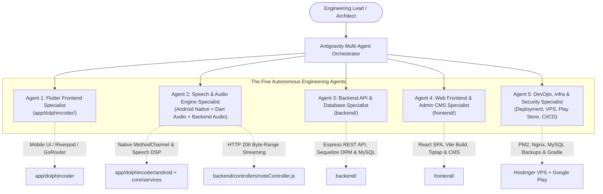

# DolphinCoder LMS — Autonomous Engineering Agents Specification (`AGENTS.md`)

> **Master Operating Blueprint for Specialized AI Agents & Engineering Teams**  
> This document formalizes the architecture, operational boundaries, domain responsibilities, and workflows for the **Five Autonomous Engineering Agents** assigned to the DolphinCoder LMS monorepo.
> 
> **Target Monorepo Focus Folders:**
> 1. `app/dolphincoder/` — Flutter 3 Mobile Application (Android/iOS)
> 2. `frontend/` — React 18 / Vite 5 Web Client & Admin CMS
> 3. `backend/` — Node.js 20 / Express 4 / Sequelize 6 / MySQL 8 API & Database
>
> *(Note: The legacy folder `app/appit/` is strictly quarantined and must not be touched or modified.)*

---

## 🏛️ System Topology & Agent Roster

---

## 🤖 Detailed Profiles of the Five Agents

### 1. Agent 1: Flutter Frontend Architecture Specialist (`agent_1_flutter_mobile`)
* **Primary Scope:** `app/dolphincoder/`
* **Target Environment:** Flutter 3.22+, Dart 3.3+, Android SDK 34, iOS 17.
* **Core Responsibilities:**
  - **State Architecture**: Maintain Riverpod 2 providers (`StateNotifier`, `AsyncNotifier`, `FutureProvider.family`).
  - **Declarative Navigation**: Maintain GoRouter 13.2 configuration, including auth state redirects and the 5-tab floating shell (`/home`, `/leagues`, `/quests`, `/shop`, `/profile`).
  - **Tactile UI & Gamification**: Build and refine the 3D sinusoidal Archipelago path, 8 interactive stage runners (`word_match`, `listen_tap`, `sentence_builder`, `sprechen`, `flashcard`, `quiz_mcq`, `dialogue`, `grammar_tip`), celebratory confetti shower (`ConfettiWidget`), and sound wave ripple animations.
  - **Design System & Theming**: Maintain AMOLED Dark (`#0A0F1E`) and Oceanic Light palettes, tactile elevation buttons, typography hierarchy, and responsive constraints.
  - **Performance**: Enforce sub-second cold boot ($< 450\text{ms}$), optimistic progression updates, and 6-item pagination.
* **Key Associated Documentation:**
  - [`architecture/01_flutter_frontend.md`](file:///Users/cms/Desktop/Code/mern/lms_speedup/MERNLMS/architecture/01_flutter_frontend.md)
  - [`android.md`](file:///Users/cms/Desktop/Code/mern/lms_speedup/MERNLMS/android.md)
  - [`android_features.md`](file:///Users/cms/Desktop/Code/mern/lms_speedup/MERNLMS/android_features.md)
  - [`app/dolphincoder/README.md`](file:///Users/cms/Desktop/Code/mern/lms_speedup/MERNLMS/app/dolphincoder/README.md)
  - [`app/dolphincoder/context.md`](file:///Users/cms/Desktop/Code/mern/lms_speedup/MERNLMS/app/dolphincoder/context.md)

---

### 2. Agent 2: Speech Recognition, Audio Engine & Pronunciation Specialist (`agent_2_speech_audio`)
* **Primary Scope:** 
  - Android Native Bridge: `app/dolphincoder/android/app/src/main/kotlin/com/dolphincoder/lms/MainActivity.kt`
  - Dart Audio Services: `app/dolphincoder/lib/core/services/` (`speech_lifecycle_bridge.dart`, `speech_recognition_service.dart`, `tts_service.dart`, `sound_effects_service.dart`, `pronunciation_evaluator.dart`)
  - Backend Audio Streaming: `backend/controllers/noteController.js`, `backend/models/KaraokeAudio.js`
* **Core Responsibilities:**
  - **3-Tier Speech Engine Fallback**: Manage native speech recognition routing (Tier 1: Google QuickSearchBox $\to$ Tier 2: OEM Speech Services $\to$ Tier 3: Generic default platform recognizer) to prevent silent timeouts.
  - **Hardware Lifecycle & Anti-Leak**: Maintain native `MethodChannel` (`com.dolphincoder.lms/speech_lifecycle`), teardown hooks on `onDestroy`/`onPause`, and reflection injection into `SpeechToTextPlugin`.
  - **5-Phase Speech Lifecycle**: Enforce the finite state machine (`Idle` $\to$ `Armed` $\to$ `Listening` $\to$ `Processing` $\to$ `Evaluated`) with double-tap submission gating.
  - **Pronunciation Evaluation Algorithms**: Maintain text normalization (Umlauts `ä, ö, ü, ß`, numbers, diacritics), dynamic programming Levenshtein distance, Soundex phonetic tolerance, and monotonic forward alignment.
  - **Audio Hardware Routing**: Maintain Bluetooth SCO voice routing, `ACTION_AUDIO_BECOMING_NOISY` headphone disconnect listener, and audio focus ducking.
  - **Binary Audio Streaming**: Maintain HTTP 206 Partial Content byte-range audio streaming from MySQL `LONGBLOB` for Karaōke notes and lesson reference audio.
* **Key Associated Documentation:**
  - [`architecture/02_speech_audio_engine.md`](file:///Users/cms/Desktop/Code/mern/lms_speedup/MERNLMS/architecture/02_speech_audio_engine.md)
  - [`phone.md`](file:///Users/cms/Desktop/Code/mern/lms_speedup/MERNLMS/phone.md)
  - [`app/dolphincoder/audit.md`](file:///Users/cms/Desktop/Code/mern/lms_speedup/MERNLMS/app/dolphincoder/audit.md)

---

### 3. Agent 3: Backend API, Database & Business Logic Specialist (`agent_3_backend_api`)
* **Primary Scope:** `backend/`
* **Target Environment:** Node.js 20 LTS, Express 4.18, Sequelize 6.35, MySQL 8.0.
* **Core Responsibilities:**
  - **Sequelize ORM & Schemas**: Maintain all 14 Sequelize models (`User`, `Note`, `KaraokeAudio`, `Quiz`, `Question`, `Flashcard`, `Video`, `Subject`, `Topic`, `UserActivity`, `Page`, `Island`, `IslandNode`, `LessonStage`, `UserNodeProgress`) with virtual `_id` mongo-compatibility fields and strict foreign key cascades.
  - **Connection Pooling & Self-Healing Sync**: Manage MySQL 2 connection pools (`acquire: 30000ms`, `max: 20`) and safe DDL migration sequences.
  - **Gamification & Economy Engine**: Maintain daily streaks with client-timezone grouping (`utils/dateHelper.js`), 30-minute oxygen bubble regeneration (cap 5), pearls economy (default 10), and ad reward claims (`POST /api/gamification/claim-ad-reward`).
  - **Automated Testing & Benchmarking**: Maintain Jest/Supertest automated test suites (`backend/tests/`) and Hostinger live latency benchmarking (`backend/scripts/benchmark_hostinger.js`).
  - **Web Crawler & Verification Endpoints**: Maintain `/app-ads.txt` (Google AdMob crawler verification), `/sitemap.xml`, `/robots.txt`, and IndexNow keys.
* **Key Associated Documentation:**
  - [`backend/README.md`](file:///Users/cms/Desktop/Code/mern/lms_speedup/MERNLMS/backend/README.md)
  - [`backend.md`](file:///Users/cms/Desktop/Code/mern/lms_speedup/MERNLMS/backend.md)
  - [`architecture/03_backend_api_and_database.md`](file:///Users/cms/Desktop/Code/mern/lms_speedup/MERNLMS/architecture/03_backend_api_and_database.md)
  - [`architecture/calculations.md`](file:///Users/cms/Desktop/Code/mern/lms_speedup/MERNLMS/architecture/calculations.md)
  - [`databaseupdate.md`](file:///Users/cms/Desktop/Code/mern/lms_speedup/MERNLMS/databaseupdate.md)
  - [`databaseupdate1.md`](file:///Users/cms/Desktop/Code/mern/lms_speedup/MERNLMS/databaseupdate1.md)

---

### 4. Agent 4: Web Frontend & Admin CMS Specialist (`agent_4_web_frontend`)
* **Primary Scope:** `frontend/`
* **Target Environment:** React 18, Vite 5, React Router 6, Tailwind CSS 3, Tiptap Rich Text.
* **Core Responsibilities:**
  - **React SPA Architecture**: Maintain all 28 page views in `frontend/src/pages/`, modular contexts, and Axios interceptors.
  - **Production Build Integration**: Ensure Vite compiles the static bundle directly to `backend/dist` with asset finger-printing and zero cross-origin issues.
  - **Interactive Learning Features**:
    - Karaoke Note Reader with Web Audio API chime synthesizers and Web Speech API continuous dictation.
    - LingoDolphy web learning experience (`/lingodolphy`) with sinusoidal archipelago progression and 8 interactive stages.
    - Sandboxed 16:9 HTML slide viewer with smooth-scroll `#hash` interceptors.
    - Match the Pairs interactive column matching and timed quiz engine with review screens.
  - **Admin Studio & CMS**: Curriculum Studio (`/lessons`), Pages SEO editor (`/admin/pages`) with dynamic meta tags, and trainer management.
* **Key Associated Documentation:**
  - [`frontend/README.md`](file:///Users/cms/Desktop/Code/mern/lms_speedup/MERNLMS/frontend/README.md)
  - [`frontend.md`](file:///Users/cms/Desktop/Code/mern/lms_speedup/MERNLMS/frontend.md)
  - [`web_features.md`](file:///Users/cms/Desktop/Code/mern/lms_speedup/MERNLMS/web_features.md)
  - [`architecture/04_web_frontend_admin.md`](file:///Users/cms/Desktop/Code/mern/lms_speedup/MERNLMS/architecture/04_web_frontend_admin.md)

---

### 5. Agent 5: DevOps, Infrastructure, Security & Monetization Specialist (`agent_5_devops_infra`)
* **Primary Scope:** Cross-cutting Deployment, Hostinger VPS, PM2, Nginx, MySQL, Android Play Store Release.
* **Target Environment:** Hostinger VPS (Ubuntu 22.04 LTS), Nginx, PM2, Let's Encrypt SSL, Android Gradle Toolchain.
* **Core Responsibilities:**
  - **Unified Deployment Topology**: Single-server Express process hosting both `/api/*` and static SPA (`backend/dist`) under Nginx reverse proxy.
  - **Process Lifecycle & Clustering**: PM2 cluster mode configuration (`ecosystem.config.js`), zero-downtime reloads, and log rotation.
  - **Database Reliability**: MySQL 8 sizing, `max_allowed_packet = 64M` (for `LONGBLOB` audio buffers), automated cron backups, and disaster recovery.
  - **Mobile Release Pipeline**: Flutter/Gradle build toolchain, release keystore management, ProGuard/R8 reflection keep rules for speech plugins, and Google Play Store App Bundle (`.aab`) packaging.
  - **Monetization & Compliance**: Google AdMob SDK configuration, AdMob crawler verification (`/app-ads.txt`), and interstitial/rewarded frequency capping.
  - **Security**: Strict Helmet headers, CORS origin isolation, tiered express-rate-limiters, and JWT rotation.
* **Key Associated Documentation:**
  - [`DEPLOYMENT.md`](file:///Users/cms/Desktop/Code/mern/lms_speedup/MERNLMS/DEPLOYMENT.md)
  - [`architecture/05_devops_infra_security.md`](file:///Users/cms/Desktop/Code/mern/lms_speedup/MERNLMS/architecture/05_devops_infra_security.md)
  - [`scaleup.md`](file:///Users/cms/Desktop/Code/mern/lms_speedup/MERNLMS/scaleup.md)
  - [`systemdesign.md`](file:///Users/cms/Desktop/Code/mern/lms_speedup/MERNLMS/systemdesign.md)
  - [`fix.md`](file:///Users/cms/Desktop/Code/mern/lms_speedup/MERNLMS/fix.md)

---

## 📋 Cross-Agent Collaboration & Operating Rules

1. **Strict Folder Boundaries**:
   - Agent 1 operates in `app/dolphincoder/`.
   - Agent 2 operates across the audio bridge (`app/dolphincoder/android`, `core/services/`, and `backend/controllers/noteController.js`).
   - Agent 3 operates in `backend/`.
   - Agent 4 operates in `frontend/`.
   - Agent 5 oversees deployment, infrastructure, and release configurations.
2. **Absolute Quarantine on `app/appit/`**:
   - Under NO circumstance should any agent touch, modify, or create files in `app/appit/`.
3. **Documentation-First Integrity**:
   - All code architectural changes must be reflected in the corresponding `.md` specification files before and after implementation.
   - Every file modification must preserve existing comments and docstrings.
