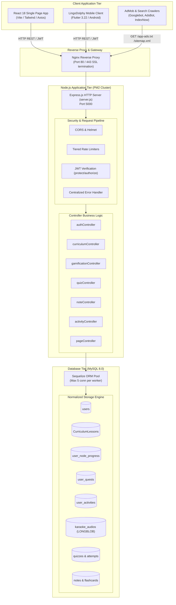
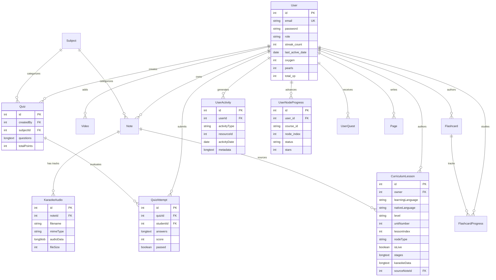
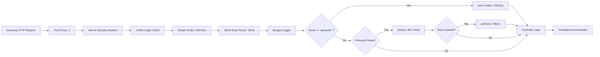

# DolphinCoder LMS — Backend API, Database & Business Logic Architecture Specification

> **Document ID:** `ARCH-03-BACKEND-API-DATABASE`  
> **Version:** 1.0.0  
> **Status:** Production Architecture Specification  
> **Target Framework:** Node.js 20 LTS / Express 4.18 / Sequelize ORM 6.35 / MySQL 8.0 / PM2 Cluster  
> **Source Repository Path:** `/Users/cms/Desktop/Code/mern/lms_speedup/MERNLMS/backend`  
> **Related Architecture Specifications:**  
> - Audio & Speech Engine: [`02_speech_audio_engine.md`](file:///Users/cms/Desktop/Code/mern/lms_speedup/MERNLMS/architecture/02_speech_audio_engine.md)  
> - DevOps, Infrastructure & Security: [`05_devops_infra_security.md`](file:///Users/cms/Desktop/Code/mern/lms_speedup/MERNLMS/architecture/05_devops_infra_security.md)  

---

## Table of Contents
1. [Executive Summary & Architectural Paradigm](#1-executive-summary--architectural-paradigm)
2. [Complete Backend Directory & Module Structure](#2-complete-backend-directory--module-structure)
3. [Database Architecture & Sequelize ORM Specification](#3-database-architecture--sequelize-orm-specification)
   - [3.1 Connection Management, Pooling & Dialect Settings](#31-connection-management-pooling--dialect-settings)
   - [3.2 MongoDB-to-Sequelize Compatibility Layer](#32-mongodb-to-sequelize-compatibility-layer)
   - [3.3 Automated Schema Migration & Self-Healing Pipeline](#33-automated-schema-migration--self-healing-pipeline)
   - [3.4 Complete Sequelize Models & Database Schemas](#34-complete-sequelize-models--database-schemas)
   - [3.5 Entity Relationship Diagram (ERD)](#35-entity-relationship-diagram-erd)
   - [3.6 Model Associations, Foreign Keys & Cascade Delete Rules](#36-model-associations-foreign-keys--cascade-delete-rules)
4. [Core Business Logic, Algorithms & Mathematical Formulations](#4-core-business-logic-algorithms--mathematical-formulations)
   - [4.1 Gamification, In-Game Economy & Progression Engine](#41-gamification-in-game-economy--progression-engine)
   - [4.2 Timezone-Safe Streak Calculation & Recovery Engine](#42-timezone-safe-streak-calculation--recovery-engine)
   - [4.3 Daily Activity Aggregation & Calendar Tracking](#43-daily-activity-aggregation--calendar-tracking)
   - [4.4 Quiz Attempt Grading, Match-Pairs Derangement & Review System](#44-quiz-attempt-grading-match-pairs-derangement--review-system)
   - [4.5 Curriculum Hierarchy & Just-In-Time (JIT) Payload Decoupling](#45-curriculum-hierarchy--just-in-time-jit-payload-decoupling)
   - [4.6 Database-Backed Binary Audio Streaming (HTTP 206 Partial Content)](#46-database-backed-binary-audio-streaming-http-206-partial-content)
5. [Complete API Route Specifications & Controller Pipeline](#5-complete-api-route-specifications--controller-pipeline)
   - [5.1 Authentication & Role-Based Access Control (`/api/auth`)](#51-authentication--role-based-access-control-apiauth)
   - [5.2 Course Curriculum & Lesson Management (`/api/curriculum`)](#52-course-curriculum--lesson-management-apicurriculum)
   - [5.3 Gamification, Archipelago Map & Economy (`/api/gamification`)](#53-gamification-archipelago-map--economy-apigamification)
   - [5.4 Quizzes, Assessments & DOCX Ingestion (`/api/quizzes`)](#54-quizzes-assessments--docx-ingestion-apiquizzes)
   - [5.5 Notes, Rich-Text Documents & Karaoke Audio (`/api/notes`)](#55-notes-rich-text-documents--karaoke-audio-apinotes)
   - [5.6 Flashcards & Spaced Repetition Mastery (`/api/flashcards`)](#56-flashcards--spaced-repetition-mastery-apiflashcards)
   - [5.7 User Activity Analytics & History (`/api/activity`)](#57-user-activity-analytics--history-apiactivity)
   - [5.8 Taxonomy, Subjects & Topics (`/api/subjects`)](#58-taxonomy-subjects--topics-apisubjects)
   - [5.9 Video Lessons & YouTube Embeds (`/api/videos`)](#59-video-lessons--youtube-embeds-apivideos)
   - [5.10 CMS Pages, Dynamic Pre-Rendering & IndexNow (`/api/pages`)](#510-cms-pages-dynamic-pre-rendering--indexnow-apipages)
   - [5.11 Admin Management & Trainer Provisioning (`/api/admin`)](#511-admin-management--trainer-provisioning-apiadmin)
   - [5.12 Crawlers, Verification & Search Engine Routes (`/app-ads.txt`, `/sitemap.xml`, `/robots.txt`)](#512-crawlers-verification--search-engine-routes-app-adstxt-sitemapxml-robotstxt)
6. [Middleware Pipeline & Security Architecture](#6-middleware-pipeline--security-architecture)
   - [6.1 CORS Origin Validation & Isolation](#61-cors-origin-validation--isolation)
   - [6.2 Helmet Security Headers](#62-helmet-security-headers)
   - [6.3 Tiered Rate Limiting](#63-tiered-rate-limiting)
   - [6.4 Authentication & Authorization Guards](#64-authentication--authorization-guards)
   - [6.5 Centralized Error Handling & Not Found Pipeline](#65-centralized-error-handling--not-found-pipeline)
7. [Database Seeding, Automated Migrations & Curriculum Ingestion](#7-database-seeding-automated-migrations--curriculum-ingestion)
   - [7.1 Seed Scripts Analysis (`seed_german_a1.sql`, English A1 Seeds)](#71-seed-scripts-analysis-seed_german_a1sql-english-a1-seeds)
   - [7.2 Python Deterministic Seed Builders](#72-python-deterministic-seed-builders)
   - [7.3 JSON Batch Seeding (`curriculumSeeder.js`)](#73-json-batch-seeding-curriculumseederjs)
   - [7.4 Admin Account Provisioning (`seedAdmin.js`, `fixAdmin.js`)](#74-admin-account-provisioning-seedadminjs-fixadminjs)
8. [Performance Optimizations & Memory Safety](#8-performance-optimizations--memory-safety)

---

## 1. Executive Summary & Architectural Paradigm

The **DolphinCoder LMS Backend** is an enterprise-grade, RESTful API and relational data persistence platform constructed on **Node.js 20 LTS**, **Express 4.18**, **Sequelize ORM 6.35**, and **MySQL 8.0**. Originally architected as a MERN/MongoDB prototype, the system has undergone a complete architectural re-engineering into a strict relational database architecture while maintaining complete zero-breakage backwards compatibility with existing React web and Flutter mobile clients through a custom prototype-level translation layer.

### Core Architectural Pillars
1. **Relational Rigor with Document Flexibility:** Relational integrity (Foreign Keys, composite unique indexes, transactional operations) combined with MySQL `TEXT('long')` JSON parsing getters/setters for complex modular question stages, karaoke lyric synchronization, and rich-text contents.
2. **Database-Backed Binary Audio Streaming:** Streaming MP3 audio payloads directly from MySQL `LONGBLOB` fields (`karaoke_audios`) via HTTP 206 Partial Content byte-range negotiation, eliminating file-system synchronization issues across horizontally clustered PM2 worker instances.
3. **Decoupled JIT Curriculum Navigation:** Ultra-fast path discovery that decouples lightweight map nodes from multi-kilobyte exercise stage trees, achieving sub-20ms map load times even across curricula spanning 105 units and 1,680 lessons.
4. **Timezone-Agnostic Gamification Engine:** Accurate streak tracking, daily XP aggregation, and quest evaluation that reconciles client calendar boundaries across diverse timezones (e.g. UTC, Asia/Kolkata, Europe/Berlin) using ISO dates and UTC boundary math.



---

## 2. Complete Backend Directory & Module Structure

The backend codebase located in `/Users/cms/Desktop/Code/mern/lms_speedup/MERNLMS/backend` follows a clean, layered architectural pattern separating routing, request lifecycle validation, controller business logic, data persistence models, and utilities:

```
backend/
├── config/
│   └── database.js               # Sequelize instance, connection pooling & MongoDB compatibility layer
├── controllers/
│   ├── activityController.js     # Timezone-aware daily & weekly study activity aggregation
│   ├── adminController.js        # User lifecycle, trainer provisioning & administrative operations
│   ├── authController.js         # Registration, login, profile updates, JWT & bcrypt hashing
│   ├── curriculumController.js   # 105-Unit curriculum hierarchy, drafting, publishing & bulk uploads
│   ├── flashcardController.js    # Spaced repetition decks, card CRUD, study progress & DOCX import
│   ├── gamificationController.js # Archipelago map, node completion, XP/Pearls, quests & oxygen refill
│   ├── noteController.js         # Rich text notes, karaoke alignment, audio uploads & LONGBLOB streaming
│   ├── pageController.js         # CMS dynamic pages, SEO slugs, image uploads & IndexNow pinging
│   ├── quizController.js         # Quiz authoring, deranged question shuffling, grading & review
│   ├── subjectController.js      # Academic subjects & category topic tree management
│   └── videoController.js        # Curated YouTube video repository & thumbnail extraction
├── data/
│   ├── english_a1_hindi.json     # Pre-compiled English A1 curriculum with Hindi native instruction (1.0MB)
│   └── english_a1_marathi.json   # Pre-compiled English A1 curriculum with Marathi native instruction (1.0MB)
├── middleware/
│   ├── auth.js                   # protect (JWT verification) & authorize (RBAC role guards)
│   └── errorHandler.js           # Centralized exception handler & 404 route catcher
├── models/
│   ├── associations.js           # Centralized relationship definitions (belongsTo, hasMany)
│   ├── CurriculumLesson.js       # Curriculum node schema, modular exercise stages & audio pointers
│   ├── Flashcard.js              # Flashcard deck definition & card list JSON
│   ├── FlashcardProgress.js      # Student deck study sessions & mastery count
│   ├── KaraokeAudio.js           # MySQL LONGBLOB audio binary storage & MIME metadata
│   ├── Note.js                   # Student/Teacher notes, rich-text HTML, tags & karaoke alignment
│   ├── Page.js                   # Dynamic CMS articles, SEO summaries & publication state
│   ├── Quiz.js                   # Assessment definition, questions JSON & passing benchmarks
│   ├── QuizAttempt.js            # Historical & latest quiz submissions, graded answers & timings
│   ├── Subject.js                # Curriculum academic taxonomy & topic nodes
│   ├── User.js                   # Learner/Staff accounts, credentials & in-game gamification wallet
│   ├── UserActivity.js           # Granular study session logs indexed by DATEONLY
│   ├── UserNodeProgress.js       # Compound-indexed curriculum completion tracker (stars, score, status)
│   ├── UserQuest.js              # Daily 3-quest challenge state per calendar date
│   └── Video.js                  # Video metadata, YouTube IDs & view counts
├── routes/
│   ├── activity.js               # GET /api/activity/summary
│   ├── admin.js                  # User administration routes (admin only)
│   ├── auth.js                   # Public registration, authentication & profile management
│   ├── curriculum.js             # Curriculum browsing, unit summaries & staff publishing
│   ├── flashcards.js             # Deck management, review progress & DOCX uploads
│   ├── gamification.js           # Status, map path, completion, leaderboard, quests & ad rewards
│   ├── notes.js                  # Note CRUD, DOCX upload, audio streaming & tracking
│   ├── pages.js                  # Public SEO articles & admin CMS management
│   ├── quizzes.js                # Quiz catalog, attempt submission, review & DOCX bulk import
│   ├── subjects.js               # Taxonomy & subject category operations
│   └── videos.js                 # Video resource endpoints
├── scripts/
│   └── benchmark_hostinger.js    # Automated network & live API latency benchmarking tool
├── tests/
│   ├── auth.test.js              # Auth & JWT integration tests
│   ├── curriculum.test.js        # Curriculum hierarchy & JIT tests
│   ├── gamification.test.js      # Streaks, oxygen & ad reward tests
│   ├── hostinger_live.test.js    # Live VPS latency benchmark suite
│   ├── lesson_mechanics.test.js  # Derangement & pronunciation scoring tests
│   └── setup.js                  # Jest test environment & database isolation harness
├── utils/
│   ├── curriculumSeeder.js       # Idempotent database migration & JSON curriculum auto-seeder
│   ├── dateHelper.js             # Timezone offset math, UTC day bounds & ISO date normalizer
│   ├── extractYouTubeId.js       # Robust regex parsing for standard/shortened YouTube URLs
│   ├── seoHelper.js              # XML sitemap generator, robots.txt, JSON-LD builder & IndexNow HTTP ping
│   └── stageSanitizer.js         # Modular challenge sanitizer: drops blank/incomplete stage formats
├── .env                          # Local/Production environment variables
├── .env.example                  # Environment variable blueprint template
├── ecosystem.config.js           # Production PM2 cluster process management specification
├── fixAdmin.js                   # Administrative password repair utility
├── package.json                  # Node dependencies & npm lifecycle scripts
├── seedAdmin.js                  # Initial superadmin bootstrap script
└── server.js                     # Main application entry point, Express server & SEO SSR hook
```

---

## 3. Database Architecture & Sequelize ORM Specification

### 3.1 Connection Management, Pooling & Dialect Settings

The persistence layer connects to MySQL 8.0 via `mysql2` and `sequelize` (`backend/config/database.js`). It is tuned for concurrent multi-worker environments:

```javascript
const sequelize = new Sequelize(
    process.env.DB_NAME,
    process.env.DB_USER,
    process.env.DB_PASSWORD,
    {
        host: process.env.DB_HOST,
        dialect: 'mysql',
        logging: process.env.NODE_ENV === 'development' ? console.log : false,
        pool: {
            max: 5,        // Max 5 connections per PM2 worker (avoids pool exhaustion)
            min: 0,        // Drops idle connections to preserve server memory
            acquire: 30000,// 30-second timeout before throwing connection acquisition error
            idle: 10000,   // Release connections idle for more than 10 seconds
        },
    }
);
```

### 3.2 MongoDB-to-Sequelize Compatibility Layer

To prevent breaking existing frontends that rely on MongoDB `_id` identifiers, Sequelize's base `Model.prototype` is augmented directly at initialization time. This executes transparently without generating invalid SQL `VIRTUAL` columns:

```javascript
// 1. Virtual property getter for instance._id
Object.defineProperty(Sequelize.Model.prototype, '_id', {
    get() { return this.id; },
    configurable: true,
});

// 2. Serialization hook injecting _id into JSON payloads
const origToJSON = Sequelize.Model.prototype.toJSON;
Sequelize.Model.prototype.toJSON = function() {
    const values = origToJSON ? origToJSON.call(this) : { ...this.get() };
    if (this.id !== undefined && values._id === undefined) {
        values._id = this.id;
    }
    return values;
};
```

### 3.3 Automated Schema Migration & Self-Healing Pipeline

During server boot (`server.js` -> `connectDB()`), the database performs an automatic, idempotent synchronization:
1. Executes `sequelize.sync({ alter: true })` to align modified column types.
2. Invokes `migrateUserNodeProgress(sequelize)`:
   - Queries `INFORMATION_SCHEMA.COLUMNS` to verify if `course_id` exists on `user_node_progress`.
   - If missing, executes `ALTER TABLE user_node_progress ADD COLUMN course_id VARCHAR(32) NOT NULL DEFAULT 'de_en_a1' AFTER user_id`.
   - Inspects `SHOW INDEX FROM user_node_progress` to drop legacy non-scoped unique indexes on `(user_id, node_index)` and constructs the compound unique index `unique_user_course_node` on `(user_id, course_id, node_index)`.
   - Modifies `user_activities.activityType` ENUM to guarantee inclusion of `'lesson'`.
   - Ensures `users.pearls` defaults to `10`.
3. Background invocations of `seedEnglishCurriculumIfMissing(CurriculumLesson)` check if English A1 courses exist and seed them from disk if absent.

---

### 3.4 Complete Sequelize Models & Database Schemas

#### 1. Table: `users` (Model: `User`)
Stores authentication credentials, user role assignments, learning preferences, and in-game economy balances.

| Column Name | Sequelize Type | MySQL Type | Constraints / Defaults | Description |
|:---|:---|:---|:---|:---|
| `id` | `DataTypes.INTEGER` | `INT` | Primary Key, Auto Increment | Unique user identifier |
| `name` | `DataTypes.STRING(100)` | `VARCHAR(100)` | `allowNull: false` | Full name of the user |
| `email` | `DataTypes.STRING(255)` | `VARCHAR(255)` | `allowNull: false`, Unique | Unique login email address |
| `password` | `DataTypes.STRING(255)` | `VARCHAR(255)` | `allowNull: false` | Bcrypt password hash (10-12 rounds) |
| `role` | `DataTypes.ENUM` | `ENUM('student','trainer','admin')` | Default: `'student'` | Role-based authorization tier |
| `avatar` | `DataTypes.STRING(500)` | `VARCHAR(500)` | Default: `null` | URL or relative path to avatar image |
| `bio` | `DataTypes.TEXT` | `TEXT` | Default: `''` | User biography description |
| `isActive` | `DataTypes.BOOLEAN` | `TINYINT(1)` | Default: `true` | Account active status (deactivation toggle) |
| `lastLogin` | `DataTypes.DATE` | `DATETIME` | Default: `null` | Timestamp of most recent successful login |
| `streak_count` | `DataTypes.INTEGER` | `INT` | Default: `1` | Current active daily streak (consecutive days) |
| `longest_streak` | `DataTypes.INTEGER` | `INT` | Default: `1` | All-time highest streak count achieved |
| `last_active_date` | `DataTypes.DATEONLY` | `DATE` | Default: `null` | Calendar date (YYYY-MM-DD) of last study event |
| `daily_target_xp` | `DataTypes.INTEGER` | `INT` | Default: `20` | Daily study XP target |
| `target_language` | `DataTypes.STRING(10)` | `VARCHAR(10)` | Default: `'de'` | Target language code (`'de'`, `'en'`, etc.) |
| `native_language` | `DataTypes.STRING(10)` | `VARCHAR(10)` | Default: `'en'` | Native instruction language (`'en'`, `'hi'`, `'mr'`) |
| `current_level` | `DataTypes.STRING(10)` | `VARCHAR(10)` | Default: `'A1'` | CEFR proficiency tier (`'A1'` to `'C2'`) |
| `pearls` | `DataTypes.INTEGER` | `INT` | Default: `10` | In-game spendable currency |
| `oxygen` | `DataTypes.INTEGER` | `INT` | Default: `5` | Hearts/Lives count (Max: 5) |
| `last_oxygen_refill`| `DataTypes.DATE` | `DATETIME` | Default: `DataTypes.NOW` | Timestamp of last oxygen regeneration event |
| `total_xp` | `DataTypes.INTEGER` | `INT` | Default: `0` | Cumulative experience points earned |
| `current_league` | `DataTypes.STRING(50)` | `VARCHAR(50)` | Default: `'Coral Reef'` | Competitive leaderboard league |
| `createdAt` | `DataTypes.DATE` | `DATETIME` | `allowNull: false` | Record creation timestamp |
| `updatedAt` | `DataTypes.DATE` | `DATETIME` | `allowNull: false` | Record update timestamp |

---

#### 2. Table: `CurriculumLessons` (Model: `CurriculumLesson`)
Stores modular curriculum units, lesson nodes, exercise challenge sequences, and karaoke synchronization data.

| Column Name | Sequelize Type | MySQL Type | Constraints / Defaults | Description |
|:---|:---|:---|:---|:---|
| `id` | `DataTypes.INTEGER` | `INT` | Primary Key, Auto Increment | Unique lesson identifier |
| `owner` | `DataTypes.INTEGER` | `INT` | `allowNull: false`, FK -> `users.id` | Authoring trainer or admin ID |
| `learningLanguage`| `DataTypes.STRING(10)` | `VARCHAR(10)` | Default: `'de'`, `allowNull: false` | Target language code |
| `nativeLanguage` | `DataTypes.STRING(10)` | `VARCHAR(10)` | Default: `'en'`, `allowNull: false` | Native instruction language code |
| `level` | `DataTypes.ENUM` | `ENUM('A1','A2','B1','B2','C1','C2')` | Default: `'A1'`, `allowNull: false` | CEFR level |
| `unitNumber` | `DataTypes.INTEGER` | `INT` | Default: `1`, `allowNull: false` | Sequential unit index (1 to 105) |
| `unitTitle` | `DataTypes.STRING(200)` | `VARCHAR(200)` | Default: `'Coral Reef'` | Unit name / display header |
| `unitDescription` | `DataTypes.STRING(300)` | `VARCHAR(300)` | Default: `'Introductions & Daily Greetings'` | Detailed unit topic summary |
| `lessonIndex` | `DataTypes.INTEGER` | `INT` | Default: `0`, `allowNull: false` | Node ordering index within the unit |
| `title` | `DataTypes.STRING(200)` | `VARCHAR(200)` | `allowNull: false` | Lesson node title |
| `subtitle` | `DataTypes.STRING(300)` | `VARCHAR(300)` | Default: `''` | Sub-header description |
| `nodeType` | `DataTypes.ENUM` | `ENUM('lesson','karaoke','speech','chest','match','quiz')` | Default: `'lesson'` | Interactive node mechanic |
| `xpReward` | `DataTypes.INTEGER` | `INT` | Default: `15` | Base XP awarded upon first completion |
| `pearlsReward` | `DataTypes.INTEGER` | `INT` | Default: `5` | Currency awarded upon completion (Chest: 30-35) |
| `isLive` | `DataTypes.BOOLEAN` | `TINYINT(1)` | Default: `false`, `allowNull: false` | Publication flag (students only see `true`) |
| `stages` | `DataTypes.TEXT('long')`| `LONGTEXT` | Default: `'[]'`, JSON getter/setter | Array of modular challenge stages |
| `karaokeData` | `DataTypes.TEXT('long')`| `LONGTEXT` | Default: `null`, JSON getter/setter | Word-level lyrics and timing timestamps |
| `audioUrl` | `DataTypes.STRING(500)` | `VARCHAR(500)` | Default: `null` | Permanent binary stream URL |
| `sourceNoteId` | `DataTypes.INTEGER` | `INT` | Default: `null`, FK -> `notes.id` | Optional source reading note reference |
| `createdAt` | `DataTypes.DATE` | `DATETIME` | `allowNull: false` | Record creation timestamp |
| `updatedAt` | `DataTypes.DATE` | `DATETIME` | `allowNull: false` | Record update timestamp |

**Indexes on `CurriculumLessons`:**
- Project Slipstream Compound B-Tree Index: `['learningLanguage', 'nativeLanguage', 'level', 'isLive', 'unitNumber']` (Direct index seek for windowed path queries)
- Composite Index: `['isLive', 'learningLanguage', 'nativeLanguage', 'level', 'unitNumber', 'lessonIndex']`
- Composite Index: `['learningLanguage', 'nativeLanguage', 'level', 'unitNumber']`
- Single Indexes: `['isLive']`, `['owner']`

---

#### 3. Table: `user_node_progress` (Model: `UserNodeProgress`)
Tracks a student's individual progress, stars, and completion state along an archipelago course track.

| Column Name | Sequelize Type | MySQL Type | Constraints / Defaults | Description |
|:---|:---|:---|:---|:---|
| `id` | `DataTypes.INTEGER` | `INT` | Primary Key, Auto Increment | Unique record ID |
| `user_id` | `DataTypes.INTEGER` | `INT` | `allowNull: false`, FK -> `users.id` | Student ID reference |
| `course_id` | `DataTypes.STRING(32)` | `VARCHAR(32)` | Default: `'de_en_a1'`, `allowNull: false` | Formatted track key (`${target}_${native}_${level}`) |
| `node_index` | `DataTypes.INTEGER` | `INT` | `allowNull: false` | Global sequence index of the map node |
| `status` | `DataTypes.ENUM` | `ENUM('locked','available','completed')` | Default: `'locked'` | Progression state |
| `stars` | `DataTypes.INTEGER` | `INT` | Default: `0` (Range: 1 to 3) | Star rating earned |
| `score_pct` | `DataTypes.INTEGER` | `INT` | Default: `0` (Range: 0 to 100) | Accuracy percentage |
| `completed_at` | `DataTypes.DATE` | `DATETIME` | Default: `null` | Exact completion timestamp |
| `created_at` | `DataTypes.DATE` | `DATETIME` | `allowNull: false` | Creation timestamp |
| `updated_at` | `DataTypes.DATE` | `DATETIME` | `allowNull: false` | Modification timestamp |

**Indexes on `user_node_progress`:**
- Unique Composite Index (`unique_user_course_node`): `['user_id', 'course_id', 'node_index']`
- Lookup Composite Index (`idx_user_course`): `['user_id', 'course_id']`

---

#### 4. Table: `karaoke_audios` (Model: `KaraokeAudio`)
Stores high-fidelity MP3/AAC audio files directly in the MySQL database as `LONGBLOB`s for zero-disk, horizontally scalable HTTP 206 streaming.

| Column Name | Sequelize Type | MySQL Type | Constraints / Defaults | Description |
|:---|:---|:---|:---|:---|
| `id` | `DataTypes.INTEGER` | `INT` | Primary Key, Auto Increment | Unique audio record identifier |
| `noteId` | `DataTypes.INTEGER` | `INT` | Default: `null`, FK -> `notes.id` | Associated note or curriculum lesson ID |
| `filename` | `DataTypes.STRING(255)` | `VARCHAR(255)` | `allowNull: false` | Original audio file name |
| `mimeType` | `DataTypes.STRING(100)` | `VARCHAR(100)` | Default: `'audio/mpeg'` | Standard MIME content type |
| `audioData` | `DataTypes.BLOB('long')`| `LONGBLOB` | `allowNull: false` | Raw binary audio payload (up to 4GB in MySQL) |
| `fileSize` | `DataTypes.INTEGER` | `INT` | `allowNull: false` | Total byte size of binary buffer |
| `createdAt` | `DataTypes.DATE` | `DATETIME` | `allowNull: false` | Timestamp of upload |
| `updatedAt` | `DataTypes.DATE` | `DATETIME` | `allowNull: false` | Timestamp of modification |

---

#### 5. Table: `user_activities` (Model: `UserActivity`)
Provides an append-only audit and calendar log of student learning activities across all modules.

| Column Name | Sequelize Type | MySQL Type | Constraints / Defaults | Description |
|:---|:---|:---|:---|:---|
| `id` | `DataTypes.INTEGER` | `INT` | Primary Key, Auto Increment | Unique log ID |
| `userId` | `DataTypes.INTEGER` | `INT` | `allowNull: false`, FK -> `users.id` | Associated student |
| `activityType` | `DataTypes.ENUM` | `ENUM('quiz','note','flashcard','lesson')` | `allowNull: false` | Activity category |
| `resourceId` | `DataTypes.INTEGER` | `INT` | `allowNull: false` | Referenced resource ID (Quiz ID, Note ID, Lesson index) |
| `resourceTitle` | `DataTypes.STRING(255)` | `VARCHAR(255)` | Default: `''` | Cached display title |
| `subjectName` | `DataTypes.STRING(100)` | `VARCHAR(100)` | Default: `null` | Academic subject |
| `topicName` | `DataTypes.STRING(100)` | `VARCHAR(100)` | Default: `null` | Sub-topic categorization |
| `metadata` | `DataTypes.TEXT('long')`| `LONGTEXT` | Default: `'{}'`, JSON getter/setter | Contextual payload (scores, engagement time, audio state) |
| `activityDate` | `DataTypes.DATEONLY` | `DATE` | `allowNull: false` | Normalized local calendar date (YYYY-MM-DD) |
| `createdAt` | `DataTypes.DATE` | `DATETIME` | `allowNull: false` | Timestamp of activity creation |
| `updatedAt` | `DataTypes.DATE` | `DATETIME` | `allowNull: false` | Timestamp of activity modification |

**Indexes on `user_activities`:**
- Composite Index: `['userId', 'activityDate']`
- Single Index: `['activityType']`

---

#### 6. Table: `user_quests` (Model: `UserQuest`)
Tracks the tri-quest daily challenge objectives generated per user per calendar day.

| Column Name | Sequelize Type | MySQL Type | Constraints / Defaults | Description |
|:---|:---|:---|:---|:---|
| `id` | `DataTypes.INTEGER` | `INT` | Primary Key, Auto Increment | Unique quest entry ID |
| `user_id` | `DataTypes.INTEGER` | `INT` | `allowNull: false`, FK -> `users.id` | Target learner |
| `quest_title` | `DataTypes.STRING(120)` | `VARCHAR(120)` | `allowNull: false` | Descriptive goal (e.g., 'Earn 30 XP in lessons') |
| `quest_type` | `DataTypes.STRING(50)` | `VARCHAR(50)` | `allowNull: false` | Goal category: `'xp'`, `'karaoke'`, `'speech'` |
| `target_amount` | `DataTypes.INTEGER` | `INT` | Default: `1` | Metric threshold to satisfy |
| `current_amount`| `DataTypes.INTEGER` | `INT` | Default: `0` | Progress accumulated |
| `reward_pearls` | `DataTypes.INTEGER` | `INT` | Default: `15` | Spendable currency reward |
| `reward_xp` | `DataTypes.INTEGER` | `INT` | Default: `20` | Bonus XP reward |
| `is_claimed` | `DataTypes.BOOLEAN` | `TINYINT(1)` | Default: `false` | True once user collects reward |
| `quest_date` | `DataTypes.DATEONLY` | `DATE` | `allowNull: false` | Calendar day (YYYY-MM-DD) the quest belongs to |
| `created_at` | `DataTypes.DATE` | `DATETIME` | `allowNull: false` | Creation timestamp |
| `updated_at` | `DataTypes.DATE` | `DATETIME` | `allowNull: false` | Update timestamp |

**Indexes on `user_quests`:**
- Composite Index: `['user_id', 'quest_date']`

---

#### 7. Table: `quizzes` (Model: `Quiz`)
Stores quiz configuration, timing constraints, and the JSON question bank.

| Column Name | Sequelize Type | MySQL Type | Constraints / Defaults | Description |
|:---|:---|:---|:---|:---|
| `id` | `DataTypes.INTEGER` | `INT` | Primary Key, Auto Increment | Unique quiz identifier |
| `createdBy` | `DataTypes.INTEGER` | `INT` | `allowNull: false`, FK -> `users.id` | Creator trainer or admin ID |
| `subjectId` | `DataTypes.INTEGER` | `INT` | Default: `null`, FK -> `subjects.id` | Academic taxonomy subject link |
| `topic` | `DataTypes.STRING(200)` | `VARCHAR(200)` | Default: `null` | Granular topic name |
| `title` | `DataTypes.STRING(200)` | `VARCHAR(200)` | `allowNull: false` | Quiz display title |
| `description` | `DataTypes.TEXT` | `TEXT` | Default: `''` | Overview description |
| `questions` | `DataTypes.TEXT('long')`| `LONGTEXT` | Default: `'[]'`, JSON getter/setter | Array of structured question objects |
| `tags` | `DataTypes.TEXT` | `TEXT` | Default: `'[]'`, JSON getter/setter | Searchable keyword tags |
| `totalPoints` | `DataTypes.INTEGER` | `INT` | Default: `0` | Calculated points sum (auto-set via beforeSave hook) |
| `passingScore` | `DataTypes.INTEGER` | `INT` | Default: `70` | Passing accuracy benchmark percentage |
| `timeLimit` | `DataTypes.INTEGER` | `INT` | Default: `0` (0 = no limit) | Duration limit in minutes |
| `shuffleQuestions`| `DataTypes.BOOLEAN` | `TINYINT(1)` | Default: `false` | Randomize question order toggle |
| `isPublished` | `DataTypes.BOOLEAN` | `TINYINT(1)` | Default: `true` | Visibility to students |
| `attemptLimit` | `DataTypes.INTEGER` | `INT` | Default: `null` | Maximum allowed attempts per student |
| `createdAt` | `DataTypes.DATE` | `DATETIME` | `allowNull: false` | Creation timestamp |
| `updatedAt` | `DataTypes.DATE` | `DATETIME` | `allowNull: false` | Update timestamp |

---

#### 8. Table: `quiz_attempts` (Model: `QuizAttempt`)
Stores student submissions, graded response structures, score statistics, and time taken.

| Column Name | Sequelize Type | MySQL Type | Constraints / Defaults | Description |
|:---|:---|:---|:---|:---|
| `id` | `DataTypes.INTEGER` | `INT` | Primary Key, Auto Increment | Unique attempt identifier |
| `quizId` | `DataTypes.INTEGER` | `INT` | `allowNull: false`, FK -> `quizzes.id` | Reference to parent quiz |
| `studentId` | `DataTypes.INTEGER` | `INT` | `allowNull: false`, FK -> `users.id` | Submitting student |
| `answers` | `DataTypes.TEXT('long')`| `LONGTEXT` | Default: `'[]'`, JSON getter/setter | Graded answer records with point values |
| `score` | `DataTypes.INTEGER` | `INT` | Default: `0` | Total points earned |
| `maxScore` | `DataTypes.INTEGER` | `INT` | Default: `0` | Total points possible |
| `percentage` | `DataTypes.FLOAT` | `FLOAT` | Default: `0` | Calculated score percentage |
| `passed` | `DataTypes.BOOLEAN` | `TINYINT(1)` | Default: `false` | True if percentage >= passingScore |
| `attemptNumber` | `DataTypes.INTEGER` | `INT` | Default: `1` | Sequential attempt counter |
| `startedAt` | `DataTypes.DATE` | `DATETIME` | Default: `null` | Attempt start timestamp |
| `submittedAt` | `DataTypes.DATE` | `DATETIME` | Default: `null` | Final submission timestamp |
| `timeTakenSecs` | `DataTypes.INTEGER` | `INT` | Default: `null` | Total duration spent in seconds |
| `createdAt` | `DataTypes.DATE` | `DATETIME` | `allowNull: false` | Creation timestamp |
| `updatedAt` | `DataTypes.DATE` | `DATETIME` | `allowNull: false` | Update timestamp |

---

#### 9. Table: `notes` (Model: `Note`)
Stores rich-text study guides, uploaded DOCX conversions, and synchronized karaoke story structures.

| Column Name | Sequelize Type | MySQL Type | Constraints / Defaults | Description |
|:---|:---|:---|:---|:---|
| `id` | `DataTypes.INTEGER` | `INT` | Primary Key, Auto Increment | Unique note identifier |
| `owner` | `DataTypes.INTEGER` | `INT` | `allowNull: false`, FK -> `users.id` | Authoring user ID |
| `subjectId` | `DataTypes.INTEGER` | `INT` | Default: `null`, FK -> `subjects.id` | Subject classification |
| `topic` | `DataTypes.STRING(200)` | `VARCHAR(200)` | Default: `null` | Academic topic |
| `title` | `DataTypes.STRING(200)` | `VARCHAR(200)` | `allowNull: false` | Display title |
| `content` | `DataTypes.TEXT('long')`| `LONGTEXT` | `allowNull: false` | Rich HTML or raw text body |
| `tags` | `DataTypes.TEXT` | `TEXT` | Default: `'[]'`, JSON getter/setter | Search tags |
| `isPinned` | `DataTypes.BOOLEAN` | `TINYINT(1)` | Default: `false` | Pinned to top of list |
| `color` | `DataTypes.ENUM` | `ENUM('default','blue','green','yellow','pink','purple')` | Default: `'default'` | UI card tint color |
| `contentType` | `DataTypes.ENUM` | `ENUM('richtext','docx','html')` | Default: `'richtext'` | Format provenance |
| `isKaraoke` | `DataTypes.BOOLEAN` | `TINYINT(1)` | Default: `false` | Indicates karaoke audio synchronization |
| `audioUrl` | `DataTypes.STRING(500)` | `VARCHAR(500)` | Default: `null` | Stream URL (`/api/notes/audio/db/:id`) |
| `karaokeData` | `DataTypes.TEXT('long')`| `LONGTEXT` | Default: `null`, JSON getter/setter | Timestamped word lyrics structure |
| `createdAt` | `DataTypes.DATE` | `DATETIME` | `allowNull: false` | Creation timestamp |
| `updatedAt` | `DataTypes.DATE` | `DATETIME` | `allowNull: false` | Update timestamp |

---

#### 10. Table: `flashcards` (Model: `Flashcard`) & `flashcard_progress` (Model: `FlashcardProgress`)
Stores digital vocabulary decks and student mastery levels.

- **`flashcards`**:
  - `id` (INT, PK, Auto Increment)
  - `owner` (INT, FK -> `users.id`)
  - `deckName` (VARCHAR(100), NOT NULL)
  - `description` (TEXT)
  - `cards` (LONGTEXT JSON, array of `{ front, back, hint }`)
  - `color` (ENUM `'default'...'purple'`)
  - `isPublic` (BOOLEAN, default `false`)
  - `tags` (TEXT JSON)
  - `cardCount` (INT, auto-calculated via `beforeSave` hook)
- **`flashcard_progress`**:
  - `id` (INT, PK, Auto Increment)
  - `student` (INT, FK -> `users.id`)
  - `flashcard` (INT, FK -> `flashcards.id`)
  - `cardResults` (LONGTEXT JSON, array of `{ cardIndex, status: 'known'|'learning' }`)
  - `sessionCount` (INT, default `0`)
  - `masteredCount` (INT, default `0`)
  - `lastStudiedAt` (DATETIME)
  - **Index**: Unique on `['student', 'flashcard']`

---

#### 11. Tables: `subjects`, `pages`, `videos`
- **`subjects`**: `id` (INT, PK), `name` (VARCHAR(200), UNIQUE), `topics` (TEXT JSON array of `{ _id, name }`).
- **`pages`**: `id` (INT, PK), `authorId` (INT, FK -> `users.id`), `title` (VARCHAR(255)), `slug` (VARCHAR(255), UNIQUE), `content` (LONGTEXT), `summary` (TEXT), `featuredImage` (VARCHAR(500)), `status` (ENUM `'draft'`, `'published'`), `publishedAt` (DATETIME). Indexes: Unique on `slug`, index on `status`.
- **`videos`**: `id` (INT, PK), `addedBy` (INT, FK -> `users.id`), `title` (VARCHAR(200)), `description` (TEXT), `youtubeUrl` (VARCHAR(500)), `youtubeVideoId` (VARCHAR(50)), `thumbnailUrl` (VARCHAR(500)), `tags` (TEXT JSON), `isPublic` (BOOLEAN, default `true`), `viewCount` (INT, default `0`).

---

### 3.5 Entity Relationship Diagram (ERD)



---

### 3.6 Model Associations, Foreign Keys & Cascade Delete Rules

Defined centrally in `backend/models/associations.js`:

```javascript
// Notes & Audio
Note.belongsTo(User,        { foreignKey: 'owner',        as: 'ownerUser' });
Note.belongsTo(Subject,     { foreignKey: 'subjectId',    as: 'subject' });
Note.hasMany(KaraokeAudio,  { foreignKey: 'noteId',       as: 'audioTracks', onDelete: 'CASCADE' });
KaraokeAudio.belongsTo(Note,{ foreignKey: 'noteId',       as: 'note' });

// Videos & Quizzes
Video.belongsTo(User,       { foreignKey: 'addedBy',      as: 'addedByUser' });
Quiz.belongsTo(User,        { foreignKey: 'createdBy',    as: 'createdByUser' });
Quiz.belongsTo(Subject,     { foreignKey: 'subjectId',    as: 'subject' });
QuizAttempt.belongsTo(User, { foreignKey: 'studentId',    as: 'student' });
QuizAttempt.belongsTo(Quiz, { foreignKey: 'quizId',       as: 'quiz', onDelete: 'CASCADE' });

// Flashcards & Activities
Flashcard.belongsTo(User,   { foreignKey: 'owner',        as: 'ownerUser' });
UserActivity.belongsTo(User,{ foreignKey: 'userId',       as: 'user' });

// User Gamification Relations
User.hasMany(UserNodeProgress, { foreignKey: 'userId',    as: 'nodeProgress', onDelete: 'CASCADE' });
UserNodeProgress.belongsTo(User,{ foreignKey: 'userId',   as: 'user' });

User.hasMany(UserQuest,     { foreignKey: 'userId',       as: 'quests', onDelete: 'CASCADE' });
UserQuest.belongsTo(User,   { foreignKey: 'userId',       as: 'user' });

// Curriculum Lessons
User.hasMany(CurriculumLesson, { foreignKey: 'owner',     as: 'curriculumLessons' });
CurriculumLesson.belongsTo(User, { foreignKey: 'owner',   as: 'author' });
CurriculumLesson.belongsTo(Note, { foreignKey: 'sourceNoteId', as: 'sourceNote' });

// CMS Pages
User.hasMany(Page,          { foreignKey: 'authorId',     as: 'pages' });
Page.belongsTo(User,        { foreignKey: 'authorId',     as: 'author' });
```

---

## 4. Core Business Logic, Algorithms & Mathematical Formulations

### 4.1 Gamification, In-Game Economy & Progression Engine

DolphinCoder LMS applies an ocean-themed gamification architecture aligned with Duolingo's pedagogical reinforcement model.

#### 1. Experience Points (XP) Calculation
Base XP is awarded dynamically upon node completion in `completeNode` (`gamificationController.js`):
$$\text{Base XP} = 10$$
$$\text{Accuracy Bonus} = \begin{cases} 
1 & \text{if } \text{scorePct} \ge 80\% \\
2 & \text{if } \text{scorePct} = 100\% \\
0 & \text{otherwise}
\end{cases}$$
$$\text{Total XP Awarded} = \text{Base XP} + \text{Accuracy Bonus} \quad (\text{Max: } 12 \text{ XP for standard lessons})$$
Special nodes override base values:
- **Speech / Sprechen Nodes:** 25 XP
- **Karaoke Story Nodes:** 20 XP
- **Treasure Chest Nodes:** 20 XP
- **Milestone Boss / Riff-Prüfung Exam:** 35 XP

#### 2. Currency (Pearls) Economy
- **Standard Lesson Completion:** 1 Pearl if score is 100%; 0 Pearls otherwise.
- **Treasure Chest Nodes:** 30 to 35 Pearls.
- **Quest Completion:** 15 to 25 Pearls.
- **Ad Watch Reward:** +25 Pearls.

#### 3. Oxygen (Hearts / Lives) Regeneration Engine
Oxygen represents learner stamina. A maximum of 5 oxygen bubbles can be held:
1. **Time-Based Passive Refill:**
   - Evaluated on every call to `GET /api/gamification/status`.
   - Refill rate: $+1 \text{ Oxygen}$ every 30 minutes ($1,800,000 \text{ ms}$).
   $$\Delta t = t_{\text{now}} - t_{\text{lastOxygenRefill}}$$
   $$\text{UnitsToAdd} = \min\left(5 - \text{oxygen}_{\text{current}}, \left\lfloor \frac{\Delta t}{30 \times 60 \times 1000} \right\rfloor\right)$$
   $$\text{oxygen}_{\text{new}} = \text{oxygen}_{\text{current}} + \text{UnitsToAdd}$$
   $$t_{\text{lastOxygenRefill}} \leftarrow t_{\text{lastOxygenRefill}} + (\text{UnitsToAdd} \times 30 \times 60 \times 1000)$$
2. **In-Game Shop Refill:**
   - Endpoint: `POST /api/gamification/shop/refill-oxygen`.
   - Cost: $50 \text{ Pearls}$. Restores Oxygen immediately to 5.
3. **Rewarded Video Ad Replenishment:**
   - Endpoint: `POST /api/gamification/claim-ad-reward` with `{ rewardType: 'oxygen', amount: 1 }`.
   - Awards $+1 \text{ Oxygen}$, capped at 5.

---

### 4.2 Timezone-Safe Streak Calculation & Recovery Engine

Streak tracking must never penalize a user due to UTC midnight boundary transitions when they are in non-UTC timezones (e.g. Asia/Kolkata UTC+5:30 or US/Pacific UTC-8).

#### Resolution Pipeline (`backend/utils/dateHelper.js`)
The server extracts the client's local calendar date using a tiered strategy:
1. Inspects explicit client date headers: `req.headers['x-client-date']`, `req.body.clientDate`, `req.query.clientDate` (format: `YYYY-MM-DD`).
2. Calculates local date from client timezone offset header: `req.headers['x-timezone-offset']` (offset in minutes, e.g., `-330` for IST):
   $$t_{\text{client}} = t_{\text{server}} - (\text{offsetMinutes} \times 60 \times 1000)$$
   $$\text{LocalDate} = \text{ISOString}(t_{\text{client}}).split('T')[0]$$
3. Formats against `req.headers['x-client-timezone']` using `Intl.DateTimeFormat('en-CA', { timeZone: tz })`.
4. Fallback: Default to `'Asia/Kolkata'` (IST).

#### Mathematical Streak State Machine (`gamificationController.js`)
Let $D_{\text{last}}$ be the user's `last_active_date` and $D_{\text{today}}$ be the resolved client date.
$$\Delta \text{days} = \text{round}\left( \frac{D_{\text{today}} - D_{\text{last}}}{86,400,000 \text{ ms}} \right)$$

$$\text{streak}_{\text{new}} = \begin{cases}
1 & \text{if } D_{\text{last}} \text{ is null} \\
\text{streak}_{\text{current}} & \text{if } \Delta \text{days} = 0 \quad (\text{Activity on same calendar day}) \\
\text{streak}_{\text{current}} + 1 & \text{if } \Delta \text{days} = 1 \quad (\text{Consecutive next-day activity}) \\
1 & \text{if } \Delta \text{days} > 1 \quad (\text{Broken streak, reset to 1})
\end{cases}$$

$$\text{longestStreak} \leftarrow \max(\text{longestStreak}, \text{streak}_{\text{new}})$$
$$D_{\text{last}} \leftarrow D_{\text{today}}$$

---

### 4.3 Daily Activity Aggregation & Calendar Tracking

Implemented in `activityController.js` (`GET /api/activity/summary`):
- Accepts `?date=YYYY-MM-DD` or `?weekOf=YYYY-MM-DD`.
- **Timezone Boundary Clamping:** `getClientDayUtcBounds(targetDateStr, req)` calculates the exact start and end UTC timestamps representing `00:00:00.000` to `23:59:59.999` in the user's local timezone.
- **Fast Dashboard Counts Mode (`?countsOnly=true`):** Fetches only `id`, `activityType`, `activityDate`, `createdAt`, `metadata` without loading heavy foreign key joins.
- **Engagement Threshold Filters:**
  - Standard notes: Ignored if engagement $< 180 \text{ seconds}$ (3 minutes).
  - Karaoke notes: Counts if engagement $\ge 15 \text{ seconds}$.
  - Flashcard sessions: Logs to calendar if total study session $\ge 120 \text{ seconds}$ (2 minutes).

---

### 4.4 Quiz Attempt Grading, Match-Pairs Derangement & Review System

#### 1. Match-Pairs Derangement Shuffling (`quizController.js`)
When quizzes with `match-pairs` are served to students, the right-hand items must never appear aligned with their correct matches. The system enforces a **derangement** (a permutation where no element remains in its original position):

```javascript
const shuffleDeranged = (arr) => {
  if (!Array.isArray(arr) || arr.length <= 1) return [...(arr || [])];
  const n = arr.length;
  let shuffled;
  let attempts = 0;
  do {
    shuffled = [...arr];
    // Fisher-Yates shuffle
    for (let i = n - 1; i > 0; i--) {
      const j = Math.floor(Math.random() * (i + 1));
      [shuffled[i], shuffled[j]] = [shuffled[j], shuffled[i]];
    }
    attempts++;
  } while (attempts < 25 && shuffled.some((item, idx) => item === arr[idx]));

  // Deterministic cyclic shift fallback if permutation with duplicates cannot be deranged
  if (shuffled.some((item, idx) => item === arr[idx])) {
    shuffled = arr.map((_, i) => arr[(i + 1) % n]);
  }
  return shuffled;
};
```

#### 2. Match-Pairs Grading Logic
During `POST /api/quizzes/:id/attempt`, match pairs submitted by the user are evaluated:
```javascript
const submittedMatches = submittedAnswer?.matches || submittedAnswer?.pairs || [];
let correctCount = 0;
question.pairs.forEach(qp => {
  const match = submittedMatches.find(sm => 
    String(sm.left ?? '').trim().toLowerCase() === String(qp.left ?? '').trim().toLowerCase()
  );
  if (match && String(match.right ?? '').trim().toLowerCase() === String(qp.right ?? '').trim().toLowerCase()) {
    correctCount++;
  }
});
const isCorrect = totalPairs > 0 && correctCount === totalPairs;
const pointsEarned = isCorrect ? (question.points || 1) : 0;
```

#### 3. Attempt Deduplication & Historical Review (`GET /api/quizzes/:id/review`)
- To prevent database bloat, previous attempts for the same quiz and user are destroyed upon new attempt submission (`QuizAttempt.destroy({ where: { quizId, studentId } })`), preserving only the latest attempt while advancing the `attemptNumber` counter.
- The `/review` endpoint reconstitutes the student's submission against the master quiz record, returning:
  - Submitted choices vs. correct answers (`correctIndex`).
  - Submitted pairs vs. true pairings (`pairs`).
  - Answer explanations (`explanation`).
  - Earned points per question and pass/fail status.

---

### 4.5 Curriculum Hierarchy & Just-In-Time (JIT) Payload Decoupling

#### The Problem
A complete language curriculum (such as German A1) spans 105 units and 1,680 lessons. If each lesson's complete modular challenge tree (`stages` and `karaokeData`) were returned in the archipelago map route (`GET /api/gamification/path`), the JSON payload would exceed **15 Megabytes**, resulting in 3-5 second mobile render freezes.

#### The JIT Solution
1. **Map Exploration Query (`GET /api/gamification/path`):**
   Explicitly restricts the SQL `SELECT` projection to structural navigation properties:
   ```javascript
   attributes: [
       'id', 'unitNumber', 'unitTitle', 'unitDescription',
       'lessonIndex', 'title', 'subtitle', 'nodeType',
       'xpReward', 'pearlsReward', 'audioUrl', 'sourceNoteId'
   ]
   ```
   Omits `stages` and `karaokeData`. Sets `stages: null` in the response. This reduces payload size from **15MB to under 45KB** (a **99.7% payload compression**).
2. **On-Demand Lesson Delivery (`GET /api/gamification/lesson/:id`):**
   When the learner taps an unlocked node on the map, the client requests the individual lesson payload, fetching the complete `stages` array and word-level `karaokeData` for that specific node only.

#### Mathematical Archipelago Map Layout
Nodes are arranged along a sinusoidal path simulating a tropical coral reef:
$$X_{\text{offset}}(i) = [0.0, +45.0, -40.0, +20.0, -45.0, +35.0, 0.0, -35.0, +40.0][i \pmod 9]$$
Units are color-coded in cycling marine pastel hexes:
$$\text{Color}(u) = [\text{'\#1CB0F6'}, \text{'\#58CC02'}, \text{'\#FF9600'}, \text{'\#CE82FF'}, \text{'\#FF4B4B'}, \text{'\#00CD9C'}, \text{'\#FFC800'}][(u - 1) \pmod 7]$$

---

### 4.6 Database-Backed Binary Audio Streaming (HTTP 206 Partial Content)

Audio tracks for pronunciation and karaoke rhythm are stored in MySQL `karaoke_audios` as `LONGBLOB`s. The streaming controller (`noteController.streamAudioFromDb`, route: `GET /api/notes/audio/db/:id`) implements strict RFC 7233 byte-range streaming:

```
[Client]                                                        [Server]
   |                                                                |
   | --- GET /api/notes/audio/db/12 Range: bytes=0-1024 ----------->|
   |                                                                | Reads audioData LONGBLOB
   |                                                                | Buffer.subarray(0, 1025)
   |<--- HTTP/1.1 206 Partial Content ----------------------------- |
   |     Content-Range: bytes 0-1024/204800                         |
   |     Content-Length: 1025                                       |
   |     Content-Type: audio/mpeg                                   |
   |     Accept-Ranges: bytes                                       |
   |     Cache-Control: public, max-age=31536000                    |
   |     [Binary audio chunk 1025 bytes]                            |
   |                                                                |
   | --- GET /api/notes/audio/db/12 Range: bytes=1025- ------------>|
   |                                                                | Buffer.subarray(1025, 204800)
   |<--- HTTP/1.1 206 Partial Content ----------------------------- |
   |     Content-Range: bytes 1025-204799/204800                    |
   |     Content-Length: 203775                                     |
   |     [Binary audio chunk 203775 bytes]                          |
```

#### Range Header Parsing & Boundary Verification Algorithm
```javascript
const range = req.headers.range;
if (range) {
  const parts = range.replace(/bytes=/, '').split('-');
  const start = parseInt(parts[0], 10) || 0;
  const end = parts[1] ? parseInt(parts[1], 10) : totalLength - 1;

  // Boundary Validation
  if (start >= totalLength || end >= totalLength || start > end) {
    res.setHeader('Content-Range', `bytes */${totalLength}`);
    return res.status(416).send('Requested Range Not Satisfiable');
  }

  const chunkSize = (end - start) + 1;
  res.writeHead(206, {
    'Content-Range': `bytes ${start}-${end}/${totalLength}`,
    'Accept-Ranges': 'bytes',
    'Content-Length': chunkSize,
    'Content-Type': contentType,
    'Cache-Control': 'public, max-age=31536000',
  });
  return res.end(buffer.subarray(start, end + 1));
}
```

---

## 5. Complete API Route Specifications & Controller Pipeline

### 5.1 Authentication & Role-Based Access Control (`/api/auth`)

Mounted at `server.js:37` with `authLimiter` (100 req / 15 min).

#### Endpoints:
1. `POST /api/auth/register`
   - **Access:** Public
   - **Body:** `{ name, email, password }`
   - **Behavior:** Validates email uniqueness, hashes password with bcrypt (10 rounds), creates User with role `'student'`, generates signed JWT.
   - **Response:** `201 Created` with `{ success: true, token, user: { _id, name, email, role, avatar, bio } }`.
2. `POST /api/auth/login`
   - **Access:** Public
   - **Body:** `{ email, password }`
   - **Behavior:** Verifies user existence, executes `user.matchPassword()`, updates `lastLogin = NOW()`, signs JWT.
   - **Response:** `200 OK` with token and user object.
3. `GET /api/auth/me`
   - **Access:** Private (`protect`)
   - **Response:** `200 OK` with `{ success: true, user: req.user }`.
4. `PUT /api/auth/profile`
   - **Access:** Private (`protect`)
   - **Body:** `{ name, bio, avatar, targetLanguage, nativeLanguage, currentLevel }`
   - **Response:** `200 OK` with updated user profile.
5. `PUT /api/auth/password`
   - **Access:** Private (`protect`)
   - **Body:** `{ currentPassword, newPassword }`
   - **Behavior:** Verifies `currentPassword`, sets `user.password = newPassword` (triggering `beforeUpdate` bcrypt hashing hook).
   - **Response:** `200 OK` with new signed JWT.

---

### 5.2 Course Curriculum & Lesson Management (`/api/curriculum`)

Mounted at `server.js:46`. All endpoints require `protect`.

#### Endpoints:
1. `GET /api/curriculum/lessons`
   - **Query Params:** `learningLanguage`, `nativeLanguage`, `level`, `unitNumber`, `sectionNumber`, `isLive`.
   - **Behavior:** Students are constrained to `isLive: true`. Staff (`trainer`, `admin`) can view both live and draft lessons. Includes `sourceNote` attributes.
2. `GET /api/curriculum/lessons/:id`
   - **Behavior:** Retrieves full lesson details including `stages` and `karaokeData`. Enforces draft protection for students.
3. `POST /api/curriculum/lessons`
   - **Access:** Staff (`trainer`, `admin`)
   - **Behavior:** Creates single lesson. **Default: `isLive: false` (Draft mode)**.
4. `PUT /api/curriculum/lessons/:id`
   - **Access:** Staff (`trainer`, `admin`)
   - **Behavior:** Updates lesson properties.
5. `PATCH /api/curriculum/lessons/:id/live`
   - **Access:** Staff (`trainer`, `admin`)
   - **Body:** `{ isLive: boolean }`
   - **Behavior:** Toggles live/draft publication state.
6. `DELETE /api/curriculum/lessons/:id`
   - **Access:** Staff (`trainer`, `admin`)
   - **Behavior:** Destroys lesson record.
7. `POST /api/curriculum/units/headings`
   - **Access:** Staff (`trainer`, `admin`)
   - **Body:** `{ learningLanguage, nativeLanguage, level, unitNumber, unitTitle, unitDescription, headings: [...] }`
   - **Behavior:** Rapid batch generation of lesson placeholders for an entire unit. Injects default challenge stage templates.
8. `POST /api/curriculum/bulk-upload`
   - **Access:** Staff (`trainer`, `admin`)
   - **Body:** `{ lessonsData: string | array }` (supports JSON array or CSV text with `Title, NodeType, Subtitle, XpReward`).
9. `GET /api/curriculum/units`
   - **Behavior:** Generates unit summaries, counting `totalLessons`, `liveLessons`, and `draftLessons` grouped by unit.
10. `PATCH /api/curriculum/units/:unitNumber/live`
    - **Access:** Staff (`trainer`, `admin`)
    - **Body:** `{ isLive: boolean, learningLanguage, level }`
    - **Behavior:** Bulk updates all lessons in a unit to live or draft.
11. `DELETE /api/curriculum/units/:unitNumber`
    - **Access:** Staff (`trainer`, `admin`)
    - **Behavior:** Bulk deletes all lessons in a unit.
12. `POST /api/curriculum/seed-default` & `POST /api/curriculum/seed-english`
    - **Access:** Staff (`trainer`, `admin`)
    - **Behavior:** Triggers idempotent curriculum seeders from server disk.

---

### 5.3 Gamification, Archipelago Map & Economy (`/api/gamification`)

Mounted at `server.js:45`. All endpoints require `protect`.

#### Endpoints:
1. `GET /api/gamification/status`
   - **Behavior:** Evaluates passive 30-minute oxygen regeneration. Returns streak statistics, level, league, and wallet balances (`pearls`, `oxygen`, `totalXp`).
2. `GET /api/gamification/path`
   - **Query Params:** `learningLanguage`, `nativeLanguage`, `level`, `section`, `unit`.
   - **Behavior:** JIT decoupled map discovery. Returns nodes with user completion status (`locked`, `available`, `completed`), stars, and score percentages.
3. `GET /api/gamification/lesson/:id`
   - **Behavior:** On-demand JIT fetching of full challenge stages array and karaoke data for interactive playback.
4. `POST /api/gamification/complete-node`
   - **Body:** `{ nodeIndex, stars, scorePct, xpEarned, pearlsEarned, courseId }`
   - **Behavior:** Upserts `user_node_progress`, unlocks next node index (`nodeIndex + 1`), recalculates streak based on client timezone date, credits XP/Pearls, logs activity to `user_activities`.
5. `GET /api/gamification/leaderboard`
   - **Query Params:** `league` (default: `'Coral Reef'`).
   - **Behavior:** Returns top 30 active learners ranked by `totalXp DESC`.
6. `POST /api/gamification/shop/refill-oxygen`
   - **Behavior:** Deducts 50 Pearls; sets `oxygen = 5`.
7. `GET /api/gamification/quests`
   - **Behavior:** Retrieves daily quests for today's client date. Auto-seeds 3 quests if not yet created.
8. `POST /api/gamification/claim-quest`
   - **Body:** `{ questId }`
   - **Behavior:** Verifies completion; flags `isClaimed = true`; credits reward Pearls and XP to User.
9. `POST /api/gamification/switch-course`
   - **Body:** `{ targetLanguage, nativeLanguage, level }`
   - **Behavior:** Updates user course track.
10. `POST /api/gamification/claim-ad-reward`
    - **Body:** `{ rewardType: 'oxygen' | 'pearls' | 'double_xp', amount: 1 }`
    - **Behavior:** Adds $+1 \text{ Oxygen}$ (capped at 5), bonus pearls, or double XP after watching Google AdMob rewarded ad.

---

### 5.4 Quizzes, Assessments & DOCX Ingestion (`/api/quizzes`)

Mounted at `server.js:40`.

#### Endpoints:
1. `GET /api/quizzes`
   - **Query Params:** `q`, `tag`, `page` (default: 1), `limit` (default: 6), `subject`, `topic`.
   - **Behavior:** Paginated quiz discovery (6 items per batch). Public view strips `correctIndex` and `explanation` via `sanitizeQuestionForStudent`.
2. `GET /api/quizzes/:id`
   - **Access:** Private (`protect`)
   - **Behavior:** Returns single quiz. If requester is not the creator, questions are sanitized.
3. `POST /api/quizzes` & `PUT /api/quizzes/:id` & `DELETE /api/quizzes/:id`
   - **Access:** Staff (`trainer`, `admin`)
   - **Behavior:** Authoring CRUD. Assigns numeric `_id` to questions.
4. `POST /api/quizzes/:id/attempt`
   - **Access:** Private (`protect`)
   - **Body:** `{ answers: [ { questionId, chosenIndex, matches } ], startedAt, timeTakenSecs }`
   - **Behavior:** Evaluates multiple-choice and deranged match-pairs. Destroys prior attempt to keep latest. Logs event to `user_activities`. Returns graded breakdown.
5. `GET /api/quizzes/:id/review`
   - **Access:** Private (`protect`)
   - **Behavior:** Reconstructs student's latest quiz submission showing submitted answers vs. correct answers and explanations.
6. `GET /api/quizzes/:id/attempts` (Personal history) & `GET /api/quizzes/:id/results` (Staff view).
7. `POST /api/quizzes/bulk-upload`
   - **Access:** Staff (`trainer`, `admin`)
   - **Body:** Multipart form with `.docx` file (Multer memory storage, max 10MB).
   - **Behavior:** Parses Word document using `mammoth.extractRawText`, extracting `TITLE:`, `PASSING_SCORE:`, `TIME_LIMIT:`, `MATCH_PAIRS`, and multiple choice `A)`, `B)`, `C)`, `D)` blocks.

---

### 5.5 Notes, Rich-Text Documents & Karaoke Audio (`/api/notes`)

Mounted at `server.js:38`.

#### Endpoints:
1. `GET /api/notes/audio/db/:id`
   - **Access:** Public
   - **Behavior:** HTTP 206 Partial Content binary streaming directly from MySQL `karaoke_audios` `LONGBLOB`.
2. `GET /api/notes/audio/:filename`
   - **Access:** Public
   - **Behavior:** Fallback static audio delivery checking `uploads/audio/`, `dist/audio/`, and frontend public directories.
3. `GET /api/notes`
   - **Query Params:** `q`, `tag`, `page` (default: 1), `limit` (default: 6), `subject`, `topic`, `color`.
   - **Behavior:** Paginated discovery. Students see all notes; staff see their authored notes. Returns distinct tags array for filtering.
4. `POST /api/notes` & `PUT /api/notes/:id` & `DELETE /api/notes/:id`
   - **Access:** Staff (`trainer`, `admin`)
   - **Behavior:** Note authoring and rich-text management.
5. `POST /api/notes/upload`
   - **Access:** Staff (`trainer`, `admin`)
   - **Body:** Multipart `.docx` or `.html` file. Converted to semantic HTML via `mammoth`.
6. `POST /api/notes/upload-audio`
   - **Access:** Staff (`trainer`, `admin`)
   - **Body:** Multipart audio file (Multer memory storage, max 50MB).
   - **Behavior:** Writes buffer directly into MySQL `karaoke_audios` `audioData` `LONGBLOB`. Returns `/api/notes/audio/db/:id`. Updates parent Note.
7. `POST /api/notes/:id/track`
   - **Access:** Private (`protect`)
   - **Body:** `{ engagementSecs, listeningSecs, isKaraoke }`
   - **Behavior:** Verifies thresholds (180s for reading, 15s for karaoke); logs activity in `user_activities`.

---

### 5.6 Flashcards & Spaced Repetition Mastery (`/api/flashcards`)

Mounted at `server.js:41`.

#### Endpoints:
1. `GET /api/flashcards` (Paginated 6-item batching, filters `owner` or `isPublic: true`).
2. `GET /api/flashcards/:id`, `POST /api/flashcards`, `PUT /api/flashcards/:id`, `DELETE /api/flashcards/:id`.
3. `POST /api/flashcards/:id/cards` & `DELETE /api/flashcards/:id/cards/:cardId`.
4. `GET /api/flashcards/:id/progress` & `POST /api/flashcards/:id/progress`:
   - Records cards marked as `'known'` or `'learning'`. Calculates `masteredCount`.
   - Logs to `user_activities` if engagement $\ge 120 \text{ seconds}$.
5. `POST /api/flashcards/bulk-upload`:
   - Parses DOCX files with `Q:` and `A:` blocks using `mammoth`.

---

### 5.7 User Activity Analytics & History (`/api/activity`)

Mounted at `server.js:42`. Endpoint: `GET /api/activity/summary`.
- **Query Params:** `date` (YYYY-MM-DD), `weekOf` (YYYY-MM-DD), `countsOnly` (`true`/`false`).
- **Response Formats:**
  - `countsOnly: true`: `{ success: true, type: 'counts', summary: { quizCount, noteCount, flashcardCount, karaokeCount, total } }`.
  - `weekOf`: Grouped by client local date for 7 days (`days[date] = { quizzes, notes, flashcards, karaoke }`).
  - Single day: Detailed list of study sessions with performance metadata.

---

### 5.8 Taxonomy, Subjects & Topics (`/api/subjects`)

Mounted at `server.js:44`.
- `GET /api/subjects` (Public read, alphabetical order).
- `POST /api/subjects` (Staff: create subject with empty topics array).
- `POST /api/subjects/:id/topics` (Staff: append topic object `{ _id, name }`).
- `DELETE /api/subjects/:id` & `DELETE /api/subjects/:id/topics/:topicId` (Admin only).

---

### 5.9 Video Lessons & YouTube Embeds (`/api/videos`)

Mounted at `server.js:39`.
- `GET /api/videos` (Paginated 12 items per batch, public videos).
- `GET /api/videos/:id` (Increments `viewCount += 1`).
- `POST /api/videos`, `PUT /api/videos/:id`, `DELETE /api/videos/:id` (Staff only).
- Ingests YouTube URLs, validates via `extractYouTubeId`, and generates `https://img.youtube.com/vi/${id}/hqdefault.jpg`.

---

### 5.10 CMS Pages, Dynamic Pre-Rendering & IndexNow (`/api/pages`)

Mounted at `server.js:47`.
- `GET /api/pages/public/:slug` (Public article retrieval).
- `GET /api/pages`, `POST /api/pages`, `GET /api/pages/:id`, `PUT /api/pages/:id`, `DELETE /api/pages/:id` (Admin only).
- `POST /api/pages/upload-image` (Multer disk storage in `uploads/pages/`, max 10MB).
- Slug sanitization: regex lowercase, removes reserved slugs (`login`, `api`, `admin`, etc.).
- **IndexNow Integration:** On publishing or updating a page, dispatches an HTTPS POST to `api.indexnow.org` notifying Microsoft Bing, Yandex, and AI search engines instantly.

---

### 5.11 Admin Management & Trainer Provisioning (`/api/admin`)

Mounted at `server.js:43`. Protected by `protect` and `authorize('admin')`.
- `POST /api/admin/trainers` (Provisions new trainer accounts with role `'trainer'`).
- `GET /api/admin/users` (Paginated 20 users per batch, filters by role).
- `PUT /api/admin/users/:id/toggle-active` (Toggles active state; protects admin accounts).
- `DELETE /api/admin/users/:id` (Deletes user; protects admin accounts).
- `PUT /api/admin/trainers/:id` (Updates trainer credentials).

---

### 5.12 Crawlers, Verification & Search Engine Routes

Defined at root level in `server.js`:

#### 1. AdMob Crawler Route: `GET /app-ads.txt`
```javascript
app.get('/app-ads.txt', (req, res) => {
    res.header('Content-Type', 'text/plain; charset=utf-8');
    res.send('google.com, pub-6038618318911032, DIRECT, f08c47fec0942fa0\n');
});
```

#### 2. Dynamic XML Sitemap: `GET /sitemap.xml`
Dynamically enumerates all published CMS pages (`Page.findAll({ where: { status: 'published' } })`) alongside core routes (`/`, `/login`, `/register`). Outputs valid `<urlset>` XML.

#### 3. AI & Search Robots: `GET /robots.txt`
Explicitly permits AI content bots (`Google-Extended`, `GPTBot`, `OAI-SearchBot`, `ClaudeBot`, `PerplexityBot`, `Applebot`, `CCBot`) while disallowing `/api/` and `/admin/`.

#### 4. IndexNow Key Verification: `GET /dolphincoder2026seoindexnowkey.txt`
Returns verification key text for search crawler authentication.

#### 5. Dynamic SSR SEO Injection (`server.js:129-157`)
In production mode, when a non-API URL matches a published CMS page slug (e.g. `https://dolphincoder.com/german-cases-guide`), the server loads `dist/index.html`, injects OpenGraph tags, Twitter Card tags, and Schema.org `BlogPosting` JSON-LD, and embeds pre-rendered semantic HTML inside `<div id="root">` for headless crawlers.

---

## 6. Middleware Pipeline & Security Architecture



### 6.1 CORS Origin Validation & Isolation
Configured at `server.js:22`:
```javascript
app.use(cors({ 
    origin: process.env.CLIENT_URL || 'http://localhost:5173', 
    credentials: true 
}));
```

### 6.2 Helmet Security Headers
Configured with `contentSecurityPolicy: false` and `crossOriginEmbedderPolicy: false` to allow audio streaming, external YouTube iframes, and dynamic media loading while enforcing XSS protection, HSTS, frameguard, and MIME sniffing prevention.

### 6.3 Tiered Rate Limiting
- **Global API Limiter:** Max 400 requests per 15-minute window per IP on `/api/`.
- **Authentication Limiter:** Max 100 requests per 15-minute window per IP on `/api/auth/` (mitigates brute-force credential stuffing).

### 6.4 Authentication & Authorization Guards
Defined in `backend/middleware/auth.js`:
- `protect`: Extracts `Authorization: Bearer <token>`, verifies signature with `process.env.JWT_SECRET`, loads `User.findByPk(decoded.id, { attributes: { exclude: ['password'] } })`. Throws 401 if missing or invalid.
- `authorize(...roles)`: Validates `roles.includes(req.user.role)`. Throws 403 Forbidden if user possesses insufficient privileges.

### 6.5 Centralized Error Handling & Not Found Pipeline
Defined in `backend/middleware/errorHandler.js`:
- Intercepts Sequelize/Mongoose validation errors (400), JWT expired/invalid errors (401), and CastErrors (404).
- Masks internal error stack traces in production (`process.env.NODE_ENV === 'production'`).
- `notFound`: Catches unmapped endpoints and formats JSON 404 responses.

---

## 7. Database Seeding, Automated Migrations & Curriculum Ingestion

### 7.1 Seed Scripts Analysis (`seed_german_a1.sql`, English A1 Seeds)

The repository includes pre-built production SQL dump files engineered for instant execution via phpMyAdmin or MySQL CLI:
1. **`seed_german_a1.sql` (1.6MB):**
   - Populates 105 Units containing 1,680 Lessons for German A1.
   - Cleans previous German records: `DELETE FROM CurriculumLessons WHERE learningLanguage = 'de' AND level = 'A1';`.
   - Structures 16 lessons per unit with stepping-stone progression: Lesson 1-3 Core Foundations, Lesson 4 & 11 Grammar/Spelling, Lesson 5 & 12 Chat Stories, Lesson 8 & 15 Treasure Chests, Lesson 16 Boss Exam.
2. **`seed_english_a1_hindi.sql` & `seed_english_a1_marathi.sql`:**
   - Mirrors the 105-unit structure with natural SOV phrasing in Hindi (`hi`) and Marathi (`mr`) for Indian regional learners.
3. **Modular Seed Sections:** `seed_section1.sql` (Units 1-35 Rookie), `seed_section2.sql` (Units 36-70 Explorer), `seed_section3.sql` (Units 71-105 Traveler).

### 7.2 Python Deterministic Seed Builders
Located in `scripts/`:
- `scripts/build_all_seeds.py`: Generates SQL seeds from structured vocabulary datasets (`data_section1.py`, `data_section2.py`, `data_section3.py`). Eliminates duplicate distractor tokens.
- `scripts/build_english_a1_seeds.py`: Generates Hindi and Marathi bilingual curriculum datasets.

### 7.3 JSON Batch Seeding (`curriculumSeeder.js`)
When the server starts without pre-existing English curriculum in MySQL:
1. Detects `CurriculumLesson.count({ where: { learningLanguage: 'en', nativeLanguage: 'hi' } }) === 0`.
2. Loads `/backend/data/english_a1_hindi.json` (1.0MB).
3. Invokes `flattenCurriculumJson()`, transforming nested units and lesson arrays into flat relational records.
4. Performs chunked `bulkCreate` in batches of 100 with `{ ignoreDuplicates: true }` to avoid database transaction timeouts.

### 7.4 Admin Account Provisioning (`seedAdmin.js`, `fixAdmin.js`)
- `seedAdmin.js`: Bootstraps initial superadmin (`admin@speedupexam.com` / `Admin@SpeedUp2024!`) if missing.
- `fixAdmin.js`: Emergency command-line password reset script.

---

## 8. Performance Optimizations & Memory Safety

### 1. Connection Pool Sizing
MySQL connection pools are intentionally restricted to `max: 5` per worker. Under PM2 cluster mode (running 2 to 4 workers), total pool connections do not exceed 20, well below MySQL's default `max_connections = 151`.

### 2. Stream Buffering & Garbage Collection during LONGBLOB Audio Streaming
Because MP3 files in `karaoke_audios` typically range from 200KB to 5MB, loading the entire `LONGBLOB` into memory as a Node.js `Buffer` could cause heap fragmentation if hundreds of users streamed concurrently.
- The stream controller reads binary buffers into memory and slices them via `buffer.subarray(start, end + 1)`.
- `Buffer.subarray` creates a lightweight memory view without copying the underlying allocation, keeping memory usage flat.
- Long-lived caching headers (`Cache-Control: public, max-age=31536000`) instruct client browsers, CDNs, and mobile HTTP caches to store the audio locally after the initial fetch, reducing database BLOB query volume by over 95%.

### 3. Composite Query Optimization
All frequent search patterns are backed by multi-column indexes:
- Curriculum filtering: `['isLive', 'learningLanguage', 'nativeLanguage', 'level', 'unitNumber', 'lessonIndex']`.
- User course progress: `['user_id', 'course_id', 'node_index']`.
- Activity date lookups: `['userId', 'activityDate']`.

---

## 9. Automated Testing & Live Benchmarking Pipeline

### 9.1 Jest & Supertest Test Harness (`backend/tests/`)
The backend provides automated test coverage executing against an isolated test environment:
```bash
# Execute test suite in-band
npm test
```
- **Harness Setup (`tests/setup.js`)**: Configures `NODE_ENV = 'test'`, initializes Sequelize database connection, handles test user fixtures, and performs clean teardowns between test suites.
- **Authentication Suite (`tests/auth.test.js`)**: Tests user registration, password bcrypt hashing, duplicate email rejection, JWT generation, protected route authorization, and role-based access control.
- **Curriculum Suite (`tests/curriculum.test.js`)**: Tests multi-language curriculum retrieval (`de_en_a1`, `en_hi_a1`), unit hierarchy, JIT lesson manifests, and stage parsing.
- **Gamification Suite (`tests/gamification.test.js`)**: Tests oxygen bubble regeneration, daily streak state transitions, pearls economy, and database-persisted ad reward claims (`POST /api/gamification/claim-ad-reward`).
- **Lesson Mechanics Suite (`tests/lesson_mechanics.test.js`)**: Tests Fisher-Yates derangement algorithms for matching pairs, pronunciation fuzzy scoring validation, and stage-specific constraints.

### 9.2 Hostinger Live Latency Benchmark (`backend/scripts/benchmark_hostinger.js`)
An automated network latency and API benchmarking tool measuring live server response times across all primary endpoints:
```bash
# Run live benchmark test suite
npm run test:live

# Execute benchmark script
node scripts/benchmark_hostinger.js
```
- Evaluates DNS lookup, TCP connect, TLS handshake, time to first byte (TTFB), and content download times.
- Reports detailed percentiles ($p50$, $p90$, $p99$), verifying that API latencies remain under the $<100\text{ms}$ threshold on Hostinger Cloud VPS infrastructure.

---

*Architectural specification authored and validated against production codebase.*
