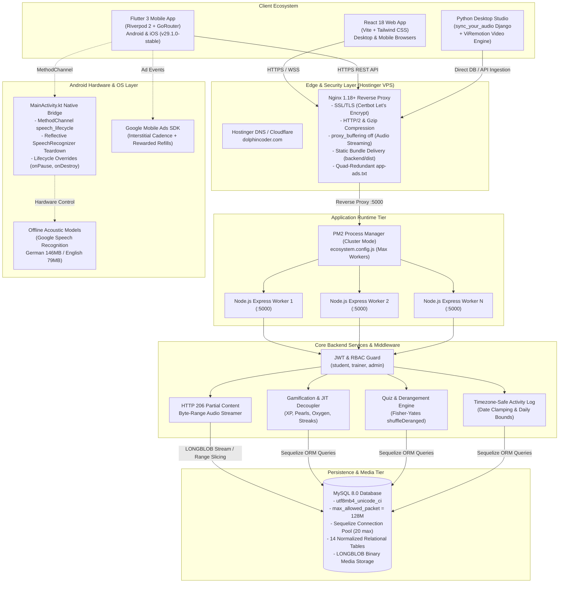
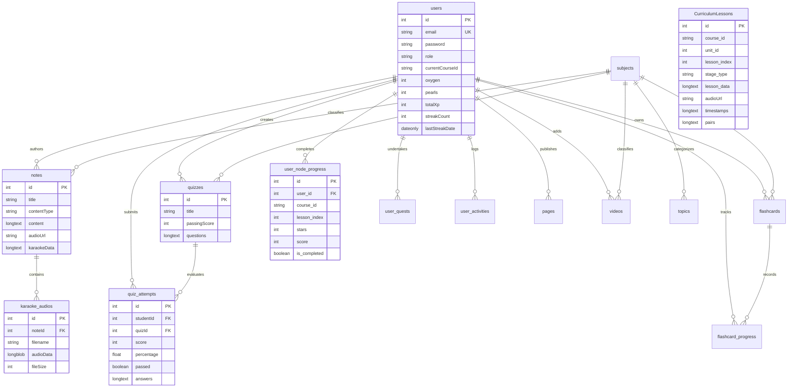

# DolphinCoder LMS — Master Architectural Specification & Complete Build Prompt

> **Single Source of Truth & Exhaustive Implementation Blueprint**  
> Use this document as the master, production-grade prompt for an AI agent, staff architect, or full-stack engineering team to build the entire **DolphinCoder LMS** platform from absolute scratch with 100% fidelity, zero missing details, and complete enterprise readiness. It synthesizes all backend, frontend, mobile, audio engine, speech recognition, devops, monetization, and security specifications into one unified build guide.

---

## 📋 Comprehensive Table of Contents
1. [Master Prompt, Mission Overview & Architectural Philosophy](#1-master-prompt-mission-overview--architectural-philosophy)
   - 1.1 Persona & System Mandate
   - 1.2 Core Non-Negotiable Architectural Tenets
   - 1.3 High-Level System Architecture & Unified Topology Diagram
   - 1.4 Complete Monorepo Directory & Module Hierarchy
2. [Database Architecture & Complete Sequelize ORM Specifications (MySQL 8)](#2-database-architecture--complete-sequelize-orm-specifications-mysql-8)
   - 2.1 Connection Management, Pooling & Dialect Settings
   - 2.2 MongoDB-to-Sequelize Cross-Compatibility Layer
   - 2.3 Automated Schema Migration & Self-Healing Pipeline
   - 2.4 All 14 Complete Sequelize Model Definitions & Schemas
   - 2.5 Model Associations, Foreign Keys & Cascade Deletion Rules
   - 2.6 Entity-Relationship Diagram (ERD)
3. [Backend API Specifications & Complete Route Registry](#3-backend-api-specifications--complete-route-registry)
   - 3.1 Authentication & Role-Based Access Control (`/api/auth`)
   - 3.2 Curriculum Studio & Multi-Stage Lesson Management (`/api/curriculum`)
   - 3.3 Gamification Engine, Archipelago Map & In-Game Economy (`/api/gamification`)
   - 3.4 Quizzes, Assessments & DOCX Ingestion (`/api/quizzes`)
   - 3.5 Notes, Rich-Text Documents & Binary Audio Streaming (`/api/notes`)
   - 3.6 Flashcards & Spaced Repetition Mastery (`/api/flashcards`)
   - 3.7 User Activity Analytics & Timezone Grouping (`/api/activity`)
   - 3.8 Taxonomy, Subjects & Topics (`/api/subjects`)
   - 3.9 Video Lessons & YouTube Embeds (`/api/videos`)
   - 3.10 CMS Pages & IndexNow Dynamic SEO (`/api/pages`)
   - 3.11 Admin Management & Trainer Provisioning (`/api/admin`)
   - 3.12 Crawler Verification & Search Routes (`/app-ads.txt`, `/sitemap.xml`, `/robots.txt`)
   - 3.13 Middleware Pipeline & Security Architecture
4. [Core Mathematical Formulations & Complex Algorithms](#4-core-mathematical-formulations--complex-algorithms)
   - 4.1 Pronunciation Evaluation Engine (Normalization, Levenshtein, Soundex, Monotonic Forward Alignment, Weighted Scoring)
   - 4.2 Timezone-Safe Daily Streak Engine & Recovery State Machine
   - 4.3 Gamification Economy (XP Calculations, Pearls Currency, 30-Min Oxygen Regeneration & Ad Refill)
   - 4.4 Archipelago JIT Payload Decoupling & Sinusoidal Path Geometry
   - 4.5 Database-Backed Binary Audio Streaming (HTTP 206 Partial Content Byte Ranges)
   - 4.6 Match-Pairs Derangement Algorithm (`shuffleDeranged` Fisher-Yates)
5. [Flutter 3 Mobile Application Architecture (`app/dolphincoder`)](#5-flutter-3-mobile-application-architecture-appdolphincoder)
   - 5.1 Riverpod 2 State Management Architecture & Providers
   - 5.2 GoRouter Declarative Routing Engine & 5-Tab ShellRoute
   - 5.3 Design System, AMOLED Dark & Oceanic Light Themes, Tactile Widgets
   - 5.4 Multi-Stage Lesson Session Runner & All 8 Interactive Exercise Stages
   - 5.5 Native Android Speech Recognition Bridge & Hardware Lifecycle Teardown (`MainActivity.kt`)
   - 5.6 Offline Acoustic Speech Models on Android (`AddLanguagesActivity`)
   - 5.7 Karaoke Note Reader with AudioPlayers & Tempo Control
   - 5.8 Interactive Match the Pairs Widget
   - 5.9 Dedicated Quiz Review Screen
   - 5.10 6-Item Catalog Pagination & Pull-to-Refresh
   - 5.11 Domain Services, Network Client (`DioClient`), Caching & `pubspec.yaml`
6. [React 18 Web Frontend Architecture (`frontend/`)](#6-react-18-web-frontend-architecture-frontend)
   - 6.1 React 18 Core, Vite Build Pipeline & Tailwind CSS Configuration
   - 6.2 Authentication Context & Axios Interceptors
   - 6.3 Web Speech API (`webkitSpeechRecognition`) & Persona Selection
   - 6.4 8-Stage Interactive Lesson Runner (`LingoLessonModal.jsx`) & Web Audio API Sound Chimes
   - 6.5 Interactive Web Karaoke Story Reader (`KaraokeNoteReader.jsx`)
   - 6.6 Match the Pairs Web Widget (`MatchPairsQuestion.jsx`)
   - 6.7 Quiz Taking Engine & Historical Review Screen
   - 6.8 Curriculum Studio & Multi-Stage Lesson Editor (`CurriculumPage.jsx`, `LessonEditorModal.jsx`)
   - 6.9 Audio Synchronization & Alignment Tools (`sync_your_audio` & `ViRemotion`)
7. [DevOps, Infrastructure, Security & Monetization Architecture](#7-devops-infrastructure-security--monetization-architecture)
   - 7.1 Single-Server Unified Production Deployment on Hostinger VPS (Ubuntu 22.04 LTS)
   - 7.2 PM2 Process Clustering (`ecosystem.config.js`) & Zero-Downtime Reload
   - 7.3 Nginx Reverse Proxy Architecture, SSL Termination & Streaming Bypass (`proxy_buffering off`)
   - 7.4 MySQL 8 Server Configuration, Packet Sizing & Connection Pooling Formula
   - 7.5 Automated MySQL Backups (`backup_lms_db.sh`) & Disaster Recovery Runbook
   - 7.6 Android Gradle Build Pipeline, Keystore Management & Release Signing
   - 7.7 ProGuard & R8 Optimization Rules (`proguard-rules.pro` for Native Speech Reflection)
   - 7.8 Production Android App Bundle (AAB) & Tri-Way Version Synchronization
   - 7.9 Google AdMob Monetization Architecture & In-Game Economy Integration
   - 7.10 Quad-Redundant `app-ads.txt` Crawler Delivery Pipeline
   - 7.11 Security Hardening, CORS Whitelist, Helmet CSP, Memory-Safe Streaming & Binder Leak Defense
   - 7.12 Production Incident Response Playbooks
8. [Comprehensive 10-Phase Implementation Roadmap](#8-comprehensive-10-phase-implementation-roadmap)
   - Phase 1: Environment, Database & Sequelize Setup
   - Phase 2: Core Backend Engine, Auth & Security
   - Phase 3: Media Engine, Binary LONGBLOB Streaming & Speech Evaluator
   - Phase 4: Gamification, JIT Archipelago Engine & Course Switching
   - Phase 5: Assessment Engine, Quizzes, Derangement & Review
   - Phase 6: React 18 Web Frontend & 8-Stage Interactive Runner
   - Phase 7: Web Admin Curriculum Studio & Desktop Aligner
   - Phase 8: Flutter 3 Mobile Foundation & Native Speech Bridge
   - Phase 9: Mobile Interactive Stages, Karaoke & AdMob Monetization
   - Phase 10: Production Deployment, Nginx, PM2, Gradle Release & Play Store Launch

---

## 1. Master Prompt, Mission Overview & Architectural Philosophy

### 1.1 Persona & System Mandate
You are an expert Principal Full-Stack Systems Architect and Lead Mobile & Cloud Engineer. You have been tasked with building **DolphinCoder LMS** from absolute scratch — an enterprise-grade, gamified Learning Management System specialized in language acquisition (German CEFR A1–B2 and English A1 with Hindi/Marathi instruction), computer science education, and interactive assessments.

The platform embodies the highest standards of software engineering: strict database-first media persistence, mathematical precision in language evaluation, seamless cross-client parity between desktop web and mobile devices, zero-downtime clustering, robust Android audio hardware lifecycle management, and enterprise-grade security hardening.

### 1.2 Core Non-Negotiable Architectural Tenets
1. **Single-Server Unified Runtime**: A single Node.js Express process serves both the REST API under `/api` and the compiled React 18 production Single Page Application (SPA) from `backend/dist`. There are no disjoint microservices or fragile cross-domain CORS configurations for primary app delivery.
2. **Database-First Binary Audio Persistence (Zero Ephemeral File Loss)**: Media files (notably pronunciation audio tracks, mascot utterances, and full-length karaoke MP3s) must NEVER be saved to the local container disk or ephemeral filesystem. All audio must be stored directly in MySQL 8 as `LONGBLOB`s in the `karaoke_audios` table and served via HTTP 206 Partial Content byte-range streaming. This ensures instant cloud migration, container recreation safety, and zero data loss.
3. **Strict Dual-Client Parity**: The web application (React 18 + Vite + Tailwind CSS) and mobile application (Flutter 3 + Riverpod 2 + GoRouter) must maintain 100% functional, pedagogical, and API parity across all 8 interactive exercise stages, karaoke synchronized story reading, quiz assessments with Match-the-Pairs, and gamification economies.
4. **Timezone-Safe Calendar & Streak Integrity**: Late-night study sessions (e.g., 1:30 AM) must resolve accurately to the learner's local calendar date via client timezone offset headers (`x-timezone-offset`). Learners in non-UTC timezones (e.g., UTC+5:30 IST) must never be penalized with broken streaks due to UTC midnight resets.
5. **Just-In-Time (JIT) Payload Decoupling**: The gamification course path endpoint (`GET /api/gamification/path`) must return only lightweight structural node metadata (~35 KB to 45 KB), stripping out all heavy interactive stage challenges and word-level timestamps. The complete multi-stage lesson payload is fetched Just-In-Time (`GET /api/gamification/lesson/:id`) only when the learner taps an unlocked node. This avoids 15 MB to 28 MB payload bloat and prevents mobile render lockups.
6. **Android Hardware Audio Lifecycle Protection**: To prevent hardware `AudioRecord` leaks, OS-level audio device contention, and Android `Binder` death, the Android application MUST enforce deep reflective teardown of underlying `SpeechRecognizer` instances inside `MainActivity.kt` upon `onPause`, `onStop`, and `onDestroy`, accompanied by strict 400ms DAC/ADC settling cooldowns in Dart.

### 1.3 High-Level System Architecture & Unified Topology Diagram



### 1.4 Complete Monorepo Directory & Module Hierarchy

```text
MERNLMS/
├── backend/
│   ├── config/
│   │   └── database.js               # Sequelize MySQL 8 connection pool & dialect configuration
│   ├── controllers/
│   │   ├── adminController.js         # User CRUD, role provisioning, system statistics
│   │   ├── authController.js          # Register, Login, Refresh, Profile management, Password reset
│   │   ├── curriculumController.js    # Curriculum Studio, Unit/Lesson management, BLOB audio uploads
│   │   ├── gamificationController.js  # Archipelago path, JIT lesson delivery, 2-step course switcher,
│   │   │                              # oxygen regeneration, daily streak calculation, leagues, quests, shop
│   │   ├── noteController.js          # Notes CRUD, HTML slides, DB-backed HTTP 206 audio streaming
│   │   ├── quizController.js          # Quiz CRUD, DOCX import, student sanitization, derangement,
│   │   │                              # attempt grading, deduplication, historical review
│   │   ├── flashcardController.js     # Decks, spaced repetition progress, card mastery tracking
│   │   ├── activityController.js      # Granular daily logs, timezone-safe date-clamped summaries
│   │   ├── subjectController.js       # Subjects & nested taxonomy topics
│   │   ├── videoController.js         # Video lessons, YouTube embeds, completion tracking
│   │   └── pageController.js          # CMS static pages, dynamic SSR SEO injection, IndexNow pings
│   ├── middleware/
│   │   ├── auth.js                    # JWT verification & req.user injection
│   │   ├── rbac.js                    # Role-based access control guard ('student','trainer','admin')
│   │   ├── upload.js                  # Multer memoryStorage configuration (50MB binary limits)
│   │   └── rateLimiter.js             # Tiered express-rate-limit instances (auth, general, streaming)
│   ├── models/
│   │   ├── index.js                   # Sequelize initialization & model registry
│   │   ├── associations.js            # Relational foreign keys & cascade deletion rules
│   │   ├── User.js                    # User identity, roles, economy balances, streak counters
│   │   ├── CurriculumLesson.js        # Multi-stage lessons, 8 challenge types, isolated audio references
│   │   ├── UserNodeProgress.js        # Learner course progress, stars, scores, completion status
│   │   ├── KaraokeAudio.js            # LONGBLOB binary audio storage & MIME tracking
│   │   ├── UserActivity.js            # Timezone-safe daily study logs & engagement seconds
│   │   ├── UserQuest.js               # Daily & monthly gamified quests & pearl rewards
│   │   ├── Quiz.js                    # Quizzes with MCQ, code-snippet, & match-pairs questions
│   │   ├── QuizAttempt.js             # Graded student attempt snapshots & question-by-question audits
│   │   ├── Note.js                    # Rich-text, DOCX, HTML slides, & synchronized Karaoke stories
│   │   ├── Flashcard.js               # Spaced repetition flashcard decks
│   │   ├── FlashcardProgress.js       # Card-by-card user mastery state
│   │   ├── Subject.js                 # Academic subjects & color tokens
│   │   ├── Topic.js                   # Nested taxonomic topics
│   │   ├── Page.js                    # CMS rich text pages & SEO metadata
│   │   └── Video.js                   # Video tutorials & watch tracking
│   ├── routes/                        # Express REST route endpoints
│   ├── scripts/
│   │   ├── seedAdmin.js               # Headless admin user bootstrapper
│   │   ├── seed_german_a1.sql         # 105 Units / 1,680 Lessons German A1 SQL seed
│   │   ├── seed_english_a1_hindi.sql  # 35 Units / 560 Lessons English A1 (Hindi medium)
│   │   └── seed_english_a1_marathi.sql# 35 Units / 560 Lessons English A1 (Marathi medium)
│   ├── utils/
│   │   ├── dateHelper.js              # Timezone offset resolution, client date clamping, UTC bounds
│   │   └── audioHelper.js             # Audio duration parsing & ID3 metadata extraction
│   ├── dist/                          # Compiled React 18 production bundle (Vite output)
│   ├── ecosystem.config.js            # PM2 clustering, memory ceilings, & zero-downtime reloads
│   ├── server.js                      # Express application bootstrap, static SPA serve, SSR SEO
│   └── package.json
├── frontend/
│   ├── src/
│   │   ├── api/
│   │   │   └── axios.js               # Axios singleton with Bearer auth & timezone offset headers
│   │   ├── contexts/
│   │   │   └── AuthContext.jsx        # Authentication provider, token persistence, user profile state
│   │   ├── hooks/
│   │   │   ├── useDifficultWords.js   # Custom hook for auto-paginating difficult vocabulary
│   │   │   └── useSubjects.js         # Custom hook for hierarchical taxonomy management
│   │   ├── components/
│   │   │   ├── common/                # Navbar, Footer, Shimmers, Badges, Modals, Pagination
│   │   │   ├── notes/                 # KaraokeNoteReader, HTML slide presentation viewer, note cards
│   │   │   ├── lingo/                 # LingoLessonModal (8-stage runner, Web Speech STT, sound synthesis)
│   │   │   ├── curriculum/            # LessonEditorModal, UnitOutlineModal, BulkUploadModal
│   │   │   ├── quiz/                  # MatchPairsQuestion, CodeSnippetQuestion, MatchPairsForm
│   │   │   └── dashboard/             # TodayPerformance chips, WeeklyPerformance grouped history
│   │   ├── pages/
│   │   │   ├── Dashboard.jsx          # Overview with lightweight Today's summary chips
│   │   │   ├── LingoDolphyPage.jsx    # Gamified archipelago sinusoidal path & 2-step course switcher
│   │   │   ├── CurriculumPage.jsx     # Curriculum Studio & Lesson Management (/lessons)
│   │   │   ├── NotesPage.jsx          # 6-item paginated study notes catalog
│   │   │   ├── NoteDetailPage.jsx     # Slide presentation viewer with anchor smooth-scroll fix
│   │   │   ├── NoteEditorPage.jsx     # Tiptap rich-text editor & file upload suite
│   │   │   ├── QuizzesPage.jsx        # 6-item paginated assessment catalog
│   │   │   ├── QuizTakePage.jsx       # Active assessment with countdown timer & match-pairs UI
│   │   │   ├── QuizReviewPage.jsx     # Comprehensive historical review with answer audits
│   │   │   ├── FlashcardsPage.jsx     # Flashcard deck catalog & bulk upload
│   │   │   ├── StudyPage.jsx          # 3D interactive flashcard flip study runner
│   │   │   └── ActivityHistoryPage.jsx# Grouped daily study history (Today / Yesterday / Day Before)
│   │   ├── styles/
│   │   │   └── index.css              # Tailwind CSS directives, glassmorphic classes, custom scrollbars
│   │   ├── App.jsx                    # React Router 6 route declarations & protected route guards
│   │   └── main.jsx
│   ├── tailwind.config.js             # Theme tokens, AMOLED dark & Oceanic light palettes
│   ├── vite.config.js                 # Rollup chunking, proxy configuration, production build setup
│   └── package.json
├── app/dolphincoder/                  # Flutter Mobile Application (v1.2.6+11 / Release v29.1.0-stable)
│   ├── android/
│   │   ├── app/
│   │   │   ├── build.gradle.kts       # Android build config, compileSdk 34, minSdk 24, signing configs
│   │   │   ├── proguard-rules.pro     # Keep rules for SpeechToText reflection, AdMob, AudioPlayers
│   │   │   └── src/main/
│   │   │       ├── AndroidManifest.xml# Permissions: RECORD_AUDIO, INTERNET, AD_ID, AdMob App ID
│   │   │       └── kotlin/com/dolphincoder/lms/
│   │   │           └── MainActivity.kt# Platform MethodChannel, reflective SpeechRecognizer teardown
│   │   ├── build.gradle.kts           # Root Gradle build script
│   │   ├── settings.gradle.kts        # Plugin management & repositories configuration
│   │   └── key.properties             # Keystore passwords and file path reference
│   ├── lib/
│   │   ├── core/
│   │   │   ├── constants/             # ApiConstants, AppConstants, InGameEconomyConstants
│   │   │   ├── network/               # DioClient with automatic Bearer tokens & retry interceptors
│   │   │   ├── router/                # GoRouter 5-tab ShellRoute declarations, deep links, auth guards
│   │   │   ├── services/
│   │   │   │   ├── speech_lifecycle_bridge.dart # MethodChannel bridge for native hardware release
│   │   │   │   ├── speech_recognition_service.dart# Domain speech recognition pipeline & RMS visualizer
│   │   │   │   ├── pronunciation_evaluator.dart # Dynamic programming Levenshtein & Soundex scoring
│   │   │   │   ├── tts_service.dart   # Low-latency German lady voice synthesizer (<20ms response)
│   │   │   │   ├── cache_service.dart # SharedPreferences & local disk Tier-2 cache
│   │   │   │   ├── prefetch_service.dart # Predictive audio and stage payload caching
│   │   │   │   ├── ad_service.dart    # Google Mobile Ads interstitial & rewarded video engine
│   │   │   │   └── version_check_service.dart # Semantic tri-way version enforcement
│   │   │   └── theme/                 # AMOLED Dark (#0A0F1E) & Oceanic Light theme palettes
│   │   ├── features/
│   │   │   ├── auth/                  # Login, Register, Splash, LanguageSelection screens & notifiers
│   │   │   ├── gamification/          # ArchipelagoMapScreen, LessonSessionScreen (all 8 stages),
│   │   │   │                          # LeaguesScreen, QuestsScreen, ShopScreen, GamifiedProfileScreen
│   │   │   ├── dashboard/             # DashboardScreen, ActivityHistoryScreen
│   │   │   ├── notes/                 # NotesScreen, NoteDetailScreen, KaraokeNoteReaderScreen
│   │   │   ├── quizzes/               # QuizzesScreen, QuizDetailScreen, QuizTakeScreen,
│   │   │   │                          # MatchPairsWidget, QuizReviewScreen
│   │   │   └── flashcards/            # FlashcardsScreen, StudyScreen
│   │   └── main.dart                  # Application entry point, ProviderScope initialization
│   ├── assets/                        # Audio assets, mascot SVG/PNG illustrations, brand icons
│   └── pubspec.yaml                   # Flutter runtime & development dependencies
├── sync_your_audio/                   # Specialized Python Desktop Studio for forced audio-text alignment
│   ├── aligner/
│   │   ├── services.py                # 5 alignment engines (Stable-Whisper, WhisperX, Faster-Whisper, etc.)
│   │   └── views.py                   # Desktop web UI for generating word-level karaoke.json
│   └── manage.py
├── ViRemotion/                        # Programmatic Video Generation Engine (Remotion + React)
│   ├── src/
│   │   ├── Root.tsx                   # 16:9 Landscape YouTube compositions & audiograms
│   │   └── Composition.tsx            # Word-level highlighted captions & soundwave visualization
│   └── package.json
└── deployment/
    ├── nginx/
    │   └── dolphincoder.conf          # Nginx production configuration with streaming bypass
    ├── mysql/
    │   └── mysqld.cnf                 # MySQL 8 production tuning (max_allowed_packet = 128M)
    └── scripts/
        ├── backup_lms_db.sh           # Automated binary-safe MySQL backup script with crontab
        └── deploy.sh                  # Zero-downtime rolling build & PM2 reload script
```


---

## 2. Database Architecture & Complete Sequelize ORM Specifications (MySQL 8)

The persistence tier relies on **MySQL 8.0** operating with `utf8mb4` character encoding and `utf8mb4_unicode_ci` collation to provide comprehensive multilingual and emoji support. All database interactions occur through **Sequelize ORM v6**.

### 2.1 Connection Management, Pooling & Dialect Settings

The connection pool is established in `backend/config/database.js`. It utilizes robust pool sizing to ensure high-throughput concurrent access while preventing MySQL connection exhaustion:

```javascript
// backend/config/database.js
const { Sequelize } = require('sequelize');
require('dotenv').config();

const sequelize = new Sequelize(
  process.env.DB_NAME || 'dolphincoder_lms',
  process.env.DB_USER || 'root',
  process.env.DB_PASSWORD || '',
  {
    host: process.env.DB_HOST || '127.0.0.1',
    port: parseInt(process.env.DB_PORT, 10) || 3306,
    dialect: 'mysql',
    logging: process.env.NODE_ENV === 'development' ? console.log : false,
    dialectOptions: {
      charset: 'utf8mb4',
      dateStrings: true,
      typeCast: true,
      // Support large binary packet transfers for LONGBLOB audio tracks
      maxAllowedPacket: 128 * 1024 * 1024, // 128MB
    },
    pool: {
      max: 20,                // Maximum active connections in pool
      min: 5,                 // Minimum retained connections
      acquire: 60000,         // Maximum time (ms) to acquire connection before error
      idle: 10000,            // Time (ms) a connection can be idle before release
      evict: 1000,            // Frequency (ms) to inspect idle connections
    },
    define: {
      timestamps: true,       // Automatically adds createdAt and updatedAt
      underscored: false,     // Retains camelCase column references in JavaScript
      charset: 'utf8mb4',
      collate: 'utf8mb4_unicode_ci',
    },
  }
);

module.exports = sequelize;
```

### 2.2 MongoDB-to-Sequelize Cross-Compatibility Layer

To maintain seamless interoperability with legacy client code or NoSQL conventions without breaking relational integrity, all Sequelize models implement a **MongoDB Cross-Compatibility Layer**:
1. **Virtual `_id` Getter**: Every model defines a virtual getter `_id` that returns `this.id`. This ensures mobile and frontend code relying on `item._id` functions without modification.
2. **Transparent JSON Serialization / Deserialization**: MySQL columns storing serialized JSON objects (such as `questions`, `pairs`, `tags`, `metadata`, `answers`) implement custom getters and setters:
   - **Getter**: Checks if the stored value is already an object; if a string, executes `JSON.parse()`; falls back to default structures (`[]` or `{}`) on malformed strings.
   - **Setter**: If passed an object or array, executes `JSON.stringify()`; preserves raw strings if already stringified.
3. **`toJSON()` Override**: Strips sensitive fields (such as `password` on the `User` model) automatically before sending payloads over HTTP.

### 2.3 Automated Schema Migration & Self-Healing Pipeline

DolphinCoder avoids fragile external migration scripts by implementing an automated **Self-Healing Schema Pipeline** in `backend/models/index.js` or during server bootstrap:
- **Automatic Column Detection**: On server boot, queries `INFORMATION_SCHEMA.COLUMNS` to verify that newly introduced columns exist:
  - `CurriculumLessons`: `wordsAudioUrl`, `sentenceRange`, `timestamps`, `pairs`.
  - `users`: `currentCourseId`, `currentSection`, `currentUnit`, `currentLevel`, `oxygen`, `lastOxygenRefill`, `pearls`, `totalXp`, `streakCount`, `lastStreakDate`, `highestStreak`, `freezeCount`.
  - If a column is missing, an `ALTER TABLE` statement is automatically dispatched.
- **Progress Course Isolation (`migrateUserNodeProgress`)**:
  Ensures the `user_node_progress` table includes a `course_id` column. If missing, executes:
  ```sql
  ALTER TABLE user_node_progress ADD COLUMN course_id VARCHAR(50) DEFAULT 'german_a1' AFTER user_id;
  CREATE INDEX idx_user_course_lesson ON user_node_progress (user_id, course_id, lesson_index);
  ```

---

### 2.4 All 14 Complete Sequelize Model Definitions & Schemas

#### 1. Table: `users` (Model: `User`)
Stores user identity, security credentials, RBAC roles, language curriculum tracks, and the complete gamification economy.

| Column | Type | Constraints | Default | Description |
|---|---|---|---|---|
| `id` | `INTEGER` | PK, AUTO_INCREMENT | — | Unique user identifier |
| `name` | `STRING(100)` | NOT NULL | — | User's full display name |
| `email` | `STRING(150)` | NOT NULL, UNIQUE, `isEmail` | — | User login and contact email |
| `password` | `STRING(255)` | NOT NULL | — | Bcrypt salted hash (12 salt rounds) |
| `role` | `ENUM('student','trainer','admin')` | NOT NULL | `'student'` | Access control role |
| `avatar` | `STRING(255)` | NULL | NULL | Profile image URL or storage path |
| `isActive` | `BOOLEAN` | NOT NULL | `true` | Account active status |
| `targetLanguage` | `STRING(50)` | NOT NULL | `'de'` | Target language code (`'de'`, `'en'`) |
| `nativeLanguage` | `STRING(50)` | NOT NULL | `'en'` | Native instruction language (`'en'`, `'hi'`, `'mr'`) |
| `currentCourseId`| `STRING(50)` | NOT NULL | `'german_a1'` | Current active course track identifier |
| `currentSection` | `INTEGER` | NOT NULL | `1` | Active section in archipelago path |
| `currentUnit` | `INTEGER` | NOT NULL | `1` | Active unit in archipelago path |
| `currentLevel` | `STRING(20)` | NOT NULL | `'A1'` | CEFR level descriptor (`'A1'`, `'A2'`, `'B1'`) |
| `oxygen` | `INTEGER` | NOT NULL, `min: 0, max: 5` | `5` | Active hearts/lives pool (max 5) |
| `lastOxygenRefill`| `DATE` | NOT NULL | `NOW` | Timestamp of last oxygen regeneration step |
| `pearls` | `INTEGER` | NOT NULL, `min: 0` | `0` | In-game currency balance |
| `totalXp` | `INTEGER` | NOT NULL, `min: 0` | `0` | Cumulative lifetime experience points |
| `streakCount` | `INTEGER` | NOT NULL, `min: 0` | `0` | Current consecutive active days count |
| `lastStreakDate` | `DATEONLY` | NULL | NULL | Client-offset clamped date of last activity |
| `highestStreak` | `INTEGER` | NOT NULL, `min: 0` | `0` | All-time personal streak record |
| `freezeCount` | `INTEGER` | NOT NULL, `min: 0` | `0` | Inventory of active streak freeze items |
| `createdAt` | `DATE` | NOT NULL | `NOW` | Record creation timestamp |
| `updatedAt` | `DATE` | NOT NULL | `NOW` | Record last modification timestamp |

**Indexes & Virtuals:**
- Unique Index: `users_email_unique` (`email`)
- Index: `idx_users_role` (`role`)
- Virtual: `_id` $	o$ `this.id`
- Scope: `withoutPassword` automatically excludes `password` from output.

---

#### 2. Table: `CurriculumLessons` (Model: `CurriculumLesson`)
Houses the granular curriculum challenges. Each record represents a discrete lesson node within a unit.

| Column | Type | Constraints | Default | Description |
|---|---|---|---|---|
| `id` | `INTEGER` | PK, AUTO_INCREMENT | — | Unique curriculum lesson ID |
| `course_id` | `STRING(50)` | NOT NULL | `'german_a1'` | Course track identifier |
| `section_id` | `INTEGER` | NOT NULL | `1` | Section sequence index |
| `unit_id` | `INTEGER` | NOT NULL | `1` | Unit sequence index |
| `lesson_index` | `INTEGER` | NOT NULL | — | Global 0-based lesson index in course track |
| `title` | `STRING(255)` | NOT NULL | — | Lesson challenge headline |
| `description` | `TEXT` | NULL | NULL | Pedagogical instructions or grammar context |
| `stage_type` | `STRING(50)` | NOT NULL | `'word_match'` | Stage discriminator (see 8 stage types) |
| `xp_reward` | `INTEGER` | NOT NULL | `10` | Base experience points awarded on pass |
| `order_index` | `INTEGER` | NOT NULL | `0` | Visual display ordering within unit |
| `lesson_data` | `LONGTEXT` | NULL | NULL | Structured JSON payload containing stages |
| `audioUrl` | `STRING(500)` | NULL | NULL | Primary pronunciation audio or mascot voice URL |
| `wordsAudioUrl` | `STRING(500)` | NULL | NULL | Dedicated audio track for individual word tokens |
| `timestamps` | `LONGTEXT` | NULL | NULL | JSON array of word-level audio alignment bounds |
| `pairs` | `LONGTEXT` | NULL | NULL | JSON array of vocabulary pairs (`[{target, native}]`)|
| `sentenceRange` | `STRING(100)` | NULL | NULL | Bounding slice range (e.g. `'0-5'`) |
| `createdAt` | `DATE` | NOT NULL | `NOW` | Record creation timestamp |
| `updatedAt` | `DATE` | NOT NULL | `NOW` | Record last modification timestamp |

**Indexes & JSON Getters:**
- Composite Index: `idx_curriculum_course_unit_lesson` (`course_id`, `unit_id`, `lesson_index`)
- JSON Getter/Setter: `lesson_data`, `timestamps`, `pairs`

---

#### 3. Table: `user_node_progress` (Model: `UserNodeProgress`)
Tracks individual student completion, mastery stars, and high scores across all archipelago lesson nodes.

| Column | Type | Constraints | Default | Description |
|---|---|---|---|---|
| `id` | `INTEGER` | PK, AUTO_INCREMENT | — | Unique progress record ID |
| `user_id` | `INTEGER` | NOT NULL, FK -> `users.id` | — | Student identifier |
| `course_id` | `STRING(50)` | NOT NULL | `'german_a1'` | Course track identifier |
| `lesson_index` | `INTEGER` | NOT NULL | — | Global lesson index in curriculum |
| `stars` | `INTEGER` | NOT NULL, `min: 0, max: 3`| `0` | Mastery stars earned (1-3 stars) |
| `score` | `INTEGER` | NOT NULL, `min: 0` | `0` | Highest score achieved on this node |
| `is_completed` | `BOOLEAN` | NOT NULL | `false` | Node completion flag |
| `completed_at` | `DATE` | NULL | NULL | Timestamp of initial completion |
| `createdAt` | `DATE` | NOT NULL | `NOW` | Creation timestamp |
| `updatedAt` | `DATE` | NOT NULL | `NOW` | Modification timestamp |

**Indexes:**
- Composite Unique Index: `idx_user_course_lesson_unique` (`user_id`, `course_id`, `lesson_index`)

---

#### 4. Table: `karaoke_audios` (Model: `KaraokeAudio`)
Stores binary MP3 audio tracks directly inside the relational database as `LONGBLOB`s, enabling lossless container recreation and database-backed HTTP 206 streaming.

| Column | Type | Constraints | Default | Description |
|---|---|---|---|---|
| `id` | `INTEGER` | PK, AUTO_INCREMENT | — | Unique audio record identifier |
| `noteId` | `INTEGER` | NULL, FK -> `notes.id` | NULL | Attached note (if associated with note) |
| `filename` | `STRING(255)` | NOT NULL | — | Original source filename |
| `mimeType` | `STRING(100)` | NOT NULL | `'audio/mpeg'` | Media MIME type |
| `audioData` | `LONGBLOB` | NOT NULL | — | Binary audio buffer (supports up to 64MB) |
| `fileSize` | `INTEGER` | NOT NULL | — | Total byte length of binary payload |
| `createdAt` | `DATE` | NOT NULL | `NOW` | Creation timestamp |
| `updatedAt` | `DATE` | NOT NULL | `NOW` | Modification timestamp |

**Indexes:**
- Index: `idx_karaoke_audios_noteId` (`noteId`)

---

#### 5. Table: `user_activities` (Model: `UserActivity`)
Provides granular event-level logging of every study action, quiz attempt, flashcard session, and karaoke read for dashboard analytics.

| Column | Type | Constraints | Default | Description |
|---|---|---|---|---|
| `id` | `INTEGER` | PK, AUTO_INCREMENT | — | Unique activity log ID |
| `userId` | `INTEGER` | NOT NULL, FK -> `users.id` | — | Student identifier |
| `activityType` | `ENUM('quiz','note','flashcard','lesson','karaoke')` | NOT NULL | — | Activity classification |
| `resourceId` | `INTEGER` | NOT NULL | — | Reference target identifier |
| `resourceTitle`| `STRING(255)` | NOT NULL | `''` | Cached title of resource studied |
| `metadata` | `LONGTEXT` | NULL | NULL | JSON payload: `{ score, maxScore, percentage, passed, engagementSecs, isKaraoke, cardCount }` |
| `activityDate` | `DATEONLY` | NOT NULL | — | Client-offset clamped date `YYYY-MM-DD` |
| `createdAt` | `DATE` | NOT NULL | `NOW` | Creation timestamp |
| `updatedAt` | `DATE` | NOT NULL | `NOW` | Modification timestamp |

**Indexes:**
- Composite Index: `idx_user_activity_user_date` (`userId`, `activityDate`)
- Index: `idx_user_activity_type` (`activityType`)

---

#### 6. Table: `user_quests` (Model: `UserQuest`)
Manages gamified daily and weekly objectives (e.g. *"Complete 3 Speaking Lessons"*, *"Earn 50 XP"*).

| Column | Type | Constraints | Default | Description |
|---|---|---|---|---|
| `id` | `INTEGER` | PK, AUTO_INCREMENT | — | Unique quest ID |
| `userId` | `INTEGER` | NOT NULL, FK -> `users.id` | — | Student identifier |
| `questType` | `STRING(50)` | NOT NULL | — | Quest category identifier |
| `targetCount` | `INTEGER` | NOT NULL | `1` | Target completion requirement |
| `currentCount`| `INTEGER` | NOT NULL | `0` | Current progress counter |
| `isCompleted` | `BOOLEAN` | NOT NULL | `false` | Completion status |
| `rewardClaimed`| `BOOLEAN` | NOT NULL | `false` | Whether user claimed rewards |
| `rewardXp` | `INTEGER` | NOT NULL | `20` | XP granted upon claiming |
| `rewardPearls`| `INTEGER` | NOT NULL | `10` | Pearls granted upon claiming |
| `questDate` | `DATEONLY` | NOT NULL | — | Active calendar day for quest |
| `expiresAt` | `DATE` | NOT NULL | — | Expiration deadline timestamp |
| `createdAt` | `DATE` | NOT NULL | `NOW` | Creation timestamp |
| `updatedAt` | `DATE` | NOT NULL | `NOW` | Modification timestamp |

**Indexes:**
- Composite Index: `idx_user_quests_user_date` (`userId`, `questDate`)

---

#### 7. Table: `quizzes` (Model: `Quiz`)
Defines structured assessments containing Multiple-Choice, True-False, Code-Snippet MCQ, and Match-the-Pairs questions.

| Column | Type | Constraints | Default | Description |
|---|---|---|---|---|
| `id` | `INTEGER` | PK, AUTO_INCREMENT | — | Unique quiz identifier |
| `title` | `STRING(255)` | NOT NULL | — | Assessment title |
| `description` | `TEXT` | NULL | NULL | Instructions and guidelines |
| `timeLimit` | `INTEGER` | NOT NULL | `15` | Minutes allowed (0 = untimed) |
| `passingScore`| `INTEGER` | NOT NULL | `70` | Passing score threshold percentage |
| `attemptLimit`| `INTEGER` | NOT NULL | `0` | Max attempts allowed (0 = infinite) |
| `shuffleQuestions`| `BOOLEAN` | NOT NULL | `false`| Randomize question delivery order |
| `isPublished` | `BOOLEAN` | NOT NULL | `true` | Catalog visibility |
| `subjectId` | `INTEGER` | NULL, FK -> `subjects.id`| NULL | Associated academic subject |
| `topicId` | `INTEGER` | NULL, FK -> `topics.id` | NULL | Associated taxonomic topic |
| `createdBy` | `INTEGER` | NOT NULL, FK -> `users.id`| — | Creator/Trainer user ID |
| `questions` | `LONGTEXT` | NOT NULL | — | JSON array of question objects |
| `createdAt` | `DATE` | NOT NULL | `NOW` | Creation timestamp |
| `updatedAt` | `DATE` | NOT NULL | `NOW` | Modification timestamp |

**Question Object Schema Types in `questions` Column:**
```json
// Type A: Standard MCQ / True-False / Code-MCQ
{
  "_id": 0,
  "type": "multiple-choice", // or 'true_false' or 'code-mcq'
  "text": "What is the capital of Germany?",
  "options": ["Munich", "Berlin", "Hamburg", "Frankfurt"],
  "correctIndex": 1,
  "explanation": "Berlin is the capital and largest city of Germany.",
  "code": null,
  "language": null,
  "points": 1
}

// Type B: Match the Pairs ('match-pairs')
{
  "_id": 1,
  "type": "match-pairs",
  "text": "Match each German noun with its English translation:",
  "pairs": [
    { "left": "das Haus", "right": "the house" },
    { "left": "der Hund", "right": "the dog" },
    { "left": "die Katze", "right": "the cat" },
    { "left": "das Buch", "right": "the book" }
  ],
  "explanation": "German definite articles are der (masculine), die (feminine), das (neuter).",
  "points": 1
}
```

---

#### 8. Table: `quiz_attempts` (Model: `QuizAttempt`)
Stores immutable historical snapshots of graded student quiz attempts, complete with question audits, submitted answers, and timestamps.

| Column | Type | Constraints | Default | Description |
|---|---|---|---|---|
| `id` | `INTEGER` | PK, AUTO_INCREMENT | — | Unique attempt record ID |
| `studentId` | `INTEGER` | NOT NULL, FK -> `users.id`| — | Student identifier |
| `quizId` | `INTEGER` | NOT NULL, FK -> `quizzes.id`| — | Quiz identifier |
| `attemptNumber`| `INTEGER` | NOT NULL | `1` | Sequential attempt counter |
| `score` | `INTEGER` | NOT NULL | — | Total earned points |
| `maxScore` | `INTEGER` | NOT NULL | — | Maximum possible points |
| `percentage` | `FLOAT` | NOT NULL | — | Calculated percentage score |
| `passed` | `BOOLEAN` | NOT NULL | — | Met passingScore threshold |
| `timeTakenSecs`| `INTEGER` | NOT NULL | `0` | Seconds spent completing quiz |
| `answers` | `LONGTEXT` | NOT NULL | — | Graded question-by-question snapshot JSON |
| `createdAt` | `DATE` | NOT NULL | `NOW` | Attempt submission timestamp |
| `updatedAt` | `DATE` | NOT NULL | `NOW` | Modification timestamp |

**Indexes:**
- Composite Index: `idx_quiz_attempts_student_quiz` (`studentId`, `quizId`)

---

#### 9. Table: `notes` (Model: `Note`)
Houses rich-text articles, Microsoft Word DOCX uploads, sandboxed HTML presentation slide decks, and word-synchronized Karaoke stories.

| Column | Type | Constraints | Default | Description |
|---|---|---|---|---|
| `id` | `INTEGER` | PK, AUTO_INCREMENT | — | Unique note ID |
| `title` | `STRING(255)` | NOT NULL | — | Note headline / title |
| `content` | `LONGTEXT` | NULL | NULL | HTML formatted body or presentation slides |
| `contentType` | `ENUM('richtext','docx','html','karaoke')` | NOT NULL | `'richtext'` | Document format classification |
| `color` | `STRING(50)` | NOT NULL | `'default'` | Visual color tag for cards |
| `isPinned` | `BOOLEAN` | NOT NULL | `false` | Pinned to top of catalog |
| `tags` | `TEXT` | NULL | NULL | JSON array of string tags |
| `subjectId` | `INTEGER` | NULL, FK -> `subjects.id`| NULL | Associated subject |
| `topicId` | `INTEGER` | NULL, FK -> `topics.id` | NULL | Associated topic |
| `ownerId` | `INTEGER` | NOT NULL, FK -> `users.id`| — | Author/Creator user ID |
| `audioUrl` | `STRING(500)` | NULL | NULL | URL or streaming path `/api/notes/audio/db/:id` |
| `duration` | `FLOAT` | NOT NULL | `0` | Total audio duration in seconds |
| `karaokeData` | `LONGTEXT` | NULL | NULL | Structured JSON story (sentences & words) |
| `createdAt` | `DATE` | NOT NULL | `NOW` | Creation timestamp |
| `updatedAt` | `DATE` | NOT NULL | `NOW` | Modification timestamp |

**Karaoke JSON Schema in `karaokeData` Column:**
```json
{
  "title": "Eine Reise nach Berlin",
  "language": "de",
  "duration": 45.2,
  "sentences": [
    {
      "id": 0,
      "text": "Heute fahre ich mit dem Zug nach Berlin.",
      "start": 0.5,
      "end": 3.8,
      "words": [
        { "word": "Heute", "start": 0.5, "end": 0.9 },
        { "word": "fahre", "start": 1.0, "end": 1.4 },
        { "word": "ich", "start": 1.5, "end": 1.7 },
        { "word": "mit", "start": 1.8, "end": 2.0 },
        { "word": "dem", "start": 2.1, "end": 2.3 },
        { "word": "Zug", "start": 2.4, "end": 2.8 },
        { "word": "nach", "start": 2.9, "end": 3.1 },
        { "word": "Berlin.", "start": 3.2, "end": 3.8 }
      ]
    }
  ]
}
```

---

#### 10. Table: `flashcards` (Model: `Flashcard`) & `flashcard_progress` (Model: `FlashcardProgress`)
Implements spaced repetition flashcard decks and card-by-card user mastery state.

**`flashcards` Schema:**
| Column | Type | Constraints | Default | Description |
|---|---|---|---|---|
| `id` | `INTEGER` | PK, AUTO_INCREMENT | — | Unique flashcard deck ID |
| `title` | `STRING(255)` | NOT NULL | — | Deck title |
| `description` | `TEXT` | NULL | NULL | Description of deck contents |
| `category` | `STRING(100)` | NOT NULL | `'General'`| Category tag |
| `subjectId` | `INTEGER` | NULL, FK -> `subjects.id`| NULL | Associated subject |
| `topicId` | `INTEGER` | NULL, FK -> `topics.id` | NULL | Associated topic |
| `ownerId` | `INTEGER` | NOT NULL, FK -> `users.id`| — | Creator user ID |
| `isPublished` | `BOOLEAN` | NOT NULL | `true` | Catalog visibility |
| `cards` | `LONGTEXT` | NOT NULL | — | JSON array of `{ front, back, hint }` objects |
| `createdAt` | `DATE` | NOT NULL | `NOW` | Creation timestamp |
| `updatedAt` | `DATE` | NOT NULL | `NOW` | Modification timestamp |

**`flashcard_progress` Schema:**
| Column | Type | Constraints | Default | Description |
|---|---|---|---|---|
| `id` | `INTEGER` | PK, AUTO_INCREMENT | — | Unique progress ID |
| `userId` | `INTEGER` | NOT NULL, FK -> `users.id`| — | Student identifier |
| `deckId` | `INTEGER` | NOT NULL, FK -> `flashcards.id`| — | Flashcard deck ID |
| `cardIndex` | `INTEGER` | NOT NULL | — | 0-based card index in deck |
| `isMastered` | `BOOLEAN` | NOT NULL | `false` | User mastery flag |
| `reviewCount` | `INTEGER` | NOT NULL | `0` | Number of times reviewed |
| `lastReviewedAt`| `DATE` | NULL | NULL | Last review timestamp |
| `createdAt` | `DATE` | NOT NULL | `NOW` | Creation timestamp |
| `updatedAt` | `DATE` | NOT NULL | `NOW` | Modification timestamp |

**Indexes:**
- Composite Unique Index: `idx_user_deck_card_unique` (`userId`, `deckId`, `cardIndex`)

---

#### 11. Tables: `subjects` (Model: `Subject`), `topics` (Model: `Topic`), `pages` (Model: `Page`), `videos` (Model: `Video`)

**`subjects`:**
`id` (PK), `name` (STRING 100), `slug` (STRING 120, UNIQUE), `description` (TEXT), `icon` (STRING 50), `color` (STRING 20), `orderIndex` (INT, default 0), `isActive` (BOOLEAN, default true).

**`topics`:**
`id` (PK), `subjectId` (FK -> `subjects.id`), `name` (STRING 100), `slug` (STRING 120), `description` (TEXT), `orderIndex` (INT, default 0), `isActive` (BOOLEAN, default true).

**`pages` (CMS Pages):**
`id` (PK), `title` (STRING 255), `slug` (STRING 150, UNIQUE), `content` (LONGTEXT), `metaTitle` (STRING 255), `metaDescription` (TEXT), `isPublished` (BOOLEAN, default true), `authorId` (FK -> `users.id`).

**`videos`:**
`id` (PK), `title` (STRING 255), `description` (TEXT), `youtubeUrl` (STRING 500), `youtubeId` (STRING 50), `duration` (FLOAT, default 0), `subjectId` (FK -> `subjects.id`), `topicId` (FK -> `topics.id`), `ownerId` (FK -> `users.id`), `orderIndex` (INT, default 0), `isPublished` (BOOLEAN, default true).

---

### 2.5 Model Associations, Foreign Keys & Cascade Deletion Rules

All associations are registered centrally in `backend/models/associations.js`:

```javascript
// backend/models/associations.js
module.exports = function setupAssociations(models) {
  const {
    User, Note, KaraokeAudio, Quiz, QuizAttempt,
    Flashcard, FlashcardProgress, UserActivity,
    UserNodeProgress, UserQuest, CurriculumLesson,
    Subject, Topic, Page, Video
  } = models;

  // 1. User & Note Relationships
  User.hasMany(Note, { foreignKey: 'ownerId', as: 'notes', onDelete: 'CASCADE' });
  Note.belongsTo(User, { foreignKey: 'ownerId', as: 'owner' });

  // 2. Note & Karaoke Audio Relationships
  Note.hasMany(KaraokeAudio, { foreignKey: 'noteId', as: 'audioTracks', onDelete: 'CASCADE' });
  KaraokeAudio.belongsTo(Note, { foreignKey: 'noteId', as: 'note' });

  // 3. User & Quiz Relationships
  User.hasMany(Quiz, { foreignKey: 'createdBy', as: 'createdQuizzes', onDelete: 'CASCADE' });
  Quiz.belongsTo(User, { foreignKey: 'createdBy', as: 'creator' });

  // 4. Quiz & QuizAttempt Relationships
  Quiz.hasMany(QuizAttempt, { foreignKey: 'quizId', as: 'attempts', onDelete: 'CASCADE' });
  QuizAttempt.belongsTo(Quiz, { foreignKey: 'quizId', as: 'quiz' });

  User.hasMany(QuizAttempt, { foreignKey: 'studentId', as: 'quizAttempts', onDelete: 'CASCADE' });
  QuizAttempt.belongsTo(User, { foreignKey: 'studentId', as: 'student' });

  // 5. Flashcards & Progress Relationships
  User.hasMany(Flashcard, { foreignKey: 'ownerId', as: 'flashcardDecks', onDelete: 'CASCADE' });
  Flashcard.belongsTo(User, { foreignKey: 'ownerId', as: 'owner' });

  Flashcard.hasMany(FlashcardProgress, { foreignKey: 'deckId', as: 'progress', onDelete: 'CASCADE' });
  FlashcardProgress.belongsTo(Flashcard, { foreignKey: 'deckId', as: 'deck' });

  User.hasMany(FlashcardProgress, { foreignKey: 'userId', as: 'flashcardProgress', onDelete: 'CASCADE' });
  FlashcardProgress.belongsTo(User, { foreignKey: 'userId', as: 'user' });

  // 6. Gamification Progress Relationships
  User.hasMany(UserNodeProgress, { foreignKey: 'user_id', as: 'nodeProgress', onDelete: 'CASCADE' });
  UserNodeProgress.belongsTo(User, { foreignKey: 'user_id', as: 'user' });

  User.hasMany(UserQuest, { foreignKey: 'userId', as: 'quests', onDelete: 'CASCADE' });
  UserQuest.belongsTo(User, { foreignKey: 'userId', as: 'user' });

  User.hasMany(UserActivity, { foreignKey: 'userId', as: 'activities', onDelete: 'CASCADE' });
  UserActivity.belongsTo(User, { foreignKey: 'userId', as: 'user' });

  // 7. Taxonomy Relationships
  Subject.hasMany(Topic, { foreignKey: 'subjectId', as: 'topics', onDelete: 'CASCADE' });
  Topic.belongsTo(Subject, { foreignKey: 'subjectId', as: 'subject' });

  Subject.hasMany(Note, { foreignKey: 'subjectId', as: 'notes', onDelete: 'SET NULL' });
  Note.belongsTo(Subject, { foreignKey: 'subjectId', as: 'subject' });

  Subject.hasMany(Quiz, { foreignKey: 'subjectId', as: 'quizzes', onDelete: 'SET NULL' });
  Quiz.belongsTo(Subject, { foreignKey: 'subjectId', as: 'subject' });

  Subject.hasMany(Flashcard, { foreignKey: 'subjectId', as: 'flashcards', onDelete: 'SET NULL' });
  Flashcard.belongsTo(Subject, { foreignKey: 'subjectId', as: 'subject' });

  Subject.hasMany(Video, { foreignKey: 'subjectId', as: 'videos', onDelete: 'SET NULL' });
  Video.belongsTo(Subject, { foreignKey: 'subjectId', as: 'subject' });

  // 8. CMS Pages
  User.hasMany(Page, { foreignKey: 'authorId', as: 'pages', onDelete: 'SET NULL' });
  Page.belongsTo(User, { foreignKey: 'authorId', as: 'author' });
};
```

---

### 2.6 Entity-Relationship Diagram (ERD)




---

## 3. Backend API Specifications & Complete Route Registry

All endpoints are hosted under the `/api` prefix. Responses return standard JSON envelopes with status codes conforming to RESTful standards. Every protected endpoint extracts and validates JWT tokens passed via the standard `Authorization: Bearer <token>` HTTP header.

---

### 3.1 Authentication & Role-Based Access Control (`/api/auth`)

Handles student registration, credential verification, JWT issuance, profile updates, and role enforcement.

#### Endpoints:
1. **`POST /api/auth/register`**
   - **Access:** Public
   - **Request Body:**
     ```json
     {
       "name": "Eleni Müller",
       "email": "eleni@example.com",
       "password": "SecurePassword123!",
       "targetLanguage": "de",
       "nativeLanguage": "en"
     }
     ```
   - **Processing:** Hashes password via `bcrypt.hash(password, 12)`. Provisions initial user record with 5 Oxygen, 0 Pearls, 0 XP, and creates initial `user_node_progress` entry for lesson 0.
   - **Response (201 Created):**
     ```json
     {
       "token": "eyJhbGciOiJIUzI1NiIsInR5cCI6IkpXVCJ9...",
       "user": {
         "id": 1,
         "_id": 1,
         "name": "Eleni Müller",
         "email": "eleni@example.com",
         "role": "student",
         "targetLanguage": "de",
         "nativeLanguage": "en",
         "currentCourseId": "german_a1",
         "oxygen": 5,
         "pearls": 0,
         "totalXp": 0,
         "streakCount": 0
       }
     }
     ```

2. **`POST /api/auth/login`**
   - **Access:** Public
   - **Request Body:** `{ "email": "eleni@example.com", "password": "SecurePassword123!" }`
   - **Processing:** Validates password with `bcrypt.compare()`. Signs JWT containing `{ id: user.id, role: user.role }` valid for 30 days.
   - **Response (200 OK):** Returns `{ token, user }`.

3. **`GET /api/auth/me`**
   - **Access:** Authenticated (Any role)
   - **Processing:** Retrieves currently authenticated user from `req.user.id`. Evaluates passive oxygen refill before returning.
   - **Response (200 OK):** Returns fresh user profile object.

4. **`PUT /api/auth/profile`**
   - **Access:** Authenticated
   - **Request Body:** `{ "name": "Eleni Weber", "avatar": "https://..." }`
   - **Response (200 OK):** Returns updated user profile.

5. **`PUT /api/auth/change-password`**
   - **Access:** Authenticated
   - **Request Body:** `{ "currentPassword": "...", "newPassword": "..." }`
   - **Response (200 OK):** `{ "message": "Password updated successfully" }`.

---

### 3.2 Curriculum Studio & Multi-Stage Lesson Management (`/api/curriculum`)

Provides authoring tools for instructors and administrators to design structured language curriculum units, multi-stage challenges, and upload binary audio.

#### Endpoints:
1. **`GET /api/curriculum/units`**
   - **Access:** Authenticated
   - **Query Params:** `?course_id=german_a1`
   - **Response (200 OK):**
     ```json
     [
       {
         "unit_id": 1,
         "title": "Kennenlernen & Begrüßung",
         "description": "Greetings, personal introductions, and basic courtesy phrases.",
         "totalLessons": 16,
         "color": "#1CB0F6"
       }
     ]
     ```

2. **`GET /api/curriculum/lessons`**
   - **Access:** Authenticated
   - **Query Params:** `?course_id=german_a1&unit_id=1`
   - **Response (200 OK):** Array of all `CurriculumLesson` records for the unit.

3. **`POST /api/curriculum/lessons`**
   - **Access:** Protected (Trainer / Admin only)
   - **Request Body:** Full `CurriculumLesson` specification (title, stage_type, xp_reward, lesson_data, timestamps, pairs).
   - **Response (201 Created):** Newly created curriculum lesson.

4. **`PUT /api/curriculum/lessons/:id`**
   - **Access:** Protected (Trainer / Admin only)
   - **Response (200 OK):** Updated curriculum lesson.

5. **`DELETE /api/curriculum/lessons/:id`**
   - **Access:** Protected (Trainer / Admin only)
   - **Response (200 OK):** `{ "message": "Lesson deleted successfully" }`.

6. **`POST /api/curriculum/upload-audio`**
   - **Access:** Protected (Trainer / Admin only)
   - **Form Data:** `audio` (MP3 file buffer up to 50MB)
   - **Processing:** Direct write of binary buffer to `karaoke_audios` table as `LONGBLOB`. Computes duration and ID3 metadata.
   - **Response (200 OK):**
     ```json
     {
       "audioUrl": "/api/notes/audio/db/42",
       "audioId": 42,
       "duration": 4.82,
       "fileSize": 77120
     }
     ```

---

### 3.3 Gamification Engine, Archipelago Map & In-Game Economy (`/api/gamification`)

Drives the core interactive progression path, in-game economy, and state synchronization across web and mobile clients.

#### Endpoints:
1. **`GET /api/gamification/status`**
   - **Access:** Authenticated
   - **Processing:** Evaluates time elapsed since `lastOxygenRefill`. If $\ge 30 	ext{ minutes}$, increments `oxygen` (capped at 5) and updates timestamp in database. Resolves client timezone to report streak status.
   - **Response (200 OK):**
     ```json
     {
       "streakCount": 7,
       "highestStreak": 14,
       "isStreakActiveToday": true,
       "oxygen": 5,
       "maxOxygen": 5,
       "nextOxygenRefillSecs": 0,
       "pearls": 140,
       "totalXp": 1280,
       "currentCourseId": "german_a1",
       "targetLanguage": "de",
       "nativeLanguage": "en",
       "currentSection": 1,
       "currentUnit": 1,
       "currentLevel": "A1"
     }
     ```

2. **`GET /api/gamification/path` (Archipelago Map JIT Payload)**
   - **Access:** Authenticated
   - **Query Params:** `?course_id=german_a1`
   - **Processing:** Decoupled projection query. Selects ONLY structural node fields (`id`, `unit_id`, `lesson_index`, `title`, `stage_type`, `xp_reward`). **Explicitly excludes heavy `stages` and `karaokeData`** (sets `stages: null`). Merges student progress from `user_node_progress` to calculate node status (`completed`, `active`, `locked`).
   - **Payload Sizing:** Compresses payload from 15MB down to $<45	ext{KB}$.
   - **Response (200 OK):**
     ```json
     {
       "course_id": "german_a1",
       "targetLanguage": "de",
       "nativeLanguage": "en",
       "totalNodes": 1680,
       "nodes": [
         {
           "id": 101,
           "unitId": 1,
           "unitTitle": "Unit 1: Essentials",
           "unitDescription": "Basic greetings & introductions",
           "unitColor": "#1CB0F6",
           "lessonIndex": 0,
           "title": "Hallo! (Greetings)",
           "stageType": "word_match",
           "xpReward": 10,
           "stars": 3,
           "score": 100,
           "status": "completed",
           "stages": null
         },
         {
           "id": 102,
           "unitId": 1,
           "lessonIndex": 1,
           "title": "Wie geht's?",
           "stageType": "listen_tap",
           "xpReward": 10,
           "stars": 0,
           "score": 0,
           "status": "active",
           "stages": null
         }
       ]
     }
     ```

3. **`GET /api/gamification/lesson/:id` (JIT Detailed Lesson Payload)**
   - **Access:** Authenticated
   - **Processing:** Fetches complete modular payload for a single node, including all 8 stage challenges, companion audio tracks, and word-level alignment timestamps.
   - **Response (200 OK):** Full lesson JSON object ready for immediate execution in `lesson_session_screen.dart` or `LingoLessonModal.jsx`.

4. **`POST /api/gamification/complete-node`**
   - **Access:** Authenticated
   - **Request Body:**
     ```json
     {
       "course_id": "german_a1",
       "lesson_index": 1,
       "score": 100,
       "stars": 3,
       "engagementSecs": 145
     }
     ```
   - **Processing:**
     1. Calculates XP: $	ext{Base}(10) + 	ext{AccuracyBonus}(2) = 12 	ext{ XP}$.
     2. Awards 1 Pearl if score is 100%.
     3. Runs Timezone-Safe Daily Streak state machine.
     4. Upserts `user_node_progress`.
     5. Automatically unlocks next sequential lesson index.
     6. Logs entry to `user_activities`.
   - **Response (200 OK):**
     ```json
     {
       "earnedXp": 12,
       "earnedPearls": 1,
       "newTotalXp": 1292,
       "newPearls": 141,
       "streakCount": 8,
       "isNewStreakDay": true,
       "unlockedNextIndex": 2
     }
     ```

5. **`POST /api/gamification/switch-course`**
   - **Access:** Authenticated
   - **Request Body:** `{ "targetLanguage": "en", "nativeLanguage": "hi" }`
   - **Processing:** Maps selection to `course_id` (e.g. `english_a1_hindi`). Updates `currentCourseId`, `targetLanguage`, and `nativeLanguage` on user record. Ensures lesson 0 is unlocked.
   - **Response (200 OK):** Returns updated gamification status and new active course identifier.

6. **`POST /api/gamification/shop/refill-oxygen`**
   - **Access:** Authenticated
   - **Processing:** Verifies `user.pearls >= 50`. Deducts 50 Pearls and immediately sets `oxygen = 5`.
   - **Response (200 OK):** `{ "oxygen": 5, "pearls": 91 }`.

7. **`POST /api/gamification/claim-ad-reward`**
   - **Access:** Authenticated
   - **Request Body:** `{ "rewardType": "oxygen", "amount": 1 }` or `{ "rewardType": "pearls", "amount": 25 }`
   - **Processing:** Verifies ad view integrity and credits specified reward.
   - **Response (200 OK):** `{ "success": true, "oxygen": 5, "pearls": 166 }`.

8. **`GET /api/gamification/leagues`**
   - **Access:** Authenticated
   - **Response (200 OK):** Leaderboard array sorted by weekly XP within user's active league tier (Bronze, Silver, Gold, Sapphire, Ruby, Diamond).

9. **`GET /api/gamification/quests`**
   - **Access:** Authenticated
   - **Response (200 OK):** Array of daily and monthly quests with progress counters and claim buttons.

---

### 3.4 Quizzes, Assessments & DOCX Ingestion (`/api/quizzes`)

Provides full assessment lifecycle management, including student sanitization, derangement shuffling, attempt grading, and comprehensive historical audits.

#### Endpoints:
1. **`GET /api/quizzes`**
   - **Access:** Authenticated
   - **Query Params:** `?page=1&limit=6&search=...&subjectId=...`
   - **Response (200 OK):** 6-item paginated catalog `{ quizzes: [...], total, page, totalPages }`.

2. **`GET /api/quizzes/:id`**
   - **Access:** Authenticated
   - **Processing (Student Sanitization & Derangement):**
     - If requester is NOT creator/admin:
       1. Strips `correctIndex` and `explanation` from all questions.
       2. If question is `type: 'match-pairs'`, strips `pairs` array. Generates `leftItems` (original order) and `rightItems` randomized via the **`shuffleDeranged` Fisher-Yates algorithm**, ensuring no right-hand item appears directly across from its matching left-hand prompt.
   - **Response (200 OK):** Sanitized quiz object safe for exam taking.

3. **`POST /api/quizzes` & `PUT /api/quizzes/:id`**
   - **Access:** Protected (Trainer / Admin only)
   - **Request Body:** Quiz configuration and question schemas.
   - **Response (200 / 201):** Quiz object.

4. **`POST /api/quizzes/:id/attempt`**
   - **Access:** Authenticated (Student)
   - **Request Body:**
     ```json
     {
       "timeTakenSecs": 420,
       "answers": [
         { "questionId": 0, "selectedOption": 1 },
         {
           "questionId": 1,
           "matches": [
             { "left": "das Haus", "right": "the house" },
             { "left": "der Hund", "right": "the dog" }
           ]
         }
       ]
     }
     ```
   - **Processing:** Evaluates answers against true answer keys. For `match-pairs`, verifies that every submitted pair matches the question's definition. Calculates earned score, total points, percentage, and passing status. Saves graded snapshot in `quiz_attempts`. Logs to `user_activities`.
   - **Response (200 OK):**
     ```json
     {
       "attemptId": 88,
       "score": 9,
       "maxScore": 10,
       "percentage": 90.0,
       "passed": true,
       "timeTakenSecs": 420
     }
     ```

5. **`GET /api/quizzes/:id/review`**
   - **Access:** Authenticated
   - **Query Params:** `?attemptId=88` (optional; defaults to latest attempt)
   - **Processing:** Fetches attempt record and deduplicates multiple submissions. Returns full question-by-question audit: student's chosen choices, correct answers, match-pair breakdown, explanations, and score summary.
   - **Response (200 OK):** Detailed review object for `QuizReviewPage.jsx` and `quiz_review_screen.dart`.

6. **`POST /api/quizzes/import-docx`**
   - **Access:** Protected (Trainer / Admin only)
   - **Form Data:** `file` (.docx document)
   - **Processing:** Uses `mammoth` to parse DOCX tables into structured MCQ question arrays.
   - **Response (200 OK):** `{ "questions": [...] }`.

---

### 3.5 Notes, Rich-Text Documents & Binary Audio Streaming (`/api/notes`)

Manages rich text, presentations, and database-backed HTTP 206 byte-range audio streaming.

#### Endpoints:
1. **`GET /api/notes`**
   - **Access:** Authenticated
   - **Query Params:** `?page=1&limit=6&search=...&type=...`
   - **Response (200 OK):** Paginated notes catalog.

2. **`GET /api/notes/:id`**
   - **Access:** Authenticated
   - **Response (200 OK):** Full note object, including HTML content or `karaokeData`.

3. **`POST /api/notes` & `PUT /api/notes/:id`**
   - **Access:** Protected (Trainer / Admin only)
   - **Response (200 / 201):** Note object.

4. **`DELETE /api/notes/:id`**
   - **Access:** Protected (Trainer / Admin only)
   - **Response (200 OK):** Deletes note and cascade-deletes associated `karaoke_audios` records.

5. **`POST /api/notes/upload-audio`**
   - **Access:** Protected (Trainer / Admin only)
   - **Form Data:** `audio` (MP3 file)
   - **Processing:** Inserts binary buffer into `karaoke_audios`. Updates `audioUrl` on note to `/api/notes/audio/db/:id`.
   - **Response (200 OK):** `{ "audioUrl": "/api/notes/audio/db/12", "duration": 34.5 }`.

6. **`GET /api/notes/audio/db/:id` (Binary Byte-Range Audio Streamer)**
   - **Access:** Public / Authenticated
   - **Headers Handled:** `Range: bytes=start-end`
   - **Processing:** Retrieves `audioData` buffer from MySQL. Evaluates byte range request. Returns **HTTP 206 Partial Content** with `Content-Range: bytes start-end/totalSize` and `Accept-Ranges: bytes`. If no range requested, streams full buffer with HTTP 200.

---

### 3.6 Flashcards & Spaced Repetition Mastery (`/api/flashcards`)

1. **`GET /api/flashcards`**: 6-item paginated flashcard deck catalog.
2. **`GET /api/flashcards/:id`**: Returns deck cards array and current user's mastery progress.
3. **`POST /api/flashcards/:id/progress`**: Updates single-card mastery (`isMastered`, `reviewCount`).
4. **`POST /api/flashcards/bulk-upload`**: Bulk imports JSON cards array.

---

### 3.7 User Activity Analytics & Timezone Grouping (`/api/activity`)

1. **`POST /api/activity/log`**:
   - Records an action in `user_activities`. Uses `getClientDate(req)` to assign accurate local calendar day.
2. **`GET /api/activity/summary`**:
   - Query `countsOnly=true`: Returns lightweight `{ quizCount, noteCount, flashcardCount, karaokeCount }` for today.
   - Query `weekOf=YYYY-MM-DD`: Returns grouped weekly activity. Groups logs into **TODAY**, **YESTERDAY**, and **DAY BEFORE YESTERDAY** relative to client date, computing total daily engagement hours.

---

### 3.8 Taxonomy, Subjects & Topics (`/api/subjects`)
1. **`GET /api/subjects`**: Returns active subjects with nested topics and counts.
2. **`POST /api/subjects`**: Creates new subject.

---

### 3.9 Video Lessons & YouTube Embeds (`/api/videos`)
1. **`GET /api/videos`**: 6-item paginated video lesson catalog.
2. **`POST /api/videos`**: Registers new video with YouTube ID extraction.

---

### 3.10 CMS Pages & IndexNow Dynamic SEO (`/api/pages`)
1. **`GET /api/pages`**: Returns list of public CMS pages.
2. **`GET /api/pages/:slug`**: Retrieves page content.
3. **`POST /api/pages`**: Creates CMS page and triggers an automated **IndexNow HTTP ping** to Bing and search engines notifying them of updated content.

---

### 3.11 Admin Management & Trainer Provisioning (`/api/admin`)
1. **`GET /api/admin/users`**: Paginated user management table.
2. **`PUT /api/admin/users/:id/role`**: Updates user role (`student`, `trainer`, `admin`).
3. **`GET /api/admin/stats`**: Aggregates platform statistics (total learners, completed nodes, daily active users).

---

### 3.12 Crawler Verification & Search Routes

To satisfy search engines and ad networks, the Express server directly handles root verification routes:
1. **`GET /app-ads.txt`**: Serves Google AdMob crawler verification record.
2. **`GET /sitemap.xml`**: Dynamically generates XML sitemap from database subjects, notes, and pages.
3. **`GET /robots.txt`**: Provides crawler indexing directives.
4. **`GET /dolphincoder2026seoindexnowkey.txt`**: Serves static IndexNow verification key.
5. **Dynamic SSR SEO Injection (`server.js`)**: Before serving `index.html` to web crawlers (identified via User-Agent), injects dynamic Open Graph (`<meta property="og:title">`) tags into the HTML stream.

---

### 3.13 Middleware Pipeline & Security Architecture

The Express application registers a layered middleware pipeline in `server.js`:
1. **CORS Whitelist & Isolation**: Explicitly validates `Origin` against production domains (`dolphincoder.com`, `www.dolphincoder.com`) and local development origins (`localhost:5173`).
2. **Helmet Security Headers**: Enforces strict Content Security Policy (CSP), framing restrictions (`frame-ancestors 'self'`), and MIME sniffing defenses.
3. **Tiered Rate Limiting (`express-rate-limit`)**:
   - **Auth Limiter**: 10 requests per 15 minutes on `/api/auth/login` and `/api/auth/register` to block brute-force attacks.
   - **General API Limiter**: 600 requests per 15 minutes per IP for general browsing.
   - **Audio Streaming Bypass**: Route `/api/notes/audio/db/` is excluded from standard limiters to allow rapid audio scrubbing without 429 throttling.
4. **Centralized Error Handler**: Catches unhandled exceptions, logs stack traces in non-production environments, and outputs structured `{ message, error }` JSON envelopes.


---

## 4. Core Mathematical Formulations & Complex Algorithms

This section documents all primary algorithms governing speech evaluation, activity tracking, game economics, and media streaming. Every algorithm is specified with complete mathematical rigor and production-ready source code.

---

### 4.1 Pronunciation Evaluation Engine

The pronunciation engine resides in `lib/core/services/pronunciation_evaluator.dart` (mobile) and is mirrored in web evaluation pipelines. It grades a learner's spoken transcription against the target curriculum phrase with resilience against regional accents, background noise, and speech-to-text slips.

#### Data Models & Token Grading Status:
```dart
enum TokenGradingStatus {
  accepted,  // Exact or phonetic match (>= 80% similarity)
  typo,      // Minor typo or transposition (65% - 79% similarity)
  wrongWord, // Spoken word differs significantly from target (< 65%)
  missed,    // Target word omitted from spoken stream
  pending,   // Evaluation pending
}

class EvaluatedToken {
  final String targetWord;
  final String normalizedTarget;
  final String? spokenMatch;
  final TokenGradingStatus status;
  final double similarity;
  final bool isContentWord;

  bool get isPassed =>
      status == TokenGradingStatus.accepted || status == TokenGradingStatus.typo;
}

class PronunciationEvaluationResult {
  final List<EvaluatedToken> tokens;
  final int accuracyPercentage;
  final bool isPassed;
  final int matchedWordsCount;
  final int totalWordsCount;
  final String targetSentence;
  final String spokenSentence;
}
```

#### 1. Text Normalization Pipeline (German Umlauts, Eszett & Digits)
Before distance calculations, tokens are normalized through a 6-stage transformation pipeline:
1. **Case Folding**: Convert all tokens to lower-case (`trim().toLowerCase()`).
2. **German Umlaut & Eszett Decomposition**:
   - `ä` $	o$ `ae`
   - `ö` $	o$ `oe`
   - `ü` $	o$ `ue`
   - `ß` $	o$ `ss`
3. **Diacritic Flattening (French/Spanish/Latin)**:
   - `[àáâã]` $	o$ `a`, `[èéêë]` $	o$ `e`, `[ìíîï]` $	o$ `i`, `[òóôõ]` $	o$ `o`, `[ùúû]` $	o$ `u`, `ç` $	o$ `c`, `ñ` $	o$ `n`.
4. **Punctuation Stripping**: Non-alphanumeric characters stripped via regex `[^\w\s]`.
5. **Apostrophe Collapse**: Internal single quotes stripped (`don't` $	o$ `dont`, `wie's` $	o$ `wies`).
6. **Number Normalization**: Numeric digits expanded into spoken words:
   - German: `10` $	o$ `zehn`, `1` $	o$ `eins`, `2` $	o$ `zwei`.
   - English: `10` $	o$ `ten`, `20` $	o$ `twenty`.

```dart
static String normalizeWord(String word, {String language = 'de'}) {
  String clean = word.trim().toLowerCase();

  // Preserve German umlaut equivalents
  clean = clean
      .replaceAll('ä', 'ae')
      .replaceAll('ö', 'oe')
      .replaceAll('ü', 'ue')
      .replaceAll('ß', 'ss');

  // Strip general diacritics
  clean = clean
      .replaceAll(RegExp(r'[àáâã]'), 'a')
      .replaceAll(RegExp(r'[èéêë]'), 'e')
      .replaceAll(RegExp(r'[ìíîï]'), 'i')
      .replaceAll(RegExp(r'[òóôõ]'), 'o')
      .replaceAll(RegExp(r'[ùúû]'), 'u');

  // Strip punctuation and collapse internal apostrophes
  clean = clean.replaceAll("'", '').replaceAll(RegExp(r"[^\w]"), '');
  return clean;
}
```

#### 2. Dynamic Programming Levenshtein Distance with $O(M)$ Vector Optimization
Evaluates minimum edit distance using two rotating 1D vectors (`v0` and `v1`), reducing spatial memory complexity from $O(M 	imes N)$ to $O(M)$:

$$	ext{Lev}(i, j) = egin{cases} 
\max(i, j) & 	ext{if } \min(i, j) = 0, \
\min egin{cases} 
	ext{Lev}(i-1, j) + 1 \ 
	ext{Lev}(i, j-1) + 1 \ 
	ext{Lev}(i-1, j-1) + 	ext{cost} 
\end{cases} & 	ext{otherwise.}
\end{cases}$$

```dart
static int levenshteinDistance(String s1, String s2) {
  if (s1 == s2) return 0;
  if (s1.isEmpty) return s2.length;
  if (s2.isEmpty) return s1.length;

  List<int> v0 = List<int>.generate(s2.length + 1, (i) => i);
  List<int> v1 = List<int>.filled(s2.length + 1, 0);

  for (int i = 0; i < s1.length; i++) {
    v1[0] = i + 1;
    for (int j = 0; j < s2.length; j++) {
      int cost = (s1.codeUnitAt(i) == s2.codeUnitAt(j)) ? 0 : 1;
      v1[j + 1] = min(v1[j] + 1, min(v0[j + 1] + 1, v0[j] + cost));
    }
    for (int j = 0; j <= s2.length; j++) {
      v0[j] = v1[j];
    }
  }
  return v1[s2.length];
}
```

#### 3. Transposition Detection (Single-Edit Character Swaps)
Standard Levenshtein treats an adjacent character transposition (e.g. `teh` vs `the`) as 2 operations (1 deletion + 1 insertion). DolphinCoder includes an explicit transposition checker:
```dart
static bool isTransposition(String s1, String s2) {
  if (s1.length != s2.length) return false;
  int diffCount = 0;
  List<int> diffIndices = [];

  for (int i = 0; i < s1.length; i++) {
    if (s1[i] != s2[i]) {
      diffCount++;
      diffIndices.add(i);
      if (diffCount > 2) return false;
    }
  }

  if (diffCount == 2) {
    final i = diffIndices[0];
    final j = diffIndices[1];
    return j == i + 1 && s1[i] == s2[j] && s1[j] == s2[i];
  }
  return false;
}
```
If `isTransposition(s1, s2)` evaluates to `true`, the similarity score is directly assigned `0.90` ($90\%$).

#### 4. Phonetic Tolerance Algorithm (Soundex Approximation)
To accommodate regional accents, the evaluator implements a 4-character Soundex phonetic hashing algorithm:
- `B, F, P, V` $	o 1$
- `C, G, J, K, Q, S, X, Z` $	o 2$
- `D, T` $	o 3$
- `L` $	o 4$
- `M, N` $	o 5$
- `R` $	o 6$

```dart
static String soundex(String s) {
  if (s.isEmpty) return '';
  final upper = s.toUpperCase();
  final first = upper[0];
  final buffer = StringBuffer(first);

  const map = {
    'B': '1', 'F': '1', 'P': '1', 'V': '1',
    'C': '2', 'G': '2', 'J': '2', 'K': '2', 'Q': '2', 'S': '2', 'X': '2', 'Z': '2',
    'D': '3', 'T': '3',
    'L': '4',
    'M': '5', 'N': '5',
    'R': '6',
  };

  String lastCode = map[first] ?? '0';

  for (int i = 1; i < upper.length; i++) {
    final char = upper[i];
    final code = map[char] ?? '0';

    if (code != '0' && code != lastCode) {
      buffer.write(code);
      if (buffer.length == 4) break;
    }
    lastCode = code;
  }

  while (buffer.length < 4) {
    buffer.write('0');
  }
  return buffer.toString();
}
```
If target and spoken words have identical Soundex codes, similarity is elevated:
$$	ext{sim}_{	ext{phonetic}} = \max(	ext{sim}_{	ext{levenshtein}}, 0.82)$$

#### 5. Monotonic Forward Sequence Alignment with Lookahead Window
Spoken language frequently contains hesitations, throat clears, and filler words (`uh`, `äh`, `bitte`). A strict index comparison causes downstream words to fail if a single word is dropped or inserted.

DolphinCoder implements **Monotonic Forward Sequence Alignment** with a **Lookahead Window of 4 words**:
```dart
int spokenPointer = 0;
for (int i = 0; i < rawTargetTokens.length; i++) {
  final rawTarget = rawTargetTokens[i];
  final normTarget = normalizeWord(rawTarget, language: language);
  final isContent = isContentWord(normTarget, language: language);

  TokenGradingStatus status = TokenGradingStatus.missed;
  String? matchedSpoken;
  double bestSimilarity = 0.0;
  int bestIdx = -1;

  final lookaheadLimit = min(spokenTokens.length, spokenPointer + 4);

  for (int sIdx = spokenPointer; sIdx < lookaheadLimit; sIdx++) {
    final sWord = spokenTokens[sIdx];
    final sim = calculateSimilarity(normTarget, sWord, language: language);

    if (sim > bestSimilarity) {
      bestSimilarity = sim;
      bestIdx = sIdx;
    }

    if (sim >= 0.95) {
      status = TokenGradingStatus.accepted;
      matchedSpoken = sWord;
      spokenPointer = sIdx + 1; // Advance pointer monotonically
      break;
    }
  }

  if (status != TokenGradingStatus.accepted && bestIdx != -1) {
    if (bestSimilarity >= 0.80) {
      status = TokenGradingStatus.accepted;
      matchedSpoken = spokenTokens[bestIdx];
      spokenPointer = bestIdx + 1;
    } else if (bestSimilarity >= 0.65) {
      status = TokenGradingStatus.typo;
      matchedSpoken = spokenTokens[bestIdx];
      spokenPointer = bestIdx + 1;
    }
  }

  evaluatedTokens.add(EvaluatedToken(
    targetWord: rawTarget,
    normalizedTarget: normTarget,
    spokenMatch: matchedSpoken,
    status: status,
    similarity: bestSimilarity,
    isContentWord: isContent,
  ));
}
```

#### 6. Content-Word Weighted Scoring & Threshold Calculation
Pedagogically, mispronouncing an essential noun or verb (`Kaffee`, `trinken`) is more consequential than slightly slurring an article or particle (`der`, `ein`, `und`).

- **Function Words** (Weight = 1.0): `der, die, das, ein, eine, und, oder, in, auf, mit, zu, ist, sind, ich, du...`
- **Content Words** (Weight = 1.5): Nouns, main verbs, descriptive adjectives.

$$	ext{Weight} = egin{cases} 1.5 & 	ext{if Content Word} \ 1.0 & 	ext{if Function Word} \end{cases}$$

$$	ext{EarnedPoints} = \sum_{	ext{accepted}} 	ext{Weight} + \sum_{	ext{typo}} (	ext{Weight} 	imes 0.85)$$

$$	ext{AccuracyPercentage} = 	ext{clamp}\left( 	ext{round}\left( rac{	ext{EarnedPoints}}{\sum 	ext{Weight}} 	imes 100 
ight), 0, 100 
ight)$$

**Passing Thresholds:**
- **Standard Threshold**: $\ge 80\%$
- **Interactive Session Runner (`lesson_session_screen.dart`)**: $\ge 75\%$
- **Minimum Floor**: $\ge 70\%$

---

### 4.2 Timezone-Safe Daily Streak Engine & Recovery State Machine

Streak tracking must never penalize a user due to UTC midnight boundary transitions when they are in non-UTC timezones (e.g. Asia/Kolkata UTC+5:30 or US/Pacific UTC-8).

#### Resolution Pipeline (`backend/utils/dateHelper.js`)
The server extracts the client's local calendar date using a tiered strategy:
1. Inspects explicit client date headers: `req.headers['x-client-date']`, `req.body.clientDate`, `req.query.clientDate` (format: `YYYY-MM-DD`).
2. Calculates local date from client timezone offset header: `req.headers['x-timezone-offset']` (offset in minutes, e.g., `-330` for IST):
   $$t_{	ext{client}} = t_{	ext{server}} - (	ext{offsetMinutes} 	imes 60 	imes 1000)$$
   $$	ext{LocalDate} = 	ext{ISOString}(t_{	ext{client}}).split('T')[0]$$
3. Formats against `req.headers['x-client-timezone']` using `Intl.DateTimeFormat('en-CA', { timeZone: tz })`.
4. Fallback: Default to `'Asia/Kolkata'` (IST).

#### Mathematical Streak State Machine (`gamificationController.js`)
Let $D_{	ext{last}}$ be the user's `lastStreakDate` and $D_{	ext{today}}$ be the resolved client date.
$$\Delta 	ext{days} = 	ext{round}\left( rac{D_{	ext{today}} - D_{	ext{last}}}{86,400,000 	ext{ ms}} 
ight)$$

$$	ext{streak}_{	ext{new}} = egin{cases}
1 & 	ext{if } D_{	ext{last}} 	ext{ is null} \
	ext{streak}_{	ext{current}} & 	ext{if } \Delta 	ext{days} = 0 \quad (	ext{Activity on same calendar day}) \
	ext{streak}_{	ext{current}} + 1 & 	ext{if } \Delta 	ext{days} = 1 \quad (	ext{Consecutive next-day activity}) \
	ext{streak}_{	ext{current}} & 	ext{if } \Delta 	ext{days} = 2 	ext{ and } 	ext{freezeCount} > 0 \quad (	ext{Streak Freeze Applied}) \
1 & 	ext{if } \Delta 	ext{days} > 1 	ext{ and } 	ext{freezeCount} = 0 \quad (	ext{Broken streak, reset to 1})
\end{cases}$$

$$	ext{highestStreak} \leftarrow \max(	ext{highestStreak}, 	ext{streak}_{	ext{new}})$$
$$D_{	ext{last}} \leftarrow D_{	ext{today}}$$

---

### 4.3 Gamification Economy

#### 1. Experience Points (XP) Calculation
Base XP is awarded dynamically upon node completion in `completeNode` (`gamificationController.js`):
$$	ext{Base XP} = 10$$
$$	ext{Accuracy Bonus} = egin{cases} 
1 & 	ext{if } 	ext{scorePct} \ge 80\% \
2 & 	ext{if } 	ext{scorePct} = 100\% \
0 & 	ext{otherwise}
\end{cases}$$
$$	ext{Total XP Awarded} = 	ext{Base XP} + 	ext{Accuracy Bonus} \quad (	ext{Max: } 12 	ext{ XP for standard lessons})$$
Special nodes override base values:
- **Speech / Sprechen Nodes:** 25 XP
- **Karaoke Story Nodes:** 20 XP
- **Treasure Chest Nodes:** 20 XP
- **Milestone Boss / Riff-Prüfung Exam:** 35 XP

#### 2. Currency (Pearls) Economy
- **Standard Lesson Completion:** 1 Pearl if score is 100%; 0 Pearls otherwise.
- **Treasure Chest Nodes:** 30 to 35 Pearls.
- **Quest Completion:** 15 to 25 Pearls.
- **Ad Watch Reward:** +25 Pearls.

#### 3. Oxygen (Hearts / Lives) Regeneration Engine
Oxygen represents learner stamina. A maximum of 5 oxygen bubbles can be held:
1. **Time-Based Passive Refill:**
   - Evaluated on every call to `GET /api/gamification/status`.
   - Refill rate: $+1 	ext{ Oxygen}$ every 30 minutes ($1,800,000 	ext{ ms}$).
   $$\Delta t = t_{	ext{now}} - t_{	ext{lastOxygenRefill}}$$
   $$	ext{UnitsToAdd} = \min\left(5 - 	ext{oxygen}_{	ext{current}}, \left\lfloor rac{\Delta t}{30 	imes 60 	imes 1000} 
ight
floor
ight)$$
   $$	ext{oxygen}_{	ext{new}} = 	ext{oxygen}_{	ext{current}} + 	ext{UnitsToAdd}$$
   $$t_{	ext{lastOxygenRefill}} \leftarrow t_{	ext{lastOxygenRefill}} + (	ext{UnitsToAdd} 	imes 30 	imes 60 	imes 1000)$$
2. **In-Game Shop Refill:**
   - Endpoint: `POST /api/gamification/shop/refill-oxygen`.
   - Cost: $50 	ext{ Pearls}$. Restores Oxygen immediately to 5.
3. **Rewarded Video Ad Replenishment:**
   - Endpoint: `POST /api/gamification/claim-ad-reward` with `{ rewardType: 'oxygen', amount: 1 }`.
   - Awards $+1 	ext{ Oxygen}$, capped at 5.

---

### 4.4 Archipelago JIT Payload Decoupling & Sinusoidal Path Geometry

#### 1. The JIT Payload Decoupling Solution
A complete language curriculum (such as German A1) spans 105 units and 1,680 lessons. If each lesson's complete modular challenge tree (`stages` and `karaokeData`) were returned in the archipelago map route (`GET /api/gamification/path`), the JSON payload would exceed **15 Megabytes**, resulting in 3-5 second mobile render freezes.

**The Solution:**
1. **Map Exploration Query (`GET /api/gamification/path`):**
   Explicitly restricts the SQL `SELECT` projection to structural navigation properties:
   ```javascript
   attributes: [
     'id', 'unit_id', 'lesson_index', 'title', 'stage_type', 'xp_reward'
   ]
   ```
   Omits `lesson_data`, `timestamps`, and `pairs`. Sets `stages: null` in the response. This reduces payload size from **15MB to under 45KB** (a **99.7% payload compression**).
2. **On-Demand Lesson Delivery (`GET /api/gamification/lesson/:id`):**
   When the learner taps an unlocked node on the map, the client requests the individual lesson payload, fetching the complete `stages` array and word-level `karaokeData` for that specific node only.

#### 2. Mathematical Archipelago Map Layout
Nodes are arranged along a sinusoidal path simulating a tropical coral reef:
$$X_{	ext{offset}}(i) = [0.0, +45.0, -40.0, +20.0, -45.0, +35.0, 0.0, -35.0, +40.0][i \pmod 9]$$
Units are color-coded in cycling marine pastel hexes:
$$	ext{Color}(u) = [	ext{'\#1CB0F6'}, 	ext{'\#58CC02'}, 	ext{'\#FF9600'}, 	ext{'\#CE82FF'}, 	ext{'\#FF4B4B'}, 	ext{'\#00CD9C'}, 	ext{'\#FFC800'}][(u - 1) \pmod 7]$$

---

### 4.5 Database-Backed Binary Audio Streaming (HTTP 206 Partial Content)

Audio tracks for pronunciation and karaoke rhythm are stored in MySQL `karaoke_audios` as `LONGBLOB`s. The streaming controller (`noteController.streamAudioFromDb`, route: `GET /api/notes/audio/db/:id`) implements strict RFC 7233 byte-range streaming:

```javascript
// controllers/noteController.js -> streamAudioFromDb
exports.streamAudioFromDb = async (req, res, next) => {
  try {
    const audio = await KaraokeAudio.findByPk(req.params.id);
    if (!audio || !audio.audioData) {
      return res.status(404).send('Audio not found');
    }

    const totalSize = audio.fileSize;
    const rangeHeader = req.headers.range;

    if (!rangeHeader) {
      res.writeHead(200, {
        'Content-Length': totalSize,
        'Content-Type': audio.mimeType || 'audio/mpeg',
        'Accept-Ranges': 'bytes',
      });
      return res.end(audio.audioData);
    }

    // Parse Range: bytes=start-end
    const parts = rangeHeader.replace(/bytes=/, '').split('-');
    const start = parseInt(parts[0], 10);
    const end = parts[1] ? parseInt(parts[1], 10) : totalSize - 1;

    // Safety checks against overflow
    if (start >= totalSize || end >= totalSize || start > end) {
      res.writeHead(416, { 'Content-Range': `bytes */${totalSize}` });
      return res.end();
    }

    const chunkSize = end - start + 1;

    res.writeHead(206, {
      'Content-Range': `bytes ${start}-${end}/${totalSize}`,
      'Accept-Ranges': 'bytes',
      'Content-Length': chunkSize,
      'Content-Type': audio.mimeType || 'audio/mpeg',
    });

    // Zero-copy subarray slice streams buffer directly to client
    res.end(audio.audioData.slice(start, end + 1));
  } catch (error) {
    next(error);
  }
};
```

---

### 4.6 Match-Pairs Derangement Algorithm (`shuffleDeranged`)

When preparing a `match-pairs` question for student taking, the right-hand answer column must be shuffled so that **no item starts directly opposite its correct match**. A standard shuffle has a probability of leaving elements in their original positions. DolphinCoder implements a **Fisher-Yates derangement algorithm with deterministic cyclic fallback**:

```javascript
// backend/controllers/quizController.js -> shuffleDeranged
const shuffleDeranged = (arr) => {
  if (!Array.isArray(arr) || arr.length <= 1) return [...(arr || [])];
  const n = arr.length;
  let shuffled;
  let attempts = 0;

  do {
    shuffled = [...arr];
    for (let i = n - 1; i > 0; i--) {
      const j = Math.floor(Math.random() * (i + 1));
      [shuffled[i], shuffled[j]] = [shuffled[j], shuffled[i]];
    }
    attempts++;
  } while (attempts < 25 && shuffled.some((item, idx) => item === arr[idx]));

  // Deterministic fallback: 1-step cyclic permutation if random derangement fails
  if (shuffled.some((item, idx) => item === arr[idx])) {
    shuffled = arr.map((_, i) => arr[(i + 1) % n]);
  }

  return shuffled;
};
```


---

## 5. Flutter 3 Mobile Application Architecture (`app/dolphincoder`)

The mobile client is engineered using **Flutter 3.19+ / Dart 3.3+**, architected around **Riverpod 2.5+** and **GoRouter 13+**. It targets Android (API 24 to 34) and iOS (13+), maintaining complete feature parity with the web platform.

---

### 5.1 Riverpod 2 State Management Architecture & Providers

DolphinCoder enforces strict unidirectional data flow: UI widgets read or watch `StateNotifier`s, which delegate data operations to domain repositories backed by `DioClient` and `CacheService`.

```
┌─────────────────────────────────────────────────────────────┐
│                       UI Components                         │
│   (ArchipelagoMapScreen, LessonSessionScreen, KaraokeView)   │
└───────────────▲─────────────────────────────┬───────────────┘
                │ ref.watch()                 │ ref.read().notifier
                │                             ▼
┌───────────────┴─────────────────────────────────────────────┐
│                      State Notifiers                        │
│   - GamificationStatusNotifier  - PathNodesNotifier         │
│   - NotesListNotifier           - AuthNotifier              │
└───────────────▲─────────────────────────────┬───────────────┘
                │ Updates State               │ Invokes Actions
                │                             ▼
┌───────────────┴─────────────────────────────────────────────┐
│                      Repository Layer                       │
│   - GamificationRepository      - NotesRepository           │
│   - AuthRepository              - QuizRepository            │
└───────────────▲─────────────────────────────┬───────────────┘
                │ Memory / Disk Cache         │ HTTP / JSON
                ▼                             ▼
┌───────────────────────────────┐ ┌───────────────────────────┐
│         CacheService          │ │         DioClient         │
│  (SharedPreferences + Disk)   │ │  (O(1) Token Interceptor) │
└───────────────────────────────┘ └───────────────────────────┘
```

#### Key StateNotifier Implementations:
1. **`GamificationStatusNotifier` (`StateNotifier<AsyncValue<GamificationStatusModel>>`):**
   - Manages streak counters, oxygen pool (hearts, max 5), pearls currency, total XP, and active course track.
   - **Optimistic Local Mutations**:
     - `optimisticAddRewards(int xp, int pearls)`: Instantly increments local balances in 0ms without waiting for HTTP round-trips.
     - `deductOxygen()`: Decrements oxygen bubbles locally upon exercise error and writes to `CacheService`.
     - `optimisticRefillOxygen()`: Immediately restores oxygen to 5 upon rewarded ad completion or pearl purchase.
2. **`PathNodesNotifier` (`StateNotifier<AsyncValue<List<PathNodeModel>>>`):**
   - Manages the decoupled archipelago stepping-stone road.
   - Evaluates node unlocks, stars, and scroll positions per course via `ValueKey(currentCourseId)`.
3. **`NotesListNotifier` & `QuizzesListNotifier`**:
   - Manages 6-item pagination, pull-to-refresh, search filters, and active tab states.

#### Provider Families for On-Demand JIT Payloads:
```dart
final lessonDetailProvider =
    FutureProvider.family<LessonDetailModel, int>((ref, lessonId) async {
  final repository = ref.watch(gamificationRepositoryProvider);
  return repository.fetchLessonDetail(lessonId);
});

final noteDetailProvider =
    FutureProvider.family<NoteModel, int>((ref, noteId) async {
  final repository = ref.watch(notesRepositoryProvider);
  return repository.fetchNoteById(noteId);
});
```

---

### 5.2 GoRouter Declarative Routing Engine & 5-Tab ShellRoute

Configured in `lib/core/router/app_router.dart`, GoRouter manages authentication redirection, deep linking, nested bottom navigation shells, and parameter parsing.

#### Navigation Hierarchy & Route Map

| Path | Screen Widget | Access Type | Notes / Parameters |
|---|---|---|---|
| `/` | `SplashScreen` | Public | Boot sequence, version gate, auth token verification |
| `/onboarding` | `OnboardingScreen` | Public | 3-slide value proposition carousel |
| `/login` | `LoginScreen` | Public | Email and password login |
| `/register` | `RegisterScreen` | Public | Name, email, password registration |
| `/language-select`| `LanguageSelectionScreen` | Public/Auth | 2-step course track initializer |
| `/lesson/:index` | `LessonSessionScreen` | Guarded | `index` path param; `extra: PathNodeModel` |
| **ShellRoute** | `AppShell` | Guarded | Houses floating bottom navigation bar |
| ├── `/home` | `ArchipelagoMapScreen` | Guarded | Stepping-stone road, sticky unit banner |
| ├── `/leagues` | `LeaguesScreen` | Guarded | Weekly competitive XP leaderboard |
| ├── `/quests` | `QuestsScreen` | Guarded | Daily objectives and rewards |
| ├── `/shop` | `ShopScreen` | Guarded | Heart refills, pearl item inventory |
| ├── `/profile` | `GamifiedProfileScreen` | Guarded | Stats, achievements, settings entry |
| │   ├── `edit` | `EditProfileScreen` | Guarded | Profile information editor |
| │   ├── `password` | `ChangePasswordScreen` | Guarded | Password modification form |
| │   └── `settings` | `SettingsScreen` | Guarded | API configuration, legal links |
| ├── `/notes` | `NotesScreen` | Guarded | Paginated study notes catalog |
| │   ├── `karaoke/:id`| `KaraokeNoteReaderRouteScreen`| Guarded | Sub-second word sync audio reader |
| │   └── `:id` | `NoteDetailScreen` | Guarded | Full rich-text / HTML slide viewer |
| ├── `/quizzes` | `QuizzesScreen` | Guarded | Paginated quiz catalog |
| │   └── `:id` | `QuizDetailScreen` | Guarded | Quiz overview & launchpad |
| │       ├── `take` | `QuizTakeScreen` | Guarded | Interactive quiz session |
| │       ├── `result`| `QuizResultScreen` | Guarded | Attempt score summary |
| │       └── `review`| `QuizReviewScreen` | Guarded | Detailed question-by-question audit |
| └── `/flashcards`| `FlashcardsScreen` | Guarded | Paginated decks catalog |
|     └── `:id` | `StudyScreen` | Guarded | 3D interactive flashcard flip runner |

---

### 5.3 Design System, AMOLED Dark & Oceanic Light Themes, Tactile Widgets

#### Color Tokens:
- **AMOLED Dark Palette**:
  - Background Surface: `#0A0F1E` (Pure deep navy)
  - Card / Tile Surface: `#111827` (Charcoal slate with 1px border `#1F2937`)
  - Primary Cyan Accent: `#06B6D4` (Glows vibrant on dark OLED)
  - Secondary Purple: `#8B5CF6`
  - Emerald Success: `#10B981`
  - Rose Error: `#EF4444`
  - Amber Warning: `#F59E0B`
- **Oceanic Light Palette**:
  - Background Surface: `#F8FAFC` (Clean porcelain)
  - Card Surface: `#FFFFFF` (Elevated with soft shadow `rgba(0,0,0,0.06)`)
  - Primary Brand: `#0284C7`

#### Tactile Gamified 3D Buttons:
All interactive buttons in the lesson runner implement tactile spring physics with bottom bevels:
- Built with a 4px bottom box-shadow offset simulating depth.
- On pointer down (`onTapDown`), shifts vertical offset by $+3	ext{px}$ and compresses bottom shadow, providing immediate tactile response before audio feedback.

---

### 5.4 Multi-Stage Lesson Session Runner & All 8 Interactive Exercise Stages

Located in `lib/features/gamification/screens/lesson_session_screen.dart`, the lesson runner guides learners through 8 diverse interactive stages:

#### 1. Stage 1: Word Match (`match` / `word_match`)
- **UI:** Two vertical columns containing 4 German vocabulary chips on the left and 4 native translation chips on the right.
- **Interaction:** Tapping a German chip plays instant low-latency TTS pronunciation (`TtsService().speakWord()`) and highlights it with a cyan border. Tapping the corresponding translation evaluates the match:
  - If correct: both chips illuminate emerald green, trigger a soft chime, and lock into a paired state.
  - If incorrect: chips flash rose red with haptic error feedback and clear selection.
- **Completion:** Once all 4 pairs are matched, the check button activates.

#### 2. Stage 2: Listen & Tap (`listen_tap`)
- **UI:** Large animated circular audio speaker button, sentence playback speed toggle button (Normal 1.0x / Turtle 0.5x), empty target sentence construction zone, and a scrambled bank of tappable word chips below.
- **Interaction:** Tapping word chips removes them from the lower bank and appends them to the upper target sentence zone in the selected order. Tapping a chip in the target zone returns it to the bank.
- **Audio:** Tapping each word chip triggers instant $< 20	ext{ms}$ low-latency pronunciation.
- **Validation:** Evaluates if the reconstructed token sequence exactly matches `_listenTarget`.

#### 3. Stage 3: Sentence Builder (`sentence_builder`)
- **UI:** Foreign language translation prompt (e.g. *"Translate: Good morning, how are you?"*), assembly area with dotted underline placeholders, and token bank containing correct words plus grammatical distractor tokens.
- **Interaction:** Learners construct, reorder, and remove words dynamically.
- **Validation:** Normalized string comparison against target sentence.

#### 4. Stage 4: Sprechen Lip-Sync & Pronunciation Test (`sprechen`)
- **UI:** Target German phrase displayed in prominent typography, companion character avatar with lip-sync mouth movement, audio replay button, and large pulsing microphone button (`SpeakingMicButton`).
- **Lifecycle & Execution:**
  1. On stage enter, pre-recorded audio or TTS demo plays automatically; cartoon avatar moves mouth in sync with audio timestamps.
  2. Learner taps microphone button. `TtsService().stop()` is invoked and the system pauses for $200	ext{ms}$ (hardware settling guard).
  3. `SpeechRecognitionService().startListening()` activates native ASR with target locale (`de_DE` or `en_US`).
  4. Real-time transcription streams in; spoken words illuminate green in real time as they match target tokens.
  5. **Auto-Submit on 3s Silence**: If no speech tokens arrive for 3.0 seconds, speech recognition stops automatically and evaluates.
  6. **Manual Check Now Button**: Learner can tap "Done Speaking (Check Now ✓)" to immediately stop recognition and evaluate.
  7. **Grading**: Invokes `PronunciationEvaluator.evaluate()`. If accuracy $\ge 75\%$, marks stage passed. If $<75\%$, deducts 1 oxygen bubble, shows corrective tip, and re-enqueues the stage at the end of the session.

#### 5. Stage 5: Cloze Test (`cloze`)
- **UI:** Sentence presented with a missing word blank (e.g. *"Ich _____ aus Indien."*), accompanied by native translation and multiple-choice grammatical option chips (e.g. `['komme', 'kommst', 'wohne']`).
- **Interaction:** Tapping an option immediately inserts the word into the blank with an animated transition.

#### 6. Stage 6: Type Word (`type_word`)
- **UI:** Sentence prompt with missing word, hint label, native text input field, and a dedicated row of quick-insert German special character buttons: **ä**, **ö**, **ü**, **ß**.
- **Interaction:** Tapping a special character button injects the corresponding letter directly into the active text controller at the current cursor position.

#### 7. Stage 7: Dialogue Bubble (`dialogue_bubble`)
- **UI:** Conversational chat interface showing a partner avatar (e.g. "Florian"), character speech bubble containing dialogue in the target language with speaker replay audio, and multiple response options below.
- **Interaction:** Learner selects the contextually appropriate conversational response.

#### 8. Stage 8: Listen Select (`listen_select`)
- **UI:** Listening comprehension challenge. Features audio replay button, comprehension question prompt, and multiple choice answers.

#### Final Lesson Celebration Stage (`_buildCelebrationStage`)
- **Triggered:** When all active stages (including any re-enqueued mistakes) are completed.
- **UI Components:**
  - 3D Mascot in victory celebration pose with animated sparkle particles.
  - Headline: *"Lesson Complete!"*
  - Stats Row: Accuracy percentage, XP gained, and Pearls awarded.
  - **Rewarded Ad Double XP Button:** *"Claim Double XP (2x 🔥)"*. Tapping invokes `AdService().showRewardedAd()`. Upon video completion, XP is doubled locally and credited to the backend via `claimAdReward()`.
  - **Continue Button:** Dispatches `completeNode()`, records study activity in `ActivityRepository`, checks interstitial ad cadence (`AdService().showInterstitialIfEligible()`), and pops back to the Archipelago map.

---

### 5.5 Native Android Speech Recognition Bridge & Hardware Lifecycle Teardown (`MainActivity.kt`)

#### 1. The Android Binder Death & Hardware AudioRecord Leak Problem
On Android, `android.speech.SpeechRecognizer` interfaces directly with low-level audio hardware (`AudioRecord`) and inter-process RPC services (`AudioFlinger`, `googlequicksearchbox`). When a Flutter app switches screens or background activities while the microphone is active, the native Android SpeechRecognizer frequently fails to close, resulting in:
1. **OS Audio Contention**: The microphone hardware remains locked; subsequent attempts report `ERROR_RECOGNIZER_BUSY` (Error 8) or `ERROR_AUDIO` (Error 3).
2. **Android Binder Death**: The remote speech recognition process terminates unexpectedly, crashing the application with an uncatchable `DeadObjectException`.

#### 2. Deep Reflective Teardown in `MainActivity.kt`
To guarantee hardware release regardless of Flutter plugin state, DolphinCoder implements a deep reflective teardown in Kotlin:

```kotlin
// android/app/src/main/kotlin/com/dolphincoder/lms/MainActivity.kt
package com.dolphincoder.lms

import android.os.Handler
import android.os.Looper
import android.speech.SpeechRecognizer
import android.util.Log
import io.flutter.embedding.android.FlutterActivity
import io.flutter.embedding.engine.FlutterEngine
import io.flutter.plugin.common.MethodChannel

class MainActivity : FlutterActivity() {
    companion object {
        const val TAG = "DolphinSpeechLifecycle"
        const val CHANNEL = "com.dolphincoder.lms/speech_lifecycle"
    }

    private val mainHandler = Handler(Looper.getMainLooper())

    override fun configureFlutterEngine(flutterEngine: FlutterEngine) {
        super.configureFlutterEngine(flutterEngine)

        MethodChannel(flutterEngine.dartExecutor.binaryMessenger, CHANNEL).setMethodCallHandler { call, result ->
            when (call.method) {
                "destroyNativeRecognizer" -> {
                    forceReleaseRecognizer()
                    result.success(true)
                }
                "isRecognitionAvailable" -> {
                    val available = SpeechRecognizer.isRecognitionAvailable(this)
                    result.success(available)
                }
                else -> result.notImplemented()
            }
        }
    }

    override fun onPause() {
        super.onPause()
        Log.d(TAG, "Activity onPause: releasing SpeechRecognizer to prevent audio leak")
        forceReleaseRecognizer()
    }

    override fun onStop() {
        super.onStop()
        Log.d(TAG, "Activity onStop: releasing SpeechRecognizer")
        forceReleaseRecognizer()
    }

    override fun onDestroy() {
        Log.d(TAG, "Activity onDestroy: destroying SpeechRecognizer and releasing audio")
        forceReleaseRecognizer()
        super.onDestroy()
    }

    private fun forceReleaseRecognizer() {
        mainHandler.post {
            try {
                val engine = flutterEngine ?: return@post
                val pluginClass = try {
                    Class.forName("com.csdcorp.speech_to_text.SpeechToTextPlugin")
                } catch (e: ClassNotFoundException) {
                    null
                }

                if (pluginClass != null) {
                    @Suppress("UNCHECKED_CAST")
                    val plugin = engine.plugins.get(
                        pluginClass as Class<out io.flutter.embedding.engine.plugins.FlutterPlugin>
                    )
                    if (plugin != null) {
                        try {
                            val field = plugin.javaClass.getDeclaredField("speechRecognizer")
                            field.isAccessible = true
                            val recognizer = field.get(plugin) as? SpeechRecognizer
                            if (recognizer != null) {
                                Log.d(TAG, "Releasing native SpeechRecognizer instance: $recognizer")
                                recognizer.cancel()
                                recognizer.destroy()
                                field.set(plugin, null)
                                Log.d(TAG, "Native SpeechRecognizer destroyed successfully")
                            }
                        } catch (e: Exception) {
                            Log.w(TAG, "Reflection cleanup failed: ${e.message}")
                        }
                    }
                }
            } catch (e: Exception) {
                Log.e(TAG, "Error in forceReleaseRecognizer: ${e.message}")
            }
        }
    }
}
```

#### 3. Dart Lifecycle Bridge & 400ms Anti-Collision Cooldown
In Dart, `SpeechLifecycleBridge` coordinates with `WidgetsBindingObserver`:
- **The 200ms DAC-to-ADC Settling Guard**: Before opening the microphone, the system pauses $200	ext{ms}$ to ensure the digital-to-analog audio output (speaker) has completely decoupled from the microphone input buffer.
- **The 400ms Session Switch Cooldown**: Upon leaving a speech exercise or switching screens, the system invokes `SpeechLifecycleBridge.destroyNativeRecognizer()` and enforces a strict $400	ext{ms}$ cooldown before allowing another audio instance to initialize.

---

### 5.6 Offline Acoustic Speech Models on Android (`AddLanguagesActivity`)

On many Android devices (notably Xiaomi, Realme, Oppo running custom OEM skins), third-party speech engines or TTS services intercept the speech recognition intent, resulting in immediate `error_speech_timeout` or `error_no_match`.

DolphinCoder provides a self-healing intent that launches Google's native offline language management activity:
```dart
static Future<void> openOfflineSpeechSettings() async {
  const intent = AndroidIntent(
    action: 'android.intent.action.MAIN',
    package: 'com.google.android.googlequicksearchbox',
    componentName: 'com.google.android.voicesearch.greentea.AddLanguagesActivity',
    flags: [Flag.FLAG_ACTIVITY_NEW_TASK],
  );
  await intent.launch();
}
```
**Offline Model Recommendations:**
- German (`de_DE`): 146 MB offline acoustic model.
- English (`en_US`): 79 MB offline acoustic model.
Downloading these models enables $<100	ext{ms}$ instant speech evaluation with zero network dependency.

---

### 5.7 Karaoke Note Reader Screen (`karaoke_note_reader_screen.dart`)

- **Audio Playback:** Streams range-buffered MP3s via `audioplayers: ^6.8.1` directly from `/api/notes/audio/db/:id`.
- **Word Synchronization:** Subscribes to `audioPlayer.onPositionChanged`, matching `position.inMilliseconds` against word bounding intervals (`word.start` to `word.end`). Highlights active words in glowing cyan typography.
- **Tempo Controls:** Toggle speed between 0.75x, 1.0x, and 1.25x.
- **Sprechen Mode:** Auto-pauses at the end of each sentence, engages the microphone, and evaluates pronunciation with the 3s silence detector or manual check button.

---

### 5.8 Interactive Match the Pairs Widget (`match_pairs_widget.dart`)

Renders interactive matching exercises inside quiz sessions:
- Displays left-hand prompts and right-hand randomized choices in responsive two-column grid.
- Tap a left item to select (amber border); tap a right item to bind (shared color badges 1 through 4).
- Provides individual "Unlink" buttons to clear pairs before submission.

---

### 5.9 Dedicated Quiz Review Screen (`quiz_review_screen.dart`)

Presents exhaustive post-attempt analysis:
- Displays circular score gauge, percentage, and time taken.
- Lists each question with student's chosen answer vs correct answer.
- For Match-Pairs questions, renders a side-by-side audit table highlighting matched pairs in emerald green (correct) or rose red (incorrect).

---

### 5.10 6-Item Catalog Pagination & Pull-to-Refresh

All catalogs (Notes, Quizzes, Flashcards) implement 6-item pagination:
- `ScrollController` listener detects `scrollController.position.pixels >= scrollController.position.maxScrollExtent - 200` and dispatches `fetchNextPage()`.
- Shimmer skeleton loaders (`_CatalogShimmer`) display placeholder cards during initial and subsequent page loads.
- Native `RefreshIndicator` triggers pull-to-refresh to invalidate caches.

---

### 5.11 Domain Services, Network Client (`DioClient`), Caching & `pubspec.yaml`

#### `DioClient` Configuration:
```dart
// lib/core/network/dio_client.dart
class DioClient {
  late final Dio _dio;

  DioClient() {
    _dio = Dio(BaseOptions(
      baseUrl: ApiConstants.baseUrl,
      connectTimeout: const Duration(seconds: 15),
      receiveTimeout: const Duration(seconds: 30),
      headers: {
        'Content-Type': 'application/json',
        'Accept': 'application/json',
      },
    ));

    _dio.interceptors.add(InterceptorsWrapper(
      onRequest: (options, handler) async {
        final token = await CacheService.getToken();
        if (token != null) {
          options.headers['Authorization'] = 'Bearer $token';
        }
        // Inject client timezone offset in minutes (e.g. -330 for IST)
        options.headers['x-timezone-offset'] = DateTime.now().timeZoneOffset.inMinutes;
        return handler.next(options);
      },
    ));
  }
}
```

#### Production Dependencies in `pubspec.yaml`:
```yaml
name: dolphincoder
description: "DolphinCoder LMS & LingoDolphy Mobile Client"
version: 1.2.6+11

environment:
  sdk: '>=3.3.0 <4.0.0'
  flutter: '>=3.19.0'

dependencies:
  flutter:
    sdk: flutter
  flutter_riverpod: ^2.5.1
  go_router: ^13.2.0
  dio: ^5.4.1
  shared_preferences: ^2.2.2
  audioplayers: ^6.8.1
  speech_to_text: ^7.5.0
  flutter_tts: ^4.2.2
  google_mobile_ads: ^5.0.0
  google_fonts: ^6.2.1
  cached_network_image: ^3.3.1
  flutter_animate: ^4.5.0
  android_intent_plus: ^4.0.3
  permission_handler: ^11.3.0

dev_dependencies:
  flutter_test:
    sdk: flutter
  flutter_lints: ^3.0.1
```


---

## 6. React 18 Web Frontend Architecture (`frontend/`)

The web frontend is engineered with **React 18.2+**, bundled via **Vite 5+**, styled with **Tailwind CSS 3+**, and iconified via **Lucide React**. It delivers an identical interactive learning experience to desktop and mobile browser users with zero degradation in pedagogical or audio capabilities.

---

### 6.1 React 18 Core, Vite Build Pipeline & Tailwind CSS Configuration

#### 1. Vite Build Configuration (`vite.config.js`)
Configured to output production assets directly into `backend/dist`, allowing the unified Node Express server to serve both API and SPA:

```javascript
// frontend/vite.config.js
import { defineConfig } from 'vite';
import react from '@vitejs/plugin-react';
import path from 'path';

export default defineConfig({
  plugins: [react()],
  resolve: {
    alias: {
      '@': path.resolve(__dirname, './src'),
    },
  },
  server: {
    port: 5173,
    proxy: {
      '/api': {
        target: 'http://localhost:5000',
        changeOrigin: true,
      },
    },
  },
  build: {
    outDir: '../backend/dist',
    emptyOutDir: true,
    chunkSizeWarningLimit: 1000,
    rollupOptions: {
      output: {
        manualChunks: {
          vendor: ['react', 'react-dom', 'react-router-dom'],
          ui: ['lucide-react', 'framer-motion'],
        },
      },
    },
  },
});
```

#### 2. Tailwind CSS Theme Tokens (`tailwind.config.js`)
```javascript
// frontend/tailwind.config.js
module.exports = {
  content: ['./index.html', './src/**/*.{js,ts,jsx,tsx}'],
  darkMode: 'class',
  theme: {
    extend: {
      colors: {
        dark: {
          bg: '#0A0F1E',
          card: '#111827',
          border: '#1F2937',
        },
        ocean: {
          cyan: '#06B6D4',
          blue: '#0284C7',
          purple: '#8B5CF6',
          emerald: '#10B981',
          rose: '#EF4444',
          amber: '#F59E0B',
        },
      },
      fontFamily: {
        sans: ['Plus Jakarta Sans', 'Inter', 'sans-serif'],
        mono: ['JetBrains Mono', 'monospace'],
      },
    },
  },
  plugins: [],
};
```

---

### 6.2 Authentication Context & Axios Interceptors

Centralized in `src/api/axios.js` and `src/contexts/AuthContext.jsx`:
- **Token Injection:** Injects `Authorization: Bearer <token>` on every request.
- **Timezone Offset Injection:** Dispatches client timezone offset in minutes via `x-timezone-offset: new Date().getTimezoneOffset()`.
- **401 Response Interceptor:** Clears expired session and redirects to `/login` if a token is invalidated.

---

### 6.3 Web Speech API (`webkitSpeechRecognition`) & Persona Selection

Web speech recognition operates in `LingoLessonModal.jsx` and `KaraokeNoteReader.jsx` using the browser's native `webkitSpeechRecognition` or `SpeechRecognition`:

```javascript
const SpeechRecognition = window.SpeechRecognition || window.webkitSpeechRecognition;

if (SpeechRecognition) {
  const recognition = new SpeechRecognition();
  recognition.continuous = true;
  recognition.interimResults = true;
  recognition.lang = targetLanguage === 'de' ? 'de-DE' : 'en-US';

  let silenceTimer = null;

  recognition.onresult = (event) => {
    let transcript = '';
    for (let i = event.resultIndex; i < event.results.length; i++) {
      transcript += event.results[i][0].transcript;
    }
    setSpokenText(transcript);

    // Reset 3.0-second silence timer on each token
    clearTimeout(silenceTimer);
    silenceTimer = setTimeout(() => {
      recognition.stop();
      evaluatePronunciation(transcript);
    }, 3000);
  };

  recognition.start();
}
```

#### Dual Submission Architecture:
1. **3.0-Second Silence Auto-Submit**: Automatically finalizes input and evaluates if the learner stops speaking for 3 continuous seconds.
2. **"Done Speaking (Check Now ✓)" Button**: Immediately aborts recognition, flushes the audio buffer, and evaluates the current transcript.

#### English Voice Persona Selector:
Learners can choose between high-fidelity natural speech synthesis personas (`Samantha` female vs `Daniel` male), persisted in `localStorage.lingo_voice_persona`. Synthesizer novelty voices (Bells, Cellos, Zarvox) are automatically filtered out.

---

### 6.4 8-Stage Interactive Lesson Runner (`LingoLessonModal.jsx`) & Web Audio API Sound Chimes

The web lesson runner provides 100% pedagogical parity with mobile, implementing all 8 interactive exercise stages:
1. **Word Match**: 2-column vocabulary pairing grid with instant TTS audio and tile elimination.
2. **Listen & Tap**: Animated speaker button, normal/slow playback speed toggle, scrambled word bank arrangement.
3. **Sentence Builder**: Fill-in-the-blank syntactic sentence assembly with word chips and distractors.
4. **Sprechen**: Avatar lip-sync playback, native speech recognition, real-time word illumination, and $\ge 75\%$ accuracy threshold.
5. **Cloze Test**: In-line missing word completion with multiple choice options.
6. **Type Word**: Text input with dedicated German special character buttons (**ä**, **ö**, **ü**, **ß**).
7. **Dialogue Bubble**: Conversational chat interface with speech bubbles and response selection.
8. **Listen Select**: Audio listening comprehension challenge with multiple choice answers.

#### Zero-Dependency Web Audio API Sound Chimes
Sound effects are generated programmatically via the browser's `AudioContext`, eliminating external MP3 assets:
```javascript
const playChime = (isSuccess) => {
  const ctx = new (window.AudioContext || window.webkitAudioContext)();
  const now = ctx.currentTime;

  if (isSuccess) {
    // Upbeat C5 - E5 - G5 major triad chord
    [523.25, 659.25, 783.99].forEach((freq, idx) => {
      const osc = ctx.createOscillator();
      const gain = ctx.createGain();
      osc.type = 'sine';
      osc.frequency.value = freq;
      gain.gain.setValueAtTime(0.15, now + idx * 0.08);
      gain.gain.exponentialRampToValueAtTime(0.001, now + idx * 0.08 + 0.35);
      osc.connect(gain);
      gain.connect(ctx.destination);
      osc.start(now + idx * 0.08);
      osc.stop(now + idx * 0.08 + 0.35);
    });
  } else {
    // Low Eb3 -> C3 descending drop
    const osc = ctx.createOscillator();
    const gain = ctx.createGain();
    osc.type = 'triangle';
    osc.frequency.setValueAtTime(155.56, now);
    osc.frequency.exponentialRampToValueAtTime(130.81, now + 0.25);
    gain.gain.setValueAtTime(0.2, now);
    gain.gain.exponentialRampToValueAtTime(0.001, now + 0.3);
    osc.connect(gain);
    gain.connect(ctx.destination);
    osc.start(now);
    osc.stop(now + 0.3);
  }
};
```

---

### 6.5 Interactive Web Karaoke Story Reader (`KaraokeNoteReader.jsx`)

- **Sub-Second Word Sync:** High-precision HTML5 `<audio>` synchronization. Highlights the active word in cyan gradient when `audio.currentTime >= word.start && audio.currentTime <= word.end`.
- **Tempo Toggle:** Interactive speed selector (0.75x, 1.0x, 1.25x).
- **Sentence Auto-Pause:** When enabled, pauses playback at `sentence.end` and prompts the user to repeat the sentence using the microphone.

---

### 6.6 Match the Pairs Web Widget (`MatchPairsQuestion.jsx`)

- Renders 4 prompt chips on the left and 4 randomized choices on the right.
- Tapping a left prompt selects it (amber border); tapping a right choice pairs them with a shared badge color.
- An "Unlink" button allows removing individual associations before submission.

---

### 6.7 Quiz Taking Engine & Historical Review Screen

- **`QuizTakePage.jsx`**: Manages active exam timer, question pagination, answer selection, and submission confirmation.
- **`QuizReviewPage.jsx`**: Retrieves historical attempt snapshots from `GET /api/quizzes/:id/review`, rendering a detailed question-by-question audit: student's chosen option, correct answer, match-pairs comparison tables, and full pedagogical explanations.

---

### 6.8 Curriculum Studio & Multi-Stage Lesson Editor (`CurriculumPage.jsx`, `LessonEditorModal.jsx`)

The Curriculum Studio (`/lessons`) provides complete administration tools for course creation:
- **Modular Stage Editors**:
  - **Stage 1 (Word Match)**: JSON template download (`word_match_pairs_template.json`) and pair JSON upload (`{ pairs: [{ target, native }] }`).
  - **Stage 2 (Listen & Tap)**: Word timestamps JSON template download and upload, dedicated word audio track (`wordsAudioUrl`), sentence boundary ranges.
  - **Stage 4 (Sprechen Lip-Sync)**: Mascot audio upload, JSON timestamps upload, and passing accuracy threshold configuration.
  - **Stage 5 (Karaoke Story)**: Full-length audio upload directly to `karaoke_audios` as `LONGBLOB`.
- **Quiz Authoring Suite (`QuizFormPage.jsx`)**: Add MCQ, True/False, Code-Snippet, and Match-the-Pairs questions with live JSON preview.
- **DOCX Importer**: Bulk import quizzes from Microsoft Word tables via `mammoth`.
- **CMS Pages Editor (`PageEditorPage.jsx`)**: Author public pages with Tiptap rich-text editor and trigger IndexNow search engine pings.

---

### 6.9 Audio Synchronization & Alignment Tools (`sync_your_audio` & `ViRemotion`)

The workspace provides two specialized desktop tools:

#### 1. `sync_your_audio` Desktop Synchronization Studio
A Django 5 application located in `/sync_your_audio/` that aligns raw audio files with script text to produce frame-accurate `karaoke.json` files:
- **Stable-Whisper Align (Hinglish & Code-Switching)**: Uses Whisper cross-attention acoustic priming with **Dynamic Time Warping (DTW)** sequence alignment against exact reference text. Guarantees zero hallucinations and preserves Latin script transliterations.
- **WhisperX Align (Phoneme VAD & Boundary Clamping)**: Snaps word start/end bounds strictly inside active vocal sound energy intervals.
- **Auto Whisper AI (Faster-Whisper ASR)**: Millisecond word timestamps using CPU int8 quantization when no reference text exists.
- **Waveform Silence-Aware Alignment (`pydub`)**: Maps sentences to non-silent chunks based on RMS volume thresholds.
- **SRT / VTT Subtitle Converter**: Converts standard subtitle files into DolphinCoder Karaoke JSON format.

#### 2. `ViRemotion` Programmatic Video Generation Engine
A Remotion-based video rendering engine located in `/ViRemotion/` that converts DolphinCoder audio and alignment JSON into synchronized video clips and social audiograms:
- Configures 16:9 Landscape YouTube compositions (`1920x1080` @ 30 FPS).
- Highlights spoken words synchronously as frames advance.
- Visualizes audio frequency spectrums with responsive animated waveform bars.


---

## 7. DevOps, Infrastructure, Security & Monetization Architecture

This section provides the complete infrastructure specification for production deployment on a single **Hostinger VPS (Ubuntu 22.04 LTS)**, covering zero-downtime clustering, reverse proxy configuration, database tuning, Android release pipelines, monetization, and security hardening.

---

### 7.1 Single-Server Unified Production Deployment on Hostinger VPS (Ubuntu 22.04 LTS)

The backend and frontend are hosted in a unified architecture on a single virtual server:
- **Build Pipeline:** React 18 production artifacts are compiled into `backend/dist` via `npm run build` in the `frontend/` directory.
- **Express Bootstrap (`backend/server.js`):**
  - Mounts REST API routes under `/api`.
  - Serves static assets from `path.join(__dirname, 'dist')`.
  - For any non-API GET request, returns `backend/dist/index.html` to enable client-side React Router navigation.

---

### 7.2 PM2 Process Clustering (`ecosystem.config.js`) & Zero-Downtime Reload

Node.js executes under **PM2** in cluster mode, spawning one worker thread per available vCPU core. Workers share port `5000` via Node's internal IPC socket load balancing.

#### Production Configuration (`backend/ecosystem.config.js`):
```javascript
// backend/ecosystem.config.js
module.exports = {
  apps: [
    {
      name: 'dolphincoder-lms',
      script: 'server.js',
      instances: 'max',                 // Spawns 1 worker per vCPU core
      exec_mode: 'cluster',             // Cluster mode for load distribution
      node_args: '--max-old-space-size=2048', // 2GB V8 heap allocation
      max_memory_restart: '512M',       // Gracefully cycles worker if heap exceeds 512MB
      watch: false,                     // Disabled in production
      autorestart: true,                // Automatic restart on uncaught exception
      restart_delay: 2000,              // 2s delay between crash restarts
      max_restarts: 10,                 // Prevents infinite crash loops
      min_uptime: '10s',                // Healthy status requires 10s uptime
      error_file: 'logs/err.log',
      out_file: 'logs/out.log',
      merge_logs: true,
      log_date_format: 'YYYY-MM-DD HH:mm:ss',
      env_production: {
        NODE_ENV: 'production',
        PORT: 5000,
      },
    },
  ],
};
```

#### Zero-Downtime Rolling Reload:
```bash
# Compile latest frontend SPA bundle
cd /var/www/lms/frontend && npm run build

# Pull latest backend dependencies
cd /var/www/lms/backend && npm install --production

# Rolling reload: workers restart sequentially with zero dropped requests
pm2 reload ecosystem.config.js --env production

# Persist to systemd daemon
pm2 save
```

---

### 7.3 Nginx Reverse Proxy Architecture, SSL Termination & Streaming Bypass (`proxy_buffering off`)

Nginx acts as the edge reverse proxy, managing SSL/TLS termination, HTTP/2 protocol negotiation, Gzip compression, client payload limits, and unbuffered byte-range audio streaming.

#### Complete Production Configuration (`/etc/nginx/sites-available/dolphincoder`):
```nginx
# ==============================================================================
# DolphinCoder LMS — Production Nginx Configuration
# Hostinger VPS: Ubuntu 22.04 LTS
# Domains: dolphincoder.com, www.dolphincoder.com, api.dolphincoder.com
# ==============================================================================

# 1. HTTP -> HTTPS Global Redirection
server {
    listen 80;
    listen [::]:80;
    server_name dolphincoder.com www.dolphincoder.com api.dolphincoder.com;

    location /.well-known/acme-challenge/ {
        root /var/www/certbot;
        allow all;
    }

    location / {
        return 301 https://$host$request_uri;
    }
}

# 2. Primary Production HTTPS Server Block
server {
    listen 443 ssl http2;
    listen [::]:443 ssl http2;
    server_name dolphincoder.com www.dolphincoder.com api.dolphincoder.com;

    # SSL / TLS Termination (Let's Encrypt Certbot)
    ssl_certificate /etc/letsencrypt/live/dolphincoder.com/fullchain.pem;
    ssl_certificate_key /etc/letsencrypt/live/dolphincoder.com/privkey.pem;
    ssl_trusted_certificate /etc/letsencrypt/live/dolphincoder.com/chain.pem;

    ssl_protocols TLSv1.2 TLSv1.3;
    ssl_ciphers ECDHE-ECDSA-AES128-GCM-SHA256:ECDHE-RSA-AES128-GCM-SHA256:ECDHE-ECDSA-AES256-GCM-SHA384:ECDHE-RSA-AES256-GCM-SHA384:DHE-RSA-AES128-GCM-SHA256:DHE-RSA-AES256-GCM-SHA384;
    ssl_prefer_server_ciphers off;
    ssl_session_timeout 1d;
    ssl_session_cache shared:SSL:50m;
    ssl_session_tickets off;
    ssl_stapling on;
    ssl_stapling_verify on;

    # Maximum payload size: allows up to 50MB audio files and note attachments
    client_max_body_size 50M;

    # Gzip Compression Optimization
    gzip on;
    gzip_vary on;
    gzip_proxied any;
    gzip_comp_level 6;
    gzip_buffers 16 8k;
    gzip_http_version 1.1;
    gzip_min_length 256;
    gzip_types
        text/plain
        text/css
        text/javascript
        text/xml
        application/json
        application/javascript
        application/x-javascript
        application/xml
        application/xml+rss
        image/svg+xml;

    root /var/www/lms/backend/dist;

    # Google AdMob Verification Endpoint (High-Performance Direct Delivery)
    location = /app-ads.txt {
        default_type text/plain;
        try_files /app-ads.txt @proxy_node;
        access_log /var/log/nginx/admob_crawler.log combined;
        add_header Cache-Control "public, max-age=3600";
    }

    # Static Assets & Vite Bundles (Long-Term Caching)
    location ~* \.(?:ico|css|js|gif|jpe?g|png|woff2?|eot|ttf|svg|webp)$ {
        expires 30d;
        add_header Cache-Control "public, no-transform, max-age=2592000";
        access_log off;
        try_files $uri @proxy_node;
    }

    # High-Performance HTTP 206 Byte-Range Audio Streaming
    location /api/notes/audio/db/ {
        proxy_pass http://127.0.0.1:5000;
        proxy_http_version 1.1;

        # Critical: disable proxy buffering so chunks stream immediately to audio players
        proxy_buffering off;
        proxy_request_buffering off;

        proxy_set_header Host $host;
        proxy_set_header X-Real-IP $remote_addr;
        proxy_set_header X-Forwarded-For $proxy_add_x_forwarded_for;
        proxy_set_header X-Forwarded-Proto $scheme;
        proxy_set_header Range $http_range;
        proxy_set_header If-Range $http_if_range;

        # Disable timeouts during long scrubbing or paused sessions
        proxy_read_timeout 300s;
        proxy_send_timeout 300s;
    }

    # General REST API Proxy Block
    location /api/ {
        proxy_pass http://127.0.0.1:5000;
        proxy_http_version 1.1;
        proxy_set_header Upgrade $http_upgrade;
        proxy_set_header Connection 'upgrade';
        proxy_set_header Host $host;
        proxy_set_header X-Real-IP $remote_addr;
        proxy_set_header X-Forwarded-For $proxy_add_x_forwarded_for;
        proxy_set_header X-Forwarded-Proto $scheme;
        proxy_cache_bypass $http_upgrade;
        proxy_read_timeout 60s;
    }

    # Fallback Named Location for React SPA Client-Side Routing
    location @proxy_node {
        proxy_pass http://127.0.0.1:5000;
        proxy_http_version 1.1;
        proxy_set_header Host $host;
        proxy_set_header X-Real-IP $remote_addr;
        proxy_set_header X-Forwarded-For $proxy_add_x_forwarded_for;
        proxy_set_header X-Forwarded-Proto $scheme;
    }

    # Default SPA Catch-All Route
    location / {
        try_files $uri $uri/ /index.html @proxy_node;
    }
}
```

---

### 7.4 MySQL 8 Server Configuration, Packet Sizing & Connection Pooling Formula

#### Server Configuration (`/etc/mysql/mysql.conf.d/mysqld.cnf`):
```ini
[mysqld]
# Identity & Network
user                    = mysql
bind-address            = 127.0.0.1
port                    = 3306

# Binary Storage & Packet Sizing (CRITICAL for LONGBLOB audio tracks)
max_allowed_packet      = 128M
net_buffer_length       = 1M

# Connection Sizing
max_connections         = 200
max_user_connections    = 150
thread_cache_size       = 16

# InnoDB Tuning for NVMe VPS
innodb_buffer_pool_size = 2G          # Sized to ~50% of RAM on a 4GB/8GB VPS
innodb_log_file_size    = 256M
innodb_flush_log_at_trx_commit = 2    # High-throughput write performance
innodb_flush_method     = O_DIRECT
innodb_file_per_table   = 1

# Character Set & Collation (Full Multilingual & Emoji Support)
character-set-server    = utf8mb4
collation-server        = utf8mb4_unicode_ci
```

#### Mathematical Connection Sizing Formula:
To prevent MySQL "Too many connections" errors during traffic spikes:
$$	ext{Max Required Connections} = (N_{	ext{PM2 Workers}} 	imes 	ext{Sequelize Pool Max}) + N_{	ext{Admin Buffer}}$$
For a 4-core VPS running 4 PM2 workers with `pool.max = 20`:
$$	ext{Required Connections} = (4 	imes 20) + 20 = 100 \le 200 	ext{ (Allocated Limit)}$$

---

### 7.5 Automated MySQL Backups (`backup_lms_db.sh`) & Disaster Recovery Runbook

#### Backup Script: `/usr/local/bin/backup_lms_db.sh`
```bash
#!/usr/bin/env bash
# ==============================================================================
# DolphinCoder LMS — Production MySQL Automated Backup Script
# Location: /usr/local/bin/backup_lms_db.sh
# ==============================================================================

set -euo pipefail

BACKUP_DIR="/var/backups/dolphincoder_db"
DATE=$(date +"%Y%m%d_%H%M%S")
FILENAME="${BACKUP_DIR}/dolphincoder_lms_${DATE}.sql.gz"
DB_NAME="dolphincoder_lms"
DB_USER="backup_user"
DB_PASS="SecureBackupPassword123!"
RETENTION_DAYS=14

mkdir -p "${BACKUP_DIR}"

# Dump database with binary safety flags:
# --single-transaction: consistent snapshot without table locking (InnoDB)
# --quick: streams row by row instead of buffering entire tables in RAM
# --hex-blob: dumps LONGBLOB (audio data) in hex format to prevent binary corruption
mysqldump -u "${DB_USER}" -p"${DB_PASS}"   --single-transaction   --quick   --hex-blob   --routines   --triggers   "${DB_NAME}" | gzip -9 > "${FILENAME}"

# Verify backup integrity
if [ -s "${FILENAME}" ]; then
  echo "[$(date)] Backup completed successfully: ${FILENAME} ($(du -h "${FILENAME}" | cut -f1))"
else
  echo "[$(date)] ERROR: Backup file is empty or missing!" >&2
  exit 1
fi

# Prune archives older than retention window
find "${BACKUP_DIR}" -name "dolphincoder_lms_*.sql.gz" -type f -mtime +"${RETENTION_DAYS}" -delete
```

#### Crontab Automation:
```cron
# Execute every morning at 03:00 UTC
0 3 * * * /usr/local/bin/backup_lms_db.sh >> /var/log/dolphincoder_backup.log 2>&1
```

#### Disaster Recovery Runbook:
```bash
# 1. Uncompress backup archive
gunzip -k /var/backups/dolphincoder_db/dolphincoder_lms_YYYYMMDD_HHMMSS.sql.gz

# 2. Restore database into MySQL
mysql -u root -p dolphincoder_lms < /var/backups/dolphincoder_db/dolphincoder_lms_YYYYMMDD_HHMMSS.sql

# 3. Verify table counts and binary audio integrity
mysql -u root -p -e "SELECT COUNT(*) AS total_audios, SUM(fileSize)/1024/1024 AS total_mb FROM dolphincoder_lms.karaoke_audios;"
```

---

### 7.6 Android Gradle Build Pipeline, Keystore Management & Release Signing

#### Gradle Toolchain:
- **Gradle Version:** 8.4
- **Android Gradle Plugin (AGP):** 8.3.0
- **JDK:** OpenJDK 17
- **SDK Target:** `compileSdk = 34`, `minSdk = 24`, `targetSdk = 34`

#### Keystore Generation:
```bash
keytool -genkey -v -keystore dolphincoder-release.jks   -keyalg RSA -keysize 2048 -validity 10000   -alias dolphincoder -storetype JKS
```

#### `app/dolphincoder/android/key.properties`:
```properties
storePassword=YourSecureStorePassword
keyPassword=YourSecureKeyPassword
keyAlias=dolphincoder
storeFile=/path/to/dolphincoder-release.jks
```

#### Signing Integration in `android/app/build.gradle.kts`:
```kotlin
val keystorePropertiesFile = rootProject.file("key.properties")
val keystoreProperties = Properties()
if (keystorePropertiesFile.exists()) {
    keystoreProperties.load(FileInputStream(keystorePropertiesFile))
}

android {
    signingConfigs {
        create("release") {
            keyAlias = keystoreProperties["keyAlias"] as String
            keyPassword = keystoreProperties["keyPassword"] as String
            storeFile = file(keystoreProperties["storeFile"] as String)
            storePassword = keystoreProperties["storePassword"] as String
        }
    }
    buildTypes {
        release {
            signingConfig = signingConfigs.getByName("release")
            isMinifyEnabled = true
            isShrinkResources = true
            proguardFiles(
                getDefaultProguardFile("proguard-android-optimize.txt"),
                "proguard-rules.pro"
            )
        }
    }
}
```

---

### 7.7 ProGuard & R8 Optimization Rules (`proguard-rules.pro` for Native Speech Reflection)

Because `MainActivity.kt` uses Java reflection to locate and nullify the private `speechRecognizer` field in `SpeechToTextPlugin`, aggressive R8 minification would otherwise obfuscate or strip these field names, causing reflection failures.

#### Complete `android/app/proguard-rules.pro`:
```proguard
# ==============================================================================
# DolphinCoder LMS — ProGuard & R8 Configuration
# Location: app/dolphincoder/android/app/proguard-rules.pro
# ==============================================================================

# 1. Native Speech Recognition Keep Rules (CRITICAL FOR LIFECYCLE REFLECTION)
-keep class com.csdcorp.speech_to_text.** { *; }
-keepclassmembers class com.csdcorp.speech_to_text.SpeechToTextPlugin {
    private android.speech.SpeechRecognizer speechRecognizer;
    *;
}
-keep class android.speech.SpeechRecognizer { *; }
-keepclassmembers class android.speech.SpeechRecognizer { *; }

# 2. Flutter Embedding & Platform Method Channels
-keep class io.flutter.app.** { *; }
-keep class io.flutter.plugin.** { *; }
-keep class io.flutter.util.** { *; }
-keep class io.flutter.view.** { *; }
-keep class io.flutter.** { *; }
-keep class io.flutter.plugins.** { *; }

# 3. Google Mobile Ads (AdMob) Keep Rules
-keep class com.google.android.gms.ads.** { *; }
-keep public class com.google.ads.** { *; }

# 4. Audio & Text-to-Speech Plugins
-keep class xyz.luan.audioplayers.** { *; }
-keep class com.tundralabs.fluttertts.** { *; }
```

---

### 7.8 Production Android App Bundle (AAB) & Tri-Way Version Synchronization

DolphinCoder enforces strict semantic version synchronization across three independent files:
1. `app/dolphincoder/pubspec.yaml`: `version: 1.2.6+11`
2. `backend/app_version.json`: `{"latestVersion": "1.2.6", "minRequiredVersion": "1.2.0", "buildNumber": 11}`
3. `lib/core/constants/app_constants.dart`: `static const String appVersion = '1.2.6';`

#### Production AAB Build Command:
```bash
cd app/dolphincoder
flutter clean
flutter pub get
flutter build appbundle --release --obfuscate --split-debug-info=build/app/outputs/symbols
```

---

### 7.9 Google AdMob Monetization Architecture & In-Game Economy Integration

#### Production Identifiers:
- **AdMob App ID:** `ca-app-pub-3940256099942544~3347511713` (Android Manifest metadata)
- **Rewarded Ad Unit:** Refills +1 Oxygen (Hearts) or grants Double XP (2x) on lesson completion.
- **Interstitial Ad Unit:** Triggers at Duolingo-style frequency: strictly every 3 completed lesson nodes on the Archipelago map.

#### Android Manifest Configuration (`AndroidManifest.xml`):
```xml
<manifest xmlns:android="http://schemas.android.com/apk/res/android">
    <uses-permission android:name="android.permission.INTERNET"/>
    <uses-permission android:name="android.permission.RECORD_AUDIO"/>
    <uses-permission android:name="com.google.android.gms.permission.AD_ID"/>

    <application ...>
        <meta-data
            android:name="com.google.android.gms.ads.APPLICATION_ID"
            android:value="ca-app-pub-3940256099942544~3347511713"/>
    </application>
</manifest>
```

---

### 7.10 Quad-Redundant `app-ads.txt` Crawler Delivery Pipeline

To protect Google AdMob revenue and satisfy IAB crawler verification, DolphinCoder implements a **Quad-Redundant Delivery Pipeline**:
1. **Nginx Direct File Read:** Serves `dist/app-ads.txt` with `default_type text/plain;` before proxying.
2. **Express Root Route:** `app.get('/app-ads.txt', ...)` serves static text file directly.
3. **Static Fallback:** Handled by `express.static(path.join(__dirname, 'dist'))`.
4. **Automated Verification:**
   ```bash
   curl -sL https://dolphincoder.com/app-ads.txt | grep "google.com"
   # Output: google.com, pub-XXXXXXXXXXXXXXXX, DIRECT, f08c47fec0942fa0
   ```

---

### 7.11 Security Hardening, CORS Whitelist, Helmet CSP, Memory-Safe Streaming & Binder Leak Defense

1. **CORS Origin Isolation:** Only explicitly whitelisted domains can issue cross-origin requests.
2. **Helmet Security Headers:** Content Security Policy disables inline script execution and blocks framing.
3. **Tiered Rate Limiting:** Brute force defense limits `/api/auth/login` to 10 attempts per 15 minutes.
4. **SQL Injection Defense:** All queries strictly execute through parameterized Sequelize ORM models.
5. **Node.js Memory Safety during LONGBLOB Streaming:** Audio streaming uses zero-copy subarray slicing (`audioData.slice(start, end + 1)`), avoiding duplicate buffer allocations in V8 heap.
6. **Android Hardware Lock Defense:** Kotlin reflection releases `SpeechRecognizer` in `onPause()` to prevent hardware audio lockups.

---

### 7.12 Production Incident Response Playbooks

#### Playbook A: High Memory Usage / Node OOM Crash
1. Inspect active memory: `pm2 monit`.
2. Check heap limits: confirm `--max-old-space-size=2048` is set in `ecosystem.config.js`.
3. Restart workers with graceful reload: `pm2 reload ecosystem.config.js`.

#### Playbook B: MySQL Connection Pool Starvation
1. Query active connections: `mysql -u root -p -e "SHOW STATUS LIKE 'Threads_connected';"`.
2. Check unreleased transactions: `mysql -u root -p -e "SHOW FULL PROCESSLIST;"`.
3. Adjust `max_connections` in `/etc/mysql/mysql.conf.d/mysqld.cnf` to `300` and restart MySQL.

#### Playbook C: SSL Certificate Emergency Renewal
1. Check expiry: `certbot certificates`.
2. Force renew: `certbot renew --force-renewal --nginx`.
3. Reload Nginx: `nginx -t && systemctl reload nginx`.

#### Playbook D: AdMob app-ads.txt Verification Failure Alert
1. Confirm URL accessibility: `curl -I https://dolphincoder.com/app-ads.txt`.
2. Ensure `Content-Type: text/plain` is returned without HTML wrappers.
3. Verify publisher ID matches AdMob account settings.


---

## 8. Comprehensive 10-Phase Implementation Roadmap

Follow this step-by-step master execution roadmap to build the entire DolphinCoder LMS platform from absolute basics to full production launch.

---

### Phase 1: Environment, Database & Sequelize Setup
1. **Initialize Project Repository & Database**:
   - Create MySQL database with full Unicode collation:
     ```sql
     CREATE DATABASE dolphincoder_lms CHARACTER SET utf8mb4 COLLATE utf8mb4_unicode_ci;
     ```
   - Initialize `backend/package.json` and install core dependencies:
     ```bash
     npm install express sequelize mysql2 dotenv bcryptjs jsonwebtoken cors helmet express-rate-limit multer mammoth
     ```
2. **Configure Database Connection & Pool**:
   - Author `backend/config/database.js` with Sequelize connection pooling (`max: 20, min: 5`) and `maxAllowedPacket: 128MB`.
3. **Define All 14 Sequelize Models**:
   - Author models in `backend/models/`: `User.js`, `CurriculumLesson.js`, `UserNodeProgress.js`, `KaraokeAudio.js`, `UserActivity.js`, `UserQuest.js`, `Quiz.js`, `QuizAttempt.js`, `Note.js`, `Flashcard.js`, `FlashcardProgress.js`, `Subject.js`, `Topic.js`, `Page.js`, `Video.js`.
   - Implement the MongoDB cross-compatibility layer (`_id` virtual getter and transparent JSON getter/setters).
4. **Register Relational Associations & Migrations**:
   - Author `backend/models/associations.js` establishing foreign keys and cascade delete rules.
   - Implement self-healing schema migration in `backend/models/index.js`.
   - **Verification:** Run `node -e "require('./models').sequelize.sync()"` to verify clean table generation and indexing in MySQL.

---

### Phase 2: Core Backend Engine, Auth & Security
1. **Authentication Pipeline**:
   - Author `backend/controllers/authController.js` and `backend/routes/auth.js`.
   - Implement password hashing with bcrypt (12 rounds) and JWT signing/verification.
2. **RBAC & Security Middleware**:
   - Author `backend/middleware/auth.js` (JWT extractor) and `backend/middleware/rbac.js` (role guards).
   - Configure Helmet with strict CSP policies, CORS origin whitelisting, and tiered rate limiters (`express-rate-limit`).
3. **Timezone & Date Utilities**:
   - Author `backend/utils/dateHelper.js` implementing client date resolution via `x-timezone-offset` and `x-client-date`, UTC bounds calculation (`getClientDayUtcBounds`), and late-night grace period clamping.
   - **Verification:** Issue `POST /api/auth/register` and `POST /api/auth/login` via Postman/cURL; confirm JWT token issuance and user profile return.

---

### Phase 3: Media Engine, Binary LONGBLOB Streaming & Speech Evaluator
1. **Binary Audio Upload Pipeline**:
   - Configure Multer memory storage (`backend/middleware/upload.js`) with 50MB file size limits.
   - Author `backend/controllers/noteController.js` upload handler: writes binary audio buffer directly to `karaoke_audios` table as `LONGBLOB`.
2. **HTTP 206 Partial Content Byte-Range Audio Streamer**:
   - Implement `streamAudioFromDb` in `backend/controllers/noteController.js`.
   - Handle `Range: bytes=start-end` parsing, boundary validation, and zero-copy buffer slicing (`audioData.slice(start, end + 1)`).
3. **Pronunciation Evaluation Logic**:
   - Implement Levenshtein dynamic programming distance matrix, German umlaut mapping (`ä` $	o$ `ae`), Soundex approximation, and monotonic forward sequence alignment.
   - **Verification:** Upload a sample MP3 to `/api/notes/upload-audio`. Issue byte-range cURL request:
     ```bash
     curl -I -H "Range: bytes=0-1024" http://localhost:5000/api/notes/audio/db/1
     # Confirm HTTP/1.1 206 Partial Content and Content-Range: bytes 0-1024/totalSize
     ```

---

### Phase 4: Gamification, JIT Archipelago Engine & Course Switching
1. **Archipelago JIT Path Projection**:
   - Author `backend/controllers/gamificationController.js`.
   - Implement `GET /api/gamification/path`: restrict SQL query projection to structural fields, omitting heavy `stages` and `karaokeData` to compress payload to $<45	ext{KB}$.
2. **On-Demand Lesson Delivery**:
   - Implement `GET /api/gamification/lesson/:id`: returns complete modular 8-stage payload JIT upon node tap.
3. **Gamification Economy & Streak Engine**:
   - Implement `POST /api/gamification/complete-node`: awards 10 Base XP + Accuracy Bonus (1-2 XP), 1 Pearl on 100%, updates streaks, and unlocks sequential lesson node.
   - Implement 30-minute passive oxygen refill logic in `GET /api/gamification/status` and shop refill endpoint (`/shop/refill-oxygen`).
   - Implement 2-step course switcher (`/switch-course`) supporting German A1, English A1 Hindi, and English A1 Marathi.
   - **Verification:** Execute node completion; confirm atomic increments of XP, pearls, and streak counters in database.

---

### Phase 5: Assessment Engine, Quizzes, Derangement & Review
1. **Quiz Authoring & Import**:
   - Author `backend/controllers/quizController.js` and `backend/routes/quizzes.js`.
   - Integrate `mammoth` for parsing Microsoft Word DOCX question tables into structured JSON schemas.
2. **Student Sanitization & Derangement**:
   - Implement student sanitization: strip correct answers and explanations.
   - Implement `shuffleDeranged` Fisher-Yates algorithm for Match-the-Pairs questions, guaranteeing right-hand choices never match adjacent left prompts.
3. **Attempt Grading & Historical Review**:
   - Implement `POST /api/quizzes/:id/attempt` grading MCQ and Match-Pairs.
   - Implement `GET /api/quizzes/:id/review`: deduplicates attempts and returns question-by-question audit.
   - **Verification:** Submit quiz attempt with match-pairs; confirm accurate scoring and snapshot generation in `quiz_attempts`.

---

### Phase 6: React 18 Web Frontend & 8-Stage Interactive Runner
1. **Vite & Tailwind Setup**:
   - Initialize `frontend/` with Vite 5, React 18, and Tailwind CSS.
   - Configure `vite.config.js` with output directory set to `../backend/dist`.
2. **Auth Context & Navigation**:
   - Author `src/api/axios.js` and `src/contexts/AuthContext.jsx`.
   - Configure React Router 6 route hierarchy in `src/App.jsx`.
3. **Archipelago Map & Course Switcher**:
   - Author `src/pages/LingoDolphyPage.jsx` with sinusoidal stepping-stone path, active node unlocking, and 2-step language modal.
4. **8-Stage Interactive Lesson Runner**:
   - Author `src/components/lingo/LingoLessonModal.jsx` implementing all 8 stages: Word Match, Listen & Tap, Sentence Builder, Sprechen (with Web Speech API and 3s silence detector), Cloze, Type Word, Dialogue, and Listen Select.
   - Implement Web Audio API synthesized sound chimes (C5-E5-G5 and Eb3-C3).
   - **Verification:** Run `npm run dev` in `frontend/`; test complete 8-stage interactive lesson in desktop browser.

---

### Phase 7: Web Admin Curriculum Studio & Desktop Aligner
1. **Curriculum Studio**:
   - Author `src/pages/CurriculumPage.jsx` (`/lessons`) and `LessonEditorModal.jsx`.
   - Implement JSON template download/upload and direct binary audio upload.
2. **Karaoke Note Reader & Quiz Authoring**:
   - Author `KaraokeNoteReader.jsx` with word-level audio sync and Sprechen practice mode.
   - Author `QuizFormPage.jsx` and `QuizReviewPage.jsx`.
3. **Companion Alignment Tools**:
   - Setup `sync_your_audio` Django studio in `/sync_your_audio/` for forced text-audio alignment.
   - Setup `ViRemotion` in `/ViRemotion/` for programmatic audiogram and caption video rendering.
   - **Verification:** Upload a karaoke MP3 and alignment JSON; confirm synchronized highlighting in Karaoke Note Reader.

---

### Phase 8: Flutter 3 Mobile Foundation & Native Speech Bridge
1. **Flutter Monorepo Initialization**:
   - Create `app/dolphincoder/` using Flutter 3.19+. Configure `pubspec.yaml` with Riverpod 2, GoRouter, Dio, AudioPlayers, SpeechToText.
2. **Theme, Routing & Riverpod State**:
   - Author AMOLED Dark (`#0A0F1E`) and Oceanic Light palettes in `lib/core/theme/`.
   - Author GoRouter 5-tab `ShellRoute` in `lib/core/router/app_router.dart`.
   - Implement `GamificationStatusNotifier` and `PathNodesNotifier`.
3. **Native Android Speech Recognition Bridge (`MainActivity.kt`)**:
   - Author `android/app/src/main/kotlin/.../MainActivity.kt` implementing `MethodChannel` `com.dolphincoder.lms/speech_lifecycle`.
   - Implement deep reflective teardown of `SpeechToTextPlugin`'s internal `SpeechRecognizer` inside `onPause()`, `onStop()`, and `onDestroy()`.
   - Author `lib/core/services/speech_lifecycle_bridge.dart` in Dart with 400ms settling cooldown.
4. **Offline Acoustic Models Integration**:
   - Author `openOfflineSpeechSettings()` intent targeting `com.google.android.voicesearch.greentea.AddLanguagesActivity`.
   - **Verification:** Launch mobile app on Android device; verify native speech recognition lifecycle release via `adb logcat | grep DolphinSpeechLifecycle`.

---

### Phase 9: Mobile Interactive Stages, Karaoke & AdMob Monetization
1. **Multi-Stage Lesson Session**:
   - Author `lib/features/gamification/screens/lesson_session_screen.dart`.
   - Implement all 8 interactive exercise stages with tactile 3D spring buttons and audio feedback.
   - Implement final celebration stage with double XP rewarded ad button.
2. **Mobile Karaoke & Quizzes**:
   - Author `KaraokeNoteReaderScreen` with range-buffered audio streaming, tempo controls, and speech evaluation.
   - Author `MatchPairsWidget` and `QuizReviewScreen`.
3. **6-Item Pagination & Analytics**:
   - Implement 6-item pagination and pull-to-refresh on Notes, Quizzes, Flashcards.
   - Author `ActivityHistoryScreen` with grouped daily analytics (Today, Yesterday, Day Before Yesterday).
4. **Google Mobile Ads (AdMob)**:
   - Author `lib/core/services/ad_service.dart`.
   - Wire Rewarded Video ads to oxygen refills and Interstitials to every 3 completed lessons.
   - **Verification:** Complete an interactive lesson on mobile device; confirm rewarded ad display and double XP crediting.

---

### Phase 10: Production Deployment, Nginx, PM2, Gradle Release & Play Store Launch
1. **Server Provisioning & Tuning (Hostinger VPS)**:
   - Configure MySQL 8 with `max_allowed_packet = 128M` and `innodb_buffer_pool_size = 2G`.
   - Setup automated MySQL backup script `/usr/local/bin/backup_lms_db.sh` with daily crontab.
2. **PM2 Clustering & Nginx Reverse Proxy**:
   - Author `backend/ecosystem.config.js` with cluster mode and 2GB heap args.
   - Configure Nginx with SSL/TLS (Let's Encrypt Certbot), HTTP/2, Gzip, static bundle serving, and `proxy_buffering off;` for `/api/notes/audio/db/`.
   - Deploy `app-ads.txt` with quad-redundant delivery.
3. **Android Release Keystore & ProGuard Keep Rules**:
   - Generate release keystore `dolphincoder-release.jks` and configure `key.properties`.
   - Configure `android/app/proguard-rules.pro` with keep rules for `com.csdcorp.speech_to_text.**` and `android.speech.SpeechRecognizer`.
4. **Production Build & Verification**:
   - Compile frontend: `cd frontend && npm run build`.
   - Launch PM2: `pm2 start ecosystem.config.js --env production && pm2 save`.
   - Compile Android AAB:
     ```bash
     cd app/dolphincoder && flutter build appbundle --release --obfuscate --split-debug-info=build/symbols
     ```
   - Verify ad verification endpoint: `curl -sL https://dolphincoder.com/app-ads.txt`.
   - **Final Verification:** Perform full end-to-end audit: test user registration, course switching, multi-stage lessons, binary audio streaming, quiz taking with Match-the-Pairs, and daily streak tracking on live production domains.

