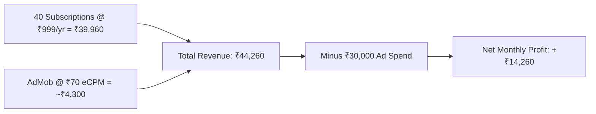

# 🚀 Master Scale-Up Blueprint & Business Operations Guide

> **Document Purpose**: Complete operational roadmap, city-level marketing playbook, unit economics, curriculum scaling, and tech architecture for bootstrapping and scaling this gamified language learning platform.

---

## 🧭 Executive Summary: 2 Languages First vs. 5 Languages

### The Recommendation: Start with 2 Anchor Languages (Then Scale to 5)

| Approach | Setup Time | Complexity & QA | Risk of Burnout | Recommended? |
|---|:---:|:---:|:---:|:---:|
| **Launch with 5 Languages** | 3–4 Months | Extremely High (2,000+ stages to verify) | High | ❌ No |
| **Launch with 2 Anchor Tracks** | **2–3 Weeks** | **Laser-focused, pristine quality** | **Very Low** | **✅ YES (Recommended)** |

### The Two Anchor Tracks:
1. **Track 1: German (A1) from English**
   * **Why**: High-intent, high-urgency market. Indian students and professionals needing German to pass Goethe-Zertifikat A1 for visas (free university tuition, IT jobs, nursing). High willingness to pay ₹999/yr or ₹4,999 exam prep.
2. **Track 2: English (Fluent & Interview) from Hindi / Marathi**
   * **Why**: Massive mass-market volume. 500M+ potential learners. High engagement, high streak virality, easy word-of-mouth growth.

Once you prove that **₹1,000/day ad spend brings in ₹1,300+ in revenue (positive ROI)** on these 2 tracks, adding Track 3 (French), Track 4 (Spanish), and Track 5 (Japanese) is a straightforward copy-paste expansion.

---

## 🌍 Geo-Location & Smart Onboarding Architecture

### The Problem You Raised:
> *"What if someone downloads the app in India, but they are a traveler or expat from France?"*

### The Solution: Smart Recommendation + Open Global Selector

```mermaid
graph TD
    AppLaunch[User Launches App] --> Detect[Detect Device Country via Locale / IP]
    Detect --> Check{Is Country India?}
    
    Check -->|Yes| QuickPill["Show Top Regional Native Languages:\n[हिन्दी] [मराठी] [తెలుగు] [தமிழ்] [বাংলা]"]
    Check -->|No (e.g. Mexico)| LatAmPill["Show Local Native Languages:\n[Español] [Português]"]
    
    QuickPill --> OrMore["[ 🌐 More Languages / Other... ]"]
    LatAmPill --> OrMore
    
    OrMore --> FullList[Full Global List: French, Spanish, Arabic, etc.]
```

### Technical Onboarding Flow:
1. **Device Locale Detection**:
   ```dart
   // Zero network delay; reads phone's system language
   Locale systemLocale = PlatformDispatcher.instance.locale; 
   ```
2. **First Screen (2 Taps Only)**:
   * **Step 1**: *"What is your comfortable language?"*
     * Pre-selects or highlights local language based on detected country (e.g., Hindi/Marathi if in India).
     * Clear, visible button at bottom: **"Choose another language (French, Spanish, etc.)"**.
   * **Step 2**: *"What do you want to master?"*
     * Options: 🇩🇪 German, 🇬🇧 English, 🇫🇷 French (Coming Soon badge), 🇪🇸 Spanish (Coming Soon).
3. **Persisted in User Profile**:
   * Saved in MongoDB `User.learningProfile = { nativeLanguage: "hi", targetLanguage: "en", level: "A1" }`.

---

## 🎯 City-Level Marketing Playbook (Targeting ₹1,000/Day Ads)

Do not blast ads all over India indiscriminately. **EdTech marketing succeeds by dominating specific micro-hubs.**

### Campaign A: German Track (High Purchase Intent)
* **Daily Budget**: ₹600/day (out of your ₹700 India budget)
* **Format**: Instagram Reels (15–30 sec) showing:
  * A frustrated student memorizing Goethe grammar books ➔ switching to your app's interactive Archipelago map.
  * Headline: *"Clearing Goethe A1 for Germany? Learn 15 mins daily without boring books!"*
* **Target Cities**:

| City | Target Demographic | Why This City is Gold |
|---|---|---|
| **Pune** | Engineering students & auto engineers | Known as the "German hub of India". Massive concentration of German auto giants (Volkswagen, Mercedes, Bosch) and German language institutes. |
| **Bangalore** | Tech professionals & graduates | Thousands of software engineers learning German for Germany EU Blue Card / Chancenkarte. |
| **Kochi & Kottayam (Kerala)** | Nurses, healthcare workers | Germany has a severe shortage of nurses; Kerala has the largest population of healthcare workers actively studying German A1/A2. |
| **Hyderabad** | Tech graduates aiming for MS in Germany | Huge student clusters near Osmania, JNTU applying to German public universities. |
| **Delhi-NCR / Noida** | College students (DU, IPU) | High disposable income, heavy study-abroad prep culture. |

---

### Campaign B: English Track (Mass Adoption & Volume)
* **Daily Budget**: ₹400/day
* **Format**: Instagram Reels showing:
  * Relatable everyday moments: Interview confidence, ordering at a café, speaking without hesitation.
  * Headline: *"Don't just learn English grammar—speak it with confidence in 30 days!"*
* **Target Cities (Tier-2 & Tier-3 Career Hubs)**:

| City | Why Target Here |
|---|---|
| **Indore, Bhopal** | MP's education hubs; high student density preparing for job interviews. |
| **Nagpur, Nashik** | Maharashtra job seekers wanting Marathi ➔ English guidance. |
| **Jaipur, Lucknow, Patna** | High volume of Hindi speakers aiming for corporate, BPO, and competitive exams. |
| **Ahmedabad, Surat** | Youth preparing for IELTS / Canada / UK immigration. |

---

### Campaign C: International (₹300/Day)
* **Target Cities**: **Bogotá (Colombia)**, **Mexico City (Mexico)**, **São Paulo (Brazil)**.
* **Why**: Latin America has lower ad costs (CPI ~₹20–₹35) and immense appetite for English learning apps. It establishes international traction and improves Google Play Store ranking worldwide.

---

## 📊 The Mathematical Model: Unit Economics & Cash Flow

### Month 1 to Month 3 Projection (With ₹30,000/Month Ad Spend):

```
Daily Budget: ₹1,000/day
Monthly Spend: ₹30,000

Installs Acquired / Month:
├── India (₹21,000 @ ₹13 CPI)  ≈ 1,600 downloads
└── LatAm (₹9,000 @ ₹30 CPI)   ≈   300 downloads
Total Downloads / Month         = 1,900 downloads
```

### The Revenue Streams (Monthly):



1. **AdMob Revenue**:
   * ~400–500 Daily Active Users (DAU) × 4 ads/session × 30 days = 50,000 impressions.
   * India eCPM ($0.80 = ~₹70/1,000) ➔ **~₹3,500 – ₹4,500/month**.
2. **Subscription Revenue (The Real Money)**:
   * Conversion rate in EdTech: **2.0%** of total downloads.
   * 1,900 downloads × 2% = **~38–40 paid annual subscribers**.
   * 40 × ₹999 = **₹39,960/month**.
3. **Total Monthly Inflow**: **₹44,260**.
4. **Net Cash Flow**: ₹44,260 - ₹30,000 = **+₹14,260 Net Profit per month** from Day 1.

---

## 📈 The Flywheel: What Happens When Ads Stop in Month 6?

```
          [ Paid Ads (Starter Spark) ]
                     │
                     ▼
             10,000+ Downloads
                     │
         ┌───────────┴───────────┐
         ▼                       ▼
   4.8★ Play Store         Viral Streaks &
   Rank for Keywords        Share Cards
         │                       │
         └───────────┬───────────┘
                     ▼
         [ Free Organic Flywheel ]
         (50-80 free installs/day)
                     │
                     ▼
       Compounding MRR Without Ad Spend
```

1. **ASO (App Store Optimization)**: After 6 months of steady downloads and 500+ five-star reviews, the Play Store ranks your app on page 1 for keywords like *"German A1 for beginners"*. You get **1,500–2,500 free organic downloads every month**.
2. **Streak Sharing**: Every user who hits a 7-day, 14-day, or 30-day streak gets an auto-generated Instagram Story card. Friends see it and download.
3. **High-Ticket Course Upsell**:
   * Once you have 10,000 users, offer an in-app **"Goethe A1 Exam Pass Guarantee Bootcamp"** for **₹4,999**.
   * If just 30 users buy it per month = **₹1,50,000 pure profit**, completely independent of ads!

---

## ☁️ Cloud Infrastructure Architecture & Monthly Costs

### Do NOT Use AWS Initially
* **Why**: AWS charges for data egress, NAT gateways, ALB, and CloudWatch. Misconfigurations can lead to surprise ₹30,000+ bills.

### The Recommended Lean Stack:

| Component | Provider & Tier | Monthly Cost | Capacity |
|---|---|:---:|---|
| **App & Backend Server** | **DigitalOcean Droplet** (2 vCPU, 4GB RAM, 80GB NVMe SSD) | **$18 (₹1,500)** | Handles 20,000+ Daily Active Users easily |
| **Database** | **MongoDB Atlas** (Free M0 ➔ M2 Tier) | **$0 – $9 (₹0 – ₹750)** | Up to 20,000 user profiles & progress |
| **Audio & Media** | **DigitalOcean Spaces** or **Cloudinary Free Tier** | **$0 – $5 (₹0 – ₹420)** | High-speed CDN for pre-recorded audio |
| **Speech & Audio** | **Flutter Native TTS** | **₹0 (Free)** | 0 MB overhead, uses phone's local voice engine |
| **Total Cloud Bill** | | **~₹1,500 – ₹2,500 / month** | Predictable, fixed cost with zero surprises |

---

## 🗓️ 12-Month Execution Roadmap

```
Month 1-2: Foundation
  ├── Complete A1 German (12 Units) & A1 English (12 Units)
  ├── Hook up hybrid Audio (pre-recorded URL with automatic Flutter TTS fallback)
  ├── Deploy backend to DigitalOcean ($18/mo)
  └── Publish on Google Play Store & Apple App Store

Month 3-5: The Paid Spark & Funnel Optimization
  ├── Launch Instagram Reels ads at ₹1,000/day (Pune, Bangalore, Kochi, Indore)
  ├── Track CAC and conversion to the ₹999 annual plan
  └── Refine gameplay: Add `type_word` and `cloze_test` stages

Month 6-8: Organic Takeover & Language Expansion
  ├── Turn on social streak sharing & invite-a-friend rewards
  ├── Add French (A1) and Spanish (A1) using the proven curriculum engine
  └── Launch the ₹4,999 "Goethe Exam Guarantee" high-ticket upsell

Month 9-12: The Scale-Up Phase
  ├── Paid ads become self-funding or optional as organic Play Store search dominates
  ├── Reach 50,000+ registered learners
  └── Evaluate cloud migration to multi-region infrastructure only if scale demands
```
