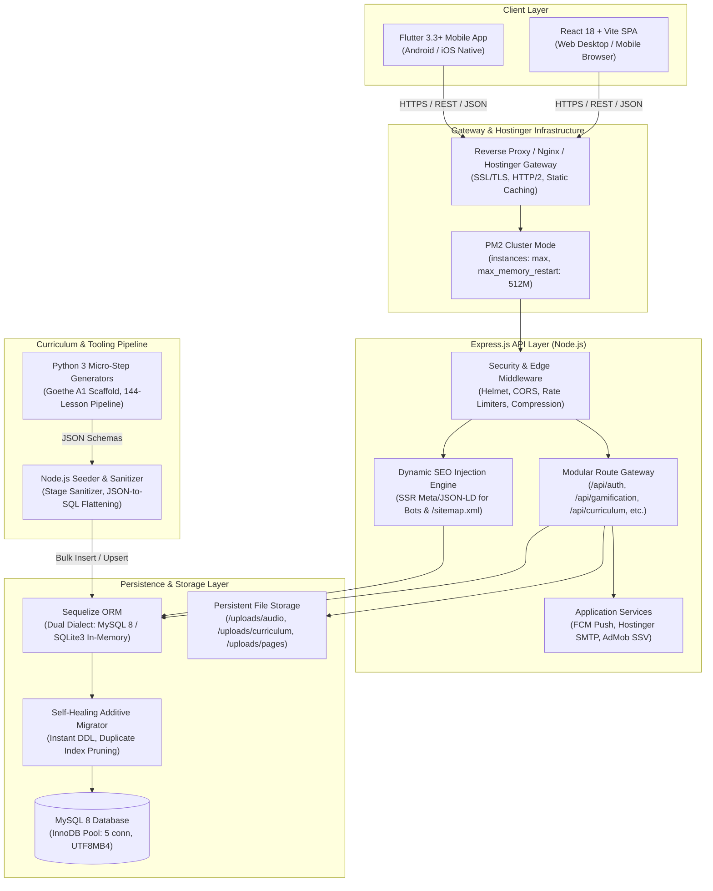
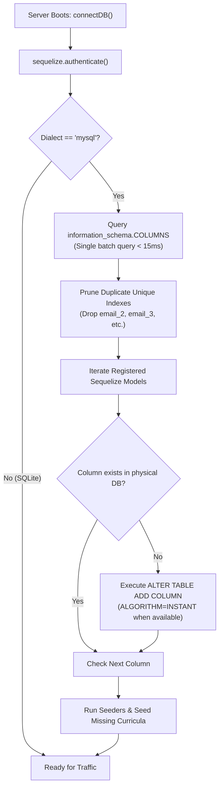
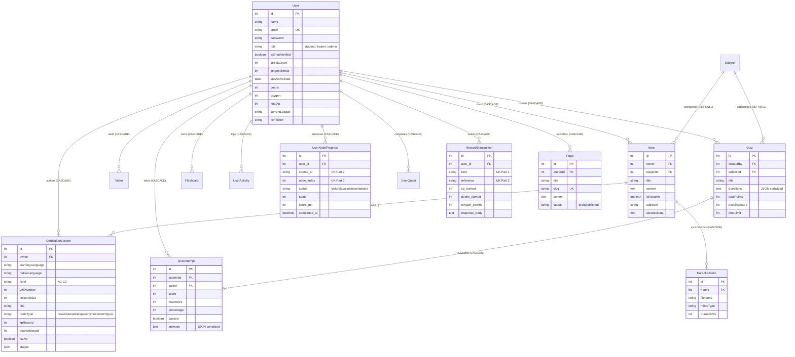
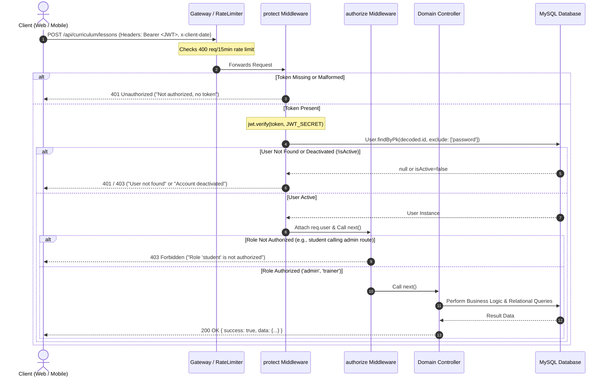
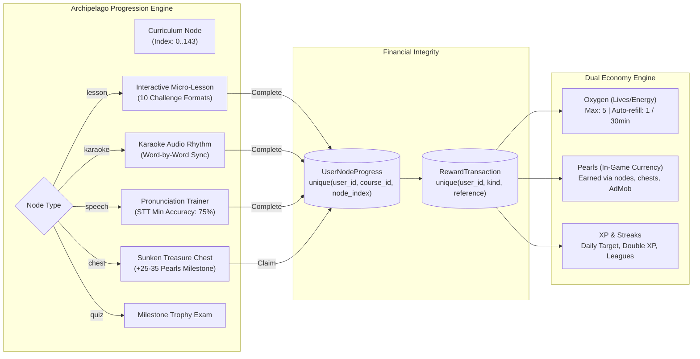
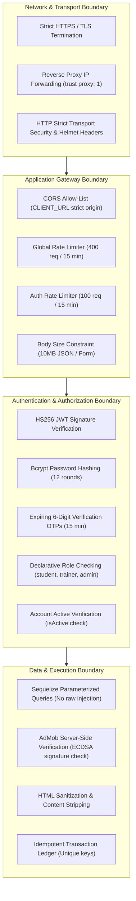
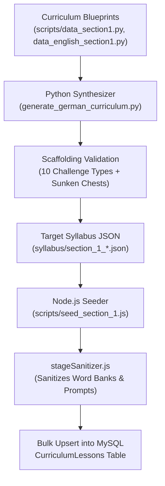

# DolphinCoder LMS — Complete System Architecture & Deep-Dive Technical Blueprint

> **Document Version:** 1.0.0  
> **Target Audience:** Principal Architects, Lead Engineers, Security Auditors, DevOps  
> **System Name:** DolphinCoder LMS (also operating as *LingoDolphy / Lingo Dolphin*)  
> **Generated:** November 2026  
> **Repository Path:** `/Users/cms/Desktop/Code/mern/lms_speedup/MERNLMS`

---

## 1. Executive Architectural Overview

DolphinCoder LMS is an enterprise-grade, multi-platform language learning management ecosystem engineered to deliver gamified, CEFR-aligned language acquisition (German, English, Marathi, Hindi) across web browsers and native mobile devices. The platform incorporates pedagogical mechanics popularized by modern gamified micro-learning platforms (scaffolded interactive challenges, spaced repetition, archipelago learning paths, dual in-game economy, leagues, and streaks) alongside traditional LMS features (rich-text notes, synchronized karaoke audio readers, docx-to-content ingestion, video masterclasses, interactive quizzes, and flashcard decks).



### Core Architectural Pillars
1. **Sub-Second Cold Start & Deferred Initialization:**
   - On the mobile front, Flutter renders the interactive frame immediately on Frame 1 (<400ms startup) while deferring auxiliary SDKs (Firebase Analytics, Crashlytics, AdMob, Text-To-Speech) via `addPostFrameCallback`.
   - On the web client, route-level code splitting (`React.lazy` and `Suspense`) isolates heavy Rich Text Editor bundles, DOCX parsers, and Admin modules from critical student learning paths.
2. **Resilient Additive-Only Database Lifecycle:**
   - Eliminates destructive `sequelize.sync({ alter: true })` runs. The backend employs an additive-only, schema-inspecting migrator that audits MySQL `information_schema.COLUMNS` at boot time (<15ms overhead), dynamically creates missing table attributes with instant DDL, and auto-prunes duplicate indexes to avoid MySQL InnoDB's 64-index ceiling.
3. **MERN-to-Relational Polyfill Bridge:**
   - To preserve client contracts and prevent legacy frontend regressions during migration from MongoDB to relational MySQL, the Sequelize runtime monkey-patches `Sequelize.Model.prototype._id` and overrides `.toJSON()` to project both `id` and `_id` on all entity instances.
4. **Idempotent Financial & Gamification Ledger:**
   - Every credit of in-game currency (XP, Pearls, Oxygen) is recorded in a transactional ledger (`RewardTransaction`) enforcing composite unique constraints on `(user_id, kind, reference)` to prevent double-spending, network replay exploits, and race conditions.
5. **Universal Client Context & Timezone-Aware Progress:**
   - Client applications transmit calendar date and IANA timezone offsets (`x-client-date`, `x-timezone-offset`, `x-client-timezone`), allowing the server to calculate streak continuity, freeze expirations, and midnight quest renewals relative to the learner's localized time.

---

## 2. Ecosystem Topology & Component Catalog

The DolphinCoder LMS codebase is structured as a coordinated polyglot workspace encompassing four specialized subsystems:

```
MERNLMS/
├── backend/                # Express.js REST API, Sequelize ORM, PM2 Config
├── frontend/               # React 18, Vite 5, TailwindCSS Web Single-Page Application
├── app/dolphincoder/       # Flutter 3.3+ Cross-Platform Mobile Application
├── syllabus/               # Generated CEFR A1 Language Curricula (JSON)
├── scripts/                # Python 3 & Node.js Curriculum Synthesizers & Seeders
├── planning/               # Historical Architecture & Product Feature Specs
└── package.json            # Monorepo Orchestration Scripts
```

### 2.1 Component Specifications

| Subsystem | Technology Stack | Entry Point | Primary Responsibility |
| :--- | :--- | :--- | :--- |
| **Web Client** | React 18.2, Vite 5, TailwindCSS 3.3, TipTap Editor, Axios | `frontend/src/App.jsx` | Browser-based portal for students, trainers, and administrators. Provides content authoring, audio upload, karaoke playback, administrative user management, and dynamic CMS pages. |
| **Mobile Client** | Flutter 3.3+, Dart 3.3+, Riverpod 2.5, Dio 5.4, GoRouter 13.2 | `app/dolphincoder/lib/main.dart` | High-performance mobile learning client. Delivers the gamified Archipelago map, speech recognition (`speech_to_text`), TTS synthesis, AdMob rewarded ads, and offline-resilient local caching. |
| **Backend API Gateway** | Node.js 18+, Express 4.18, Sequelize 6.35, PM2 Cluster | `backend/server.js` | Centralized business logic, REST API routing, JWT token lifecycle, Nodemailer SMTP gateway, Firebase Cloud Messaging dispatch, and dynamic SEO SSR pre-rendering. |
| **Relational Database** | MySQL 8.0 (Production) / SQLite3 (Testing) | `backend/config/database.js` | Persistent relational storage. Utilizes InnoDB connection pools in production and an in-memory transactional queue in Jest test environments. |
| **Syllabus Pipeline** | Python 3, Node.js CLI, Sharp, Mammoth | `scripts/build_all_seeds.py`, `scripts/seed_section_1.js` | Pedagogical data synthesis. Generates multi-pair language lessons across 12 units x 12 lessons (144 nodes) complying with Goethe-Institut CEFR standards. |

---

## 3. Global Architecture & Infrastructure Topology

### 3.1 Production Process Architecture (PM2 & Hostinger Cloud)
The production backend operates inside a Node.js runtime managed by PM2 (`backend/ecosystem.config.js`). It is tuned specifically for containerized or virtual private server environments on Hostinger Cloud:

```javascript
// backend/ecosystem.config.js
module.exports = {
  apps: [
    {
      name: 'dolphincoder-lms',
      script: 'server.js',
      instances: 'max',               // Scales across all available CPU cores
      exec_mode: 'cluster',           // Zero-downtime reload & load balancing
      env_production: {
        NODE_ENV: 'production',
        PORT: 5000,
      },
      watch: false,
      max_memory_restart: '512M',      // Guards against memory leaks
      error_file: 'logs/err.log',
      out_file: 'logs/out.log',
      log_date_format: 'YYYY-MM-DD HH:mm:ss',
    },
  ],
};
```

### 3.2 Gateway, Security Boundaries & Middleware Stack
Incoming HTTP requests enter Express through `backend/server.js` and traverse a defense-in-depth pipeline:

1. **Proxy Trust:** `app.set('trust proxy', 1)` enables correct client IP resolution behind Cloudflare/Nginx reverse proxies.
2. **Helmet Security Headers:** `helmet({ contentSecurityPolicy: false, crossOriginEmbedderPolicy: false })` secures HTTP headers while permitting cross-origin media rendering (YouTube embeds, HTML5 audio streams).
3. **CORS Isolation:** Restricts origin access strictly to `process.env.CLIENT_URL` (or `http://localhost:5173` in local development) with `credentials: true`.
4. **Compression Engine:** Gzip/Deflate compression with a `1024` byte threshold and an explicit `x-no-compression` escape valve for binary media.
5. **Tiered Rate Limiting (`express-rate-limit`):**
   - **Global API Rate Limit:** 400 requests per 15-minute window on all `/api/` endpoints.
   - **Authentication Rate Limit:** 100 requests per 15-minute window on `/api/auth/` routes to prevent credential stuffing and OTP brute-force attacks.
6. **Payload Size Guard:** JSON and URL-encoded body parsers capped at `10mb` to allow inline rich text and diagram transfers while preventing buffer exhaustion attacks.

### 3.3 Dynamic SEO Engine & Search Engine Discoverability
Unlike standard React Single Page Applications that serve blank shells to web crawlers, the DolphinCoder Express server contains a hybrid Server-Side Rendering (SSR) fallback engine (`backend/utils/seoHelper.js`):

- **Catch-All Page Interceptor (`server.js:162`):** When a request matches a single-level path (e.g., `GET /advanced-german-grammar`), the server intercepts the request prior to serving `dist/index.html`.
- **Database Metadata Query:** Express queries the `Page` table for `status = 'published'` matching the requested slug.
- **HTML Transformation:** If found, `injectSeoTags()` replaces HTML placeholder tokens with dynamic `<title>`, `<meta name="description">`, OpenGraph (`og:title`, `og:image`), Twitter Card metadata, and Schema.org `BlogPosting` JSON-LD.
- **Search Engine Discovery Protocols:**
  - `GET /sitemap.xml`: Dynamically generates XML sitemaps containing all published CMS pages, refreshed automatically.
  - `GET /robots.txt`: Provides crawling directives for Googlebot, Bingbot, and AI agents.
  - `GET /${INDEXNOW_KEY}.txt`: Automated verification route for instant search engine indexing via the IndexNow protocol.
  - `GET /app-ads.txt`: AdMob developer verification endpoint for mobile ad monetization.

### 3.4 Mobile Gateway & Version Handshake
Mobile clients communicate with an update gateway on application resume:
- Endpoint: `GET /app_version.json`
- Contract:
  ```json
  {
    "min_required_version": 29,
    "min_version_name": "1.4.3",
    "latest_version_name": "1.4.3",
    "update_url": "https://play.google.com/store/apps/details?id=com.dolphincoder.lms",
    "title": "Critical Security Update",
    "message": "Please update to v1.4.3 immediately to continue learning."
  }
  ```
- If the running mobile binary's build number (`versionCode`) is lower than `min_required_version`, Flutter's `VersionCheckService` halts execution and surfaces a non-dismissible modal `ForceUpdateDialog`.

---

## 4. Database Architecture & Data Persistence Layer

### 4.1 Dual-Dialect Storage Engine
The database connection module (`backend/config/database.js`) provisions two distinct database engines based on execution context:

1. **Production Engine (MySQL 8 via `mysql2`):**
   - Utilizes persistent pooling (`max: 5`, `min: 0`, `acquire: 30000ms`, `idle: 10000ms`).
   - Configured with utf8mb4 collation to natively support multi-language scripts (Devanagari, German umlauts) and emojis.
2. **Test Engine (SQLite3 In-Memory):**
   - Configured as `storage: ':memory:'`.
   - **SQLite Concurrency Queue:** Because SQLite does not support concurrent write transactions across threads, `database.js` overrides `sequelize.transaction()` with a serialized Promise queue (`sqliteTxQueue`) allowing Jest test suites to run safely without `SQLITE_BUSY` transaction collisions.

### 4.2 Additive-Only Self-Healing Migrator
The database uses an in-house schema migrator (`backend/utils/schemaMigrator.js`) that runs automatically inside `connectDB()`:



**Key Safety Properties:**
- **Zero Data Loss:** Strictly executes `ADD COLUMN`. It never drops tables, never drops columns, and never executes destructive type conversions.
- **Index Cap Protection:** Sequelize's legacy `alter: true` generated incremental duplicate indexes (`email_1`, `email_2`, etc.) upon each server restart. `pruneDuplicateIndexes()` identifies and removes these keys, ensuring tables never hit MySQL's hard limit of 64 indexes per table.

### 4.3 Entity-Relationship Model Catalog
The application models (`backend/models/`) encapsulate 14 core entities managed through explicit relational associations (`backend/models/associations.js`):



---

## 5. Authentication, Authorization & Session Lifecycle

### 5.1 Dual-Auth Ingestion Pipeline
Authentication supports both traditional email/password credentials and Google OAuth2 Single Sign-On (SSO):

1. **Email / Password Flow:**
   - Passwords hashed with `bcryptjs` using 12 salt rounds (configurable via `process.env.BCRYPT_ROUNDS`).
   - Upon registration, the user account is flagged with `isEmailVerified: false`.
   - The server generates a cryptographically secure 6-digit numeric OTP (`crypto.randomInt(100000, 1000000)`), stores it with a 15-minute expiration (`verificationOtpExpires`), and dispatches an HTML verification email via Nodemailer.
   - Upon verification via `POST /api/auth/verify-registration-otp`, the account is activated and a signed JWT is returned.
2. **Google OAuth2 Flow:**
   - Client sends Google ID Token to `POST /api/auth/google-login`.
   - The backend validates the token using `google-auth-library` (`OAuth2Client.verifyIdToken`).
   - If valid, the user is either created or resolved, flagged as verified (`isEmailVerified: true`), and issued a JWT.

### 5.2 Token Minting & RBAC Matrix
JSON Web Tokens are minted with `User.prototype.getSignedJwtToken()`:
- **Payload:** `{ id: user.id }`
- **Signing Algorithm:** HS256 using `process.env.JWT_SECRET`
- **Expiry:** Default `7d` (configurable via `process.env.JWT_EXPIRE`)

#### Role-Based Access Control (RBAC) Enforcement
Endpoint authorization is enforced via middleware chaining:
```javascript
// Example: Restricting curriculum creation to staff
router.post('/lessons', protect, authorize('admin', 'trainer'), createLesson);
```

| Route Group | Path Prefix | Permitted Roles | Notes |
| :--- | :--- | :--- | :--- |
| **Public Auth** | `/api/auth/login`, `/register`, `/verify-*-otp`, `/forgot-password` | Anonymous | Open to all clients; protected by `authLimiter` (100 req/15 min) |
| **Account Management** | `/api/auth/me`, `/profile`, `/password` | `student`, `trainer`, `admin` | Requires valid Bearer JWT (`protect`) |
| **Gamification & Map** | `/api/gamification/path`, `/status`, `/complete-node`, `/quests` | `student`, `trainer`, `admin` | Validates active session and user progress state |
| **Content Authoring** | `POST/PUT/DELETE /api/notes`, `/quizzes`, `/flashcards`, `/videos` | `trainer`, `admin` | Blocked for `student` role (`403 Forbidden`) |
| **Curriculum Mgmt** | `/api/curriculum/lessons`, `/units`, `/bulk-upload` | `trainer`, `admin` | Students can only access `GET /lessons` with `isLive=true` |
| **Platform Admin** | `/api/admin/*`, `/api/pages/*` (CRUD), `/api/notifications/broadcast` | `admin` strictly | Administrative overrides, trainer creation, CMS, force-update gateway |

### 5.3 Request & Authentication Lifecycle Sequence



---

## 6. Client-Server Communication & API Protocol Contract

### 6.1 Standardized API Contract
All API endpoints adhere to a predictable JSON envelope:

#### Successful Response:
```json
{
  "success": true,
  "data": { ... },
  "message": "Operation completed successfully"
}
```

#### Paginated / List Response:
```json
{
  "success": true,
  "count": 42,
  "lessons": [ ... ]
}
```

#### Error Response:
```json
{
  "success": false,
  "message": "Resource not found",
  "requireVerification": false
}
```

### 6.2 Web Client API Layer (`frontend/src/api/axios.js`)
The React application communicates via a centralized Axios instance:
- **Base URL:** Dynamic fallback `import.meta.env.VITE_API_BASE_URL || '/api'`.
- **Request Interceptor:**
  - Injects `Authorization: Bearer ${token}` from `localStorage`.
  - Injects temporal context: `x-client-date` (YYYY-MM-DD), `x-timezone-offset`, and `x-client-timezone`.
- **Response Interceptor:**
  - Intercepts `401 Unauthorized` responses, flushes stale session tokens (`localStorage.removeItem('token')`), and forces client redirection to `/login`.

### 6.3 Mobile Client API Layer (`DioClient` & Telemetry)
The Flutter application uses a customized `Dio` client (`app/dolphincoder/lib/core/network/dio_client.dart`):
- **O(1) In-Memory Token Injection:** To prevent asynchronous disk I/O on every single network request, `DioClient` maintains an in-memory `_cachedToken` variable that synchronizes with `FlutterSecureStorage`.
- **Network Latency Telemetry (`NetworkLatencyInterceptor`):**
  - Measures high-precision round-trip elapsed network time on all requests.
  - Maintains a circular buffer of the last 200 request metrics in `NetworkLatencyTracker`.
  - Calculates real-time moving averages (`averageLatencyMs`) for diagnostic reporting.
- **Payload Dump Suppression:** In non-release mode, `PrettyDioLogger` suppresses voluminous payload dumps on heavy endpoints (such as `/gamification/path`) to avoid Android USB ADB logcat buffer overflows and thread freezing.

---

## 7. Gamification & Curriculum Subsystem Architecture

The platform's flagship pedagogical engine is the **Island Archipelago Path** (`/gamification/*` and `/curriculum/*`):



### 7.1 Course Key Topology
Courses are addressed via a strict naming convention:
`{targetLanguage}_{nativeLanguage}_{level}`
- `de_en_a1`: German for English speakers (CEFR A1)
- `en_hi_a1`: English for Hindi speakers (CEFR A1)
- `en_mr_a1`: English for Marathi speakers (CEFR A1)

### 7.2 The 10 Modular Interactive Challenge Formats
Each curriculum lesson node contains an array of scaffolded challenges (`stages`) validated and sanitized by `backend/utils/stageSanitizer.js`:

1. `picture_select`: Visual vocabulary identification from image grids.
2. `word_match`: Multi-pair associative vocabulary matching.
3. `sentence_builder`: Grammatical word-bank ordering with distractors.
4. `cloze_test`: Contextual fill-in-the-blank comprehension.
5. `listen_tap`: Audio echo bank assembly.
6. `listen_select`: Acoustic comprehension multiple choice.
7. `type_word`: Orthographic spelling test with first-letter progressive hints.
8. `dialogue_bubble`: Multi-character conversational simulation.
9. `sprechen`: Speech-to-text oral pronunciation grading with threshold verification.
10. `karaoke`: Real-time rhythmic audio reading synchronization.

### 7.3 Oxygen & Pearl Economy Specification
- **Oxygen Decay & Recovery:**
  - Maximum capacity: 5 Oxygen units.
  - An incorrect answer deducts 1 Oxygen unit (`POST /api/gamification/deduct-oxygen`).
  - If Oxygen drops below 5, the backend automatically calculates passive recovery upon any status request: 1 Oxygen unit is refilled for every 30 elapsed minutes (`lastOxygenRefill`).
  - Immediate refill can be purchased in the Shop using Pearls (`POST /api/gamification/shop/refill-oxygen`).
- **Idempotency Guarantee:**
  - When completing a node (`POST /api/gamification/complete-node`), the server queries `RewardTransaction` for `kind = 'node_completion'` and `reference = 'node_<courseId>_<nodeIndex>'`.
  - If a transaction record already exists, rewards are suppressed, guaranteeing that network retries or malicious replay scripts cannot farm XP or Pearls.

---

## 8. Security Architecture & Boundary Enforcement

The DolphinCoder LMS incorporates multi-layered controls across network, transport, application, and database tiers:



1. **AdMob Server-Side Verification (SSV):**
   - Rewarded video ad completions (`/api/gamification/claim-ad-reward` and `/api/gamification/admob/ssv`) are validated using cryptographic signatures against Google's public key servers (`backend/utils/adMobVerifier.js`) to prevent reward spoofing.
2. **Password & OTP Hardening:**
   - User passwords are automatically hashed via Sequelize lifecycle hooks (`beforeCreate`, `beforeUpdate`).
   - OTP codes are generated via `crypto.randomInt` rather than pseudorandom `Math.random()`, preventing predictability.
3. **Database Injection Defense:**
   - All database interaction occurs through Sequelize object relational mapping utilizing parameterized SQL binding. Raw queries within seeders and migrators are restricted to internal DDL statements with sanitized table names.

---

## 9. Error Handling, Telemetry & Resilience Strategies

### 9.1 Unified Backend Error Boundary (`errorHandler.js`)
All route handlers delegate exceptions to Express's centralized error handler (`backend/middleware/errorHandler.js`). The handler inspects exception prototypes and maps them into deterministic HTTP status codes:

```javascript
// Error Mapping Logic in errorHandler.js
- SequelizeUniqueConstraintError   => 400 Bad Request ("<Field> already exists")
- SequelizeValidationError          => 400 Bad Request (Aggregated validation messages)
- JsonWebTokenError                 => 401 Unauthorized ("Invalid token")
- TokenExpiredError                 => 401 Unauthorized ("Token expired")
- CastError / NotFoundError         => 404 Not Found ("Resource not found")
- Default Internal Errors           => 500 Internal Server Error (Stack traces hidden in prod)
```

### 9.2 Mobile Fault Recovery & Lifecycle Handshake
1. **Network Disconnect Normalization:**
   - In Flutter, `DioClient.handleError()` translates raw socket exceptions, connection timeouts, and DNS errors into user-friendly `ApiException` models (`"Connection timed out"`, `"Check your network"`).
   - If a `403 Forbidden` response indicates unverified status (`requireVerification: true`), the mobile application navigates immediately to the `VerifyEmailScreen`.
2. **App Lifecycle Reconnection:**
   - When the mobile application transitions from background to foreground (`AppLifecycleState.resumed`), `DolphinCoderApp` triggers:
     - Version verification handshake with the backend.
     - Silent synchronization of the latest curriculum path (`pathNodesProvider.notifier.loadPath(silent: true)`), ensuring cached local progress reflects any updates made on the web.

---

## 10. Syllabus & Tooling Pipeline

The `syllabus/` and `scripts/` directories contain an automated curriculum build pipeline for compiling CEFR-compliant language trees:



- **Pedagogical Structure:** Section 1 is divided into 12 Units of 12 Lessons each (totaling 144 Lessons per course).
- **Milestone Cadence:** Lessons 1–5 and 7–10 contain interactive micro-lessons; Lessons 6 and 11 feature Sunken Treasure Chest rewards; Lesson 12 serves as the Unit Trophy Exam.

---

## 11. Architectural Evaluation & Technical Evolution

### Architectural Strengths
- **Sub-Second First Paint:** Decoupled initialization on both mobile and web clients enables fast cold starts.
- **Resilient Zero-Downtime Database Architecture:** Additive-only schema sync avoids blocking locks, index exhaustion, and data loss.
- **SEO Accessibility on an SPA:** Dynamic tag injection enables search engine discovery without requiring a complete Next.js rewrite.
- **Idempotent Rewards:** Strict composite unique constraints on reward ledgers prevent duplicate reward distribution.

### Technical Debt & Evolution Roadmap
1. **Monolithic Controller Decomposition:**
   - `gamificationController.js` (>1,300 lines) and `curriculumController.js` (>950 lines) encapsulate extensive business logic directly within controller functions. Refactoring into dedicated domain services (`GamificationService`, `CurriculumService`) will improve unit test isolation.
2. **Distributed Caching (Redis):**
   - Dynamic path queries (`/gamification/path`) assemble large node trees directly from MySQL. Introducing a Redis cache layer for published, immutable curriculum nodes will decrease database CPU utilization as active learner volume increases.
3. **Database Migration Standard:**
   - The self-healing additive migrator is resilient for column additions; however, introducing formal versioned migrations (e.g., Sequelize CLI or Umzug) will provide audited rollback management for complex future schema transformations.
