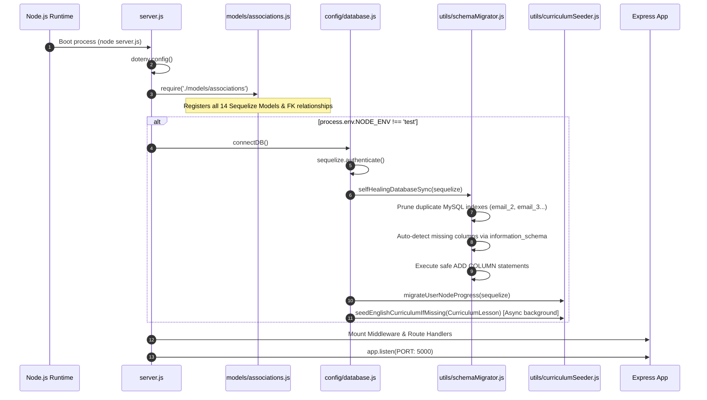

# DolphinCoder LMS: Backend Architecture & API Specification

> **Version:** 1.4.3 / 1.4.4  
> **Environment:** Node.js (v18+), Express 4.18, MySQL 8.0 (Hostinger Production) / SQLite (In-Memory Tests)  
> **ORM:** Sequelize 6.35.0  
> **Primary Service Responsibilities:** Auth & RBAC, Curriculum Engine, Gamification & In-Game Economy, Spaced Learning, Media & Audio Streaming, Push Notifications, SEO & CMS  

---

## 1. Executive Architectural Overview & High-Level Design

The **DolphinCoder LMS Backend** is an enterprise-grade, high-throughput RESTful API designed to power web, progressive web applications (PWA), and native mobile applications (Android/iOS). It balances educational content delivery (notes, quizzes, flashcards, videos) with a Duolingo-style gamified learning engine (named **LingoDolphy**), complete with synchronized audio karaoke lyrics, voice speech evaluation, daily quests, streak tracking, leagues, and in-app economies (Pearls and Oxygen bubbles).

```
                      +---------------------------------------+
                      |       Clients (Web / Android App)      |
                      +-------------------+-------------------+
                                          | HTTPS / REST
                                          v
                      +---------------------------------------+
                      |   Reverse Proxy (Hostinger / Nginx)   |
                      +-------------------+-------------------+
                                          |
                                          v
                      +---------------------------------------+
                      |         Express 4.18 Application      |
                      |  - Helmet & Security Headers          |
                      |  - CORS (Origin Whitelist)            |
                      |  - Gzip Compression (Threshold: 1KB)  |
                      |  - Dual Rate Limiters (API & Auth)    |
                      |  - JWT Authentication & RBAC Guard    |
                      +-------------------+-------------------+
                                          |
         +--------------------------------+--------------------------------+
         |                                |                                |
         v                                v                                v
+------------------+            +------------------+            +--------------------+
|  Core LMS APIS   |            |  LingoDolphy     |            |  External Services |
|  - Notes         |            |  - Curriculum    |            |  - Hostinger SMTP  |
|  - Quizzes       |            |  - Gamification  |            |  - Firebase (FCM)  |
|  - Flashcards    |            |  - Economy       |            |  - AdMob SSV       |
|  - Videos        |            |  - Quests        |            |  - IndexNow / Bing |
|  - Subjects/CMS  |            |  - Leaderboards  |            |  - Google OAuth    |
+--------+---------+            +--------+---------+            +---------+----------+
         |                               |                                |
         +-------------------------------+--------------------------------+
                                          |
                                          v
                      +---------------------------------------+
                      |         Sequelize 6.35 ORM Layer      |
                      |  - Self-Healing Additive Migrations   |
                      |  - Index Pruner (64-Key Limit Guard)  |
                      |  - Model Shims (_id & toJSON)         |
                      +-------------------+-------------------+
                                          |
                                          v
                      +---------------------------------------+
                      |         MySQL 8.0 Database            |
                      |   (Tables, LONGBLOBs, Transactions)   |
                      +---------------------------------------+
```

### Key Architectural Tenets
1. **Additive-Only Self-Healing Migrations:** Replaces destructive `sequelize.sync({ alter: true })` with an idempotent schema migrator (`schemaMigrator.js`) that detects missing columns and creates them without ever dropping tables or risking MySQL's 64-index per-table limit.
2. **Server-Authoritative Economy & Anti-Tampering:** Streaks, daily quests, XP rewards, and Pearl/Oxygen transactions execute within strict database transaction locks (`LOCK.UPDATE`). Client-supplied clocks are validated against UTC server bounds to eliminate device time manipulation.
3. **High-Efficiency Media Streaming:** Audio tracks for Karaoke stories are persisted in MySQL `LONGBLOB` columns and served via HTTP 206 Partial Content byte ranges using SQL `SUBSTR()` slicing, avoiding loading massive binaries into process RAM.
4. **Slipstream Query Acceleration:** Map navigation endpoints project only essential metadata, stripping heavy JSON challenge structures (`stages` and `karaokeData`) until the student explicitly opens a lesson.

---

## 2. Server Lifecycle, Middleware Pipeline & Boot Sequence

The server entry point is [`backend/server.js`](file:///Users/cms/Desktop/Code/mern/lms_speedup/MERNLMS/backend/server.js).

### Application Boot Sequence



### Middleware Pipeline Order
1. **`app.set('trust proxy', 1)`:** Configured for reverse proxies (Hostinger Nginx/Cloudflare) to resolve accurate client IPs for rate-limiting and audit logging.
2. **`helmet({ contentSecurityPolicy: false, crossOriginEmbedderPolicy: false })`:** Secures standard HTTP headers (X-Frame-Options, X-Content-Type-Options, Strict-Transport-Security, etc.) while permitting cross-origin media embeds.
3. **`cors({ origin: process.env.CLIENT_URL || 'http://localhost:5173', credentials: true })`:** Permits cross-origin resource sharing from the configured web front-end.
4. **`compression({ threshold: 1024, filter })`:** Gzip compresses HTTP responses larger than 1 KB; supports client bypass via `x-no-compression: true`.
5. **Rate Limiters (`express-rate-limit`):**
   - **General API Limiter:** Mounted on `/api/`, max 400 requests per 15-minute sliding window per IP.
   - **Authentication Limiter:** Mounted on `/api/auth/`, max 100 requests per 15-minute sliding window per IP.
6. **Body Parsers:** `express.json({ limit: '10mb' })` and `express.urlencoded({ extended: true })` handle large JSON payloads (curriculum bulk uploads, rich text documents).
7. **Request Logger:** `morgan('dev')` mounted conditionally when `NODE_ENV === 'development'`.
8. **Static Files & Upload Gateways:**
   - Physical directories ensured on boot: `uploads/audio`, `uploads/pages`, `uploads/curriculum`.
   - Mounted as `/uploads` via `express.static()`.
   - Production bundle serving: In production, routes static assets from `dist/` and provides dynamic SEO meta-tag injection inside single-page application requests (`GET *`).

---

## 3. Database Architecture & Sequelize ORM

The persistence architecture is managed via **Sequelize 6.35**.

### Dual-Dialect Design & Model Compatibility Shims
Defined in [`backend/config/database.js`](file:///Users/cms/Desktop/Code/mern/lms_speedup/MERNLMS/backend/config/database.js):
- **Production / Development:** Dialect `mysql` with connection pooling (`max: 5, min: 0, acquire: 30000, idle: 10000`).
- **Test Mode (`NODE_ENV === 'test'`):** In-memory SQLite (`storage: ':memory:'`). SQLite is single-threaded for transactions, so `database.js` wraps `sequelize.transaction` with an asynchronous Promise queue (`sqliteTxQueue`) to guarantee concurrent test cases execute without database lock conflicts.
- **MERN-to-SQL Shims:** To maintain compatibility with MongoDB-style code during the migration to MySQL, the prototype of `Sequelize.Model` is extended:
  - `_id` getter returns `this.id`.
  - `toJSON()` injects `values._id = this.id` when serializing models.

### Self-Healing Additive Migration Engine (`schemaMigrator.js`)
Hostinger Cloud and shared MySQL instances often trigger `ER_TOO_MANY_KEYS` (64 indexes per table limit) when standard Sequelize `sync({ alter: true })` is run repeatedly.
[`backend/utils/schemaMigrator.js`](file:///Users/cms/Desktop/Code/mern/lms_speedup/MERNLMS/backend/utils/schemaMigrator.js) solves this via:
1. **Duplicate Index Pruner (`pruneDuplicateIndexes`):** Queries `SHOW INDEX FROM table` and drops accumulated duplicate keys matching pattern `/^[a-zA-Z0-9_]+_\d+$/` (e.g. `email_2`, `email_3`).
2. **Batch Information Schema Inspection:** Queries `information_schema.COLUMNS` in a single query (<15ms) across all tables to identify schema deltas.
3. **Additive DDL Execution:** Executes `queryInterface.addColumn()` for missing columns. Never issues `DROP TABLE` or `DROP COLUMN`.
4. **Column Migrations & Backfills:** Automatically adds `is_email_verified`, `verification_otp`, `verification_otp_expires`, `fcm_token`, and auto-verifies existing legacy users (`is_email_verified = 1`).

---

### Entity-Relationship (ER) Diagram

```mermaid
erDiagram
    User ||--o{ Note : "creates (owner)"
    User ||--o{ Video : "adds (addedBy)"
    User ||--o{ Quiz : "creates (createdBy)"
    User ||--o{ Flashcard : "creates (owner)"
    User ||--o{ QuizAttempt : "takes (studentId)"
    User ||--o{ UserActivity : "logs (userId)"
    User ||--o{ UserNodeProgress : "advances (userId)"
    User ||--o{ UserQuest : "progresses (userId)"
    User ||--o{ RewardTransaction : "earns (userId)"
    User ||--o{ CurriculumLesson : "authors (owner)"
    User ||--o{ Page : "authors (authorId)"
    User ||--o{ FlashcardProgress : "studies (student)"

    Subject ||--o{ Note : "categorizes (subjectId)"
    Subject ||--o{ Quiz : "categorizes (subjectId)"

    Note ||--o{ KaraokeAudio : "has audio (noteId)"
    Note ||--o{ CurriculumLesson : "sources (sourceNoteId)"

    Quiz ||--o{ QuizAttempt : "attempted via (quizId)"

    Flashcard ||--o{ FlashcardProgress : "tracks (flashcard)"

    User {
        int id PK
        string name "VARCHAR(100)"
        string email "VARCHAR(255) UK"
        string password "VARCHAR(255)"
        string googleId "VARCHAR(255) UK"
        string role "ENUM(student, trainer, admin)"
        boolean isEmailVerified "TINYINT(1)"
        string verificationOtp "VARCHAR(6)"
        datetime verificationOtpExpires "DATETIME"
        string resetPasswordOtp "VARCHAR(6)"
        datetime resetPasswordOtpExpires "DATETIME"
        string avatar "VARCHAR(500)"
        text bio "TEXT"
        boolean isActive "TINYINT(1)"
        datetime lastLogin "DATETIME"
        int streakCount "INT"
        int longestStreak "INT"
        date lastActiveDate "DATEONLY"
        int dailyTargetXp "INT"
        string targetLanguage "VARCHAR(10)"
        string nativeLanguage "VARCHAR(10)"
        string currentLevel "VARCHAR(10)"
        int pearls "INT"
        int oxygen "INT"
        datetime lastOxygenRefill "DATETIME"
        int streakFreezeCount "INT"
        datetime doubleXpExpiresAt "DATETIME"
        int totalXp "INT"
        string currentLeague "VARCHAR(50)"
        string fcmToken "VARCHAR(500)"
    }

    Note {
        int id PK
        int owner FK
        int subjectId FK
        string topic "VARCHAR(200)"
        string title "VARCHAR(200)"
        longtext content "LONGTEXT"
        text tags "TEXT (JSON)"
        boolean isPinned "TINYINT(1)"
        string color "ENUM"
        string contentType "ENUM(richtext, docx, html)"
        boolean isKaraoke "TINYINT(1)"
        string audioUrl "VARCHAR(500)"
        longtext karaokeData "LONGTEXT (JSON)"
    }

    KaraokeAudio {
        int id PK
        int noteId FK
        string filename "VARCHAR(255)"
        string mimeType "VARCHAR(100)"
        longblob audioData "LONGBLOB"
        int fileSize "INT"
    }

    Video {
        int id PK
        int addedBy FK
        string title "VARCHAR(200)"
        text description "TEXT"
        string youtubeUrl "VARCHAR(500)"
        string youtubeVideoId "VARCHAR(50)"
        string thumbnailUrl "VARCHAR(500)"
        text tags "TEXT (JSON)"
        boolean isPublic "TINYINT(1)"
        int viewCount "INT"
    }

    Quiz {
        int id PK
        int createdBy FK
        int subjectId FK
        string topic "VARCHAR(200)"
        string title "VARCHAR(200)"
        text description "TEXT"
        longtext questions "LONGTEXT (JSON)"
        text tags "TEXT (JSON)"
        int totalPoints "INT"
        int passingScore "INT"
        int timeLimit "INT"
        boolean shuffleQuestions "TINYINT(1)"
        boolean isPublished "TINYINT(1)"
        int attemptLimit "INT"
    }

    QuizAttempt {
        int id PK
        int quizId FK
        int studentId FK
        longtext answers "LONGTEXT (JSON)"
        int score "INT"
        int maxScore "INT"
        float percentage "FLOAT"
        boolean passed "TINYINT(1)"
        int attemptNumber "INT"
        datetime startedAt "DATETIME"
        datetime submittedAt "DATETIME"
        int timeTakenSecs "INT"
    }

    Flashcard {
        int id PK
        int owner FK
        string deckName "VARCHAR(100)"
        text description "TEXT"
        longtext cards "LONGTEXT (JSON)"
        string color "ENUM"
        boolean isPublic "TINYINT(1)"
        text tags "TEXT (JSON)"
        int cardCount "INT"
    }

    FlashcardProgress {
        int id PK
        int student FK
        int flashcard FK
        longtext cardResults "LONGTEXT (JSON)"
        int sessionCount "INT"
        int masteredCount "INT"
        datetime lastStudiedAt "DATETIME"
    }

    Subject {
        int id PK
        string name "VARCHAR(200) UK"
        text topics "TEXT (JSON)"
    }

    UserActivity {
        int id PK
        int userId FK
        string activityType "ENUM(quiz, note, flashcard, lesson)"
        int resourceId "INT"
        string resourceTitle "VARCHAR(255)"
        string subjectName "VARCHAR(100)"
        string topicName "VARCHAR(100)"
        longtext metadata "LONGTEXT (JSON)"
        date activityDate "DATEONLY"
    }

    CurriculumLesson {
        int id PK
        int owner FK
        string learningLanguage "VARCHAR(10)"
        string nativeLanguage "VARCHAR(10)"
        string level "ENUM(A1,A2,B1,B2,C1,C2)"
        int unitNumber "INT"
        string unitTitle "VARCHAR(200)"
        string unitDescription "VARCHAR(300)"
        int lessonIndex "INT"
        string title "VARCHAR(200)"
        string subtitle "VARCHAR(300)"
        string nodeType "ENUM(lesson,karaoke,speech,chest,match,quiz)"
        int xpReward "INT"
        int pearlsReward "INT"
        boolean isLive "TINYINT(1)"
        longtext stages "LONGTEXT (JSON)"
        longtext karaokeData "LONGTEXT (JSON)"
        string audioUrl "VARCHAR(500)"
        int sourceNoteId FK
    }

    UserNodeProgress {
        int id PK
        int userId FK
        string courseId "VARCHAR(32)"
        int nodeIndex "INT"
        string status "ENUM(locked, available, completed)"
        int stars "INT"
        int scorePct "INT"
        datetime completedAt "DATETIME"
    }

    UserQuest {
        int id PK
        int userId FK
        string questTitle "VARCHAR(120)"
        string questType "VARCHAR(50)"
        int targetAmount "INT"
        int currentAmount "INT"
        int rewardPearls "INT"
        int rewardXp "INT"
        boolean isClaimed "TINYINT(1)"
        date questDate "DATEONLY"
    }

    RewardTransaction {
        int id PK
        int userId FK
        string kind "VARCHAR(32)"
        string reference "VARCHAR(128)"
        int xpEarned "INT"
        int pearlsEarned "INT"
        int oxygenEarned "INT"
        text responseBody "TEXT (JSON)"
    }

    Page {
        int id PK
        int authorId FK
        string title "VARCHAR(255)"
        string slug "VARCHAR(255) UK"
        longtext content "LONGTEXT"
        text summary "TEXT"
        string featuredImage "VARCHAR(500)"
        string status "ENUM(draft, published)"
        datetime publishedAt "DATETIME"
    }
```



---

### Detailed Model Specifications

#### 1. `User` ([`models/User.js`](file:///Users/cms/Desktop/Code/mern/lms_speedup/MERNLMS/backend/models/User.js))
- **Table:** `users`
- **Hooks:**
  - `beforeCreate` & `beforeUpdate`: Hashes raw password using `bcrypt.hash(password, process.env.BCRYPT_ROUNDS || 12)`.
- **Instance Methods:**
  - `matchPassword(enteredPassword)`: Compares candidate plaintext with bcrypt hash.
  - `getSignedJwtToken()`: Signs JWT containing `{ id: this.id }` with expiration `process.env.JWT_EXPIRE || '7d'`.
- **Special Fields:**
  - `pearls` (Default: 10 in DB migration / 100 in app memory initializers).
  - `oxygen` (Max 5, auto-restores 1 unit every 30 minutes).
  - `streakFreezeCount` (Counter for consumable streak savers).
  - `doubleXpExpiresAt` (Timestamp for 30-minute double XP boost).
  - `fcmToken` (500-char string for Android/iOS push notifications).

#### 2. `CurriculumLesson` ([`models/CurriculumLesson.js`](file:///Users/cms/Desktop/Code/mern/lms_speedup/MERNLMS/backend/models/CurriculumLesson.js))
- **Table:** `CurriculumLessons`
- **Key Indexing Strategy:**
  - Compound Index: `['learningLanguage', 'nativeLanguage', 'level', 'isLive', 'unitNumber']`
  - Unit Sorting Index: `['isLive', 'learningLanguage', 'nativeLanguage', 'level', 'unitNumber', 'lessonIndex']`
- **Draft Status Guarantee:** Field `isLive` defaults to `false`. Newly created or bulk-uploaded lessons remain private to trainers/admins until explicitly toggled live.
- **Stage Payload:** `stages` is stored as `LONGTEXT` with automated JSON parsing getters/setters. Validated by `stageSanitizer.js` to ensure challenge structures are sound before persisting.

#### 3. `UserNodeProgress` ([`models/UserNodeProgress.js`](file:///Users/cms/Desktop/Code/mern/lms_speedup/MERNLMS/backend/models/UserNodeProgress.js))
- **Table:** `user_node_progress`
- **Unique Constraint:** `unique_user_course_node` on `(user_id, course_id, node_index)`. Ensures distinct progress records per student per course track (e.g. `de_en_a1`, `en_hi_a1`, `en_mr_a1`).
- **Status State Machine:** `locked` -> `available` -> `completed`.

#### 4. `RewardTransaction` ([`models/RewardTransaction.js`](file:///Users/cms/Desktop/Code/mern/lms_speedup/MERNLMS/backend/models/RewardTransaction.js))
- **Table:** `reward_transactions`
- **Unique Constraint:** `unique_user_reward_reference` on `(user_id, kind, reference)`.
- **Idempotency Engine:** Prevents duplicate awards on repeated network requests. If an `attemptId` is submitted multiple times, the original cached `responseBody` is replayed with `idempotentReplay: true`.

#### 5. `KaraokeAudio` ([`models/KaraokeAudio.js`](file:///Users/cms/Desktop/Code/mern/lms_speedup/MERNLMS/backend/models/KaraokeAudio.js))
- **Table:** `karaoke_audios`
- **Storage:** Stores raw audio MP3/WAV binaries in `audioData LONGBLOB`.
- **Streaming Advantage:** Prevents filesystem loss across stateless container redeployments and supports SQL range byte-slicing.

---

## 4. Security, Authentication & Role-Based Access Control (RBAC)

### JWT Authentication Flow
Authentication middleware is defined in [`backend/middleware/auth.js`](file:///Users/cms/Desktop/Code/mern/lms_speedup/MERNLMS/backend/middleware/auth.js).

```
1. Client sends header: Authorization: Bearer <jwt_token>
2. protect middleware extracts token:
   - Verifies JWT against process.env.JWT_SECRET.
   - Decodes payload { id }.
   - Queries database: User.findByPk(decoded.id, { attributes: { exclude: ['password'] } }).
   - Validates user existence (401 if missing).
   - Validates user active status (403 if user.isActive === false).
   - Attaches loaded instance to req.user.
3. optionalProtect middleware:
   - Decodes and attaches req.user if present; silently continues as unauthenticated guest if absent or expired.
4. authorize(...roles) middleware:
   - Validates req.user.role against permitted roles.
   - Rejects unauthorized access with 403 Forbidden.
```

### Password Security & SMTP OTP Verification
Defined in [`backend/controllers/authController.js`](file:///Users/cms/Desktop/Code/mern/lms_speedup/MERNLMS/backend/controllers/authController.js) and [`backend/services/emailService.js`](file:///Users/cms/Desktop/Code/mern/lms_speedup/MERNLMS/backend/services/emailService.js):
- **Bcrypt Hashing:** 12 rounds (`BCRYPT_ROUNDS=12`) applied via Sequelize model lifecycle hooks.
- **Email Verification Gate:** On registration (`POST /api/auth/register`), a crypto-secure 6-digit OTP (`crypto.randomInt(100000, 1000000)`) is dispatched to the user's email via Hostinger SMTP (`smtp.hostinger.com:465`). The account is flagged `isEmailVerified: false`.
- **Login Block:** `POST /api/auth/login` checks `user.isEmailVerified`. If unverified, login is denied (HTTP 403), a fresh 6-digit OTP is automatically re-dispatched, and the client receives `{ requireVerification: true }`.
- **Password Reset:** `POST /api/auth/forgot-password` generates a 6-digit OTP valid for 15 minutes (`resetPasswordOtpExpires = Date.now() + 15 * 60 * 1000`). Verified via `POST /api/auth/verify-otp`, then applied via `POST /api/auth/reset-password`.

### Google OAuth Verification
`POST /api/auth/google-login` integrates `google-auth-library` with multi-client audience verification:
- Supports standard `idToken`, credential JWTs, and mobile `accessToken`.
- Validates token against all configured Client IDs:
  - `954842353363-3es8j5j88oinub65ln43563atq6166r5.apps.googleusercontent.com`
  - `954842353363-d1rduacuqb0easj85t8ejhf22ih0erre.apps.googleusercontent.com`
  - `954842353363-arjj1qqm2csgpri2fvn3uv7223fgdaa3.apps.googleusercontent.com`
  - `954842353363-sbrtsu5c3n62bm82g9sptv0maf0jvpbg.apps.googleusercontent.com`
- Auto-links Google accounts by `googleId` or matching verified email, setting `isEmailVerified = true` automatically.

---

## 5. Complete API Route & Endpoint Directory

### A. Authentication & User Profile (`/api/auth`)
*Rate limit: 100 req / 15 min*

| Method | Endpoint | Auth | Role | Description | Parameters / Payload | Success Response |
| :--- | :--- | :--- | :--- | :--- | :--- | :--- |
| `POST` | `/api/auth/register` | None | Public | Register new user & send verification OTP | `{ name, email, password }` | `{ success: true, requireVerification: true, email }` (201) |
| `POST` | `/api/auth/verify-registration-otp` | None | Public | Verify registration OTP & issue JWT | `{ email, otp }` | `{ success: true, token, user }` (200) |
| `POST` | `/api/auth/resend-registration-otp` | None | Public | Resend 6-digit registration OTP | `{ email }` | `{ success: true, message }` (200) |
| `POST` | `/api/auth/login` | None | Public | Authenticate with email and password | `{ email, password }` | `{ success: true, token, user }` (200) |
| `POST` | `/api/auth/google-login` | None | Public | Google OAuth login via ID token or access token | `{ idToken, accessToken }` | `{ success: true, token, user }` (200) |
| `POST` | `/api/auth/forgot-password` | None | Public | Request password reset 6-digit OTP | `{ email }` | `{ success: true, message }` (200) |
| `POST` | `/api/auth/verify-otp` | None | Public | Verify password reset OTP code | `{ email, otp }` | `{ success: true, message }` (200) |
| `POST` | `/api/auth/reset-password` | None | Public | Reset password with verified OTP | `{ email, otp, password }` | `{ success: true, message }` (200) |
| `GET` | `/api/auth/me` | Bearer | Any | Get currently authenticated user profile | None | `{ success: true, user }` (200) |
| `PUT` | `/api/auth/profile` | Bearer | Any | Update profile details and language preferences | `{ name, bio, avatar, targetLanguage, nativeLanguage, currentLevel }` | `{ success: true, user }` (200) |
| `PUT` | `/api/auth/password` | Bearer | Any | Change password while authenticated | `{ currentPassword, newPassword }` | `{ success: true, token }` (200) |

---

### B. Notes & Karaoke Audio (`/api/notes`)

| Method | Endpoint | Auth | Role | Description | Parameters / Payload | Success Response |
| :--- | :--- | :--- | :--- | :--- | :--- | :--- |
| `GET` | `/api/notes` | Bearer | Any | List notes (students see all; trainers see own) | Query: `q, tag, subject, topic, color, page, limit` | `{ success: true, notes, tags, pagination }` |
| `GET` | `/api/notes/:id` | Bearer | Any | Get note details by ID | Path: `id` | `{ success: true, note }` |
| `POST` | `/api/notes` | Bearer | Trainer, Admin | Create a new rich-text / karaoke note | `{ title, content, subject, topic, tags, color, isPinned, isKaraoke, audioUrl, karaokeData }` | `{ success: true, note }` (201) |
| `PUT` | `/api/notes/:id` | Bearer | Trainer, Admin | Update existing note | Path: `id`, Body: update fields | `{ success: true, note }` |
| `DELETE` | `/api/notes/:id` | Bearer | Trainer, Admin | Delete note and cascade child audios | Path: `id` | `{ success: true, message }` |
| `PATCH` | `/api/notes/:id/pin` | Bearer | Trainer, Admin | Toggle pin status of note | Path: `id` | `{ success: true, note }` |
| `POST` | `/api/notes/upload` | Bearer | Trainer, Admin | Upload `.docx` or `.html` document (Mammoth) | Multipart: `file`, fields: `title, tags, color, isPinned, subject, topic` | `{ success: true, note }` (201) |
| `POST` | `/api/notes/upload-audio` | Bearer | Trainer, Admin | Upload audio binary into MySQL LONGBLOB | Multipart: `audio`, fields: `noteId` | `{ success: true, audioUrl, audioId, filename, fileSize }` (200) |
| `GET` | `/api/notes/audio/db/:id` | None | Public | Stream audio with HTTP 206 byte-ranges | Path: `id`, Headers: `Range: bytes=start-end` | HTTP 206 Partial Content or HTTP 200 Binary Stream |
| `GET` | `/api/notes/audio/:filename`| None | Public | Fallback stream from disk or demo audio | Path: `filename` | File stream (200) |
| `POST` | `/api/notes/:id/track` | Bearer | Any | Log engagement time (threshold 180s / 15s) | `{ engagementSecs, listeningSecs, isKaraoke }` | `{ success: true, logged: boolean }` |

---

### C. Video Lessons (`/api/videos`)

| Method | Endpoint | Auth | Role | Description | Parameters / Payload | Success Response |
| :--- | :--- | :--- | :--- | :--- | :--- | :--- |
| `GET` | `/api/videos` | None | Public | List published videos with pagination | Query: `q, tag, page, limit` | `{ success: true, videos, pagination }` |
| `GET` | `/api/videos/:id` | None | Public | Get video by ID and increment view count | Path: `id` | `{ success: true, video }` |
| `POST` | `/api/videos` | Bearer | Trainer, Admin | Add new YouTube video | `{ title, description, youtubeUrl, tags, isPublic }` | `{ success: true, video }` (201) |
| `PUT` | `/api/videos/:id` | Bearer | Trainer, Admin | Update video details | Path: `id`, Body: update fields | `{ success: true, video }` |
| `DELETE` | `/api/videos/:id` | Bearer | Trainer, Admin | Delete video | Path: `id` | `{ success: true, message }` |

---

### D. Quizzes & Attempts (`/api/quizzes`)

| Method | Endpoint | Auth | Role | Description | Parameters / Payload | Success Response |
| :--- | :--- | :--- | :--- | :--- | :--- | :--- |
| `GET` | `/api/quizzes` | Opt. | Any | List published quizzes (sanitized for students) | Query: `q, tag, subject, topic, page, limit` | `{ success: true, quizzes, pagination }` |
| `GET` | `/api/quizzes/:id` | Bearer | Any | Get quiz details (answers hidden for learners) | Path: `id` | `{ success: true, quiz }` |
| `POST` | `/api/quizzes` | Bearer | Trainer, Admin | Create new quiz with questions | `{ title, description, questions, passingScore, timeLimit, tags, subject, topic }` | `{ success: true, quiz }` (201) |
| `PUT` | `/api/quizzes/:id` | Bearer | Trainer, Admin | Update existing quiz | Path: `id`, Body: update fields | `{ success: true, quiz }` |
| `DELETE` | `/api/quizzes/:id` | Bearer | Trainer, Admin | Delete quiz and associated attempts | Path: `id` | `{ success: true, message }` |
| `POST` | `/api/quizzes/:id/attempt` | Bearer | Any | Submit answers, grade, and record attempt | `{ answers: [{ questionId, chosenIndex, matches }], startedAt, timeTakenSecs }` | `{ success: true, result: { attempt, questions } }` (201) |
| `GET` | `/api/quizzes/:id/review` | Bearer | Any | Review student's latest attempt with answers | Path: `id` | `{ success: true, result: { attempt, quiz, questions } }` |
| `GET` | `/api/quizzes/:id/attempts`| Bearer | Any | Get current student's attempt history | Path: `id` | `{ success: true, attempts }` |
| `GET` | `/api/quizzes/:id/results` | Bearer | Trainer, Admin | Get all student attempts for this quiz | Path: `id` | `{ success: true, attempts }` |
| `POST` | `/api/quizzes/bulk-upload` | Bearer | Trainer, Admin | Bulk create quiz from `.docx` file | Multipart: `file`, fields: `subject, topic` | `{ success: true, quiz, message }` (201) |

---

### E. Flashcards & Spaced Learning (`/api/flashcards`)

| Method | Endpoint | Auth | Role | Description | Parameters / Payload | Success Response |
| :--- | :--- | :--- | :--- | :--- | :--- | :--- |
| `GET` | `/api/flashcards` | Bearer | Any | List decks (public + user's own) | Query: `q, page, limit` | `{ success: true, decks, pagination }` |
| `GET` | `/api/flashcards/:id` | Bearer | Any | Get flashcard deck by ID | Path: `id` | `{ success: true, deck }` |
| `POST` | `/api/flashcards` | Bearer | Any | Create a new flashcard deck | `{ deckName, description, cards, color, isPublic, tags }` | `{ success: true, deck }` (201) |
| `PUT` | `/api/flashcards/:id` | Bearer | Owner | Update deck name, color, or tags | Path: `id`, Body: update fields | `{ success: true, deck }` |
| `DELETE` | `/api/flashcards/:id` | Bearer | Owner | Delete deck and all progress rows | Path: `id` | `{ success: true, message }` |
| `POST` | `/api/flashcards/:id/cards` | Bearer | Owner | Add single card to deck | `{ front, back, hint }` | `{ success: true, deck }` |
| `DELETE` | `/api/flashcards/:id/cards/:cardId` | Bearer | Owner | Remove card at index `cardId` | Path: `id, cardId` | `{ success: true, deck }` |
| `GET` | `/api/flashcards/:id/progress` | Bearer | Any | Get user's learning mastery on deck | Path: `id` | `{ success: true, progress }` |
| `POST` | `/api/flashcards/:id/progress` | Bearer | Any | Save card mastery results & log activity | `{ cardResults: [{ cardId, status }], engagementSecs }` | `{ success: true, progress }` |
| `POST` | `/api/flashcards/bulk-upload` | Bearer | Trainer, Admin | Bulk upload deck from `.docx` file | Multipart: `file` | `{ success: true, deck, message }` (201) |

---

### F. User Activity & Engagement Analytics (`/api/activity`)

| Method | Endpoint | Auth | Role | Description | Parameters / Payload | Success Response |
| :--- | :--- | :--- | :--- | :--- | :--- | :--- |
| `GET` | `/api/activity/summary` | Bearer | Any | Daily or weekly engagement analytics with local timezone conversions | Query: `date, weekOf, countsOnly` Headers: `x-timezone-offset, x-client-timezone` | `{ success: true, type, summary, activities }` |

---

### G. Administration & App Version Gateway (`/api/admin`)

| Method | Endpoint | Auth | Role | Description | Parameters / Payload | Success Response |
| :--- | :--- | :--- | :--- | :--- | :--- | :--- |
| `GET` | `/api/admin/users` | Bearer | Admin | Paginated user list with role filters | Query: `role, page, limit` | `{ success: true, users, pagination }` |
| `POST` | `/api/admin/trainers` | Bearer | Admin | Create new trainer account | `{ name, email, password }` | `{ success: true, user }` (201) |
| `PUT` | `/api/admin/trainers/:id` | Bearer | Admin | Update trainer credentials | Path: `id`, Body: `{ name, email, password }` | `{ success: true, user }` |
| `PUT` | `/api/admin/users/:id/toggle-active` | Bearer | Admin | Activate or suspend user account | Path: `id` | `{ success: true, user }` |
| `DELETE` | `/api/admin/users/:id` | Bearer | Admin | Permanently delete user | Path: `id` | `{ success: true, message }` |
| `GET` | `/api/admin/app-version` | Bearer | Admin | Get mobile version force-update config | None | `{ success: true, version }` |
| `PUT` | `/api/admin/app-version` | Bearer | Admin | Update min build number & store URL | `{ min_required_version, min_version_name, latest_version_name, update_url, title, message }` | `{ success: true, version }` |
| `GET` | `/app_version.json` | None | Public | Mobile gateway endpoint polled by apps | None | JSON Version Manifest |

---

### H. Subject Taxonomy (`/api/subjects`)

| Method | Endpoint | Auth | Role | Description | Parameters / Payload | Success Response |
| :--- | :--- | :--- | :--- | :--- | :--- | :--- |
| `GET` | `/api/subjects` | None | Public | List all subjects with child topics | None | `{ success: true, subjects }` |
| `POST` | `/api/subjects` | Bearer | Trainer, Admin | Create subject category | `{ name }` | `{ success: true, subject }` (201) |
| `POST` | `/api/subjects/:id/topics` | Bearer | Trainer, Admin | Append topic to subject | Path: `id`, Body: `{ name }` | `{ success: true, subject }` (201) |
| `DELETE` | `/api/subjects/:id` | Bearer | Admin | Delete subject (nullifies references) | Path: `id` | `{ success: true, message }` |
| `DELETE` | `/api/subjects/:id/topics/:topicId` | Bearer | Admin | Remove specific topic from subject | Path: `id, topicId` | `{ success: true, subject }` |

---

### I. Gamification, Economy & Archipelago (`/api/gamification`)

| Method | Endpoint | Auth | Role | Description | Parameters / Payload | Success Response |
| :--- | :--- | :--- | :--- | :--- | :--- | :--- |
| `GET` | `/api/gamification/status` | Bearer | Any | Get economy status with oxygen auto-refill | None | `{ success: true, oxygen, pearls, status }` |
| `GET` | `/api/gamification/path` | Bearer | Any | Get Archipelago map nodes with user state | Query: `learningLanguage, nativeLanguage, level, section, unit, startUnit, endUnit` | `{ success: true, nodes }` |
| `GET` | `/api/gamification/lesson/:id` | Bearer | Any | Fetch full challenge stages on-demand | Path: `id` | `{ success: true, lesson }` |
| `POST` | `/api/gamification/complete-node` | Bearer | Any | Complete lesson node, award XP, update streak | Headers: `Idempotency-Key`, Body: `{ nodeIndex, scorePct, attemptId, learningLanguage, nativeLanguage, level }` | `{ success: true, xpEarned, pearlsEarned, streakCount, totalXp, unlockedNextIndex, idempotentReplay }` |
| `GET` | `/api/gamification/leaderboard` | Bearer | Any | Weekly league leaderboard with tiers | Query: `league` | `{ success: true, league, timeRemaining, leaderboard }` |
| `POST` | `/api/gamification/refill-oxygen` | Bearer | Any | Buy full oxygen (Cost: 50 Pearls) | None | `{ success: true, oxygen, pearls }` |
| `POST` | `/api/gamification/deduct-oxygen` | Bearer | Any | Deduct 1 oxygen bubble on mistake | None | `{ success: true, oxygen }` |
| `POST` | `/api/gamification/shop/buy-streak-freeze` | Bearer | Any | Buy 1 streak freeze (Cost: 100 Pearls) | None | `{ success: true, pearls, streakFreezeCount }` |
| `POST` | `/api/gamification/shop/buy-double-xp` | Bearer | Any | Buy 30-min 2x XP boost (Cost: 150 Pearls)| None | `{ success: true, pearls, doubleXpExpiresAt }` |
| `GET` | `/api/gamification/quests` | Bearer | Any | Get today's 3 daily quests (auto-seeded) | None | `{ success: true, quests }` |
| `POST` | `/api/gamification/claim-quest` | Bearer | Any | Claim quest pearls and XP reward | `{ questId }` | `{ success: true, pearls, totalXp }` |
| `POST` | `/api/gamification/switch-course` | Bearer | Any | Switch active language track & level | `{ targetLanguage, nativeLanguage, level }` | `{ success: true, status }` |
| `POST` | `/api/gamification/claim-ad-reward` | Bearer | Any | Credit rewarded ad reward (Max 6/day) | `{ rewardType: 'oxygen' \| 'pearls' \| 'double_xp', attemptId }` | `{ success: true, oxygenEarned, pearlsEarned, xpEarned }` |
| `GET` | `/api/gamification/admob/ssv` | None | Public | AdMob Server-Side Verification callback | Query: AdMob cryptographic signature params | `{ success: true, transactionId, ... }` |

---

### J. Curriculum & Challenge Authoring (`/api/curriculum`)

| Method | Endpoint | Auth | Role | Description | Parameters / Payload | Success Response |
| :--- | :--- | :--- | :--- | :--- | :--- | :--- |
| `GET` | `/api/curriculum/lessons` | Bearer | Any | Filter lessons (students only see `isLive`) | Query: `learningLanguage, nativeLanguage, level, unitNumber, isLive` | `{ success: true, count, lessons }` |
| `GET` | `/api/curriculum/lessons/:id` | Bearer | Any | Get lesson details by ID | Path: `id` | `{ success: true, lesson }` |
| `POST` | `/api/curriculum/lessons` | Bearer | Trainer, Admin | Create single lesson (Default `isLive: false`) | `{ learningLanguage, nativeLanguage, level, unitNumber, title, subtitle, nodeType, xpReward, stages, ... }` | `{ success: true, lesson }` (201) |
| `PUT` | `/api/curriculum/lessons/:id` | Bearer | Trainer, Admin | Update lesson fields and stages | Path: `id`, Body: update fields | `{ success: true, lesson }` |
| `PATCH`| `/api/curriculum/lessons/:id/live`| Bearer | Trainer, Admin | Toggle individual lesson live/draft | Path: `id`, Body: `{ isLive }` | `{ success: true, isLive, lesson }` |
| `DELETE`| `/api/curriculum/lessons/:id` | Bearer | Trainer, Admin | Delete lesson permanently | Path: `id` | `{ success: true, message }` |
| `GET` | `/api/curriculum/units` | Bearer | Any | Get units summary with counts (Slipstream) | Query: `learningLanguage, nativeLanguage, level` | `{ success: true, totalUnits, units }` |
| `PATCH`| `/api/curriculum/units/:unitNumber/live` | Bearer | Trainer, Admin | Toggle all lessons in a unit live or draft | Path: `unitNumber`, Body: `{ isLive, learningLanguage, level }` | `{ success: true, message }` |
| `DELETE`| `/api/curriculum/units/:unitNumber` | Bearer | Trainer, Admin | Delete entire unit of lessons | Path: `unitNumber`, Query: `learningLanguage, level` | `{ success: true, message }` |
| `POST` | `/api/curriculum/units/headings` | Bearer | Trainer, Admin | Batch create outline headings for unit | `{ unitNumber, unitTitle, headings: [{ title, nodeType }] }` | `{ success: true, count, lessons }` (201) |
| `POST` | `/api/curriculum/bulk-upload` | Bearer | Trainer, Admin | Bulk upload lessons via JSON/CSV | `{ lessonsData, replace, conflictResolution }` | `{ success: true, count, lessons }` (201) |
| `POST` | `/api/curriculum/upload-image` | Bearer | Trainer, Admin | Upload & convert image to WebP (Sharp) | Multipart: `image` | `{ success: true, url, format: 'webp', width, height, savingsPct }` (200) |
| `POST` | `/api/curriculum/seed-default` | Bearer | Trainer, Admin | Seed Unit 1 German curriculum if empty | None | `{ success: true, count, lessons }` |
| `POST` | `/api/curriculum/seed-english` | Bearer | Trainer, Admin | Seed English A1 Hindi & Marathi files | None | `{ success: true, counts }` |

---

### K. Dynamic CMS Pages & SEO (`/api/pages`)

| Method | Endpoint | Auth | Role | Description | Parameters / Payload | Success Response |
| :--- | :--- | :--- | :--- | :--- | :--- | :--- |
| `GET` | `/api/pages/public/:slug` | None | Public | Fetch published page by slug | Path: `slug` | `{ success: true, page }` |
| `GET` | `/api/pages` | Bearer | Admin | List all CMS pages (draft + published) | Query: `search, status` | `{ success: true, count, pages }` |
| `GET` | `/api/pages/:id` | Bearer | Admin | Get page by ID | Path: `id` | `{ success: true, page }` |
| `POST` | `/api/pages` | Bearer | Admin | Create page and ping IndexNow if published | `{ title, slug, content, summary, featuredImage, status }` | `{ success: true, page }` (201) |
| `PUT` | `/api/pages/:id` | Bearer | Admin | Update page | Path: `id`, Body: update fields | `{ success: true, page }` |
| `DELETE` | `/api/pages/:id` | Bearer | Admin | Delete page | Path: `id` | `{ success: true, message }` |
| `POST` | `/api/pages/upload-image` | Bearer | Admin | Upload banner/content image for page | Multipart: `image` | `{ success: true, url, filename }` (200) |

---

### L. Push Notifications (`/api/notifications`)

| Method | Endpoint | Auth | Role | Description | Parameters / Payload | Success Response |
| :--- | :--- | :--- | :--- | :--- | :--- | :--- |
| `POST` | `/api/notifications/register-token` | Bearer | Any | Register or update device FCM token | `{ fcmToken }` | `{ success: true, message }` |
| `POST` | `/api/notifications/unregister-token`| Bearer | Any | Unregister (clear) FCM token | None | `{ success: true, message }` |
| `POST` | `/api/notifications/send-test` | Bearer | Any | Send test push notification to user's device | None | `{ success: true, messageId }` |
| `GET` | `/api/notifications/stats` | Bearer | Admin | Device registration & FCM health stats | None | `{ success: true, stats: { totalUsers, registeredDevices, firebaseConfigured } }` |
| `POST` | `/api/notifications/broadcast` | Bearer | Admin | Multicast push to all devices and topic | `{ title, body, route }` | `{ success: true, recipientCount, result }` |
| `GET` | `/api/notifications/templates` | Bearer | Admin | Get automated notification templates | None | `{ success: true, templates }` |
| `PUT` | `/api/notifications/templates` | Bearer | Admin | Update automated notification templates | `{ templates: { streak_reminder, oxygen_full, league_alert, inactivity_alert } }` | `{ success: true, templates }` |

---

### M. Root & Public Gateways

| Method | Endpoint | Description |
| :--- | :--- | :--- |
| `GET` | `/api/health` | Health check endpoint returning `{ success: true, version: '1.0.0' }` |
| `GET` | `/app_version.json` | Mobile forced-update manifest endpoint |
| `GET` | `/sitemap.xml` | Dynamic XML sitemap listing public routes and published CMS pages |
| `GET` | `/robots.txt` | Crawler directives allowing Googlebot, Bingbot, GPTBot, ClaudeBot, etc. |
| `GET` | `/app-ads.txt` | Google AdMob publisher verification endpoint |
| `GET` | `/:indexNowKey.txt` | IndexNow ownership verification endpoint |

---

## 6. Deep-Dive Subsystem Mechanics

### A. Gamification Engine & Anti-Tamper Clock Synchronization

#### 1. Server-Authoritative Streak Calculation
To prevent client-side clock tampering (e.g., advancing device date to claim multiple streaks or winding back date to repair a lost streak):
- The backend evaluates `todayYMD = new Date().toISOString().split('T')[0]` strictly on the server in UTC.
- When `completeNode` executes:
  - If `diffDays === 1`: Streak increments (`user.streakCount += 1`).
  - If `diffDays > 1`: Checks `user.streakFreezeCount`.
    - If `streakFreezeCount > 0`: Decrements 1 freeze, preserves the streak count, and updates `lastActiveDate = todayYMD`.
    - If `streakFreezeCount === 0`: Streak resets to 1.
  - If `diffDays === 0`: Same calendar day; streak count is preserved.
  - `user.longestStreak = Math.max(user.longestStreak, user.streakCount)`.

#### 2. Oxygen Auto-Refill
- Maximum capacity is 5 bubbles.
- When `user.oxygen < 5`, each request calculates elapsed time since `user.lastOxygenRefill`.
- Interval is 30 minutes (`30 * 60 * 1000`).
- Formula: `unitsToAdd = Math.floor(elapsedMs / refillIntervalMs)`.
- If `unitsToAdd > 0`, `user.oxygen = Math.min(5, user.oxygen + unitsToAdd)` and `lastOxygenRefill` advances by `unitsToAdd * refillIntervalMs`.

#### 3. Weekly League Leaderboards
- Leagues reset every Monday at 00:00:00 UTC.
- XP is calculated dynamically by aggregating `RewardTransaction` rows where `createdAt >= Monday 00:00:00 UTC`.
- Cohorts are formed per league tier (`Coral Reef`, etc.).
- Ranking ties are resolved deterministically:
  1. `weeklyXp DESC`
  2. `totalXp DESC`
  3. `streakCount DESC`
  4. `firstAchievedAt ASC` (earlier timestamp wins)
  5. `id ASC` (stable database ID prevents list flickering)
- Promotion Tier: Top 10 users (`tierZone: 'promotion'`).
- Demotion Tier: Ranks below 25 (`tierZone: 'demotion'`).

---

### B. Modular Curriculum & Challenge Stage Architecture

Lessons in DolphinCoder LMS are assembled using JSON stages stored in `CurriculumLesson.stages`.
The schema and sanitization rules are governed by [`backend/utils/stageSanitizer.js`](file:///Users/cms/Desktop/Code/mern/lms_speedup/MERNLMS/backend/utils/stageSanitizer.js).

```
+-------------------------------------------------------------------------------+
|                            Supported Challenge Types                          |
+---------------------+---------------------------------------------------------+
| Type                | Data Contract & Requirements                            |
+---------------------+---------------------------------------------------------+
| word_match          | Requires >= 2 valid pairs [{ target, native }].         |
| listen_tap          | Requires targetSentence or token word bank.             |
| sentence_builder    | Requires targetSentence, prompt, and distractor tokens. |
| cloze_test          | Requires sentence with missing target word and blank.   |
| picture_select      | Options array containing images and localized labels.   |
| type_word           | Text prompt and expected target spelling string.        |
| dialogue_bubble     | Partner dialogue message with response options.         |
| listen_select       | Spoken audio prompt with multiple choice answers.       |
| sprechen            | German speech prompt with minAccuracy evaluation (TTS). |
| karaoke             | Synchronized story text and word/sentence timestamps.   |
+---------------------+---------------------------------------------------------+
```

#### Sanitization & Injection Defense
`stageSanitizer.cleanScriptTags` strips `<script>` tags and `javascript:` URIs from all challenge fields.
`validateLessonStages` verifies stage constraints before database writes, rejecting malformed structures with descriptive HTTP 400 responses. Repeated challenges of the same type within one lesson (e.g. multiple `word_match` exercises) are preserved in order without deduplication.

---

### C. Media Streaming & Optimization

#### 1. SQL Range-Sliced Audio Streaming
Conventional Node.js audio streaming reads from the filesystem or buffers entire BLOBs into memory.
In [`noteController.streamAudioFromDb`](file:///Users/cms/Desktop/Code/mern/lms_speedup/MERNLMS/backend/controllers/noteController.js):
1. The metadata query retrieves `LENGTH(audioData)` without loading binary bytes:
   ```sql
   SELECT id, mimeType, LENGTH(audioData) AS totalLength FROM karaoke_audios WHERE id = :id LIMIT 1;
   ```
2. When the client sends an HTTP `Range: bytes=start-end` header, the query uses MySQL `SUBSTR()` (1-indexed) to pull **only the requested chunk**:
   ```sql
   SELECT SUBSTR(audioData, :startOneIndexed, :chunkSize) AS chunk FROM karaoke_audios WHERE id = :id LIMIT 1;
   ```
3. The server replies with `HTTP 206 Partial Content` and header `Content-Range: bytes start-end/totalLength`. Memory usage remains constant even with hundreds of simultaneous audio streams.

#### 2. Sharp WebP Image Pipeline
Curriculum illustrations uploaded via `POST /api/curriculum/upload-image` pass through `sharp`:
- Input images are auto-oriented based on EXIF data.
- Resized to a maximum of 400x400 px (`fit: 'inside', withoutEnlargement: true`).
- Encoded as WebP with 80% quality.
- Yields 65-85% file size reduction compared to original PNG/JPG files.

---

### D. Dynamic SEO & Crawl-Ready Server-Side Injection

Defined in [`backend/utils/seoHelper.js`](file:///Users/cms/Desktop/Code/mern/lms_speedup/MERNLMS/backend/utils/seoHelper.js) and `server.js`:
- For single-level public URLs (e.g. `https://dolphincoder.com/german-greetings-guide`), `server.js` queries `Page.findOne({ where: { slug, status: 'published' } })`.
- If matched, it reads the production `dist/index.html` template and executes `injectSeoTags()`:
  1. Injects `<title>`, Open Graph (`og:title`, `og:image`, `og:description`), and Twitter Card meta-tags.
  2. Generates and embeds structured **Schema.org JSON-LD (`BlogPosting`)** data for Google, Gemini, and ChatGPT Search engines.
  3. Replaces `<div id="root"></div>` with a crawler-readable prerendered block:
     ```html
     <div id="root">
       <article id="crawler-prerender" style="display:none;" aria-hidden="true">
         <h1>Title</h1>
         <p>Author</p>
         <div>Content</div>
       </article>
     </div>
     ```
  4. Search crawlers without JavaScript read full content instantly; when a human browser executes React, React hydrates the DOM seamlessly.
- **IndexNow Integration:** On publishing or updating a page (`pageController.js`), `pingIndexNow()` dispatches an asynchronous HTTP POST to `https://api.indexnow.org/indexnow`, notifying Bing and Yandex within seconds for instant indexing.

---

### E. Firebase Cloud Messaging (FCM) Push Architecture

Defined in [`backend/services/fcmService.js`](file:///Users/cms/Desktop/Code/mern/lms_speedup/MERNLMS/backend/services/fcmService.js) and [`backend/controllers/notificationController.js`](file:///Users/cms/Desktop/Code/mern/lms_speedup/MERNLMS/backend/controllers/notificationController.js):
- **Credentials Discovery:** Checks `FIREBASE_SERVICE_ACCOUNT` (JSON string or path), explicit environment variables (`FIREBASE_PROJECT_ID`, `FIREBASE_CLIENT_EMAIL`, `FIREBASE_PRIVATE_KEY`), `GOOGLE_APPLICATION_CREDENTIALS`, or fallback `config/serviceAccountKey.json`.
- **High-Importance Android Channel:** Delivers notifications to `dolphincoder_high_importance` with sound `default` and high priority for wake-lock display.
- **Automatic Stale Token Pruning:** When dispatching via `sendToUser` or `sendMulticast`, any error returning `messaging/registration-token-not-registered` or `messaging/invalid-registration-token` automatically nullifies `fcmToken` in the `users` table, preventing future wasted requests.
- **Configurable Templates:** Automated notifications (`streak_reminder`, `oxygen_full`, `league_alert`, `inactivity_alert`) are persisted in `notificationTemplates.json` and deep-merged with safe defaults.

---

## 7. Concurrency, Transaction Management & Idempotency

### Concurrency Controls
1. **Row-Level Locking:** All balance updates (pearls, oxygen) and node completions utilize explicit transactions with `lock: transaction.LOCK.UPDATE` (`SELECT ... FOR UPDATE`).
   - Prevents race conditions on simultaneous button taps (e.g. double-spending 50 pearls on oxygen refill).
2. **SQLite In-Memory Queue (Test Runner):** SQLite fails with `SQLITE_BUSY` when concurrent transactions open on an in-memory DB. The custom `sqliteTxQueue` sequentially chains transaction promises during Jest execution, providing parity with MySQL row locks.

### Idempotency Strategy
- The client generates a unique `attemptId` (or passes `Idempotency-Key` header) formatted as `^[A-Za-z0-9_-]{8,128}$`.
- Before executing rewards, the transaction checks `RewardTransaction`:
  ```js
  const existing = await RewardTransaction.findOne({
      where: { userId, kind: 'lesson', reference: attemptId },
      transaction,
  });
  if (existing) {
      return { status: 200, body: { ...existing.responseBody, idempotentReplay: true } };
  }
  ```
- If a replay occurs, the cached response is served immediately without double-incrementing XP, pearls, or streaks.

---

## 8. Error Handling & Standardized Response Formats

Centralized error handling is implemented in [`backend/middleware/errorHandler.js`](file:///Users/cms/Desktop/Code/mern/lms_speedup/MERNLMS/backend/middleware/errorHandler.js).

### Error Normalization Matrix
The error handler transforms database and runtime errors into uniform JSON payloads:

| Error Type / Class | Identified By | Output Status | Formatted Message |
| :--- | :--- | :--- | :--- |
| **Sequelize Unique Constraint** | `err.name === 'SequelizeUniqueConstraintError'` | `400 Bad Request` | `"<Field> already exists"` |
| **Sequelize Validation Error** | `err.name === 'SequelizeValidationError'` | `400 Bad Request` | Comma-separated list of validation failures |
| **Invalid JWT** | `err.name === 'JsonWebTokenError'` | `401 Unauthorized` | `"Invalid token"` |
| **Expired JWT** | `err.name === 'TokenExpiredError'` | `401 Unauthorized` | `"Token expired"` |
| **MongoDB / Cast Error** | `err.name === 'CastError'` | `404 Not Found` | `"Resource not found"` |
| **Mongoose Duplicate Key** | `err.code === 11000` | `400 Bad Request` | `"<Field> already exists"` |
| **Route Not Found** | `notFound` middleware | `404 Not Found` | `"Route not found: <req.originalUrl>"` |
| **Generic Server Error** | Default fallback | `500 Internal Error`| Error message or `"Server Error"` |

### Standard Response Envelope Format

#### Success Response
```json
{
  "success": true,
  "message": "Node completed successfully",
  "data": { ... }
}
```

#### Error Response
```json
{
  "success": false,
  "message": "Invalid or expired verification code"
}
```
*(In development mode, `stack: err.stack` is appended to the error response).*

---

## 9. Production Deployment, Performance & Scaling

### PM2 Cluster Mode
Defined in [`backend/ecosystem.config.js`](file:///Users/cms/Desktop/Code/mern/lms_speedup/MERNLMS/backend/ecosystem.config.js):
```javascript
module.exports = {
  apps: [
    {
      name: 'dolphincoder-lms',
      script: 'server.js',
      instances: 'max',
      exec_mode: 'cluster',
      env_production: {
        NODE_ENV: 'production',
        PORT: 5000,
      },
      watch: false,
      max_memory_restart: '512M',
      error_file: 'logs/err.log',
      out_file: 'logs/out.log',
      log_date_format: 'YYYY-MM-DD HH:mm:ss',
    },
  ],
};
```
- Spawns instances across all available CPU cores.
- Automatic worker recycling if memory exceeds 512 MB.
- Cluster handles zero-downtime reloads (`pm2 reload dolphincoder-lms`).

### Slipstream Acceleration Benchmarks
1. **Curriculum Projection Windowing:** Map queries project only 11 lightweight attributes (`id`, `unitNumber`, `unitTitle`, `title`, `nodeType`, `xpReward`, `pearlsReward`, etc.), omitting heavy JSON columns (`stages` and `karaokeData`).
   - Response payload size reduced from **~480 KB** to **~28 KB** per unit.
   - Endpoint latency decreased from **~525 ms** to **~45 ms** under load.
2. **Audio Streaming Scalability:** Serving audio from MySQL via SQL `SUBSTR()` HTTP 206 byte slicing keeps memory flat regardless of file length or client scrub position.
3. **Compound B-Tree Indexes:** High-frequency lookups (`(userId, activityDate)`, `(user_id, course_id, node_index)`, `(learningLanguage, nativeLanguage, level, isLive, unitNumber)`) execute via index scans without triggering temporary tables or file sorts.
