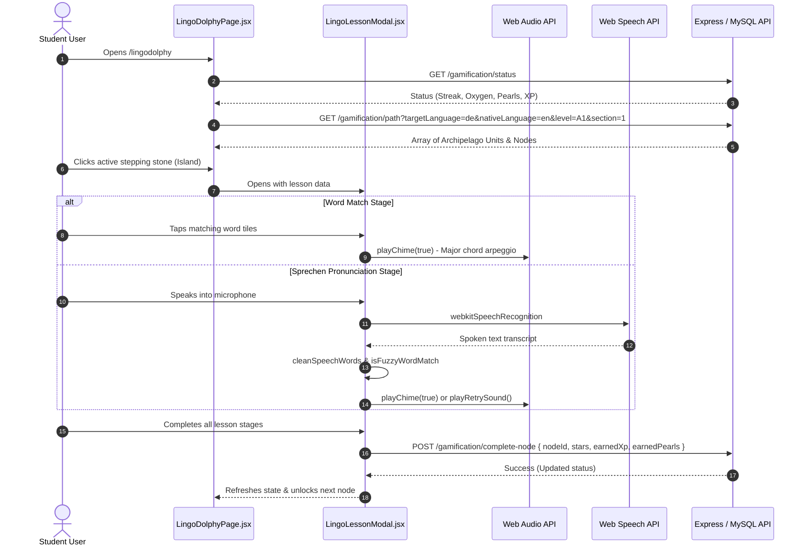
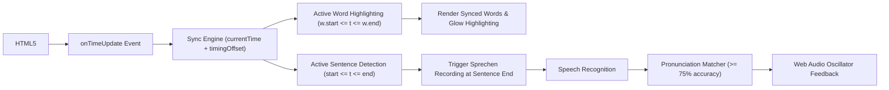
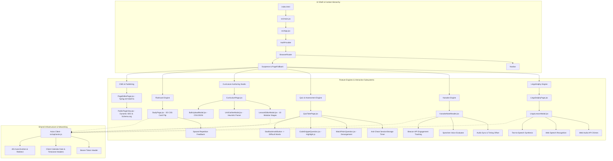

# Frontend Web Architecture & Deep-Dive Technical Specification
**Application:** DolphinCoder LMS Web Client  
**Core Technologies:** React 18.2.0, Vite 5.0.8, TailwindCSS 3.3.6, React Router DOM 6.20.0, Axios 1.6.2  
**Target File Location:** `/Users/cms/Desktop/Code/mern/lms_speedup/MERNLMS/uderstandproject/03_frontend_web_architecture.md`  

---

## 1. Executive Overview & Technology Stack

The DolphinCoder LMS frontend is a modern Single Page Application (SPA) built using React 18 and Vite. It serves as an interactive educational hub designed for learning, assessment, multimedia consumption, and gamified language acquisition.

### 1.1 Core Architecture Principles
1. **Performance & Sub-Second First Paint:** Core onboarding and navigation routes (`Landing`, `Login`, `Register`, `Dashboard`) are eagerly loaded. Heavy administrative tools, rich text authoring suites, and interactive audio readers are chunked and lazy-loaded via `React.lazy()` and `<Suspense>`.
2. **Deterministic Timezone & Session Sync:** The HTTP client dynamically calculates and forwards the client's local calendar day and timezone offset to eliminate streak and activity drift across global timezones.
3. **Multi-Sensory Gamification:** Combines the HTML5 Audio API, the Web Audio API (procedural oscillator chimes), the Web Speech Synthesis API (multi-dialect text-to-speech), and the Web Speech Recognition API (`webkitSpeechRecognition`) for speech dictation, lip-sync, and pronunciation verification.
4. **Resilient Offline-Safe Design:** Active quiz sessions maintain attempt timers in browser `sessionStorage`, backed by `beforeunload` and `popstate` navigation guards to prevent accidental data loss.
5. **Glassmorphic Aesthetic:** Custom Tailwind theme leveraging glassmorphic cards, smooth gradient borders, animated keyframes (`shimmer`, `float`, `flip`), and dark-mode-first styling.

### 1.2 Full Dependency Inventory (`frontend/package.json`)

| Package | Version | Purpose |
| :--- | :--- | :--- |
| `react` | `^18.2.0` | Declarative UI framework with Concurrent Features and hooks |
| `react-dom` | `^18.2.0` | DOM rendering and portal mounting |
| `vite` | `^5.0.8` | Next-generation ESM development server and bundler |
| `@vitejs/plugin-react`| `^4.2.1` | Fast Refresh and JSX transformation |
| `react-router-dom` | `^6.20.0` | Declarative client-side routing, navigation guards, and query param state |
| `axios` | `^1.6.2` | Promise-based HTTP client with request/response interceptors |
| `tailwindcss` | `^3.3.6` | Utility-first CSS engine with custom color extensions and keyframes |
| `postcss` / `autoprefixer` | `^8.4.32` / `^10.4.16` | CSS compilation and cross-browser vendor prefixing |
| `@tiptap/react` | `^2.1.13` | Headless ProseMirror wrapper for extensible rich-text editing |
| `@tiptap/starter-kit`| `^2.1.13` | Baseline extensions: paragraph, headings, lists, blockquote, code |
| `@tiptap/extension-underline`| `^2.1.13` | Text underline decoration |
| `@tiptap/extension-color`| `^2.1.13` | Color styling mark extension |
| `@tiptap/extension-text-style`| `^2.1.13`| Span style wrapper for inline styles |
| `docx` | `^9.7.1` | Client-side Word `.docx` generation for quiz & note bulk upload templates |
| `file-saver` | `^2.0.5` | HTML5 `saveAs` blob saver for template exports |
| `highlight.js` | `^11.11.1`| Syntax highlighting for code-mcq quiz questions (Python, JS, Java, SQL, C++, PHP) |
| `lucide-react` | `^0.294.0`| Crisp SVG iconography tree-shaken across all views |
| `react-hot-toast` | `^2.4.1` | Accessible toast notification system with frosted glass theme |
| `react-youtube` | `^10.1.0` | Official YouTube IFrame Player API wrapper with responsive aspect ratios |
| `clsx` | `^2.0.0` | Conditional CSS className constructor |

---

## 2. Build Pipeline, Bundling & Styling System

### 2.1 Vite Configuration (`frontend/vite.config.js`)
```javascript
import { defineConfig } from 'vite'
import react from '@vitejs/plugin-react'

export default defineConfig({
  plugins: [react()],
  build: {
    outDir: '../backend/dist',
    emptyOutDir: true,
  },
  server: {
    port: 5173,
    proxy: {
      '/api': {
        target: 'http://localhost:5000',
        changeOrigin: true,
      },
      '/uploads': {
        target: 'http://localhost:5000',
        changeOrigin: true,
      },
    },
  },
})
```
- **Unified Build Target:** `outDir` outputs to `../backend/dist` with `emptyOutDir: true`. When deployed, Express statically hosts `dist/`, allowing unified hosting under a single domain.
- **Development Proxies:** Proxies `/api` and `/uploads` to port 5000 during local development, preventing CORS issues.

### 2.2 Design System & Tailwind Configuration (`frontend/tailwind.config.js`)
The UI is styled using custom theme extensions:
- **`dolphin` Palette:** Royal electric blues ranging from `dolphin-50` (`#eef6ff`) to `dolphin-500` (`#2d7fff`) and `dolphin-950` (`#142157`).
- **`ocean` Palette:** Aqua marine tones ranging from `ocean-50` (`#f0fdf9`) to `ocean-500` (`#14b897`) and `ocean-900` (`#0e4d43`).
- **Custom Keyframes & Animations:**
  - `fade-in`: 0.3s ease-in-out opacity fade.
  - `slide-up`: 0.4s translateY(20px) to translateY(0) entrance.
  - `float`: 3s ease-in-out infinite translateY(-10px) floating mascot effect.
  - `shimmer`: 1.5s background-position shift for skeleton loaders.
  - `pulse-slow`: 3s cubic-bezier pulse.

### 2.3 Style Layers & Legacy vs Production Architecture
- **Active Stylesheet:** `frontend/src/styles/index.css` is imported directly by `src/main.jsx`.
- **Legacy Files:** `src/index.css` and `src/App.css` contain unused initial Vite scaffold code.
- **Component Classes Defined in `styles/index.css`:**
  - `.glass-card`: `bg-white/5 backdrop-blur-md border border-white/10 rounded-2xl`.
  - `.glass-card-hover`: Dynamic hover elevation with `-translate-y-1` and `shadow-2xl`.
  - `.gradient-text`: Text clipped with linear gradients from `dolphin-400` to `ocean-400`.
  - `.btn-primary` & `.btn-secondary`: Custom buttons with active translation states.
  - `.input-field`: Translucent input styling with `focus:ring-2 focus:ring-dolphin-500/50`.
  - `.skeleton`: Linear gradient shimmer for content skeletons.
  - `.ProseMirror`: Custom typography for the TipTap editor (headings, blockquotes, inline code, preformatted blocks, images).
  - `.flip-card` & `.flip-card-inner`: 3D CSS transform classes with `perspective: 1000px` and `rotateY(180deg)`.
  - `.progress-ring circle`: SVG progress ring with `transform: rotate(-90deg)`.

---

## 3. Network Architecture & Client Interceptors

### 3.1 HTTP Client (`frontend/src/api/axios.js`)
All HTTP requests route through a single, configured Axios instance:

```javascript
import axios from 'axios';

const api = axios.create({
  baseURL: import.meta.env.VITE_API_BASE_URL || '/api',
  timeout: 15000,
});
```

#### Request Interceptor Details
```javascript
api.interceptors.request.use((config) => {
  const token = localStorage.getItem('token');
  if (token) {
    config.headers.Authorization = `Bearer ${token}`;
  }

  // Ensure server knows the user's exact calendar date & timezone
  const now = new Date();
  const year = now.getFullYear();
  const month = String(now.getMonth() + 1).padStart(2, '0');
  const day = String(now.getDate()).padStart(2, '0');
  config.headers['x-client-date'] = `${year}-${month}-${day}`;
  config.headers['x-timezone-offset'] = now.getTimezoneOffset();
  try {
    config.headers['x-client-timezone'] = Intl.DateTimeFormat().resolvedOptions().timeZone;
  } catch (e) {
    // Fallback if resolvedOptions() is unavailable
  }

  return config;
});
```
- **Authentication:** Injects `Bearer <token>` from `localStorage`.
- **Timezone Drift Protection:** Sends `x-client-date`, `x-timezone-offset`, and `x-client-timezone` on every request. This ensures that the backend MySQL date aggregations for user streaks, study logs, and activity heatmaps match the user's calendar date rather than server UTC.

#### Response Interceptor Details
```javascript
api.interceptors.response.use(
  (response) => response,
  (error) => {
    if (error.response?.status === 401) {
      localStorage.removeItem('token');
      localStorage.removeItem('user');
      window.location.href = '/login';
    }
    return Promise.reject(error);
  }
);
```
- **401 Unauthorized Eviction:** Automatically clears tokens and redirects to `/login`.

---

## 4. Authentication, State Management & Authorization

### 4.1 Auth Context Provider (`frontend/src/contexts/AuthContext.jsx`)
Application authentication state is managed via React Context:

```javascript
const AuthContext = createContext(null);
```

#### State & Persistence
- **`user` State:** Initialized synchronously from `localStorage.getItem('user')` wrapped in a `try...catch` block.
- **`saveAuth(token, userData)`:** Synchronizes JWT and user metadata into `localStorage` and updates React state.
- **`login(email, password)`:** Dispatches `POST /auth/login`. On success, runs `saveAuth()` and triggers a toast notification: `Welcome back, <name>! 🐬`.
- **`register(name, email, password, role)`:** Dispatches `POST /auth/register`. On success, auto-authenticates the user.
- **`logout()`:** Purges `token` and `user` keys from `localStorage`, sets `user` to `null`, and triggers an informative toast.
- **`updateUser(updatedUser)`:** Allows profile edits (name, bio) to update state without requiring re-authentication.

### 4.2 Route Protection (`frontend/src/components/common/ProtectedRoute.jsx`)
```javascript
export default function ProtectedRoute({ children, roles }) {
  const { user } = useAuth();

  if (!user) return <Navigate to="/login" replace />;
  if (roles && !roles.includes(user.role)) return <Navigate to="/dashboard" replace />;

  return children;
}
```
- **Unauthenticated Users:** Redirected to `/login` with browser history replacement.
- **Role Verification:** Compares `user.role` against authorized role arrays (e.g. `['trainer', 'admin']` or `['student']`). Unauthorized users are redirected to `/dashboard`.

---

## 5. Routing Matrix & Component Hierarchy

### 5.1 Route Tree & Code Splitting (`frontend/src/App.jsx`)

```mermaid
flowchart TD
    App["App.jsx (Root)"] --> AuthProv["AuthProvider (Context)"]
    AuthProv --> Toaster["react-hot-toast (Top-Right)"]
    AuthProv --> Router["BrowserRouter & AppRoutes"]
    
    Router --> PublicR["Public Routes"]
    Router --> ProtectedR["Protected Routes (ProtectedRoute)"]
    
    PublicR --> Landing["/ (Landing)"]
    PublicR --> Login["/login (Login)"]
    PublicR --> Register["/register (Register)"]
    PublicR --> PublicPage["/:slug (PublicPageView - CMS)"]
    
    ProtectedR --> StudentR["Student Accessible"]
    ProtectedR --> TrainerR["Trainer & Admin Only"]
    ProtectedR --> AdminR["Admin Only"]
    
    StudentR --> Dash["/dashboard (Dashboard)"]
    StudentR --> Notes["/notes, /notes/:id (Notes & Reader)"]
    StudentR --> Videos["/videos, /videos/:id (Videos & Player)"]
    StudentR --> Quizzes["/quizzes, /quizzes/:id/take, /quizzes/:id/review"]
    StudentR --> Flashcards["/flashcards, /flashcards/:id/study"]
    StudentR --> Lingo["/lingodolphy (LingoDolphy Path)"]
    StudentR --> Activity["/activity, /history (ActivityHistoryPage)"]
    StudentR --> Profile["/profile (ProfilePage)"]
    
    TrainerR --> NoteEdit["/notes/new, /notes/:id/edit"]
    TrainerR --> VideoEdit["/videos/new, /videos/:id/edit"]
    TrainerR --> QuizEdit["/quizzes/new, /quizzes/:id/edit"]
    TrainerR --> FlashEdit["/flashcards/new, /flashcards/:id/edit"]
    TrainerR --> Curriculum["/lessons (Curriculum Studio)"]
    
    AdminR --> AdminPanel["/admin (User Management & App Version Gate)"]
    AdminR --> AdminPages["/admin/pages, /admin/pages/new, /admin/pages/:id/edit"]
    AdminR --> AdminNotif["/admin/notifications (FCM Push Dashboard)"]
```

All routes are managed inside `<AppRoutes>` inside `<AuthProvider>` and `<BrowserRouter>`.



### 5.2 Layout Shell (`frontend/src/App.jsx`)
```javascript
function Layout({ children }) {
  const location = useLocation();
  const isQuizTake = location.pathname.includes('/take');
  
  return (
    <div className={isQuizTake ? "min-h-screen" : "pt-24 min-h-screen"}>
      {!isQuizTake && <Navbar />}
      <main className={isQuizTake ? "pb-0" : "pb-12"}>
        <Suspense fallback={<PageFallback />}>
          {children}
        </Suspense>
      </main>
    </div>
  );
}
```
- **Distraction-Free Anti-Cheat Mode:** If the route contains `/take`, `<Navbar />` is unmounted and top padding is removed to maximize screen real estate and prevent tab switching.
- **Chunk Loading Fallback:** Every lazy-loaded page displays `<PageFallback />` with a spinning cyan loader during network chunk resolution.

---

## 6. Shared Custom Hooks & Reactive Stores

### 6.1 Taxonomical Navigation (`frontend/src/hooks/useSubjects.js`)
Centralizes subject and topic retrieval:
- `subjects`: List of subjects with nested `topics` array.
- `fetchSubjects()`: Dispatches `GET /subjects`.
- `createSubject(name)`: Dispatches `POST /subjects`. If the subject already exists, handles HTTP 409 responses by returning the existing subject.
- `createTopic(subjectId, name)`: Dispatches `POST /subjects/:subjectId/topics`.
- `getTopicsForSubject(subjectId)`: Helper that filters topics matching either numeric `id` or MongoDB-style `_id`.

### 6.2 Difficult Words Reactive Deck Store (`frontend/src/hooks/useDifficultWords.js`)
An observable module-level state store:
- **Module Singleton State:**
  - `globalBookmarkedFronts`: `Set<string>` containing lowercased front prompts currently saved.
  - `globalActiveVolume`: Number indicating the current volume (e.g. `1` for "Difficult Words - Vol 1").
  - `globalCurrentCount`: Number of cards in the active volume.
  - `globalActiveDeckId`: ID of the volume currently accepting words.
  - `listeners`: `Set<Function>` containing subscriber callbacks across active components.
- **Volume Chunking Algorithm:**
  1. Searches user flashcard decks matching the regex `/Difficult Words - Vol (\d+)/`.
  2. If the highest volume deck has `< 10` cards, it is designated as `globalActiveDeckId`.
  3. When a 10th card is added, the deck is marked complete and the volume number increments (`Vol X+1`).
- **Optimistic UI Updates:**
  When `toggleBookmark({ front, back, hint })` is called, `globalBookmarkedFronts` is updated immediately and `notifyListeners()` triggers UI re-renders. If the API request fails, the state is rolled back and an error toast is displayed.

---

## 7. Deep-Dive Page Component Analysis

### 7.1 Landing Page (`frontend/src/pages/Landing.jsx`)
- **Visuals:** Floating animated gradient orbs with backdrop blur.
- **Key Metrics:** Highlights student count, quiz count, user ratings, and platform uptime.
- **Feature Cards:** Quick previews of Smart Notes, Video Library, Interactive Quizzes, and Flashcard Decks.

### 7.2 Authentication Views (`frontend/src/pages/Login.jsx`, `frontend/src/pages/Register.jsx`)
- **Login:** Form submission with password visibility toggles (`Eye`/`EyeOff`), email input formatting, loading spinners, and redirects to `/dashboard`.
- **Register:** Account creation with role selection (`student` vs `trainer`), email validation, and direct onboarding.

### 7.3 Student & Trainer Dashboard (`frontend/src/pages/Dashboard.jsx`)
- **Time-Aware Greeting:** Computes `Good morning`, `Good afternoon`, or `Good evening` based on `new Date().getHours()`.
- **Parallel Stats Fetching:** Executes `Promise.allSettled()` across `/notes`, `/videos`, `/quizzes`, and `/flashcards`. For students, also fetches `/gamification/status` to display current XP and streak.
- **Stat Cards & Quick Actions:** Dynamic action buttons tailored to the user's role (staff can quickly create content; students see quick links to study).
- **Sub-Component Integration:** Mounts `<TodayPerformance />` to summarize today's study metrics.

### 7.4 Today's Performance Widget (`frontend/src/components/dashboard/TodayPerformance.jsx`)
- Fetches `/activity/summary?date=YYYY-MM-DD&countsOnly=true`.
- Displays metric chips for quizzes taken, notes read, karaoke stories practiced, and flashcard cards reviewed.
- Links to `/activity` for the full historical breakdown.

---

## 8. LingoDolphy Gamified Learning Engine

### 8.1 LingoDolphy Path (`frontend/src/pages/LingoDolphyPage.jsx`)
LingoDolphy implements a Duolingo-style gamified language learning path.



#### Status & Economy Top Bar
- **Course Switcher:** 2-step modal allowing students to select target languages (German, English) and instruction languages (English, Marathi, Hindi).
- **Streak Flame:** Animated badge displaying consecutive days active.
- **Oxygen Gauge:** Shows current lives (out of 5). When depleted, users can spend 30 pearls to trigger `POST /gamification/shop/refill-oxygen`.
- **Pearls & XP Badges:** Tracks cumulative learning currency and experience points.

#### Stepping Stone Path Algorithm
Nodes are grouped by unit and laid out in a zigzag pattern using an offset array:
```javascript
const zigzagOffsets = [0, 45, -45, 25, -35, 40, -20, 0];
```
- **Node States:**
  - `completed`: Green button with 3D bottom border (`border-[#46A302]`), checkmark icon, and star rating.
  - `available`: Cyan button (`bg-[#1CB0F6]`) with an animated bouncing `START HERE` badge.
  - `locked`: Dark slate button with a lock icon.
  - `chest`: Treasure chest node awarding bonus pearls and XP.

### 8.2 Interactive Lesson Engine (`frontend/src/components/lingodolphy/LingoLessonModal.jsx`)

#### Web Audio API Sound Generator
Generates procedural sound effects in real time without external audio files:
- **Success Chime (`playChime(true)`):** Major chord arpeggio playing C5 (523.25Hz), E5 (659.25Hz), G5 (783.99Hz), and C6 (1046.50Hz) using triangle oscillators with exponential gain ramps.
- **Error Buzz (`playChime(false)`):** Dissonant sawtooth wave shifting from 220Hz down to 174.61Hz.

#### Browser Text-to-Speech Engine
- Filters out novelty synthesizer voices (`NOVELTY_VOICE_NAMES` list).
- Resolves preferred natural voices by language code (`de-DE`, `en-US`, `hi-IN`, `mr-IN`).
- Supports user persona preferences (female vs male voices stored in `localStorage.getItem('lingo_voice_persona')`).

#### Pronunciation & Web Speech Recognition Evaluator
- Uses `window.webkitSpeechRecognition` with language localization.
- Normalizes German umlauts: `ä -> ae`, `ö -> oe`, `ü -> ue`, `ß -> ss`.
- Maps numbers and symbols to phonetic words (e.g. `€` -> `euro`, `3` -> `drei` / `three`).
- Evaluates word accuracy using fuzzy length and edit-distance checks (`isFuzzyWordMatch`).

#### Supported Stage Types
1. **`word_match`:** Match pairs of target language tiles with native translations.
2. **`listen_tap`:** Listen to target sentence audio and tap shuffled tokens in order.
3. **`sentence_builder`:** Arrange token words into a grammatically correct sentence.
4. **`cloze_test`:** Fill in missing words inside a sentence.
5. **`type_word`:** Text input spelling challenge.
6. **`dialogue_bubble`:** Interactive dialogue turns between student and virtual characters.
7. **`listen_select`:** Audio comprehension with multiple choice answers.
8. **`sprechen`:** Lip-sync and voice dictation with real-time feedback.
9. **`picture_select`:** Visual vocabulary challenge with image options.
10. **`karaoke`:** Word-by-word synced listening exercise.

---

## 9. Karaoke Audio Note Reader Architecture

### 9.1 Synchronized Reading Interface (`frontend/src/pages/KaraokeNoteReader.jsx`)
Provides word-by-word audio-synced text highlighting for language practice.



#### Audio & Streaming Mechanics
- **Streaming Proxy:** `resolveAudioUrl()` maps `/uploads/audio/:filename` to the API endpoint `/api/notes/audio/:filename`, enabling audio playback across diverse hosting setups.
- **Timestamp Synchronization:** Compares `currentTime + timingOffset` against word start and end times.
- **Timing Calibration Slider:** Includes an on-screen slider (`-2.0s` to `+2.0s`) allowing users to adjust synchronization drift in real time.
- **Interactive Vocabulary:** Hovering over words defined in `story.vocab` displays a definition popover showing translations, part-of-speech tags, and definitions.
- **Sprechen Speaking Mode:** Automatically pauses playback at sentence boundaries, engages the microphone via speech recognition, evaluates pronunciation against expected words, and provides audio feedback.

#### Analytics & Beacon Tracking
- Uses `document.addEventListener('visibilitychange')` to monitor tab focus.
- Separates listening duration (`listeningSecs`) from active interaction time (`engagementSecs`).
- Dispatches metrics on page unmount using `navigator.sendBeacon('/api/notes/:id/track')` to ensure reliable tracking even when the tab is closed immediately.

### 9.2 Karaoke Data Normalization (`frontend/src/utils/downloadKaraokeTemplate.js`)
- `normalizeKaraokeJson(parsed, fallbackAudioUrl)` validates uploaded JSON stories.
- If individual word timestamps are missing, it automatically calculates word boundaries by splitting sentence text and distributing durations across word character lengths.
- Strips punctuation marks (`.,/#!$%^&*;:{}=\-_~()?"'«»`) into a clean comparison token.

### 9.3 Karaoke Note Modal (`frontend/src/components/notes/KaraokeNoteModal.jsx`)
- Provides instructors with options to create Standard Notes or Karaoke Stories.
- Supports uploading audio files directly to MySQL via `POST /notes/upload-audio`.
- Supports JSON alignment imports or pasting raw German text with English translations, automatically generating proportional timestamps across the audio's duration.

---

## 10. Curriculum Studio & Course Management

### 10.1 Curriculum Studio View (`frontend/src/pages/CurriculumPage.jsx`)
The administrative command center for LingoDolphy courses:
- **Filters:** Allows filtering by Target Language (`de`, `en`, `es`, `fr`, `ja`, `it`), Native Language (`en`, `hi`, `mr`, `es`), CEFR Level (`A1`, `A2`, `B1`, `B2`), and Section (`Rookie`, `Explorer`, `Traveler`).
- **Persistence:** Synchronizes active filters to URL search parameters and `localStorage` (`curriculum_filter_settings`).
- **Lesson Management:** Reorder lessons using up/down controls, toggle Live vs Draft visibility, and preview lessons in a modal.

### 10.2 Lesson Editor Modal (`frontend/src/components/curriculum/LessonEditorModal.jsx`)
A comprehensive lesson authoring tool:
- Supports 10 modular, reorderable stage types with multi-instance support (e.g. adding two separate `word_match` challenges within the same lesson).
- Audio upload integration storing tracks directly in the database.
- Direct JSON timestamp alignment file upload for tap-to-pronounce audio playback.

### 10.3 Rapid Unit Outliner (`frontend/src/components/curriculum/UnitOutlineModal.jsx`)
Allows instructors to plan entire units by pasting a list of lesson titles. The modal automatically infers challenge types based on keywords:
- `karaoke`, `audio`, `song` $\rightarrow$ `karaoke`
- `sprech`, `voice`, `speak` $\rightarrow$ `speech`
- `chest`, `treasure`, `pearl` $\rightarrow$ `chest`
- `match`, `pair` $\rightarrow$ `match`
- `quiz`, `exam`, `test` $\rightarrow$ `quiz`

### 10.4 Bulk Curriculum Uploader (`frontend/src/components/curriculum/BulkUploadModal.jsx`)
- Supports importing lessons via CSV or JSON.
- Provides downloadable templates for both formats.
- Supports appending new lessons or replacing existing units.

---

## 11. Notes, Editor & Rich Text Publishing

### 11.1 Notes Directory (`frontend/src/pages/NotesPage.jsx`)
- Search by text, tags, card color accents, and subject/topic taxonomy.
- Pinned notes are displayed at the top of the list.
- Badges identify Karaoke Notes, linking directly to the reader.
- Includes pagination (6 notes per page) and card skeleton loaders.

### 11.2 Rich Text & Document Editor (`frontend/src/pages/NoteEditorPage.jsx`)
Supports three authoring modes:
1. **`richtext`:** TipTap editor with toolbar options for bold, italic, underline, headings (H1, H2), bullet/ordered lists, blockquotes, and code snippets.
2. **`docx`:** Client-side Word `.docx` bulk upload parser.
3. **`html`:** Raw HTML source code editor for embedding slide decks and custom widgets.

### 11.3 Note Detail Viewer (`frontend/src/pages/NoteDetailPage.jsx`)
- If `note.isKaraoke` is true, mounts `<KaraokeNoteReader />`.
- If `contentType === 'html'`, embeds the content within a sandboxed `<iframe>`. Injects an anchor click interception script into the iframe to prevent fragment navigation (`#hash`) from unloading documents into `about:blank`.
- Includes fullscreen reading toggle (`Maximize2`/`Minimize2`).
- Logs reader engagement time via `visibilitychange` listeners and Beacon API calls on unmount.

---

## 12. Assessment & Flashcard Study Engines

### 12.1 Quiz Taking Engine (`frontend/src/pages/QuizTakePage.jsx`)
- **Session State Preservation:** Appends a unique `attempt` timestamp to query parameters. Saves remaining time in `sessionStorage` (`quiz_<id>_<attempt>_state`), preventing timers from resetting on page reloads.
- **Navigation Interceptors:**
  - `beforeunload`: Warns users before closing or refreshing active quiz tabs.
  - `popstate`: Intercepts the browser back button, prompting users to confirm before quitting.
- **Question Format Support:**
  - Multiple Choice (MCQ).
  - True / False.
  - Code MCQ: Displays options in a 2x2 grid with syntax highlighting via `CodeSnippetQuestion.jsx`.
  - Match Pairs: Interactive pairing interface via `MatchPairsQuestion.jsx`.
- **Derangement Matching Algorithm:** Right-hand options in match-pair questions are scrambled using a derangement algorithm (`getDerangedRightItems`), guaranteeing that no option starts in its correct matching position.
- **Post-Quiz Summary:** Displays a circular SVG progress ring, pass/fail status, question reviews, and `StarBookmarkButton` components to bookmark missed vocabulary terms to Difficult Words flashcard decks.

### 12.2 Quiz Review Engine (`frontend/src/pages/QuizReviewPage.jsx`)
Displays a historical breakdown of previous quiz attempts, including time spent, percentage score, selected answers vs correct answers, and full answer explanations.

### 12.3 Quiz Authoring Form (`frontend/src/pages/QuizFormPage.jsx`)
- Author questions manually across all four question types.
- Supports bulk upload of quizzes via `.docx` templates generated on the fly with the `docx` library (`downloadQuizTemplate`).

### 12.4 Flashcard Study Engine (`frontend/src/pages/StudyPage.jsx`)
- **3D Flip Card:** Uses CSS transforms (`perspective: 1000px`, `rotateY(180deg)`) to flip cards between prompt and answer.
- **Spaced Repetition Feedback:** Users rate cards as "Known" (green) or "Still Learning" (red).
- **Session Progress:** Saves review progress, accuracy, and engagement time to `POST /flashcards/:id/progress`.
- **Mastery Summary:** Displays an end-of-session screen showing the percentage of known cards, review counts, and progress bars.

---

## 13. Content Management System (CMS) & Public Web Pages

### 13.1 Dynamic Page Builder (`frontend/src/pages/PageEditorPage.jsx`)
- Rich text content authoring using TipTap with the custom `TipTapImage` node extension.
- Custom slugification (`slugify`) converting titles into URL-safe slugs.
- Status toggle between Draft and Published.
- Featured image upload and summary excerpt controls.

### 13.2 Public Dynamic Page Renderer (`frontend/src/pages/PublicPageView.jsx`)
- Dynamic route handling for `/:slug`.
- Injects dynamic SEO tags on mount:
  - Document title: `<title>{page.title} | DolphinCoder</title>`
  - Meta description: `<meta name="description" content="..." />`
  - Canonical link: `<link rel="canonical" href="..." />`
  - Schema.org JSON-LD structured data for article search indexing.

---

## 14. Administration, App Version Gates & Push Notifications

### 14.1 Admin Control Center (`frontend/src/pages/AdminPage.jsx`)
- **User Management:** View registered users, update roles (`student`, `trainer`, `admin`), toggle account status, delete users, and create accounts.
- **Mobile Version Gate:** Controls minimum mobile client versions (`min_required_version`, `min_version_name`, `latest_version_name`, `update_url`, `title`, `message`). Allows administrators to enforce critical app updates across Android and iOS devices.
- **Taxonomy Management:** Manage subjects and topics.

### 14.2 Push Notification Control Center (`frontend/src/pages/AdminNotificationsPage.jsx`)
- **Firebase Cloud Messaging (FCM) Integration:** Displays device registration metrics and Firebase connectivity status.
- **Test Push:** Dispatches immediate test notifications to trainer and admin devices.
- **Global Broadcast:** Sends push notifications to all registered device tokens with deep link screen routing (e.g. `/home`, `/lingodolphy`, `/quizzes`).
- **Automated Templates:** Pre-configured notification templates for Streak Savers, Oxygen Refills, and Weekly League Leaderboards.

---

## 15. Activity Analytics & User Profile

### 15.1 Activity History Explorer (`frontend/src/pages/ActivityHistoryPage.jsx`)
- **Weekly Buckets:** Groups study history into weekly intervals (Monday to Sunday) with an infinite scroll / load more pattern.
- **Smart Date Badges:** Categorizes daily events with badges: `TODAY`, `YESTERDAY`, `DAY BEFORE YESTERDAY`, or colored weekday pills.
- **Multi-Domain Filters:** Filter activity by Quizzes, Notes, Flashcards, or Karaoke sessions.
- **Aggregated Metrics:** Displays total active study time formatted as `Xh Ym Zs`.

### 15.2 User Profile & Credentials (`frontend/src/pages/ProfilePage.jsx`)
- Update user profile details (full name, biography).
- Password change interface with input validation and show/hide toggles.

---

## 16. Component Hierarchy & Architectural Data Flow



---

## 17. Verification & Contract Audit Summary

The frontend architecture includes an automated test suite (`frontend/tests/frontend_audit_and_contracts.test.mjs`) that verifies core system contracts:
1. **Karaoke JSON Normalization Utility:** Verifies that raw imported scripts are converted into word-level timestamps with clean text comparison tokens.
2. **Route Integrity:** Validates that all required student, trainer, and admin routes are registered in `App.jsx`.
3. **LingoDolphy & Curriculum Component Integrity:** Ensures that endpoint contracts (`/gamification/status`, `/gamification/path`, `/gamification/complete-node`) and all 10 interactive stage types are present across the curriculum authoring modals.
