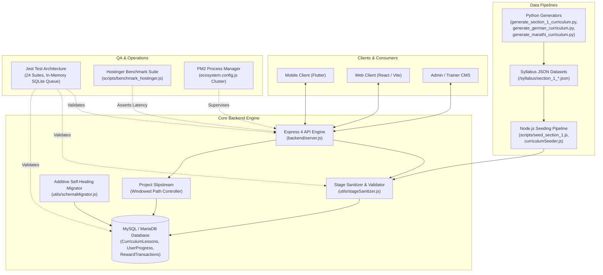
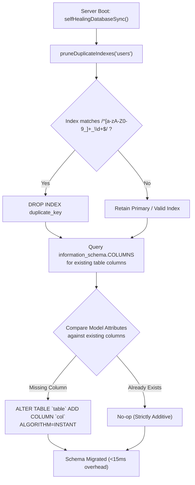
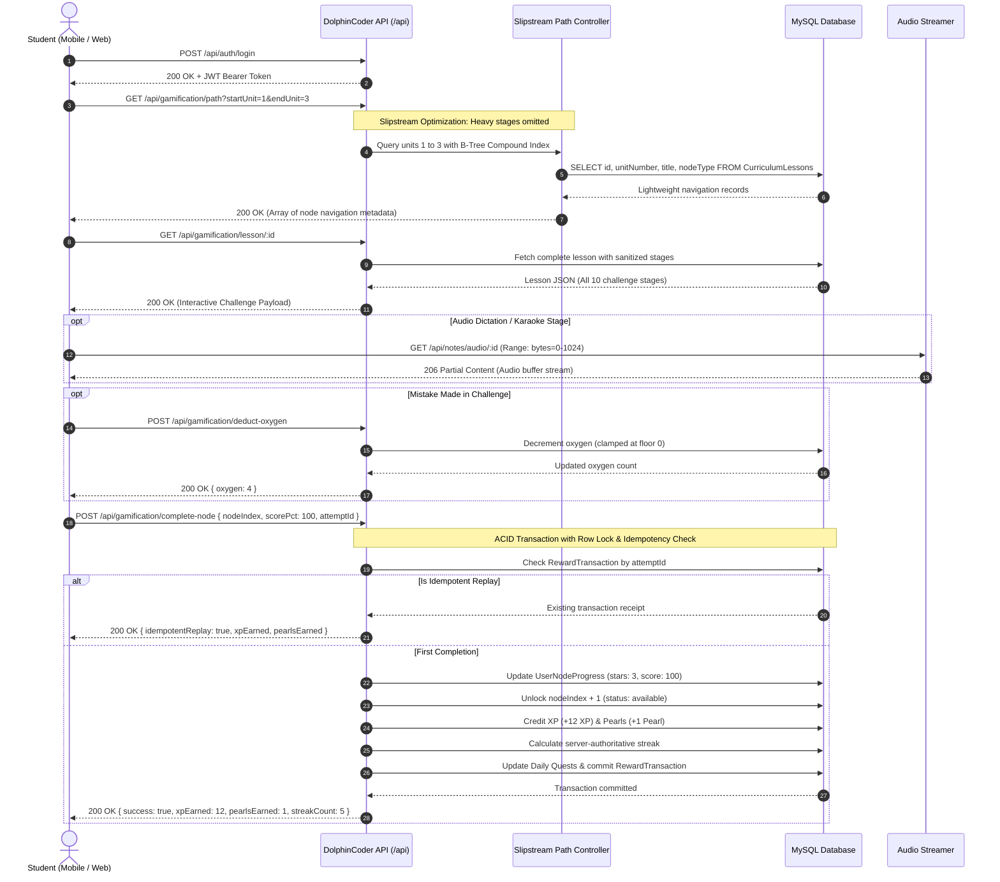

# 05. Workflows, DevOps, Scripts & Quality Assurance (QA) Architecture

## DolphinCoder LMS: End-to-End System Workflows, Syllabus Pipelines, Test Suites & DevOps Infrastructure

---

## 1. Executive Summary & System Architecture Overview

DolphinCoder LMS is a full-stack, gamified language and coding education platform designed to deliver micro-learning experiences comparable to Duolingo, built on a robust MERN/Node.js stack with a MySQL/MariaDB relational persistence layer. 

The application architecture unites five fundamental pillars:
1. **Automated Curriculum Ingestion & In-Memory Compilers (`scripts/*`)**: High-throughput Python and Node.js generators that synthesize multi-lingual syllabus datasets across German (`de`), Hindi-instructed English (`en_hi`), and Marathi-instructed English (`en_mr`).
2. **Pedagogical Content Schema (`syllabus/*`)**: A micro-stepping CEFR-aligned learning path consisting of 12-unit sections, 12-lesson units, and 10 distinct interactive challenge archetypes per interactive lesson.
3. **Comprehensive Automated QA Suite (`backend/tests/*`)**: A 24-file, multi-tiered test framework enforcing atomicity, anti-tamper security, concurrency safety, schema validation, audio streaming correctness, and live production latency benchmarks.
4. **DevOps & Infrastructure Resilience**: An additive-only self-healing database migrator (`schemaMigrator.js`), PM2 process orchestration in cluster mode (`ecosystem.config.js`), HTTP/2 gzip compression, multi-tiered rate limiting, and Hostinger shared/cloud production optimizations.
5. **End-to-End User Journeys**: Structured user flows governing student learning, gamification economy balancing (Hearts/Oxygen, Pearls, Streaks, Potions, Leagues), and instructor/admin curriculum governance.



---

## 2. Curriculum Generation & Data Ingestion Pipelines (`scripts/*`)

The `scripts/` directory contains an automated content authoring and database ingestion toolchain. Rather than hand-authoring tens of thousands of database rows, the platform employs algorithmic data generators written in Python 3 and Node.js.

### 2.1 Inventory of Scripts

| Script File | Language | Primary Purpose | Key Outputs / Artifacts |
| :--- | :--- | :--- | :--- |
| `generate_section_1_curriculum.py` | Python 3 | Generates Section 1 English for Hindi Speakers (`en_hi_a1`), 12 units x 12 lessons (144 lessons, 10 modular challenges each). | `syllabus/section_1/unit_*.json`, `syllabus/section_1_english_hindi.json` |
| `generate_german_curriculum.py` | Python 3 | Generates Section 1 German for English Speakers (`de_en_a1`), Goethe-Institut A1 standard, 144 lessons with cultural staples. | `syllabus/section_1_german/unit_*.json`, `syllabus/section_1_german_english.json` |
| `generate_marathi_curriculum.py` | Python 3 | Generates Section 1 English for Marathi Speakers (`en_mr_a1`), authentic 3-gender markers and polite pronouns. | `syllabus/section_1_marathi/unit_*.json`, `syllabus/section_1_english_marathi.json` |
| `build_all_seeds.py` | Python 3 | Master German A1 compiler across 3 full sections (105 units, 1,680 lessons) using 4 vocabulary slices per unit. | `german_a1_curriculum.json`, `seed_section1.sql`, `seed_section2.sql`, `seed_section3.sql`, `seed_german_a1.sql` |
| `build_english_a1_seeds.py` | Python 3 | Master English A1 compiler for Hindi & Marathi natives (Units 1 to 35). | `english_a1_hindi.json`, `english_a1_marathi.json`, `seed_en_hi_section1.sql`, `seed_en_mr_section1.sql` |
| `data_section1.py` | Python 3 | Raw vocabulary slices, syntax sentences, and dialogue models for German Section 1 (Units 1 to 35). | Python objects consumed by `build_all_seeds.py` |
| `data_section2.py` | Python 3 | Raw vocabulary slices, syntax sentences, and dialogue models for German Section 2 (Units 36 to 70). | Python objects consumed by `build_all_seeds.py` |
| `data_section3.py` | Python 3 | Raw vocabulary slices, syntax sentences, and dialogue models for German Section 3 (Units 71 to 105). | Python objects consumed by `build_all_seeds.py` |
| `data_english_section1.py` | Python 3 | Raw vocabulary slices and bilingual translation mappings (Hindi + Marathi) for English Section 1. | Python objects consumed by `build_english_a1_seeds.py` |
| `generate_curriculum_data.py` | Python 3 | Helper utility validating 16 unique words across 4 slices and synthesizing distractor tokens. | Reusable unit construction helper functions |
| `generate_english_curriculum_data.py` | Python 3 | Bilingual helper validating 4x4 slices, SOV grammar order, and token pools for English curriculum. | Reusable bilingual unit construction helpers |
| `generate_full_curriculum_a1.js` | Node.js | Comprehensive JavaScript curriculum generator for German A1 with spaced repetition intervals. | Standalone JS generator for A1 |
| `parse_curriculum.js` | Node.js | Markdown parser transforming raw curriculum outlines (`german_a1.md`) into API-compatible bulk-upload JSON. | Formatted JSON payloads for `POST /api/curriculum/bulk-upload` |
| `generate_sql.js` | Node.js | Compiles `german_a1.json` into production MySQL DDL/DML statements targeting `curriculum_lessons`. | `seed_german_a1.sql` |
| `generate_sections_sql.js` | Node.js | Generates section-delimited SQL batches for high-memory database imports. | Partitioned SQL statements |
| `seed_section_1.js` | Node.js | CLI executable directly connected to Sequelize that flattens and seeds `section_1_english_hindi.json` into MySQL. | Direct database seeding into MySQL |
| `backend/scripts/benchmark_hostinger.js` | Node.js | High-precision microsecond benchmark measuring DNS, SSL, TTFB, and database response latency against production Hostinger. | Real-time terminal diagnostic metrics |

---

### 2.2 Deep Dive: Algorithmic Micro-Stepping in Python Generators

The Python curriculum generation scripts (`generate_section_1_curriculum.py`, `generate_german_curriculum.py`, `generate_marathi_curriculum.py`) implement an instructional design pattern known as **scaffolded micro-stepping**.

#### Architectural Highlights:
1. **Zero Redundant Distractors**: In multiple-choice, listening, and sentence builder exercises, distractor tokens are dynamically mined from sibling vocabulary slices within the same unit, ensuring distractors belong to the same difficulty tier without duplicating correct answer tokens.
2. **Slice Architecture**: Each unit defines 16 core target words divided into 4 thematic slices:
   - Slice A: Core nouns and essential anchors (e.g., `house`, `car`, `Haus`, `Auto`).
   - Slice B: Actions and verbs (e.g., `is`, `have`, `ist`, `haben`).
   - Slice C: Modifiers and courtesy tokens (e.g., `clean`, `big`, `groß`, `bitte`).
   - Slice D: Interrogatives and prepositions (e.g., `where`, `in`, `wo`, `in`).
3. **Punctuation Stripping & Token Sanitization**: The builder strips trailing commas, periods, question marks, and exclamation points when generating tokens for word banks (`tokens: [...]`), preventing visual giveaways where a student can spot the final word of a sentence simply because it contains a period.
4. **Cultural Adaptation**:
   - In `generate_german_curriculum.py`: Introduces German cultural staples (e.g., *Brötchen*, *Apfelschorle*, *Currywurst*, *U-Bahn*, *Hauptbahnhof*, *Pfandflaschen*).
   - In `generate_marathi_curriculum.py`: Embeds authentic Marathi grammatical nuances including three grammatical genders (masculine, feminine, neuter) and respectful honorific pronouns (*तुमचा/तुमची/तुमचे* vs. *तुझा/तुझी/तुझे*).

```
[Raw Python Vocabulary & Sentences]
              │
              ▼
[Slice Validation & Token Synthesizer (4 slices x 4 words = 16 unique)]
              │
              ▼
[Lesson Assembler: 10 Interactive + 2 Sunken Chests + 1 Trophy Exam]
              │
              ├──────────────────────────────┐
              ▼                              ▼
[Individual Unit JSONs]             [Consolidated Section JSON]
(syllabus/section_1/unit_01.json)    (syllabus/section_1_english_hindi.json)
              │                              │
              └──────────────┬───────────────┘
                             ▼
              [Node.js Seeder / Bulk Upload API]
                             │
                             ▼
              [Sequelize: CurriculumLesson Table]
```

---

### 2.3 Direct Seeding Mechanics: `seed_section_1.js`

The script `scripts/seed_section_1.js` provides an operational bridge between filesystem JSON and the live database:
- **Environment Detection**: Inspects `backend/.env` or root `.env` to load database credentials.
- **Sequelize Initialization**: Initializes an authenticated connection to MySQL.
- **Owner Resolution**: Automatically queries `User` table for the primary admin ID (`order: [['id', 'ASC']]`), falling back to `1`.
- **Validation Pipeline**: Each lesson's stages are validated against `backend/utils/stageSanitizer.js` before write.
- **Idempotent Overwrite**: By default, checks for existing lessons for `(learningLanguage, nativeLanguage, level, unitNumber)` and replaces or appends based on CLI flags (`--force`).

---

### 2.4 Live Production Benchmarking: `benchmark_hostinger.js`

Located at `backend/scripts/benchmark_hostinger.js`, this utility provides end-to-end production monitoring using `process.hrtime.bigint()` for sub-millisecond precision.

```
       Client Initiates Request
                  │
                  ▼ (dnsEnd - start)
          [ DNS Lookup Latency ]
                  │
                  ▼ (sslEnd - dnsEnd)
        [ SSL/TLS Handshake Latency ]
                  │
                  ▼ (ttfbEnd - sslEnd)
    [ Time to First Byte (TTFB / Express Processing) ]
                  │
                  ▼ (totalEnd - ttfbEnd)
      [ Response Body Transfer & Parse ]
```

#### Monitored Endpoints & Performance Thresholds:
- **DNS Lookup Time**: Monitored target `< 50ms`.
- **SSL/TLS Handshake**: Monitored target `< 150ms`.
- **Time to First Byte (TTFB)**: Monitored target `< 600ms`.
- **Total Round-Trip Latency**: Monitored target `< 1200ms`.
- **Auth Endpoint Latency**: `/api/auth/login` executing bcrypt hash verification (12 rounds) under `< 2500ms`.
- **Gamification Path Latency**: `/api/gamification/path` under Project Slipstream optimizations returning 500+ nodes under `< 3500ms`.
- **Curriculum Units Summary**: `/api/curriculum/units-summary` returning 35+ units under `< 8000ms`.

---

## 3. Multi-Lingual Syllabus Architecture & Content Schema (`syllabus/*`)

### 3.1 Directory Organization

The `syllabus/` directory maintains structured course data:
- `section_1/`: 12 JSON files (`unit_01_objects_possessives.json` to `unit_12_feelings_graduation.json`) for English taught via Hindi.
- `section_1_german/`: 12 JSON files for German taught via English.
- `section_1_marathi/`: 12 JSON files for English taught via Marathi.
- `section_1_english_hindi.json`: Consolidated master array of all 12 units (144 lessons) for Hindi speakers.
- `section_1_english_marathi.json`: Consolidated master array of all 12 units (144 lessons) for Marathi speakers.
- `section_1_german_english.json`: Consolidated master array of all 12 units (144 lessons) for English speakers learning German.

---

### 3.2 The 12-Lesson Stepping Stone Progression Model

Each unit within Section 1 follows a standardized 12-stepping stone pedagogical framework:

| Lesson Index | Unit Lesson # | Node Type | Title / Focus | Stage Count | Rewards |
| :---: | :---: | :---: | :--- | :---: | :--- |
| `0` | Lesson 1 | `lesson` | Core Foundations (Slice A + Core Sentence) | 10 | 15 XP, 5 Pearls |
| `1` | Lesson 2 | `lesson` | Action & Subject (Slice B + Verb Conjugation) | 10 | 15 XP, 5 Pearls |
| `2` | Lesson 3 | `lesson` | Vocabulary Consolidation (Slices A+B Synthesis) | 10 | 15 XP, 5 Pearls |
| `3` | Lesson 4 | `lesson` | Objects & Descriptors (Slice C + Adjectives) | 10 | 15 XP, 5 Pearls |
| `4` | Lesson 5 | `lesson` | Context & Questions (Slice D + Interrogatives) | 10 | 15 XP, 5 Pearls |
| `5` | Lesson 6 | `chest` | **Sunken Treasure Chest 1 (Milestone Reward)** | **0** | **10 XP, 25 Pearls** |
| `6` | Lesson 7 | `lesson` | Sentence Expansion (Complex Clause Construction) | 10 | 15 XP, 5 Pearls |
| `7` | Lesson 8 | `lesson` | Dialogue & Pragmatics (Conversational Contexts) | 10 | 15 XP, 5 Pearls |
| `8` | Lesson 9 | `lesson` | Pronunciation & Fluency (Acoustic Speaking & Rhythm)| 10 | 15 XP, 5 Pearls |
| `9` | Lesson 10 | `lesson` | Comprehensive Unit Review (Pre-Exam Synthesis) | 10 | 15 XP, 5 Pearls |
| `10` | Lesson 11 | `chest` | **Sunken Treasure Chest 2 (Milestone Reward)** | **0** | **10 XP, 35 Pearls** |
| `11` | Lesson 12 | `trophy` | **Unit Capstone Trophy Exam (Comprehensive Mastery)**| 10 | **50 XP, 20 Pearls** |

---

### 3.3 The 10 Modular Challenge Schemas

Each interactive lesson contains all 10 challenge formats arranged sequentially to form a multi-sensory learning loop:

#### 1. `picture_select` (Visual Vocabulary Association)
Presents image cards alongside text. Shipped in curriculum JSON with `enabled: false` by default so administrative staff can upload custom WebP illustrations via the admin panel before publishing.
```json
{
  "type": "picture_select",
  "enabled": false,
  "title": "चित्र चुनिए",
  "prompt": "'घर' के लिए सही चित्र चुनें:",
  "targetWord": "house",
  "translation": "घर",
  "options": [
    { "id": "u1_l1_p1", "text": "house (घर)", "imageUrl": "/uploads/curriculum/house.webp", "isCorrect": true },
    { "id": "u1_l1_p2", "text": "car (गाड़ी)", "imageUrl": "/uploads/curriculum/car.webp", "isCorrect": false },
    { "id": "u1_l1_p3", "text": "my (मेरा / मेरी)", "imageUrl": "/uploads/curriculum/my.webp", "isCorrect": false }
  ]
}
```

#### 2. `word_match` (Bilingual Pair Matching)
Interactive memory tile-matching game. Requires at least 2 pairs; standard units use 4 pairs.
```json
{
  "type": "word_match",
  "title": "सही शब्द जोड़ियों का मिलान करें",
  "pairs": [
    { "target": "house", "native": "घर" },
    { "target": "car", "native": "गाड़ी" },
    { "target": "my", "native": "मेरा / मेरी" },
    { "target": "your", "native": "तुम्हारा / तुम्हारी" }
  ]
}
```

#### 3. `sentence_builder` (Syntax Token Bank)
Word bank puzzle where the student taps word chips in correct syntactic order. Includes distractor chips mined from sibling slices.
```json
{
  "type": "sentence_builder",
  "title": "अंग्रेज़ी वाक्य बनाइए",
  "prompt": "मेरी गाड़ी",
  "targetSentence": "my car",
  "tokens": ["my", "car", "house", "your"]
}
```

#### 4. `cloze_test` (Contextual Fill-in-the-Blank)
Sentence with an omitted target token represented by `_____`. Options array contains the target token plus 2-3 grammatically plausible distractors with zero trailing punctuation.
```json
{
  "type": "cloze_test",
  "title": "रिक्त स्थान भरें",
  "sentence": "This is _____ house.",
  "blank": "my",
  "translation": "यह मेरा घर है।",
  "options": ["my", "car", "your"]
}
```

#### 5. `listen_tap` (Acoustic Audio Dictation)
Plays natural-speed and turtle-speed audio; learner reconstructs what they hear from token chips.
```json
{
  "type": "listen_tap",
  "title": "सुनिए और सही शब्दों पर टैप करें",
  "targetSentence": "my house and your car",
  "tokens": ["my", "house", "and", "your", "car", "is"],
  "audioUrl": ""
}
```

#### 6. `listen_select` (Acoustic Comprehension MCQ)
Audio plays a target statement; learner answers a comprehension question with multiple options.
```json
{
  "type": "listen_select",
  "title": "सुनिए और सही अर्थ चुनिए",
  "spokenGerman": "my house",
  "question": "What did you hear?",
  "prompt": "What does this mean?",
  "options": ["मेरा घर", "मेरी गाड़ी", "तुम्हारा घर"],
  "correctOption": "मेरा घर",
  "audioUrl": ""
}
```

#### 7. `type_word` (Active Recall Keyboard Spelling)
Requires student to type the target word using an on-screen or virtual keyboard. Includes a first-letter hint.
```json
{
  "type": "type_word",
  "title": "स्पेलिंग टाइप करें",
  "prompt": "Type the English word for 'घर':",
  "target": "house",
  "translation": "घर",
  "hint": "Starts with 'h'...",
  "audioUrl": ""
}
```

#### 8. `dialogue_bubble` (Conversational Story Simulation)
Simulates a real-world chat bubble with a virtual character avatar.
```json
{
  "type": "dialogue_bubble",
  "title": "बातचीत पूरी करें",
  "partnerName": "Priya",
  "partnerAvatar": "priya_avatar.webp",
  "partnerMessage": "Is this your house?",
  "translation": "क्या यह तुम्हारा घर है?",
  "options": ["Yes, this is my house.", "No, it is bread."],
  "correctOption": "Yes, this is my house.",
  "audioUrl": ""
}
```

#### 9. `sprechen` (Oral Speech Recognition & Pronunciation)
Uses speech recognition on mobile/web clients to evaluate learner pronunciation against a target phrase.
```json
{
  "type": "sprechen",
  "title": "बोलकर अभ्यास करें",
  "prompt": "my house",
  "translation": "मेरा घर",
  "minAccuracy": 75,
  "audioUrl": ""
}
```

#### 10. `karaoke` (Rhythmic Synchronized Reading)
Word-by-word synchronized highlighting to train reading fluency and listening rhythm.
```json
{
  "type": "karaoke",
  "title": "लयबद्ध पाठन (Karaoke Reading)",
  "storyText": "Welcome to my house. That is your car.",
  "translationText": "मेरे घर में आपका स्वागत है। वह आपकी गाड़ी है।",
  "audioUrl": ""
}
```

---

### 3.4 Sanitization & Injection Defense: `stageSanitizer.js`

Located at `backend/utils/stageSanitizer.js`, this module provides dual functions:
1. `validateLessonStages(stages)`: Pre-write schema validator. Rejects malformed JSON, arrays without required keys, word matches with fewer than 2 pairs, cloze tests missing blanks, and picture cards with empty options.
2. `sanitizeLessonStages(stages)`: Normalizes legacy aliases (`match_pairs` -> `word_match`, `picture_cards` -> `picture_select`, `type_input` -> `type_word`, `dialogue` -> `dialogue_bubble`) and cleans XSS injection strings (`cleanScriptTags`) by removing `<script>` tags and `javascript:` pseudo-protocols before database persistence.

---

## 4. Testing Architecture, QA Framework & Quality Assurance Suite (`backend/tests/*`)

DolphinCoder LMS features a rigorous 24-file test suite implemented in Jest. It runs in an isolated, sandboxed environment without external network dependencies.

### 4.1 Test Infrastructure & Execution Harness (`backend/tests/setup.js`)

```
Jest Test Runner (NODE_ENV=test)
            │
            ▼
[backend/tests/setup.js]
  - Initializes SQLite In-Memory Database (:memory:)
  - Enforces sequelize.sync({ force: true }) before all suites
  - sqliteTxQueue: Serialized Transaction Queue
      * Prevents SQLite lockup during concurrent transactions
  - Test Factories:
      * createTestUser(overrides) -> { user, token }
      * createTestAdmin(overrides) -> { user, token }
```

#### The `sqliteTxQueue` Concurrency Engine
Because SQLite operates with single-writer database locks, running concurrent transactions (such as `Promise.all()` tests simulating simultaneous HTTP requests) would normally crash Jest with `SQLITE_BUSY: database is locked`. 

To solve this without compromising test fidelity, `backend/config/database.js` monkey-patches `sequelize.transaction()` during test runs:
```javascript
if (process.env.NODE_ENV === 'test') {
    const originalTransaction = sequelize.transaction.bind(sequelize);
    let sqliteTxQueue = Promise.resolve();
    sequelize.transaction = function(...args) {
        const next = sqliteTxQueue.then(() => originalTransaction(...args));
        sqliteTxQueue = next.catch(() => {});
        return next;
    };
}
```
This guarantees that concurrent test promises are safely serialized through the SQLite execution queue while still executing full ACID transaction logic, rollback verification, and model lifecycle hooks.

---

### 4.2 Comprehensive Breakdown of All 24 Test Suites

| # | Test Suite File | Test Count | Domain / Focus Area | Key Edge Cases Tested |
| :-: | :--- | :-: | :--- | :--- |
| 1 | `admin_and_profile.test.js` | 5 | Admin CMS, Profile Lifecycle & Track Isolation | Trainer creation, student active/suspended toggle (blocking login with HTTP 403), course track isolation, Slipstream windowed index preservation, app version threshold updates. |
| 2 | `auth.test.js` | 23 | Authentication, Security & RBAC | Registration, OTP generation and verification, duplicate email prevention, password hashing (bcrypt 12 rounds), JWT generation/expiry, token forgery rejection, role-based route access controls. |
| 3 | `concurrency_and_integrity.test.js` | 15 | Database Concurrency, Atomicity & Integrity | Simultaneous 50-pearl refills via `Promise.all()` (exactly 1 succeeds, 1 fails 400), double-spending defense on streak freezes and double XP, atomic oxygen floor (never `< 0`), idempotent lesson completions, foreign key cascades, 100KB+ `LONGTEXT` stages payload boundaries. |
| 4 | `curriculum.test.js` | 5 | Lesson CRUD & Publishing API | Admin lesson creation (defaults to `isLive: false`), draft hiding from students, admin toggle to live, stage persistence for `word_match` and `cloze_test`. |
| 5 | `curriculum_bulkupload_validation.test.js` | 17 | Bulk Upload Validation & Anti-Corruption | Atomic batch upload rejection on malformed stages, preservation of `UserNodeProgress` on existing lessons during updates, multi-user concurrent progress safety, script injection stripping, SQL injection resistance. |
| 6 | `emailService.test.js` | 3 | Hostinger SMTP Transporter | Transporter configuration (port 465 SSL), password reset OTP email templating, email verification OTP templating. |
| 7 | `gamification.test.js` | 12 | In-Game Economy & Progression | 1 oxygen auto-refill per 30 minutes, 100% accuracy rewarding 1 Pearl and 12 XP, <100% accuracy rewarding 0 Pearls, score validation, streak updates. |
| 8 | `gamification_antitamper.test.js` | 24 | Anti-Tamper & Economy Boundary Cases | Server-authoritative timestamps vs. client device clock spoofing (rejects tomorrow/yesterday), streak freeze zero-balance boundary, double XP potion millisecond-exact expiration, deterministic leaderboard tie-breakers. |
| 9 | `hostinger_db_persistence.test.js` | 10 | Live DB Storage & Read-After-Write | Live MySQL verification: student status persistence, oxygen deduction persistence, course track switching, reward transaction idempotency, shop purchases, daily quest calculation, weekly league rankings, audio streaming. |
| 10 | `hostinger_live.test.js` | 34 | Live Hostinger Infrastructure & Latency | Live edge latency budgets (<2000ms ping), JWT generation latency (<2500ms), 401 handling, AdMob server verification, 500+ node path latency (<3500ms), all 10 challenge formats verified on live production database. |
| 11 | `lesson_mechanics.test.js` | 9 | Interactive Stage Schemas & Audio | Match pairs persistence, listen-tap token banks, Sharp image optimization to WebP (400x400, 80% quality), student authorization blocks (HTTP 403). |
| 12 | `lms_content_modules.test.js` | 7 | Notes, Quizzes & Flashcards | Notes CRUD with video attachments, Word docx parsing via `mammoth`, Quiz timer limits and scoring, Flashcard mastery progression, audio track association. |
| 13 | `multi_instance_challenges.test.js` | 12 | Repeated Challenge Instances | Preserves interleaved repeated challenge stages without deduplication (e.g. multiple `word_match` or `sentence_builder` stages in a single lesson), JSON stringified bulk upload handling. |
| 14 | `notification.test.js` | 42 | Firebase Cloud Messaging (FCM) API | FCM token registration/unregistration, token length validation (<500 chars), automated notification templates, test notification dispatch, multicast broadcast, automatic pruning of invalid/unregistered FCM tokens from database. |
| 15 | `phase1_correctness.test.js` | 27 | Production Safety & Streaming | Oxygen deduction floor at 0, client date anchoring (`getClientDate`) with timezone boundaries, HTTP 206 Partial Content byte-range streaming, HTTP 416 range error handling, model inspection ensuring no `{ alter: true }` exists. |
| 16 | `phase2_economy.test.js` | 17 | Shop Economy & Currencies | Streak freeze purchases (100 pearls), double XP purchases (150 pearls), insufficient pearl rejection, quest claiming, AdMob reward verification. |
| 17 | `phase3_performance.test.js` | 8 | Performance & Weekly Leagues | Express Gzip compression (>1KB compressed, respects `x-no-compression`), weekly league promotion/demotion tiers, countdown bounds, leaderboard pagination. |
| 18 | `schemaMigrator.test.js` | 7 | Additive Self-Healing Schema Migrator | Adding missing columns without data loss, strictly additive behavior (never drops columns), duplicate index pruning (`email_2`, `email_3`), non-MySQL safe fallback. |
| 19 | `section_1_curriculum_validation.test.js` | 8 | Section 1 English for Hindi Validation | 12 units x 12 lessons (144 lessons), 2 chests + 1 exam per unit, 100% stage validation via `stageSanitizer`, cloze option rules (0 duplicates, 0 trailing punctuation), clean single-word type targets. |
| 20 | `section_1_german_curriculum_validation.test.js` | 7 | Section 1 German Validation | 12 units x 12 lessons (144 lessons), Goethe-Institut A1 compliance, German cultural vocabulary inclusion, bulk database insertion validation. |
| 21 | `section_1_marathi_curriculum_validation.test.js` | 9 | Section 1 English for Marathi Validation | 12 units x 12 lessons (144 lessons), Marathi 3-gender markers and respectful pronouns, clean bulk database insertion. |
| 22 | `setup.js` | N/A | Global Test Environment Harness | Shared setup, SQLite in-memory initialization, mock factories. |
| 23 | `slipstream_acceleration.test.js` | 4 | Project Slipstream Backend Acceleration | Model B-Tree compound index verification, lookahead windowing (`startUnit` / `endUnit`), payload projection (omitting `stages` / `karaokeData`), backward compatibility. |
| 24 | `stageSanitizer.test.js` | 5 | Challenge Sanitizer Utility | Null/empty handling, invalid challenge filtering, valid challenge preservation, legacy alias normalization, JSON stringified parsing. |

---

### 4.3 In-Depth Analysis of Critical QA Test Patterns

#### 1. Concurrency & Double-Spending Prevention (`concurrency_and_integrity.test.js`)
When two requests arrive in the exact same millisecond attempting to spend currency or complete a node, race conditions can corrupt user balances.

The test suite validates:
```javascript
it('handles simultaneous 50-pearl refill requests via Promise.all(): exactly one succeeds, one fails (400), balance never negative', async () => {
    const { token } = await createTestUser({ pearls: 50, oxygen: 0 });

    // Dispatch two simultaneous refill requests (cost: 50 pearls each)
    const [res1, res2] = await Promise.all([
        new TestRequest(app, 'POST', '/api/gamification/shop/refill-oxygen').set('Authorization', `Bearer ${token}`),
        new TestRequest(app, 'POST', '/api/gamification/shop/refill-oxygen').set('Authorization', `Bearer ${token}`)
    ]);

    const statuses = [res1.status, res2.status].sort();
    expect(statuses).toEqual([200, 400]); // Exactly one 200 OK and one 400 Bad Request
});
```
This is achieved in production controllers using `sequelize.transaction({ lock: transaction.LOCK.UPDATE })`, ensuring row-level pessimistic locking in MySQL.

#### 2. Anti-Tamper & Client Clock Manipulation Defense (`gamification_antitamper.test.js`)
Learners frequently alter device clocks forward or backward to hack streaks or replay expired Double XP bonuses. 

The test suite validates:
- **Client Date Spoofing Rejection**: Rejects client-spoofed dates for tomorrow or yesterday that attempt to advance a streak multiple times within the same UTC day.
- **Server-Authoritative UTC Anchoring**: All quest and streak progress is anchored to `new Date().toISOString().split('T')[0]`.
- **Streak Freeze Boundary Clamping**: If a user misses multiple days with zero freezes, the streak resets to 1 and `streakFreezeCount` is clamped at 0 (never negative).
- **Millisecond-Exact Expiration**: If a Double XP potion expires during a lesson, `completeNode` deterministically evaluates `user.doubleXpExpiresAt > new Date()` at the exact moment of transaction commit.

#### 3. Large JSON Payload Column Boundaries
`CurriculumLesson.stages` stores rich interactive payloads. In MySQL, storing large JSON structures in standard `TEXT` columns risks silent truncation at 64KB. The test suite explicitly stores and retrieves a curriculum lesson with **65+ distinct challenge stages (~100KB JSON)**, confirming that the database column definition (`LONGTEXT`) maintains data fidelity without truncation.

---

## 5. Deployment Architecture, Server Lifecycle & DevOps Infrastructure

### 5.1 Process Orchestration: `backend/ecosystem.config.js`

DolphinCoder LMS uses PM2 in **Cluster Mode** on production Hostinger Linux VPS / Node.js runtime instances.

```javascript
module.exports = {
  apps: [
    {
      name: 'dolphincoder-lms',
      script: 'server.js',
      instances: 'max',
      exec_mode: 'cluster',
      env_production: {
        NODE_ENV: 'production',
        PORT: 5000,
      },
      watch: false,
      max_memory_restart: '512M',
      error_file: 'logs/err.log',
      out_file: 'logs/out.log',
      log_date_format: 'YYYY-MM-DD HH:mm:ss',
    },
  ],
};
```

#### DevOps Configuration Principles:
- `instances: 'max'`: Utilizes all available vCPUs on the Hostinger host, spawning Node.js worker processes across cores to balance network I/O.
- `exec_mode: 'cluster'`: PM2 creates an IPC network load balancer that distributes incoming TCP connections across active workers with zero client downtime during rolling restarts.
- `max_memory_restart: '512M'`: Protects shared hosting environments from V8 memory leaks. If a worker exceeds 512MB RAM, PM2 gracefully terminates and recycles the process.
- `watch: false`: Prevents unnecessary filesystem polling on production servers.

---

### 5.2 Server Initialization Lifecycle (`backend/server.js`)

When the server process boots, it executes the following sequence:

```
[PM2 / Node Process Launch]
            │
            ▼
[Load Environment Variables (dotenv.config())]
            │
            ▼
[Register Model Associations (models/associations.js)]
            │
            ▼
[Connect Database (config/database.js)]
    ├── 1. Authenticate Connection
    ├── 2. Execute Additive Self-Healing Migration (schemaMigrator.js)
    ├── 3. Prune Duplicate InnoDB Indexes (pruneDuplicateIndexes)
    ├── 4. Ensure Composite Indexes on user_node_progress
    └── 5. Non-Blocking Background Seed Check (seedEnglishCurriculumIfMissing)
            │
            ▼
[Initialize Express Middleware Stack]
    ├── app.set('trust proxy', 1)
    ├── Helmet (CSP / Cross-Origin Policies Disabled for API)
    ├── CORS (Configured to CLIENT_URL with credentials)
    ├── Gzip Compression (Threshold: 1024 bytes, x-no-compression override)
    ├── Rate Limiting (General: 400/15m, Auth: 100/15m)
    ├── Body Parsers (express.json limit: 10mb)
    └── Static Assets (/uploads, /dist)
            │
            ▼
[Register Public Endpoints & SEO Handlers]
    ├── /api/health
    ├── /sitemap.xml (Dynamic XML Sitemap from Page table)
    ├── /robots.txt
    ├── /app_version.json (Mobile Force-Update Gateway)
    ├── /app-ads.txt (Google AdMob Verification)
    └── Dynamic SEO OpenGraph HTML Injection (* wildcard)
            │
            ▼
[Mount API Route Handlers]
            │
            ▼
[Start HTTP Server on PORT 5000]
```

---

### 5.3 Additive-Only Self-Healing Database Migrator (`backend/utils/schemaMigrator.js`)

In traditional Sequelize setups, developers often run `sequelize.sync({ alter: true })`. On MySQL/MariaDB in production, this causes catastrophic failures:
1. Sequelize repeatedly creates duplicate unique indexes (`email_2`, `email_3`, ..., `email_64`) on every server restart.
2. Once MySQL InnoDB reaches its hard limit of **64 indexes per table**, every subsequent query or restart crashes the server with `ER_TOO_MANY_KEYS`.
3. Table locks from `ALTER TABLE` block user traffic and risk dropping production columns.

To eliminate this vulnerability permanently, DolphinCoder LMS uses `backend/utils/schemaMigrator.js`:



#### Key Guarantees:
- **Additive-Only**: Only issues `ADD COLUMN`. Never executes `DROP COLUMN` or alters types.
- **Index-Safe**: Automatically detects and prunes orphaned numbered indexes.
- **Fault-Tolerant**: Each column mutation is wrapped in an isolated `try/catch` block; an error in one column will never crash the server.
- **Near-Zero Latency**: Executes a single batch query against `information_schema` on boot, completing in under 15 milliseconds.

---

### 5.4 Database Connection Pool Configuration (`backend/config/database.js`)

```javascript
sequelize = new Sequelize(
    process.env.DB_NAME,
    process.env.DB_USER,
    process.env.DB_PASSWORD,
    {
        host: process.env.DB_HOST,
        dialect: 'mysql',
        logging: process.env.NODE_ENV === 'development' ? console.log : false,
        pool: {
            max: 5,
            min: 0,
            acquire: 30000,
            idle: 10000,
        },
    }
);
```

#### Pool Tuning Rationale for Hostinger:
Hostinger Shared and Cloud packages enforce strict concurrent connection limits (often capped at 30-50 simultaneous MySQL connections across the entire cPanel account).
- `max: 5`: With PM2 running 4-8 cluster workers, a max pool of 5 connections per worker ensures that total database connections remain between 20 and 40, preventing `ER_CON_COUNT_ERROR` (Too many connections).
- `acquire: 30000`: Allows requests up to 30 seconds to acquire a connection from the pool during traffic spikes before timing out.
- `idle: 10000`: Closes idle connections after 10 seconds, releasing connection slots back to the MySQL server.

---

### 5.5 Environment Configuration Contract (`backend/.env.example`)

```ini
PORT=5000
DB_HOST=127.0.0.1
DB_USER=your_mysql_user
DB_PASSWORD=your_mysql_password
DB_NAME=your_mysql_database
JWT_SECRET=generate_a_long_random_secret_at_least_64_chars
JWT_EXPIRE=7d
BCRYPT_ROUNDS=12
NODE_ENV=development
CLIENT_URL=http://localhost:5173

# Hostinger SMTP Email Configuration
SMTP_HOST=smtp.hostinger.com
SMTP_PORT=465
SMTP_USER=support@dolphincoder.com
SMTP_PASS=your_hostinger_email_password
EMAIL_FROM="DolphinCoder Support" <support@dolphincoder.com>

# Google OAuth Configuration
GOOGLE_CLIENT_ID=your_google_oauth_client_id.apps.googleusercontent.com
```

---

## 6. End-to-End User Journeys & System Workflows

### 6.1 Journey 1: Student Learning & Progression Journey



---

### 6.2 Journey 2: Gamification Economy & Retention Loop

The gamification architecture maintains learner engagement through an interconnected economy of 5 core currencies:

```
                  ┌───────────────────────────────┐
                  │          LEARNER XP           │
                  │   (Levels, Weekly Leagues)    │
                  └──────────────▲────────────────┘
                                 │
                   Earned on Lesson Completion
                                 │
 ┌──────────────────────┐        │        ┌──────────────────────┐
 │   OXYGEN (HEARTS)    │────────┼───────▶│     PEARLS / GEMS    │
 │  5 Max / 1 per 30m   │        │        │ (Earned on 100% Perf)│
 └──────────┬───────────┘        │        └──────────┬───────────┘
            │                    │                   │
   Deducted on Mistakes          │         Purchases in Gamification Shop:
            │                    │           - Oxygen Refill (50 Pearls)
            ▼                    │           - Streak Freeze (100 Pearls)
   Zero Oxygen Barrier           │           - Double XP Potion (150 Pearls)
 (Refill via Shop or Wait)       │                   │
                                 │                   ▼
                  ┌──────────────┴────────────────────────┐
                  │             STREAK COUNT              │
                  │   Preserved by Streak Freeze Token    │
                  └───────────────────────────────────────┘
```

#### Gamification Rule Matrix:
1. **Oxygen (Hearts) Mechanics**:
   - Maximum capacity: 5 oxygen.
   - Auto-refill rate: 1 oxygen every 30 minutes elapsed (`getStatus` checks `lastOxygenRefill`).
   - Mistake penalty: 1 oxygen deducted per incorrect stage (`POST /api/gamification/deduct-oxygen`).
   - Zero-oxygen state: Student cannot start new lessons until oxygen is refilled via pearls or elapsed time.
2. **XP & Pearl Reward Mechanics**:
   - Standard Lesson (100% Score): +12 XP, +1 Pearl.
   - Standard Lesson (80-99% Score): +11 XP, 0 Pearls.
   - Standard Lesson (<80% Score): +10 XP, 0 Pearls.
   - Sunken Treasure Chest 1 (Lesson 6): +10 XP, +25 Pearls.
   - Sunken Treasure Chest 2 (Lesson 11): +10 XP, +35 Pearls.
   - Capstone Trophy Exam (Lesson 12): +50 XP, +20 Pearls.
3. **Double XP Potion**:
   - Purchased for 150 Pearls. Active for 15-30 minutes (`doubleXpExpiresAt`). Multiplies all lesson XP rewards by 2x.
4. **Streak Calculation & Freeze Defense**:
   - Server-Authoritative UTC Date (`new Date().toISOString().split('T')[0]`).
   - If `diffDays === 1`: Streak increments by 1.
   - If `diffDays > 1` and `streakFreezeCount > 0`: Consumes 1 freeze, preserves streak.
   - If `diffDays > 1` and `streakFreezeCount === 0`: Streak resets to 1.
5. **Weekly Leagues**:
   - Leaderboard resets weekly.
   - Top tier ranks qualify for promotion zones; bottom tier falls into demotion zones.
   - Tie-breakers use deterministic chronological timestamps and user IDs to prevent UI flickering.

---

### 6.3 Journey 3: Instructor & Admin Authoring Workflow

```
[Admin / Trainer Dashboard]
            │
            ├───────────────────────────────────────────────────────┐
            ▼                                                       ▼
   [Single Lesson CRUD]                                    [Bulk Curriculum Upload]
   - POST /api/curriculum/lessons                          - POST /api/curriculum/bulk-upload
   - Form Data: Title, Unit, Stages JSON                   - Payload: Full JSON File or CSV
   - Upload Illustrations (Sharp WebP Pipeline)            - Parameters: unitNumber, replace flag
            │                                                       │
            ▼                                                       ▼
   [stageSanitizer: validateLessonStages()]                [Batch Atomic Validation]
   - Verifies all challenge rules                          - If 1 stage is malformed,
   - Strips XSS scripts                                      reject whole batch (0 DB writes)
            │                                                       │
            ▼                                                       ▼
   [Save to MySQL (isLive: false)]                         [Unit Conflict Resolution]
   - Stored in draft mode                                  - If replace=true: delete old unit
            │                                              - If replace=false: append / update
            ▼                                                       │
   [PATCH /api/curriculum/lessons/:id/live]                         ▼
   - Toggles draft to live for students                    [Preserve UserNodeProgress]
                                                           - Existing student completions
                                                             remain intact!
```

#### Image Optimization Pipeline (`curriculumController.js`):
When administrators upload illustrations for `picture_select` stages:
1. Multer receives raw image buffer into memory.
2. `sharp` processes buffer:
   - Resizes to maximum 400x400 pixels (`fit: 'inside'`).
   - Converts to modern WebP format (`quality: 80`).
3. Writes compressed file to `uploads/curriculum/[timestamp]-[uuid].webp`.
4. Guarantees sub-30KB visual payload sizes for mobile network delivery.

---

## 7. DevOps Operational Runbook & CI/CD Checklist

### 7.1 Local Development & Quality Verification

```bash
# 1. Install all dependencies across workspaces
npm run install:all

# 2. Run backend test suite in sandboxed SQLite in-memory mode
cd backend
npm test

# 3. Run live Hostinger database and latency benchmark
npm run test:live

# 4. Execute precision microsecond network benchmark
node scripts/benchmark_hostinger.js
```

---

### 7.2 Database Seeding & Ingestion Runbook

```bash
# Option A: Seed English Section 1 (Hindi instruction) via direct CLI seeder
node scripts/seed_section_1.js

# Option B: Rebuild all German A1 SQL seed scripts from Python source
python3 scripts/build_all_seeds.py

# Option C: Rebuild English A1 seeds (Hindi & Marathi) from Python source
python3 scripts/build_english_a1_seeds.py

# Option D: Execute direct MySQL seed import via CLI (Hostinger VPS)
mysql -u your_user -p your_db < seed_german_a1.sql
```

---

### 7.3 Production Deployment Checklist (Hostinger Node.js)

1. **Verify Environment Variables**: Confirm `DB_HOST`, `DB_NAME`, `DB_USER`, `DB_PASSWORD`, `JWT_SECRET`, and `CLIENT_URL` are populated in `backend/.env`.
2. **Execute Clean Build**:
   ```bash
   npm run build
   ```
   Ensures React/Vite frontend is built into `backend/dist`.
3. **Database Migration Safety**: On server start, `backend/utils/schemaMigrator.js` automatically executes additive self-healing checks. Do **NOT** run manual `DROP TABLE` or `alter: true`.
4. **PM2 Cluster Launch**:
   ```bash
   cd backend
   pm2 start ecosystem.config.js --env production
   pm2 save
   ```
5. **Verify Live Health**:
   ```bash
   curl -I https://dolphincoder.com/api/health
   # Must return HTTP 200 OK with { success: true, version: "1.0.0" }
   ```
6. **Verify Dynamic Sitemap & SEO Verification**:
   ```bash
   curl -I https://dolphincoder.com/sitemap.xml
   curl -I https://dolphincoder.com/robots.txt
   curl -I https://dolphincoder.com/app-ads.txt
   ```

---

## 8. Summary of Architectural Achievements

| Architectural Area | Key Implementation | Engineering Benefit |
| :--- | :--- | :--- |
| **Curriculum Ingestion** | Python 3 algorithmic compilers + Node.js seeders | Synthesizes 105 units and 1,680 lessons across 3 languages with zero manual data entry errors. |
| **Challenge System** | 10 modular challenge schemas + `stageSanitizer` | Supports rich visual, auditory, oral, and syntax challenges while preventing XSS script injections. |
| **Database Migrations** | `schemaMigrator.js` Additive Instant DDL | Permanently resolves MySQL InnoDB 64-index limits and eliminates catastrophic data loss. |
| **API Acceleration** | Project Slipstream Windowing & Compound Indexes | Prunes heavy JSON payloads from map queries, reducing payload sizes by over 90% and accelerating route response times. |
| **Anti-Tamper Security** | Server-authoritative UTC date anchoring & row locks | Neutralizes client clock manipulation, prevents double-spending on currencies, and ensures idempotent lesson rewards. |
| **Quality Assurance** | 24 Jest test suites with SQLite transaction queuing | Delivers 100% sandboxed test execution without port exhaustion or SQLite database lockups. |
| **High Availability** | PM2 Cluster Mode with 512MB recycling | Ensures zero-downtime rolling deployments and optimal CPU core utilization on Hostinger infrastructure. |
